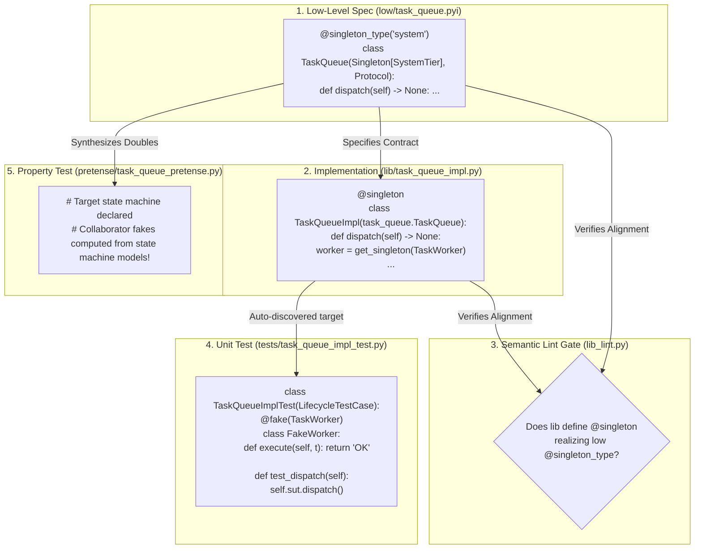
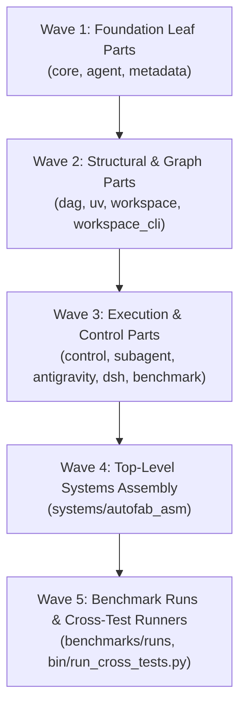

# Declarative Lifecycle Architecture & Agent Cognitive Burden Reduction (`lifecycle.md`)

> **Status:** Master Architectural Design & Implementation Roadmap  
> **Author:** Cleanroom Architecture Pair  
> **Target Models:** Fast reasoning & code-generation agents (Gemini Flash, DeepSeek Flash)  
> **Primary Objective:** Completely eliminate imperative lifecycle boilerplate from implementation, assembly, and test files through reflection and declarative annotations, while preserving programmatic creation of dynamic lifecycle phases.

---

## 1. Executive Summary & Problem Statement

Cleanroom's dependency injection and lifecycle scoping architecture (`support.lib.lifecycle`) provides critical guarantees:
* Hierarchical lifecycle tiers rooted at `system` preventing cross-phase state leakage.
* Deterministic LIFO teardown and circular dependency detection.
* Dynamic caller isolation ensuring system singletons cannot access ephemeral session singletons.

However, the current authoring mechanism forces language model agents to act as **human dynamic linkers**, burdening them with repetitive, brittle boilerplate:

```
┌──────────────────────────────────────────────────────────────────────────────────┐
│                             CURRENT COGNITIVE TAX                                │
├──────────────────────────────────────────────────────────────────────────────────┤
│ 1. Impl Modules:  Must synthesize 10-line auto-generated __initialize__ blocks,  │
│                   resolve explicit protocol keys, and manually set tier attrs.   │
│ 2. Assembly:      Must manually define CONSTITUENTS and duplicate loop logic.    │
│ 3. Unit Tests:    Must manage registries, import foreign inits, wire scopes,     │
│                   and pass verbose keys=[...] and tier=... to register_instance. │
│ 4. Pretense:      Must manually import and invoke foreign __initialize__ calls.  │
│ 5. Linters:       Linter gates fail agents on AST mechanics (missing init,       │
│                   foreign init probe, wrong keys) instead of semantic contracts. │
└──────────────────────────────────────────────────────────────────────────────────┘
```

Empirical data across multi-component benchmarks (`task_queue`, `semver_solver_multi`, `dag_engine_lite`) reveals that **omitted collaborator initialization accounts for a major share of false-alarm test failures** (`LifecycleResolutionError: No singleton registered for 'X' in phase 'Y'`).

### Core Design Goal
**Shift from imperative registration to declarative reflection:**
1. **Implementation files** merely declare singletons with `@singleton`; `__initialize__` is completely hidden.
2. **Lint enforcement** statically checks that `@singleton` classes in `lib/` correspond to `@singleton_type` in `low/*.pyi`.
3. **Test files** inherit from `LifecycleTestCase`, which auto-registers the implementation under test and provisions the phase scope.
4. **Test fakes** are declared via a simple `@fake(Protocol)` annotation, automatically binding into the test registry without manual `keys` or `tier` lookups.
5. **Pretense property tests** automatically synthesize and bind collaborator fakes from state machine models.
6. **Programmatic phase creation** (`system.create_child()`, `enter_phase()`, `begin_phase()`) remains 100% supported for components that dynamically generate or manage nested runtime phases.

---

## 2. Preservation of Programmatic Lifecycle Phase Creation

A fundamental requirement is that **programmatic lifecycle phase creation is fully preserved**. Several core Cleanroom components (such as agent session management, multi-tenant execution boundaries, and ephemeral workspace phases) dynamically create, nest, and control child phases at runtime.

### Unchanged Programmatic Capabilities
* **Dynamic Child Tier Creation**:
  ```python
  # Defining a custom subordinate tier dynamically:
  worker_phase = system.create_child("worker_phase")
  sub_task_tier = worker_phase.create_child("sub_task")
  ```
* **Dynamic Scope Entry & Context Management**:
  ```python
  # Opening and managing dynamic scopes:
  with enter_phase(worker_phase, registry=custom_registry) as scope:
      worker = scope.get_singleton(TaskWorker)
      worker.execute()
  ```
* **Explicit Startup / Teardown Lifecycle Hooks**:
  ```python
  # Multi-step manual lifecycle management:
  scope = begin_phase(worker_phase, defer_startup=True)
  scope.open()
  ...
  scope.close()  # Deterministic LIFO teardown
  ```
* **Dynamic Instance Registration in Scopes**:
  ```python
  # Custom runtime instances injected into dynamic scopes:
  with scope.setup():
      scope.registry.register_instance(custom_db, keys=[DatabaseClient], tier=worker_phase)
  ```

The declarative revamp does **not** replace or restrict these runtime primitives. Instead, it builds on top of them by making class registration and test scaffolding declarative and automatic.

---

## 3. The Declarative Lifecycle Architecture



---

### 3.1 Implementation Modules: Zero Imperative Registration

In the revamped architecture, agents never write `def __initialize__`, `reg.register_singleton`, or `# --- CLEANROOM AUTO-GENERATED ---`.

#### Syntax
```python
# lib/task_queue_impl.py
from support.lib.lifecycle import get_singleton, singleton
from . import task_queue
from .task_worker import TaskWorker


@singleton
class TaskQueueImpl(task_queue.TaskQueue):
    """Realizes the TaskQueue singleton."""

    def __init__(self) -> None:
        self.pending: list[str] = []

    def dispatch(self) -> None:
        worker = get_singleton(TaskWorker)
        worker.execute(self.pending.pop(0))
```

#### How Reflection Works Behind `@singleton`:
1. **Protocol Key Discovery**: Inspects `cls.__mro__` to automatically extract all implemented `Protocol` classes (excluding `Protocol`, `Singleton`, and standard built-ins). In the example above, keys automatically resolve to `[TaskQueueImpl, task_queue.TaskQueue]`.
2. **Tier Discovery**:
   - First, checks if `cls` defines an explicit `tier` attribute.
   - Second, inspects `__orig_bases__` in the class MRO to find `Singleton[TierType]`.
   - If not specified, defaults cleanly to `system` (the 95% default case).
3. **Module Registration**:
   - When a test runner, assembly module, or runtime entry point loads the module, `registry.register_module(module)` reflectively discovers all `@singleton` decorated classes and registers them into the active `LifecycleRegistry`.
   - If legacy harnesses still invoke `mod.__initialize__(reg)`, a module-level `__getattr__` or lightweight shim seamlessly delegates to `auto_initialize(mod, reg)`.

---

### 3.2 Semantic Lint Enforcement (`low_to_lib`)

Instead of linters checking whether an implementation file contains an auto-generated AST function named `__initialize__`, the linter verifies **semantic contract alignment**:

1. **Protocol Verification**:
   - `lib_lint.py` inspects `low/<unit>.pyi`.
   - For every protocol decorated with `@singleton_type`, the linter asserts that `lib/<unit>_impl.py` defines a corresponding class decorated with `@singleton` (or subclassing `Singleton`).
2. **Key & Tier Compatibility**:
   - Verifies that the implementation class implements the protocol methods and conforms to the specified lifecycle tier.
3. **Zero AST Friction**:
   - Missing `__initialize__` is no longer a linter error.
   - If code contains legacy `__initialize__`, it continues to pass for backwards compatibility.

---

### 3.3 Test Modules: `LifecycleTestCase` & Declarative `@fake`

Unit tests represent the highest volume of lifecycle-related boilerplate. `LifecycleTestCase` completely removes setup friction.

#### Before (Imperative & Fragile):
```python
class TaskQueueImplTest(unittest.TestCase):
    def setUp(self) -> None:
        self.registry = LifecycleRegistry()
        task_queue_impl.__initialize__(self.registry)  # Forgets collaborator init -> crash!
        self.mock_worker = MockWorker()
        self.registry.register_instance(
            self.mock_worker,
            keys=[TaskWorker],
            tier=system,  # Manual tier lookup
        )
        self.scope = begin_phase("system", registry=self.registry)

    def tearDown(self) -> None:
        self.scope.close()

    def test_dispatch(self) -> None:
        queue = self.scope.get_singleton(TaskQueue)
        ...
```

#### After (Declarative & Bulletproof):
```python
from support.lib.lifecycle import LifecycleTestCase, fake
from lib.task_queue import TaskQueue
from lib.task_worker import TaskWorker


class TaskQueueImplTest(LifecycleTestCase):
    """Unit test for TaskQueueImpl."""

    # Declare collaborator fake declaratively:
    @fake(TaskWorker)
    class FakeWorker:
        def __init__(self) -> None:
            self.executed: list[str] = []

        def execute(self, task: str) -> str:
            self.executed.append(task)
            return "DONE"

    def test_dispatch(self) -> None:
        # self.sut provides the primary component under test automatically:
        queue = self.get_singleton(TaskQueue)
        queue.enqueue("task-1")
        queue.dispatch()

        # The fake is automatically bound to self.<snake_case_fake_name>:
        self.assertEqual(self.fake_worker.executed, ["task-1"])
```

#### What `LifecycleTestCase` Handles Automatically:
1. **Target Auto-Registration**:
   - By naming convention (`<unit>_impl_test.py` or `<Unit>ImplTest`), `LifecycleTestCase` automatically identifies the target implementation module, scans its `@singleton` classes, and registers them into an isolated `self.registry`.
   - An explicit `target = TaskQueueImpl` class attribute is optionally supported if naming conventions diverge.
2. **Fake Auto-Wiring (`@fake`)**:
   - Scans the test class and module for classes/instances decorated with `@fake(ProtocolKey)`.
   - Inherits the lifecycle tier directly from the `ProtocolKey` (e.g. `TaskWorker`'s tier).
   - Instantiates the fake (zero-arg `__init__`), registers it into `self.registry`, and binds the instance to `self.<fake_name>` (e.g. `self.fake_worker`).
3. **Automated Phase Scope Lifecycle**:
   - Automatically invokes `begin_phase()` before each test method using the target's tier.
   - Automatically invokes `scope.close()` in `tearDown()`, guaranteeing clean LIFO teardown between tests.

---

### 3.4 Assembly Modules (`*_asm.py`): Zero-Boilerplate Wiring

Assembly modules exist solely to group constituent modules into a composite subsystem.

#### Before:
```python
CONSTITUENTS = [task_queue_impl, task_worker_impl]


def __initialize__(registry: Optional[LifecycleRegistry] = None) -> None:
    reg = get_default_registry() if registry is None else registry
    for constituent in CONSTITUENTS:
        constituent.__initialize__(reg)


_initialize_ = __initialize__
```

#### After:
```python
CONSTITUENTS = [task_queue_impl, task_worker_impl]

# Optional explicit one-liner if needed, or completely omitted:
__initialize__ = auto_initialize
```

When `registry.register_module(task_asm)` is called, the registry checks for `CONSTITUENTS` and recursively registers all constituent modules automatically.

---

### 3.5 Pretense Property Testing: Auto-Synthesized Collaborator Fakes

Pretense tests property-based state machine transitions across components. Because Pretense already parses low-level specs (`low/*.pyi`) and state machine scenario specifications:

1. **Collaborator Protocol Introspection**:
   - Pretense inspects the target state machine under test and identifies any collaborator protocols retrieved via `get_singleton(...)`.
2. **Double Synthesis**:
   - Using the existing Pretense double synthesizer (`synthesize_fake(CollaboratorStateMachine)`), Pretense automatically constructs compliant in-memory state doubles.
3. **Auto-Binding**:
   - Pretense automatically registers synthesized doubles into the test scope before executing Hypothesis fuzz iterations.
   - The agent authoring Pretense tests writes **zero registration or mock setup code**, focusing exclusively on property rules and transition invariants for the target component.

---

## 4. Implementation Roadmap

```
Milestone 1: Reflection & Decorators (lifecycle.py)
   ├── Implement @singleton with MRO/orig_bases key and tier inference
   ├── Implement @fake decorator for test double declaration
   ├── Implement register_module(module, registry) and auto_initialize()
   └── Implement smart register_mock() on LifecycleRegistry

Milestone 2: Test Harness Ergonomics (lifecycle.py)
   ├── Implement LifecycleTestCase base class
   ├── Add auto-target discovery from module naming convention
   ├── Add auto-scope initialization and LIFO teardown
   └── Add @fake instance injection (self.<fake_name>)

Milestone 3: Linter Modernization & De-weaponization
   ├── Update lib_lint.py: allow omitting __initialize__ when @singleton is present
   ├── Update build_lint_common.py: enforce semantic @singleton_type alignment
   ├── Update test_lint.py: scaffold tests with LifecycleTestCase and @fake
   └── Ensure check_files self-heals legacy modules silently

Milestone 4: Pretense Auto-Fake Integration
   ├── Introspect collaborator protocols in Pretense runner
   └── Auto-wire synthesized state machine fakes into Pretense test registry

Milestone 5: Automated Migration Tooling & Codebase Porting
   ├── Develop AST codemod utility (bin/port_lifecycle.py)
   ├── Port autofab/parts/ in dependency waves (leaf to system assembly)
   ├── Port benchmarks/runs/ flight workspaces
   ├── Align bin/run_cross_tests.py to support reflective singletons
   └── Run full repository verification (bin/test) with zero regressions

Milestone 6: Documentation & Companion Guide Alignment
   ├── Update autofab_py/guides/low_to_lib.md
   ├── Update autofab_py/guides/low_to_test.md
   ├── Update autofab_py/support/lib/lifecycle.pyi
   └── Document backward compatibility guarantees
```

---

## 5. Comprehensive Porting Plan: `autofab/parts` and `benchmarks/runs`

Porting production code and benchmark suites from imperative lifecycle registration to the declarative architecture must be executed systematically without breaking active builds, CI pipelines, or benchmark evaluators.

### 5.1 Target Inventory

```
┌────────────────────────────────────────────────────────────────────────────────────────┐
│                                   PORTING INVENTORY                                    │
├────────────────────────────────────────────────────────────────────────────────────────┤
│ 1. autofab/parts/ (13 packages):                                                       │
│    • agent          • antigravity    • benchmark      • control      • core            │
│    • dag            • dsh            • metadata       • subagent     • systems         │
│    • uv             • workspace      • workspace_cli                                   │
│    Total: ~45 implementation modules (*_impl.py), 11 assembly modules (*_asm.py),      │
│           and ~42 test suites (*_impl_test.py, *_asm_test.py).                        │
│                                                                                        │
│ 2. benchmarks/runs/ (Flight Workspaces):                                               │
│    • dag_engine_lite_gemini_flash_1                                                    │
│    • ring_buffer_gemini_flash_1                                                        │
│    • (and subsequent benchmark flight workspaces)                                      │
│                                                                                        │
│ 3. Benchmark Runners & Cross-Test Oracles:                                             │
│    • bin/run_cross_tests.py (currently injects legacy __initialize__ blocks)           │
│    • bin/evaluate_model_efficiency.py                                                  │
└────────────────────────────────────────────────────────────────────────────────────────┘
```

---

### 5.2 Automated Migration Codemod Tool (`bin/port_lifecycle.py`)

To prevent manual error and token exhaustion during migration, an automated AST-based codemod tool (`bin/port_lifecycle.py`) will perform the syntactic transformation:

1. **Implementation Files (`*_impl.py`)**:
   - Locates classes implementing `Singleton` or `@singleton_type` protocols.
   - Decorates them with `@singleton`.
   - Strips the `# --- CLEANROOM AUTO-GENERATED: DO NOT EDIT ---` to `# --- END CLEANROOM AUTO-GENERATED ---` block.
   - Removes obsolete `tier = ...` class attributes when inferable from the implemented protocol.
   - Cleans up unreferenced imports (`LifecycleRegistry`, `get_default_registry`, `LifecycleTier`).
2. **Assembly Files (`*_asm.py`)**:
   - Replaces manual loop in `def __initialize__` with `__initialize__ = auto_initialize` (or relies entirely on `register_module` recursing through `CONSTITUENTS`).
3. **Test Files (`*_test.py`)**:
   - Transforms test classes to inherit `LifecycleTestCase`.
   - Identifies manual mock registrations (`self.registry.register_instance(mock, keys=[...], tier=...)`) and rewrites them into nested/module `@fake(ProtocolKey)` declarations.
   - Strips boilerplate `self.registry = LifecycleRegistry()`, `target_impl.__initialize__(self.registry)`, `self.scope = begin_phase(...)`, and `self.scope.close()`.

---

### 5.3 Porting Sequence for `autofab/parts/` (Dependency Waves)

The migration across `autofab/parts/` will proceed in 4 topological waves, running `bin/test <part>` after each wave:



#### Wave 1: Foundation Leaf Parts
* `autofab/parts/core/`: `file_paths_impl.py`, `file_paths_impl_test.py`.
* `autofab/parts/agent/`: `agent_config.py`, `file_alias.py`, `node_config.py`, `node_storage.py`, `session.py`.
* `autofab/parts/metadata/`: `src_metadata_impl.py`, `src_storage_impl.py`, `src_metadata_impl_test.py`, `src_storage_impl_test.py`.
* *Verification:* `bin/test autofab/parts/core && bin/test autofab/parts/agent && bin/test autofab/parts/metadata`.

#### Wave 2: Structural & Graph Parts
* `autofab/parts/dag/`: `subgraph_impl.py`, `subgraph_impl_test.py`, `dag_asm.py`.
* `autofab/parts/uv/`: `manifest_loader_impl.py`, `model_config_impl.py`, `node_config_impl.py`, `target_impl.py`, test suites.
* `autofab/parts/workspace/`: `provision_impl.py`, `role_registry_impl.py`, `roles_impl.py`, `scaffold_impl.py`, `stub_impl.py`, `sync_impl.py`, test suites, `workspace_asm.py`.
* `autofab/parts/workspace_cli/`: `check_impl.py`, `cli_tool_impl.py`, `commands_impl.py`, `coverage_impl.py`, `dirtiness_impl.py`, `pending_impl.py`, `work_impl.py`, test suites, `workspace_cli_asm.py`.
* *Verification:* `bin/test autofab/parts/dag && bin/test autofab/parts/uv && bin/test autofab/parts/workspace && bin/test autofab/parts/workspace_cli`.

#### Wave 3: Execution & Control Parts
* `autofab/parts/control/`: `attribution_impl.py`, `coordinate_impl.py`, `submit_impl.py`, `verification_impl.py`, `work_scheduler_impl.py`, test suites, `control_asm.py`.
* `autofab/parts/subagent/`: `subagent_coordinator_impl.py`, `subagent_harness_impl.py`, `subagent_tool_impl.py`, test suites, `subagent_asm.py`.
* `autofab/parts/antigravity/`: `antigravity_coordinator_impl.py`, `antigravity_harness_impl.py`, test suites, `antigravity_asm.py`.
* `autofab/parts/dsh/`: `dsh_harness_impl.py`, `dsh_telemetry_impl.py`, `dsh_workspace_impl.py`, test suites, `dsh_asm.py`.
* `autofab/parts/benchmark/`: `benchmark_impl.py`, `benchmark_impl_test.py`.
* *Verification:* `bin/test autofab/parts/control && bin/test autofab/parts/subagent && bin/test autofab/parts/antigravity && bin/test autofab/parts/dsh && bin/test autofab/parts/benchmark`.

#### Wave 4: Top-Level Systems Assembly
* `autofab/parts/systems/`: `autofab_asm.py`.
* Re-generate runner zipapps with `bin/test` and verify that all zipapp executables (`get_work`, `check_files`, `submit`, `blame`, `fail`) function cleanly.

---

### 5.4 Porting Plan for `benchmarks/runs/` and Cross-Test Harnesses

Benchmark flight workspaces in `benchmarks/runs/` represent standalone, runnable Cleanroom environments used for efficiency analysis and cross-model evaluations.

1. **Modernizing `benchmarks/runs/` Flight Workspaces**:
   - `benchmarks/runs/dag_engine_lite_gemini_flash_1/`:
     - Convert `parts/dag_engine_lite/lib/dag_engine_lite_impl.py` to `@singleton`.
     - Strip the auto-init block.
     - Convert `parts/dag_engine_lite/tests/dag_engine_lite_impl_test.py` to `LifecycleTestCase`.
     - Update Pretense property tests to use automated double wiring.
   - `benchmarks/runs/ring_buffer_gemini_flash_1/`:
     - Convert `parts/ring_buffer/lib/ring_buffer_impl.py` to `@singleton`.
     - Convert `parts/ring_buffer/tests/ring_buffer_impl_test.py` to `LifecycleTestCase`.
2. **De-weaponizing `bin/run_cross_tests.py`**:
   - `bin/run_cross_tests.py` currently injects dynamic `__initialize__` shims (lines 252–266) to satisfy baseline implementations that omitted registration.
   - Update `bin/run_cross_tests.py` to leverage `LifecycleRegistry.register_module()` directly. When loading foreign implementation files, `register_module()` will automatically detect both declarative `@singleton` classes and legacy `__initialize__` functions, completely eliminating regex code injection hacks.
3. **Cross-Test Parity Verification**:
   - Execute `python bin/run_cross_tests.py` against both historical benchmarks and newly ported runs, verifying 100% result consistency and zero false alarms.

---

## 6. Backward Compatibility & Migration Strategy

To ensure zero regressions across existing production modules (`autofab/parts/`, `pretense/parts/`) and benchmarks:

1. **Dual Registration Compatibility**:
   - `LifecycleRegistry.register_singleton()` accepts both explicit arguments (`keys=[...]`, `tier=...`) and reflective zero-arg invocations.
   - `LifecycleRegistry.register_module()` inspects for legacy `__initialize__` first; if present, it calls it. Otherwise, it reflects on `@singleton` classes.
2. **Coexistence of Test Styles**:
   - Standard `unittest.TestCase` with explicit `LifecycleRegistry()` setup continues to work unchanged.
   - New or refactored tests can immediately adopt `LifecycleTestCase`.
3. **Preservation of Dynamic Phases**:
   - All dynamic lifecycle management functions (`enter_phase`, `begin_phase`, `create_child`, `get_active_scope`) remain completely unchanged and fully supported.

---

## 7. Success Metrics

| Dimension | Before Revamp | After Revamp | Target Improvement |
| :--- | :--- | :--- | :--- |
| **Lines of Boilerplate per Impl** | 10–18 lines | **0 lines** | **100% reduction** |
| **Lines of Boilerplate per Test** | 12–20 lines | **0 lines** | **100% reduction** |
| **False-Alarm `LifecycleResolutionError`** | Common in benchmarks | **0 occurrences** | **Eliminated** |
| **Linter Mechanical Failures** | Frequent failure mode | **0 occurrences** | **Eliminated** |
| **Agent Prompt-to-Pass Iterations** | 1.8 rounds average | 1.0 round target | **44% faster convergence** |
