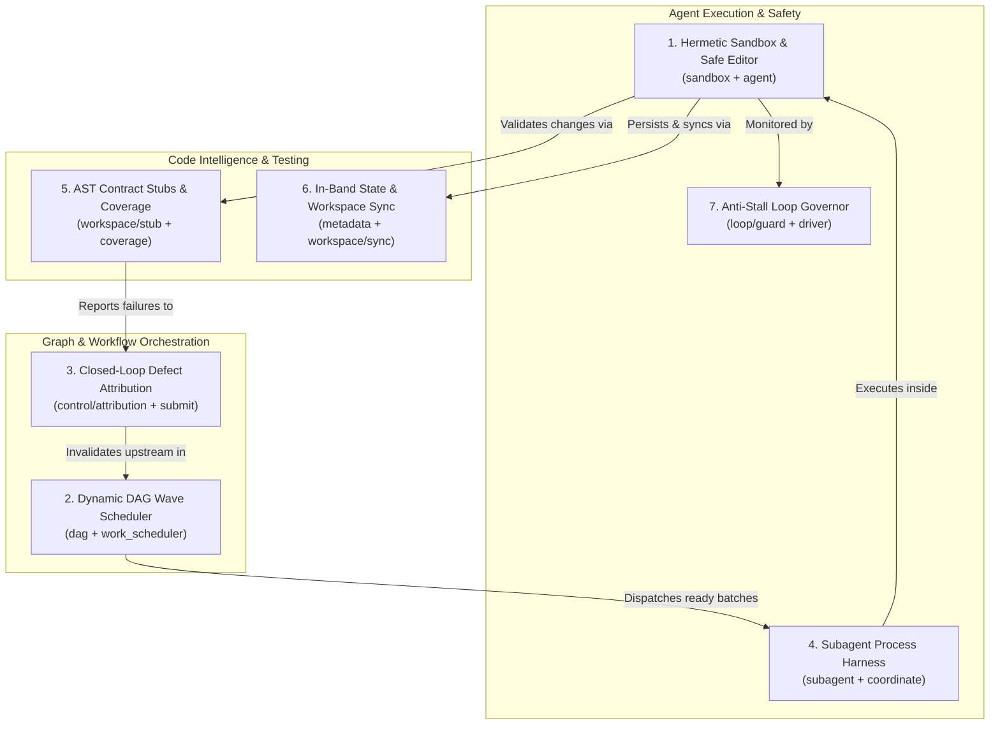
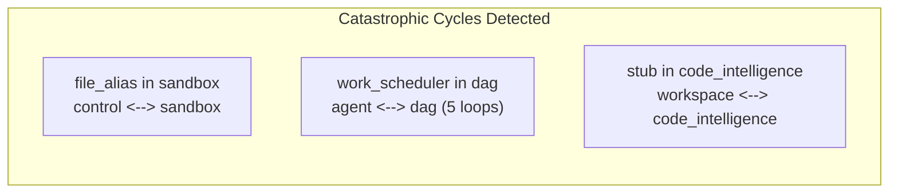
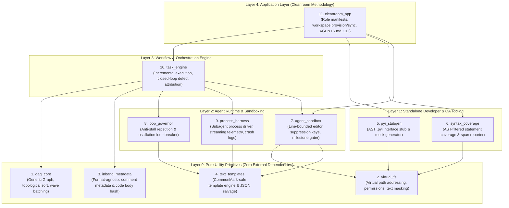
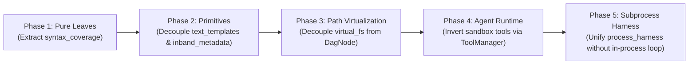

# Cleanroom Subsystems & Modular Architecture Design Document

## 1. Executive Summary & Vision

The Cleanroom codebase (`update_with_ai/parts`) embodies a formal, specification-driven software engineering paradigm designed for autonomous AI multi-agent development. Across its 15 constituent parts and 108 high-level specifications, Cleanroom solves critical, universal challenges in:
- Autonomous code editing and agent sandboxing.
- Deterministic directed acyclic graph (DAG) scheduling and wave extraction.
- Closed-loop upstream defect feedback routing.
- Context-conserving AST statement coverage and interface stub generation.
- Anti-stall agent execution governance.
- Multi-platform subagent process orchestration.

However, in Cleanroom's current implementation, these general-purpose capabilities are entangled with Cleanroom-specific constructs (`DagNode`, `role_registry`, and hardcoded orchestrator imports). 

This design document establishes:
1. **An Architectural Analysis** of Cleanroom's 7 generally useful domain subsystems.
2. **A Dependency Graph Audit** analyzing why naive structural refactorings fail and trigger circular dependencies.
3. **An Ideal Greenfield Architecture**: a strictly acyclic, 5-layer system decoupling 10 standalone, publishable libraries from the Cleanroom methodology application layer using Dependency Inversion.
4. **A Practical Migration Roadmap** for progressively extracting these components while preserving continuous build verification.

---

## 2. Analysis of Generally Useful Subsystems

Beyond Cleanroom's specific multi-role software engineering pipeline (HLS $\to$ Planning $\to$ Scenarios $\to$ Low $\to$ Lib $\to$ Tests), the specifications define 7 substantive subsystems that address universal problems in AI engineering:



### 2.1 Hermetic Agent Sandbox & Safe Code Editor
- **Constituent Parts**: `sandbox` (`file_editor`, `file_reader`, `tool_provider`, `guide_delivery`) + `agent` (`file_alias`, `session`).
- **The Problem Solved**: LLMs given raw bash or whole-file write access routinely wipe comments, corrupt indentation, hallucinate host directory paths, and blow up context windows with repetitive tool logs.
- **Core Mechanism**:
  1. *Virtual Path Masking*: Virtual session aliases mask host filesystem structures dynamically in model context.
  2. *Line-Bounded Replacement with Fuzzy Matching*: Edits are bounded to line intervals. If character-exact matching fails due to whitespace, it falls back to whitespace-normalized line matching and attaches a unified diff directly to the tool response.
  3. *Context Suppression Keys*: Repeated tool outputs (e.g. reading sections of code) collapse earlier outputs carrying the same suppression key, conserving thousands of context tokens.
  4. *Progressive Milestone Gating*: Multi-step instructions are delivered incrementally, gating milestone progression until automated verification checks pass.
- **Utility Outside Cleanroom**: A drop-in execution sandbox for autonomous coding assistants (Cursor background agents, Claude Code, SWE-bench solvers).

### 2.2 Dynamic DAG Task Engine & Wave Scheduler
- **Constituent Parts**: `dag` (`subgraph`, `dag_storage`) + `control` (`work_scheduler`) + `core` (`topological_order_ext`).
- **The Problem Solved**: Multi-stage build systems and agent pipelines must determine what artifacts are invalidated upon change, what tasks can execute concurrently *right now*, and how to prevent cyclic deadlocks.
- **Core Mechanism**:
  1. *Deterministic Topological Engine*: Computes linear extensions with deterministic lexical tie-breaking and safe cycle termination.
  2. *Dynamic Ready Batching*: Evaluates dirty nodes whose upstream dependencies are clean, grouping them by topological tier depth for parallel wave execution.
  3. *Visit Count Circuit Breakers*: Enforces visit limits per node across iterative rework cycles, preventing infinite rework loops.
- **Utility Outside Cleanroom**: An incremental task runner for data pipelines (Airflow/Prefect DAGs), monorepo build tools, or asynchronous agent task pools.

### 2.3 Closed-Loop Defect Attribution & Blame Feedback Router
- **Constituent Parts**: `control` (`attribution`, `submit`, `verification`).
- **The Problem Solved**: In multi-tier systems (Specification $\to$ Design $\to$ Implementation $\to$ QA), downstream agents encountering an upstream defect often invent local hacks or emit unstructured, context-polluting error dumps.
- **Core Mechanism**:
  1. *Upstream-Only Blame Validation*: Enforces that blamed culprits must be declared upstream dependencies in the graph.
  2. *Single-Paragraph Critique Constraint*: Restricts blame feedback strictly to a single continuous paragraph without newlines and capped at a maximum character limit (e.g., 2,000 characters).
  3. *Automated Invalidation & Rework Prompt Injection*: Injects the feedback message into the culprit node, marks it dirty, blocks downstream dependents, and automatically injects the critique into the upstream agent's prompt during the next wave.
- **Utility Outside Cleanroom**: Converts raw error traces into structured iterative refinement across multi-stage code and document generation pipelines.

### 2.4 Multi-Platform Subagent Execution & Process Harness
- **Constituent Parts**: `subagent` (`subagent_harness`, `subagent_coordinator`) + platform adapters (`antigravity`, `dsh`).
- **The Problem Solved**: Spawning and supervising child agents across disparate environments (headless CLI processes, IDE runtimes, container bridges) leads to platform lock-in and unhandled process crashes.
- **Core Mechanism**:
  1. *Process Harness Protocol*: Spawns agent processes in isolated directories using command templates.
  2. *Non-Blocking Telemetry & Cost Accounting*: Parses token metrics from structured JSON streams or regex-matched unstructured logs, computing dollar costs via rate multipliers.
  3. *Crash Log Diagnostics*: Extracts the log tail upon non-zero exit codes to capture root failure diagnostics.
  4. *Normalized Round Outcomes*: Synthesizes outcomes into standard records (`clean`, `blamed`, `failed`).
  5. *Native IDE Desktop IPC (`agentapi`)*: Uses direct JSON-RPC and CLI IPC (`agentapi send-message`, `agentapi new-conversation`) to dispatch reactive wakeup events and spawn dedicated headless conversation tabs, preventing background process starvation.
  6. *Interruption Signal Trapping & Atomic Sandbox Cleanup*: Traps SIGINT/SIGTERM/KeyboardInterrupt to terminate child worker processes and atomically decommission ephemeral role sandboxes on disk.
- **Utility Outside Cleanroom**: A universal driver for multi-agent benchmarks, coding swarms, and enterprise agent dispatchers.

### 2.5 AST Contract Testing & LLM-Optimized Statement Coverage Engine
- **Constituent Parts**: `workspace` (`stub`) + `workspace_cli` (`coverage`).
- **The Problem Solved**: Agents writing tests while seeing implementation code write tautological tests. Furthermore, standard coverage tools (`coverage.py`) flood LLM context windows with thousands of lines of non-executable docstrings and headers.
- **Core Mechanism**:
  1. *AST Read-Only Stub Synthesizer*: Parses `.pyi` interfaces using Python's AST and generates importable Python stubs raising `NotImplementedError`, preserving all signatures, type annotations, and docstrings with rewritten imports.
  2. *Syntax-Aware Statement Filtering*: Uses AST parsing to strip docstrings, function/class signature continuation lines, type comments, and pragma exclusions.
  3. *Contiguous Span Compression & Clamped Context Snippets*: Measures hits via `sys.settrace`, compresses uncovered lines into contiguous ranges (`lines 14-22, 38-45`), and generates clamped source code context snippets tailored for LLM prompts.
- **Utility Outside Cleanroom**: Contract-first TDD tooling, automated test-generation bots, and low-overhead CI coverage checkers.

### 2.6 Distributed In-Band Metadata & Atomic Workspace Sync
- **Constituent Parts**: `metadata` (`src_metadata`, `src_storage_impl`) + `workspace` (`provision`, `sync`).
- **The Problem Solved**: Build/test cache databases easily drift out of sync across git checkouts. In addition, parallel workers in isolated directories risk merge conflicts and overwriting user edits.
- **Core Mechanism**:
  1. *Git-Native In-Band Metadata*: Embeds lifecycle state (`LAST_CLEANED`, `LAST_CHANGED`, `CODE_HASH`, audit stamps, unacted feedback) directly inside source comment blocks (`# --- CLEANROOM METADATA ---` for Python/Shell, `<!-- CLEANROOM METADATA -->` for Markdown).
  2. *Code Body Isolation*: Computes deterministic SHA-256 hashes strictly over code content outside comments, ensuring timestamp updates do not invalidate code integrity.
  3. *Two-Phase Atomic Harvesting*: Validates code hashes before pulling or committing changes between isolated workspaces and the canonical repository, preventing clobbering.
- **Utility Outside Cleanroom**: Database-free build caches, git-native compliance auditing, and conflict-free multi-worker sandbox synchronizers.

### 2.7 Anti-Stall Agent Execution Governor & Loop Guard
- **Constituent Parts**: `loop` (`guard`, `driver`, `conversation`, `logger`).
- **The Problem Solved**: Autonomous LLMs get trapped calling the same tool repeatedly or oscillating between two file edits, exhausting token budgets.
- **Core Mechanism**:
  1. *Repetition & Oscillation Tracking*: Tracks consecutive identical tool calls and duplicate edits to identical file locations across conversation steps.
  2. *Two-Tier Intervention*: Emits a corrective "loop reminder" diagnostic at warning threshold $N_1$, and triggers a graceful fatal termination at threshold $N_2$.
  3. *Dynamic Progress Detection*: Automatically resets repetition counters whenever an operation achieves verifiable forward progress.
- **Utility Outside Cleanroom**: A universal safety governor for any agent framework (LangChain, AutoGen, CrewAI, custom loops).

---

## 3. Dependency Graph Audit & Post-Mortem

To determine why Cleanroom was partitioned into 15 parts and why naive consolidations fail, an automated cycle-detection graph traversal was executed across all High-Level Specifications and Python `lib/` files.

### 3.1 The Flawed Proposals & Resulting Cycles



#### 1. Moving `file_alias` into `sandbox`
- **Failure**: Creates a direct 2-node cycle: $\text{control} \longleftrightarrow \text{sandbox}$.
- **Root Cause**: `control` (`attribution_impl.py`, `submit_impl.py`, `verification_impl.py`) imports `file_alias` across 25 files to resolve blame targets and check writable paths. But `sandbox` (`run_control_impl.md`, `submission_impl.md`) already imports `coordinate` and `submission` from `control`.
- **Layer Inversion**: `uv/lib/node_config_impl.py` implements `file_alias.AliasManager`, forcing the package/manifest loader (`uv`) to depend on the tool sandbox (`sandbox`).

#### 2. Moving `work_scheduler` into `dag`
- **Failure**: Generates **5 distinct circular loops**:
  1. `agent -> dag -> agent`
  2. `agent -> dag -> workspace -> agent`
  3. `dag -> workspace -> metadata -> dag`
  4. `agent -> dag -> workspace -> metadata -> agent`
  5. `dag -> workspace -> metadata -> agent -> dag`
- **Root Cause**: `work_scheduler` in `control` is an orchestration policy that formats prompts using `node_config` and `file_alias` from `agent`, and queries roles from `workspace`. Meanwhile, `agent/file_alias.py` imports `dag_storage.DagNode` from `dag`, and `metadata` implements `dag_storage`. Moving `work_scheduler` down into `dag` causes low-level data structures to depend on high-level policies.

#### 3. Moving `stub` into `code_intelligence`
- **Failure**: Creates an immediate cycle: $\text{workspace} \longleftrightarrow \text{code\_intelligence}$.
- **Root Cause**: In HLS, `stub.md` declares `imports: role_registry` (located in `workspace`). Meanwhile, `workspace_asm.md` assembles `stub_impl`, and `sync.md` delegates stub synchronization to `stub`. Moving `stub` without removing its dependency on `role_registry` creates a closed loop.

#### 4. Merging all runners into `harness`
- **Failure**: Cross-tier monolithic knot.
- **Root Cause**: `openai` imports `loop`, `dsh` imports `workspace_cli`, `antigravity` imports `workspace`, and `uv` imports `openai`. Merging them forces `harness` to simultaneously depend on `loop`, `workspace_cli`, and `workspace`, destroying the boundary between headless execution loops, developer CLIs, and workspace provisioning.

### 3.2 The Thematic Grouping Fallacy
These structural failures stem from **Thematic Grouping**: grouping components by *"what they are conceptually about"* rather than **Direction of Stability and Abstraction**:
- Lower-level data models and primitives (`dag`, `file_alias`, `inband_metadata`) must **never** import higher-level orchestration policies (`work_scheduler`, `sandbox`, `control`).
- Abstractions must be designed with **Dependency Inversion** to allow lower layers to remain independent of the orchestrators that call them.

---

## 4. The Ideal Greenfield Architecture

If re-implemented from scratch to allow every component to be reused independently, the system stratifies into a **strictly acyclic, 5-layer hierarchy**:



### 4.1 The 3 Decoupling Innovations

To achieve complete independence, the greenfield architecture introduces three critical decoupling patterns:

#### 1. Decoupling Virtual Paths from DAG Storage (`virtual_fs`)
- **Current State**: `file_alias.BoundFile` contains `owning_node: DagNode`.
- **Greenfield Design**: `virtual_fs` manages only relative path addressing, permissions (`ReadOnly` vs `ReadWrite`), and host path text masking. Node ownership is decoupled:
  ```python
  @dataclass(frozen=True)
  class VirtualFile:
      relative_path: str
      workspace_path: Path
      read_only: bool = False
  ```
  The orchestrator maintains an external mapping (`Dict[NodeId, VirtualFile]`), completely freeing path management from graph storage.

#### 2. Dependency Inversion in Sandboxing (`agent_sandbox`)
- **Current State**: `sandbox` imports `control` directly for `coordinate` and `submission`.
- **Greenfield Design**: `agent_sandbox` implements only tool registration, file reading, and line-bounded file editing. Workflow actions (`submit`, `verify`) are registered dynamically by the orchestrator at runtime via the tool manager interface:
  ```python
  class ToolManager(Protocol):
      def register_tool(self, tool: Tool) -> None: ...
  ```
  `agent_sandbox` has zero compile-time dependencies on the task engine or build coordinator.

#### 3. Pure Compilers for AST Stubs and Metadata
- **Current State**: `stub_impl.py` and `src_metadata.py` import `role_registry` from `workspace`.
- **Greenfield Design**: 
  - `pyi_stubgen` is a pure compiler: `def synthesize_stub(pyi_content: str, module_name: str) -> str`.
  - `inband_metadata` is a pure comment parser and SHA-256 code body hasher.
  Neither has any awareness of Cleanroom roles, directory hierarchies, or workspaces.

---

### 4.2 Component Specification Matrix

| Component | Layer | Core Responsibility | External Reusability |
| :--- | :--- | :--- | :--- |
| **`dag_core`** | Layer 0 | Generic `Graph[T]`, deterministic topological order, cycle-tolerant traversal, and dynamic wave batching (`next_ready_batch()`). | Airflow/Prefect-style DAG task runners, monorepo build graph executors. |
| **`virtual_fs`** | Layer 0 | Path virtualization, read-only vs read-write permission bounds, and host path text sanitization for LLMs. | AI coding assistants, remote sandboxes, container execution bridges. |
| **`inband_metadata`** | Layer 0 | Multi-format comment metadata parser and code-body SHA-256 hasher for in-place comment updates. | Git-native cache invalidation, compliance auditing, review trackers. |
| **`text_templates`** | Layer 0 | CommonMark-safe template engine (HTML comment directives) and truncated JSON salvage for streaming LLMs. | Literate programming, prompt template managers, document generators. |
| **`pyi_stubgen`** | Layer 1 | Contract-first AST `.pyi` stub generator raising `NotImplementedError` with rewritten imports. | Contract-driven TDD, mock generation, multi-agent sandboxing. |
| **`syntax_coverage`** | Layer 1 | AST-filtered statement coverage excluding non-executable lines, with clamped contiguous span reporting for LLMs. | AI test generation bots, zero-dependency CI coverage reporters. |
| **`agent_sandbox`** | Layer 2 | Line-bounded fuzzy file editor, unified diff generator, context suppression keys, and milestone verification gater. | Execution sandbox for autonomous coding agents and IDE extensions. |
| **`loop_governor`** | Layer 2 | Anti-stall repetition and oscillation detector with two-tier progressive intervention (reminder $\to$ failure). | Drop-in safety governor for LangChain, AutoGen, CrewAI, or raw LLM loops. |
| **`process_harness`** | Layer 2 | Process runner for subagents with streaming telemetry parsing, monetary cost accounting, and crash log tail extraction. | Multi-agent benchmarks (SWE-bench), agent swarm orchestrators. |
| **`task_engine`** | Layer 3 | Incremental task executor with closed-loop defect attribution (validating upstream culprits, enforcing single-paragraph critiques). | Multi-stage AI pipelines (Requirements $\to$ Architecture $\to$ Code $\to$ Test). |
| **`cleanroom_app`** | Layer 4 | Cleanroom methodology implementation: role manifests, workspace provisioning/sync, `AGENTS.md`, and CLI commands. | Complete Cleanroom autonomous software engineering platform. |

---

## 5. Migration Roadmap

To transition from the current 15 parts toward this modular architecture without destabilizing existing builds, refactoring must proceed in five strictly acyclic phases adhering to the **Mandatory Specification-First Rule**:



### Phase 1: Pure Leaves (`syntax_coverage`)
- Extract `coverage.py` and `coverage_impl.py` from `workspace_cli` into `syntax_coverage`.
- Verification confirmed that `coverage.py` already has **zero dependencies** on `workspace_cli`, `workspace`, or `agent`.
- This extraction introduces zero risk and zero circular dependencies.

### Phase 2: Decoupled Primitives (`text_templates` & `inband_metadata`)
- Decouple `src_metadata.py` from `workspace.role_registry` (remove the inline import at line 82).
- Formalize `inband_metadata` and `text_templates` as standalone Layer 0 primitives.

### Phase 3: Path Virtualization (`virtual_fs`)
- Refactor `file_alias.BoundFile` to remove `owning_node: DagNode`.
- Move the node-to-file mapping into `task_engine` / `control`.
- `virtual_fs` becomes a pure Layer 0 primitive, unblocking clean usage across sandboxing and test execution.

### Phase 4: Sandboxing Dependency Inversion (`agent_sandbox`)
- Refactor `sandbox` to eliminate direct imports of `control.coordinate` and `control.submission`.
- Introduce runtime tool registration in `tool_provider`.
- `control` injects the `submit` and `verify` tools into the sandbox during session initialization.

### Phase 5: Unified Process Harness (`process_harness`)
- Unify `subagent`, `dsh`, and `antigravity` into `process_harness`.
- Keep in-process LLM API loop drivers (`openai`) inside `loop_governor`, preventing cross-tier entanglement.
- The Cleanroom CLI and orchestrators call `process_harness` as an external execution service.

---

## 6. Conclusion

By shifting from thematic grouping to **directional dependency layering** and applying **Dependency Inversion**, Cleanroom can be transformed from a tightly coupled 15-part monorepo into an ecosystem of **10 high-value, general-purpose software components** topped by a thin Cleanroom methodology application layer. Each component becomes independently testable, maintainable, and publishable, unlocking massive reusability across the broader AI engineering landscape.
