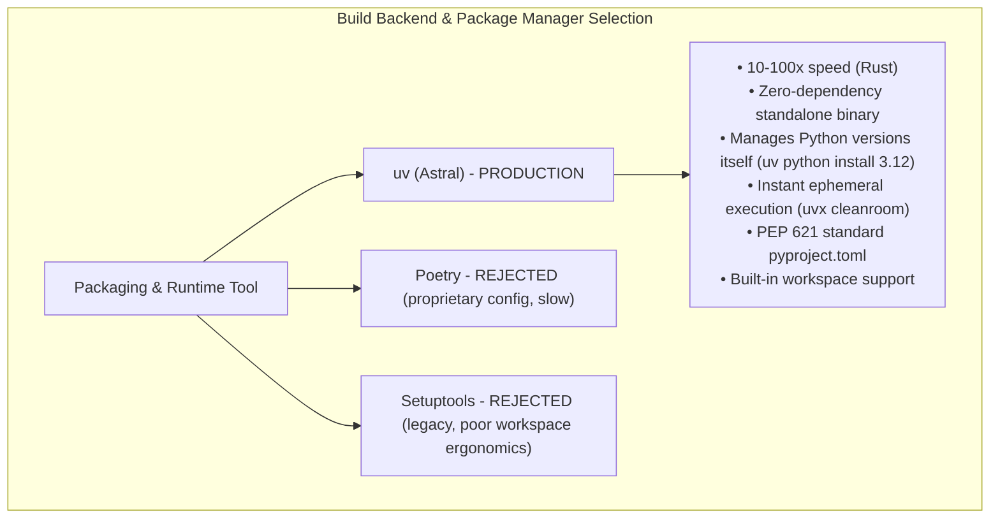

# Cleanroom Packaging, Distribution, & uv Architecture

## 1. Executive Summary & Architecture Overview

Cleanroom is a literate, specification-driven software engineering paradigm designed for deterministic AI pair programming. Cleanroom is packaged using **Hatchling** (PEP 621), orchestrated via standard **`uv`** virtual environments, and distributed as a zero-dependency CLI and library.

Historically, Cleanroom was developed inside a Bazel monorepo, relying on Starlark rules (`update_with_ai.bzl`), generated `py_binary` macro targets (`*_clean`, `*_submit`, `*_blame`), and `rules_python` toolchains. While Bazel provided strict hermeticity for internal dogfooding, it created significant barriers for adoption:
1. **The Monorepo Friction**: Developers expect standard Python tooling: installing a CLI via `pip` or `uv`, running commands ephemerally via `uvx`, configuring projects via standard `pyproject.toml`, and testing with standard tools (`pytest`, `pyright`, `ruff`).
2. **Sub-Second Tooling**: Bazel server startup latency and analysis phases imposed a 1.5–3.0 second tax on every verification pass. Replacing Bazel with native Python AST execution and `uv` virtual environments reduced verification and role dispatch latency to **sub-100ms**.
3. **Pristine Modularization**: Business logic and orchestrations have been fully modularized into canonical 4-stage Cleanroom **`parts/`** components (`parts/workspace`, `parts/tools`, `parts/control`, `parts/systems`, `parts/uv`), restricting `support/lib/` strictly to foundational runtime primitives and procedural AST linters.

Cleanroom is packaged as a standard wheel and source distribution, installable via `uv tool install cleanroom`, executable ephemerally via `uvx cleanroom`, and runnable across any standard Python project with zero Bazel prerequisite.

---

## 2. Deconstructing Runtime Misconceptions

External agent consultations often diagnose Cleanroom as requiring compiled native extensions, Docker daemons, or complex build-time hooks. Cleanroom's actual runtime reality is lean and lightweight:

```
┌────────────────────────────────────────────────────────────────────────────────────────┐
│                        MISCONCEPTION VS. CLEANROOM REALITY                             │
├────────────────────────────────────────────────────────────────────────────────────────┤
│                                                                                        │
│  [External Agent Assumption]                  [Cleanroom Technical Reality]            │
│  ─────────────────────────────────            ──────────────────────────────────────   │
│  • "Bundled binary executables / ELF"    ──►  • 100% pure Python CLI scripts           │
│    (assumes compiled native extensions)         (zero C/C++ or Rust compilation needs) │
│                                                                                        │
│  • "Subagents requiring Docker/containers"─►  • Confinement via OS chmod 444 & sibling │
│    (assumes external container daemons)         workspaces (Option 3) or CLI harnesses │
│                                                                                        │
│  • "Heavy dependencies (numpy, docker)"  ──►  • Ultra-light core AST & text toolchain │
│    (assumes machine learning runtimes)          (pydantic, pyright, pytest, AST linters)│
│                                                                                        │
│  • "Requires Setuptools C compilation"   ──►  • Standard Hatchling wheel packaging     │
│    (assumes build-time compilation)             with pure Python data assets           │
│                                                                                        │
└────────────────────────────────────────────────────────────────────────────────────────┘
```

1. **No Native C/C++ Binaries**:
   Cleanroom targets are pure Python modules running against Python's standard `ast` and `typing` libraries. Cleanroom has **zero C/C++ or Rust compilation requirements**.
2. **Subagents are Workspaces & Harnesses, Not Daemons**:
   Cleanroom executes subagent workflows either through:
   - **Option 3 (Subagentless Workspaces)**: Sibling directories with standard OS `chmod 444` read-only mounts driven by human or IDE turns (see [`subagentless_cleanroom_workspaces.md`](file:///Users/seanmcdirmid/projects/cleanroom/design-docs/subagentless_cleanroom_workspaces.md)).
   - **Option 4 (Subagent-Driven Workspaces)**: Zero-execution coordinator invoking external CLI harnesses (`antigravity`, `dsh`, `goose`).
   - **Option 1 (Headless Loop)**: In-process autonomous runner calling model APIs.
   None of these require background Docker daemons or container runtimes.
3. **Bundled Assets are Markdown Specs & Templates**:
   The non-Python assets needed by Cleanroom are literate specification templates, architectural guides (`guides/*.md`), and prompt skeletons—all UTF-8 markdown and JSON text files bundled as package data.

---

## 3. Toolchain Architecture: `uv` + Hatchling



### 3.1 Advantages of `uv`
1. **Zero-Bootstrapping via Standalone Binary**:
   `uv` is distributed as a single static binary. It can download, install, and pin the exact Python version (`3.12`) on the user's machine automatically (`uv python install 3.12`).
2. **Ephemeral Execution via `uvx`**:
   Users can run Cleanroom without modifying their project's environment:
   ```bash
   uvx cleanroom commission my_project
   uvx cleanroom work-queue
   ```
3. **PEP 621 Standard Compliance**:
   Cleanroom pairs natively with **Hatchling** (`hatchling`), using standardized `[project]` tables in `pyproject.toml`.
4. **Native Workspaces Support**:
   Cleanroom's modular parts (`parts/workspace`, `parts/tools`, `parts/control`, `parts/systems`, `parts/uv`) are managed as a clean, unified workspace without complex path-dependency hacks.

---

## 4. Emphasizing Canonical `parts/` Over `support/lib/`

A core architectural invariant of Cleanroom is that **all production capabilities must live in modular, 4-stage Cleanroom parts (`parts/`)** rather than procedural helper scripts in `support/lib/`:

```
┌────────────────────────────────────────────────────────────────────────────────────────┐
│                        PARTS/ VS. SUPPORT/LIB/ ARCHITECTURE                            │
├────────────────────────────────────────────────────────────────────────────────────────┤
│                                                                                        │
│  [update_with_ai/parts/*] (First-Class Cleanroom Components)                           │
│  ───────────────────────────────────────────────────────────                           │
│  • parts/workspace: Lifecycle, synchronization, role registry, work queues             │
│    (workspace_tool.py, workspace_work_impl.py, workspace_registry_impl.py)             │
│  • parts/tools: Statement coverage measurement and span deficit reporting              │
│    (tool_coverage.py, tool_coverage_impl.py)                                           │
│  • parts/control: Session coordination, submission, attribution, and in-band metadata  │
│    (src_metadata.py, control_submit_impl.py, control_coordinate_impl.py)               │
│  • parts/uv: UV manifest loading, loop runner, model config, and target resolution     │
│    (uv_manifest_loader_impl.py, uv_loop_impl.py, uv_target_impl.py)                    │
│  • parts/systems: Unified system assembly initialization                               │
│    (uv_cleanroom_asm.py, uv_openai_loop_asm.py)                                        │
│                                                                                        │
│  [update_python_with_ai/support/lib/*] (Restricted Meta-Framework Layer)               │
│  ───────────────────────────────────────────────────────────────────────               │
│  • Core Runtime Primitives: Metaclasses and decorators (framework.py, lifecycle.py)    │
│    *Permanent architectural foundation: never modularized into consumer parts*         │
│  • Procedural AST Linters: Deterministic syntax checkers                               │
│    (high_lint.py, spec_lint.py, low_lint.py, lib_lint.py, test_lint.py)                │
│                                                                                        │
└────────────────────────────────────────────────────────────────────────────────────────┘
```

### 4.1 Modularization History & Completed Migrations
- **Workspace Orchestration**: Monolithic `cleanroom_workspace_tool.py` was completely refactored into [`update_with_ai/parts/workspace/`](file:///Users/seanmcdirmid/projects/cleanroom/update_with_ai/parts/workspace/). `cleanroom_role_tool.py` was reduced to an ultra-slim CLI forwarder.
- **Coverage Engine**: Monolithic `evaluate_coverage.py` was refactored into [`update_with_ai/parts/tools/lib/tool_coverage.py`](file:///Users/seanmcdirmid/projects/cleanroom/update_with_ai/parts/tools/lib/tool_coverage.py) and [`tool_coverage_impl.py`](file:///Users/seanmcdirmid/projects/cleanroom/update_with_ai/parts/tools/lib/tool_coverage_impl.py).
- **In-Band Metadata**: `src_metadata.py` was canonicalized into [`update_with_ai/parts/control/lib/src_metadata.py`](file:///Users/seanmcdirmid/projects/cleanroom/update_with_ai/parts/control/lib/src_metadata.py).
- **Systems Assembly**: Retired legacy `cleanroom_asm` and `bazel_openai_loop_asm` in favor of [**`uv_cleanroom_asm`**](file:///Users/seanmcdirmid/projects/cleanroom/update_with_ai/parts/systems/lib/uv_cleanroom_asm.py) and [**`uv_openai_loop_asm`**](file:///Users/seanmcdirmid/projects/cleanroom/update_with_ai/parts/systems/lib/uv_openai_loop_asm.py).

---

## 5. Architectural Blueprint: The `pyproject.toml` & Package Layout

### 5.1 Authoritative Directory Structure
```
cleanroom/
├── pyproject.toml                     # Root workspace configuration & PyPI packaging
├── uv.lock                            # Deterministic multi-platform dependency lock
├── bin/
│   ├── cleanroom                      # Unified CLI entrypoint
│   ├── cleanroom_loop                 # Autonomous loop runner (uv)
│   └── test                           # Native pyright + pytest runner
├── update_python_with_ai/             # Python Methodology Package
│   ├── cleanroom_roles.toml           # Declarative role definitions & verification templates
│   ├── guides/                        # Literate markdown engineering guides
│   ├── templates/                     # File scaffolding templates
│   └── support/lib/                   # Core metaclass primitives & AST linters
└── update_with_ai/                    # Canonical Production Package
    ├── pyproject.toml                 # Package-level pyproject.toml
    └── parts/                         # 4-stage modular Cleanroom parts
        ├── agent/                     # Multi-turn conversation & runner logic
        ├── control/                   # Attribution, submission, and in-band src_metadata
        ├── core/                      # File paths, logging, and error primitives
        ├── dag/                       # DAG subgraph traversal & storage
        ├── loop/                      # Autonomous cleaning loop & guard
        ├── openai/                    # OpenAI API communication drivers
        ├── sandbox/                   # Double-blind file readers, editors, and run control
        ├── systems/                   # Unified systems assembly (uv_cleanroom_asm)
        ├── tools/                     # Modular statement coverage (tool_coverage)
        ├── uv/                        # Native uv manifest loader & runner
        └── workspace/                 # Workspace lifecycle, provisioning, and sync
```

### 5.2 Root `pyproject.toml`
```toml
[build-system]
requires = ["hatchling"]
build-backend = "hatchling.build"

[project]
name = "cleanroom"
version = "0.2.0"
description = "Literate, specification-driven software engineering paradigm for deterministic AI pair programming"
readme = "README.md"
requires-python = ">=3.12"
dependencies = [
    "pydantic>=2.5.0",
    "pyright>=1.1.350",
    "pytest>=8.0.0",
    "typing-extensions>=4.8.0",
    "python-dotenv>=1.0.0",
    "tqdm>=4.66.0",
]

[project.optional-dependencies]
loop = [
    "openai>=1.12.0",
]

[project.scripts]
cleanroom = "update_python_with_ai.support.lib.cleanroom_role_tool:main"
cleanroom-loop = "update_python_with_ai.support.lib.cleanroom_uv_runner:main"

[tool.uv.workspace]
members = [
    "update_with_ai",
    "staging",
]

[tool.pyright]
pythonVersion = "3.12"
typeCheckingMode = "standard"
reportMissingImports = "error"
include = [
    "update_with_ai",
    "update_python_with_ai",
]

[tool.pytest.ini_options]
pythonpath = [
    ".",
    "update_with_ai",
    "update_python_with_ai",
]
python_files = ["*_test.py", "test_*.py"]
```

---

## 6. Methodology Profiles: `cleanroom_roles.toml`

Roles are defined declaratively in `update_python_with_ai/cleanroom_roles.toml`:

```toml
[roles.high]
name = "high"
persona = "High-Level Spec Engineer"
src_pattern = "{unit_dir}/high/{unit_name}.md"
guide = "update_python_with_ai/guides/high_level_spec.md"
template = "update_python_with_ai/templates/hls_template.md"
verify_template = "uv run python -m update_python_with_ai.support.lib.high_lint {unit_dir}/high/{unit_name}.md"

[roles.scenario]
name = "scenario"
persona = "Scenario Author"
src_pattern = "{unit_dir}/scenarios/{unit_name}.md"
guide = "update_python_with_ai/guides/high_to_scenario.md"
template = "update_python_with_ai/templates/scenario_template.md"
star_role_deps = ["scenario", "high"]
feedback_role_deps = ["high"]
verify_template = "# Scenario files verified against high_to_scenario.md"

[roles.planning]
name = "planning"
persona = "Planning Engineer"
src_pattern = "{unit_dir}/planning/{unit_name}.md"
guide = "update_python_with_ai/guides/high_to_planning.md"
template = "update_python_with_ai/templates/planning_template.md"
star_role_deps = ["planning"]
feedback_role_deps = ["high"]
verify_template = "# Planning canvas verified against high_to_planning.md"

[roles.low]
name = "low"
persona = "Low-Level Spec Engineer"
src_pattern = "{unit_dir}/low/{unit_name}.pyi"
guide = "update_python_with_ai/guides/planning_to_low.md"
template = "update_python_with_ai/templates/low_template.pyi"
star_role_deps = ["low"]
feedback_role_deps = ["planning"]
verify_template = "uv run pyright --project update_python_with_ai/pyright_spec.json {unit_dir}/low/{unit_name}.pyi"

[roles.spec_qa]
name = "spec_qa"
persona = "Specification QA Arbiter"
src_pattern = ""
guide = "update_python_with_ai/guides/spec_qa.md"
role_deps = ["scenario"]
star_role_deps = ["high", "planning", "low"]
feedback_role_deps = ["high", "planning", "low"]
verify_template = "uv run python -m update_python_with_ai.support.lib.high_lint {unit_dir}/high/{unit_name}.md && (! test -f {unit_dir}/planning/{unit_name}.md || uv run python -m update_python_with_ai.support.lib.spec_lint {unit_dir}/planning/{unit_name}.md) && uv run python -m update_python_with_ai.support.lib.low_lint {unit_dir}/low/{unit_name}.pyi && uv run pyright --project update_python_with_ai/pyright_spec.json {unit_dir}/low/{unit_name}.pyi"

[roles.lib]
name = "lib"
persona = "Implementation Engineer"
src_pattern = "{unit_dir}/lib/{unit_name}.py"
guide = "update_python_with_ai/guides/low_to_lib.md"
star_role_deps = ["low"]
silent_role_deps = ["spec_qa"]
verify_template = "uv run python -m update_python_with_ai.support.lib.lib_lint {unit_dir}/lib/{unit_name}.py --pyi {unit_dir}/low/{unit_name}.pyi && uv run pyright {unit_dir}/lib/{unit_name}.py"

[roles.test]
name = "test"
persona = "Test Engineer"
src_pattern = "{unit_dir}/tests/{unit_name}_test.py"
guide = "update_python_with_ai/guides/low_to_test.md"
star_role_deps = ["low"]
silent_role_deps = ["spec_qa"]
stub_role_deps = ["lib"]
verify_template = "uv run python -m update_python_with_ai.support.lib.test_lint {unit_dir}/tests/{unit_name}_test.py --pyi {unit_dir}/low/{unit_name}.pyi && uv run pyright {unit_dir}/tests/{unit_name}_test.py"

[roles.qa]
name = "qa"
persona = "QA Arbiter"
src_pattern = ""
guide = "update_python_with_ai/guides/qa.md"
star_role_deps = ["low"]
feedback_role_deps = ["lib", "test"]
verify_template = "uv run pytest {unit_dir}/tests/{unit_name}_test.py"

[roles.coverage]
name = "coverage"
persona = "Coverage Arbiter"
src_pattern = ""
guide = "update_python_with_ai/guides/coverage.md"
role_deps = ["qa"]
verify_template = "uv run pytest {unit_dir}/tests/{unit_name}_test.py && uv run python -m update_with_ai.support.lib.cleanroom_role_tool coverage --impl {unit_dir}/lib/{unit_name}.py --test {unit_dir}/tests/{unit_name}_test.py --threshold 100.0"
```

---

## 7. Unit Declarations & Hierarchical Scope Binding

### 7.1 The Zero-Manifest Paradigm
Rather than maintaining external build manifests, Cleanroom uses the unit's **High-Level Specification** (`high/<unit>.md`) as the canonical declaration:
```markdown
# dag_subgraph_impl implementation component

implements: dag_subgraph
imports: dag_config, dag_storage
```
Horizontal dependencies (`implements:`, `imports:`, `assembles:`) are parsed directly from the HLS, while vertical role dependencies are governed by `cleanroom_roles.toml`.

### 7.2 Scope Methodology Binding (`cleanroom.toml`)
In a cleanroom project, `cleanroom.toml` should be present in the `parts` directory (not workspace) and declares its methodology once:
```toml
# parts/cleanroom.toml
methodology = "//update_python_with_ai"
```
All units within that directory automatically inherit the methodology.

---

## 8. Direct Mutations via Native Python CLI

Role workspaces submit work or report blame via direct Python actions executing in **10–30 milliseconds**:
- `bin/cleanroom submit <unit_path> --notes "change notes"`: Validates in-band metadata, records change summary, and advances the DAG.
- `bin/cleanroom blame <unit_path> --critique "feedback"`: Injects structured feedback into upstream files and marks dependent targets dirty.
- `bin/cleanroom clean [scope]`: Triggers autonomous cleaning loop over specified targets.
- `bin/cleanroom work-queue`: Computes global DAG status and pending work across all roles.

---

## 9. Verification & Pre-Bazel Deletion Gates: All Satisfied

All prerequisite gates for Bazel deletion were completed and verified:

```
┌────────────────────────────────────────────────────────────────────────────────────────┐
│                   PRE-BAZEL DELETION VERIFICATION GATES (ALL COMPLETED)                │
├────────────────────────────────────────────────────────────────────────────────────────┤
│                                                                                        │
│  [COMPLETED] [Gate 1: Systems Assembly Unification]                                    │
│  • Retired legacy cleanroom_asm and bazel_openai_loop_asm in favor of uv equivalents.  │
│  • Verified uv_cleanroom_asm boots purely under uv with zero Bazel deps.               │
│                                                                                        │
│  [COMPLETED] [Gate 2: Archive / Retire parts/bazel and Starlark Rules]                 │
│  • Deleted update_with_ai/parts/bazel/ and all constituent specs and stubs.            │
│  • Deleted update_with_ai/support/lib/update_with_ai.bzl and all .bzl macros.          │
│  • Retired bazel_macros_test.py, clean_binary_integration_test.sh, and Bazel tests.   │
│                                                                                        │
│  [COMPLETED] [Gate 3: Purge Bazel Flags from Shell Scripts]                            │
│  • Removed --bazel legacy fallback from bin/test (pure pyright + pytest).              │
│  • Confirmed bin/cleanroom and bin/cleanroom_loop have zero Bazel references.          │
│                                                                                        │
│  [COMPLETED] [Gate 4: Clean Manifest Removal]                                          │
│  • Deleted MODULE.bazel, MODULE.bazel.lock, .bazelversion, and .bazelrc.                │
│  • Deleted all BUILD.bazel files across packages and parts.                             │
│                                                                                        │
│  [COMPLETED] [Gate 5: Post-Deletion Verification Run]                                  │
│  • Executed ./bin/test: 0 Pyright errors and 354 passed pytest test suite (100%).      │
│  • Executed bin/cleanroom refresh-sys: refreshed all 8 role workspaces cleanly.        │
│  • Executed bin/cleanroom_loop --help and validated native CLI execution.              │
│                                                                                        │
└────────────────────────────────────────────────────────────────────────────────────────┘
```

Cleanroom is now 100% pure Python, powered exclusively by `uv`, Hatchling, and modular `parts/` architecture.
