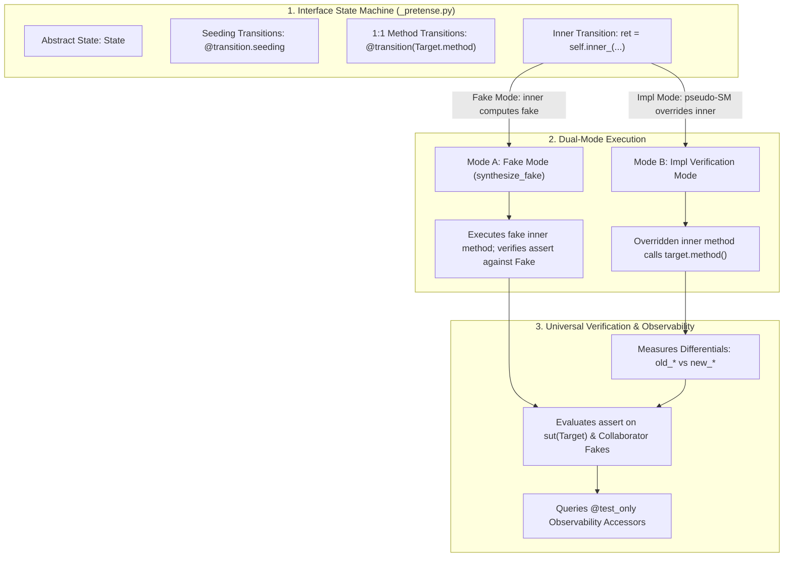
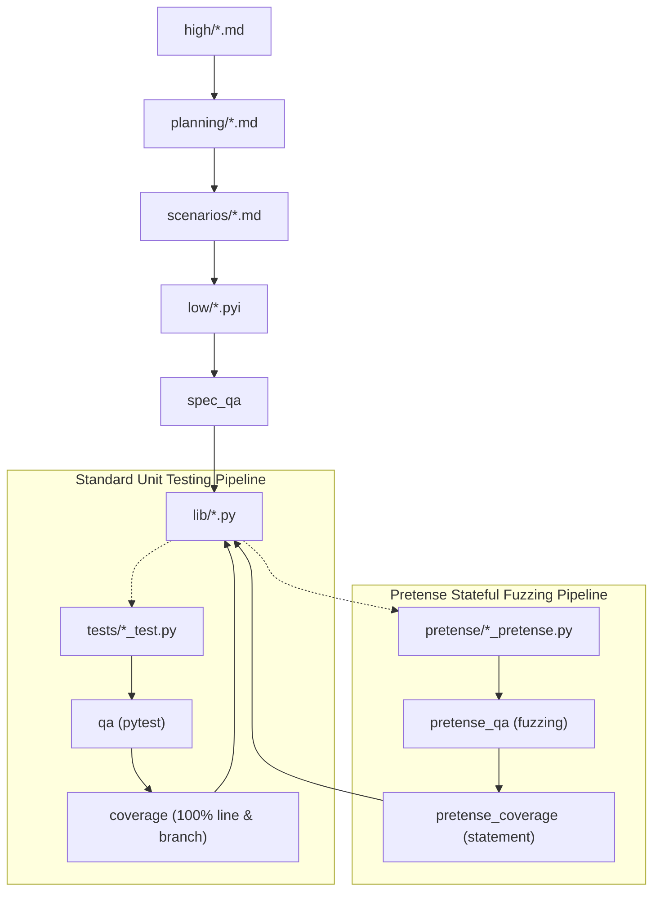

# Pretense: Stateful State-Machine Verification, Verified Fake Synthesis, and AST-Driven Contracts in Autofab (`pretense.md`)

## Table of Contents

1. [Executive Summary & Terminology Lexicon](#1-executive-summary--terminology-lexicon)
   - [Standardized Terminology Lexicon](#standardized-terminology-lexicon)
2. [Empirical Genesis: Cross-Model Differential Defect Analysis & Coincident Cognitive Blind Spots](#2-empirical-genesis-cross-model-differential-defect-analysis--coincident-cognitive-blind-spots)
   - [The Empirical Phenomenon & Cross-Model Outcomes](#the-empirical-phenomenon--cross-model-outcomes)
   - [Anatomy of the Three Undetected Defects](#anatomy-of-the-three-undetected-defects)
   - [Theoretical Analysis: Why Single-Model Autofab Missed These Defects](#theoretical-analysis-why-single-model-autofab-missed-these-defects)
   - [The Structural Coverage Illusion: Statement & Branch Reachability $\ne$ Permutation Coverage](#the-structural-coverage-illusion-statement--branch-reachability--permutation-coverage)
   - [Why Foreign Models Did Not Share the Blind Spots](#why-foreign-models-did-not-share-the-blind-spots)
   - [Architectural Remedies: The Necessity of Pretense](#architectural-remedies-the-necessity-of-pretense)
3. [Post-Mortem: Anatomical Failure of Pretense 1 on `lru_cache`](#3-post-mortem-anatomical-failure-of-pretense-1-on-lru_cache)
   - [The Multi-Transition Explosion & Discriminator Fragility](#the-multi-transition-explosion--discriminator-fragility)
   - [The Absence of AST Processing: The `_run_pass1` Mock Execution Trap](#the-absence-of-ast-processing-the-_run_pass1-mock-execution-trap)
   - [The One-Sided QA Blame Loop](#the-one-sided-qa-blame-loop)
   - [The Bogus `ensure(...)` in Interface State Machines](#the-bogus-ensure-in-interface-state-machines)
4. [Foundational Architectural Principles](#4-foundational-architectural-principles)
   - [Principle 1: Strict 1:1 Transitions with Method Symbol Typing](#principle-1-strict-11-transitions-with-method-symbol-typing)
   - [Principle 2: Natural Python Branching Over Multi-Transition Splitting](#principle-2-natural-python-branching-over-multi-transition-splitting)
   - [Principle 3: The Epistemic Boundary of Interface State Machines](#principle-3-the-epistemic-boundary-of-interface-state-machines)
   - [Principle 4: Universal Unification into Native Python `assert` (Single-Argument Enforcement)](#principle-4-universal-unification-into-native-python-assert-single-argument-enforcement)
   - [Principle 5: Defensive Dead-Ends & Coverage Exemption via `unreachable()`](#principle-5-defensive-dead-ends--coverage-exemption-via-unreachable)
   - [Principle 6: Universal Verification of Assertions in Fakes](#principle-6-universal-verification-of-assertions-in-fakes)
   - [Principle 7: Interface-Level Fake Property Fuzzing](#principle-7-interface-level-fake-property-fuzzing)
   - [Principle 8: Pre-State Snapshots & Differentials via AST Chopping](#principle-8-pre-state-snapshots--differentials-via-ast-chopping)
   - [Principle 9: The Implementation Pseudo State Machine (`call_target`)](#principle-9-the-implementation-pseudo-state-machine-call_target)
   - [Principle 10: Dynamic Scope for Collaborators & In-Component SUTs](#principle-10-dynamic-scope-for-collaborators--in-component-suts)
   - [Principle 11: Test-Only Query Methods (`@test_only`) & Epistemic Traceability](#principle-11-test-only-query-methods-test_only--epistemic-traceability)
   - [Principle 12: Symmetrical QA Blame Attribution](#principle-12-symmetrical-qa-blame-attribution)
   - [Principle 13: AST Chopping & Compile-Time Validation](#principle-13-ast-chopping--compile-time-validation)
   - [Principle 14: Prohibition of Pre-Seeding & Blank Initial State Invariant](#principle-14-prohibition-of-pre-seeding--blank-initial-state-invariant)
   - [Principle 15: Collaborator Seeding Transitions in Implementation Fuzz Testing](#principle-15-collaborator-seeding-transitions-in-implementation-fuzz-testing)
   - [Principle 16: Cross-Collaborator Outcome Assertions](#principle-16-cross-collaborator-outcome-assertions)
   - [Principle 17: Inter-Interface Requirements & Model Assertions](#principle-17-inter-interface-requirements--model-assertions)
   - [Principle 18: Multi-Interface Implementations (`implements: B, C`)](#principle-18-multi-interface-implementations-implements-b-c)
   - [Principle 19: Interface Fixed Conformance Testing (`Test<Target>Fake`)](#principle-19-interface-fixed-conformance-testing-testtargetfake)
   - [Principle 20: Base Interface Transition Delegation & Onion Dispatch](#principle-20-base-interface-transition-delegation--onion-dispatch)
   - [Principle 21: Model Parameter Specialization & Polymorphic Initial State](#principle-21-model-parameter-specialization--polymorphic-initial-state)
5. [Contract Violations, Error Handling, and Reachability: Fuzzing vs. Fixed Scenario Testing](#5-contract-violations-error-handling-and-reachability-fuzzing-vs-fixed-scenario-testing)
   - [Contract Violations vs. Operational Errors in Specifications](#contract-violations-vs-operational-errors-in-specifications)
   - [Fuzz Testing Never Explores Contract Violations (Valid by Construction)](#fuzz-testing-never-explores-contract-violations-valid-by-construction)
   - [Runtime Precondition Failures: SUT Invocations on Fakes Fail Immediately](#runtime-precondition-failures-sut-invocations-on-fakes-fail-immediately)
   - [Fixed Scenario Testing of Contracted Errors (`require(..., error=...)`)](#fixed-scenario-testing-of-contracted-errors-require-error)
   - [Reachability Rule: Contracted Errors vs. Uncontracted Guards](#reachability-rule-contracted-errors-vs-uncontracted-guards)
   - [Elimination of Blanket Coverage Exclusions & Semantic Coverage Auditing](#elimination-of-blanket-coverage-exclusions--semantic-coverage-auditing)
   - [Auditor Circuit Breakers & High-Salience Guidance](#auditor-circuit-breakers--high-salience-guidance)
6. [Empirical Synthesis: Why Multi-Agent Unit Tests Outperformed Pretense on `deepseek-flash`](#6-empirical-synthesis-why-multi-agent-unit-tests-outperformed-pretense-on-deepseek-flash)
   - [The Empirical Benchmark Telemetry](#the-empirical-benchmark-telemetry)
   - [The Two-State Synchronization Problem (Dual States in Lockstep)](#the-two-state-synchronization-problem-dual-states-in-lockstep)
   - [Pre-Training Distribution vs. Custom DSL (Cognitive Load on Fast Models)](#pre-training-distribution-vs-custom-dsl-cognitive-load-on-fast-models)
   - [Deterministic Assertion Diffs vs. Shrunk Fuzzing Counterexamples](#deterministic-assertion-diffs-vs-shrunk-fuzzing-counterexamples)
   - [The Checked Precondition Trap (`*Error` vs. Contract Violations)](#the-checked-precondition-trap-error-vs-contract-violations)
   - [Code Volume & Context Bloat](#code-volume--context-bloat)
7. [Why Stateful Fuzzing Misses Targeted Contract Postconditions (The Horizon & Tautology Problem)](#7-why-stateful-fuzzing-misses-targeted-contract-postconditions-the-horizon--tautology-problem)
   - [The Exponential Horizon of Random Walks ($P = (1/N)^k$)](#the-exponential-horizon-of-random-walks-p--1nk)
   - [The Abstract Model Tautology Effect ($SUT \equiv Model_{SM}$)](#the-abstract-model-tautology-effect-sut-equiv-model_sm)
   - [The Coverage Backpressure Asymmetry on Omission Defects (Case Study: Node Re-Registration)](#the-coverage-backpressure-asymmetry-on-omission-defects-case-study-node-re-registration)
   - [Precondition Gating as a State-Space Pruning Knife](#precondition-gating-as-a-state-space-pruning-knife)
   - [Accidental vs. Essential Complexity in Verification](#accidental-vs-essential-complexity-in-verification)
   - [The Dual Requirement: Stateful Fuzzing + Concrete Scenario Drivers](#the-dual-requirement-stateful-fuzzing--concrete-scenario-drivers)
8. [Component Architecture: Interface State Machine vs. Impl Pseudo State Machine](#8-component-architecture-interface-state-machine-vs-impl-pseudo-state-machine)
   - [Interface State Machine (`<name>_pretense.py`)](#interface-state-machine-name_pretensepy)
   - [Implementation Pseudo State Machine (`<name>_impl_pretense.py`)](#implementation-pseudo-state-machine-name_impl_pretensepy)
   - [Seeding Transitions & Fakes Outside Default Initialization](#seeding-transitions--fakes-outside-default-initialization)
   - [Cross-Component Precondition Composition](#cross-component-precondition-composition)
   - [Multi-Interface Composition & Transition Inheritance](#multi-interface-composition--transition-inheritance)
   - [Streamlined Component Boundaries: Interface Conciseness vs Implementation Grounding](#streamlined-component-boundaries-interface-conciseness-vs-implementation-grounding)
9. [End-to-End Concrete Reference: `LRUCache`](#9-end-to-end-concrete-reference-lrucache)
   - [Low-Level Specification with `@test_only` (`low/lru_cache.pyi`)](#low-level-specification-with-test_only-lowlru_cachepyi)
   - [Interface State Machine (`pretense/lru_cache_pretense.py`)](#interface-state-machine-pretenselru_cache_pretensepy)
   - [Implementation Pseudo State Machine & Tests (`pretense/lru_cache_impl_pretense.py`)](#implementation-pseudo-state-machine--tests-pretenselru_cache_impl_pretensepy)
10. [The Pretense CLI Runner, Linter, & Verifier Architecture](#10-the-pretense-cli-runner-linter--verifier-architecture)
    - [AST Chopping & Compilation Pipeline](#ast-chopping--compilation-pipeline)
    - [Static AST Validation in `pretense_lint.py`](#static-ast-validation-in-pretense_lintpy)
11. [Role Architecture & Circuit Breaker Governance](#11-role-architecture--circuit-breaker-governance)
    - [Roles: `pretense`, `pretense_qa`, `pretense_coverage`](#roles-pretense-pretense_qa-pretense_coverage)
    - [Symmetrical Blame Attribution](#symmetrical-blame-attribution)
    - [Auditor Circuit Breaker: Kill/Restart on Repetitive Blame](#auditor-circuit-breaker-killrestart-on-repetitive-blame)
12. [Empirical Benchmarking: Pretense as a Baseline Equalizer](#12-empirical-benchmarking-pretense-as-a-baseline-equalizer)
    - [Empirical Cross-Model Telemetry (`dag_engine_lite`)](#empirical-cross-model-telemetry-dag_engine_lite)
    - [Cost-Efficiency Dynamics](#cost-efficiency-dynamics)
    - [Empirical Multi-Component & Cross-Interface Telemetry (`task_queue`, `inter_interface`, `multi_interface`)](#empirical-multi-component--cross-interface-telemetry-task_queue-inter_interface-multi_interface)
13. [Comparative Evolution Matrix](#13-comparative-evolution-matrix)
14. [Combined Verification Methodology (`--method combined`) [DONE]](#14-combined-verification-methodology---method-combined-done)
    - [The Complementary Verification Thesis](#the-complementary-verification-thesis)
    - [Benchmark Runner CLI Interface (`--method`)](#benchmark-runner-cli-interface---method)
    - [DAG Role Topology & Dual-Branch Convergence](#dag-role-topology--dual-branch-convergence)
    - [Verification Gate & Artifact Archival](#verification-gate--artifact-archival)
15. [Architectural Roadmap & Future Work](#15-architectural-roadmap--future-work)
    - [TODO 1 [DONE]: Cross-Collaborator Fake Injection & Multi-Component Constraint Testing During Interface Fake Fuzzing](#todo-1-done-cross-collaborator-fake-injection--multi-component-constraint-testing-during-interface-fake-fuzzing)
    - [TODO 2 [DONE]: Quantitative Code & Statement Coverage on Synthesized Fakes in Interface Verification](#todo-2-done-quantitative-code--statement-coverage-on-synthesized-fakes-in-interface-verification)
    - [TODO 3 [DONE]: Strict Ban on `super()` and `assert` for Inner Transitions in State Machines](#todo-3-done-strict-ban-on-super-and-assert-for-inner-transitions-in-state-machines)
    - [TODO 4 [DONE]: Compile Support Libraries (`support/lib/*.py`) to `.pyc` to Prevent Subagent Inspection](#todo-4-done-compile-support-libraries-supportlibpy-to-pyc-to-prevent-subagent-inspection)
    - [TODO 5 [DONE]: Virtually Contracted Operational Exceptions via `require_env`, Collaborator State Binding, and Strict Ban on `raise`](#todo-5-done-virtually-contracted-operational-exceptions-via-require_env-collaborator-state-binding-and-strict-ban-on-raise)
    - [TODO 6 [DONE]: Strict Ban on `Domain.any()` and Mandatory Typed Parameter Domains](#todo-6-done-strict-ban-on-domainany-and-mandatory-typed-parameter-domains)
    - [TODO 7 [DONE]: Dynamic Argument-to-State Preconditions (`Domain.not_in`) and Generative Decoupling](#todo-7-done-dynamic-argument-to-state-preconditions-domainnot_in-and-generative-decoupling)
    - [TODO 8 [DONE]: Comparative Source-of-Truth Arbitration in Pretense QA (`pretense_qa.md`)](#todo-8-done-comparative-source-of-truth-arbitration-in-pretense-qa-pretense_qamd)
    - [TODO 9 [DONE]: Tooling Ergonomics, Feedback Deduplication, and Blame Facet Relaxation](#todo-9-done-tooling-ergonomics-feedback-deduplication-and-blame-facet-relaxation)
    - [TODO 10 [DONE]: Multi-Round Reachability Decision Model for Coverage Arbiters (`pretense_coverage.md`)](#todo-10-done-multi-round-reachability-decision-model-for-coverage-arbiters-pretense_coveragemd)
    - [TODO 11 [TODO]: Enforced Env State Declarations, Mandatory `self.bind`, and `_ext` Termination](#todo-11-todo-enforced-env-state-declarations-mandatory-selfbind-and-_ext-termination)
    - [TODO 12 [DONE]: Combined Fixed + Fuzz Coverage Measurement on `lib/*.py`](#todo-12-done-combined-fixed--fuzz-coverage-measurement-on-libpy)
    - [TODO 13 [TODO]: Revamping Argument Generation: Procedural Recognizers, Edge-Biased Generators, Custom Domains, and Mechanistic Edge Coverage](#todo-13-todo-revamping-argument-generation-procedural-recognizers-edge-biased-generators-custom-domains-and-mechanistic-edge-coverage)
    - [TODO 14 [TODO]: Purge Legacy Exception-Based Transition Selection and Port Benchmark Results (`benchmarks/results/`)](#todo-14-todo-purge-legacy-exception-based-transition-selection-and-port-benchmark-results-benchmarksresults)

---

## 1. Executive Summary & Terminology Lexicon

Empirical benchmarking across model tiers on `dag_engine_lite` revealed a critical blind spot in LLM-generated software verification:
1. **AST Statement & Branch Coverage Is Shallow**: A test suite achieving 95% line coverage and 90% branch coverage greenlit three genuine soundness bugs (off-by-one retry accounting, node re-registration stale edge accumulation, and cross-component scheduler desynchronization).
2. **Mutation Testing (`mutmut`) Is Orthogonal, Not Obsolete**: AST mutators can only mutate syntax lines that exist. If an implementation omits a state cleanup or synchronization loop entirely, there is no syntax for `mutmut` to mutate, and the omission passes silently. Pretense's differential state fuzzing ($Lib \equiv Spec$) covers the **omission class** that mutation testing structurally cannot see.
3. **Open-Ended "Chaos Testers" Lack a Termination Metric**: Asking an LLM to author arbitrary "chaos" or "edge-case" tests without an objective stopping condition degrades into unbound token consumption with no mathematical convergence criteria.

This design document establishes **Pretense**—Autofab's unified state-machine-driven testing, verification, and fake synthesis engine. Powered by Hypothesis's conjecture fuzzing engine (`hypothesis.stateful.RuleBasedStateMachine`), Pretense forces models to verify state-transition invariants through bounded, deterministic search, minimal-trace shrinking, automatic fake synthesis, and AST-chopped 1:1 transitions.

### Standardized Terminology Lexicon

To prevent conflation across specifications, state machines, implementations, and test harnesses, Pretense establishes a strict terminology standard:

| Term | Exact Definition | Canonical Location |
| :--- | :--- | :--- |
| **The Specification** | The authoritative, declarative contract of record. Defines *what* contracts, types, protocols, postconditions, and invariants must hold, without mandating procedural algorithms. | `high/*.md`, `planning/*.md`, `low/*.pyi` |
| **Pretense State Machine** | An **executable state transition model** written in Python (transitions, antecedents, abstract collections). It is an executable artifact derived from the specification, **NOT** a synonym for the specification itself! | `parts/*/pretense/*_pretense.py` |
| **Pretense Fake Adapter** | A concrete runtime object conforming to an interface `Protocol`, synthesized from an interface state machine (`synthesize_fake(StateMachine)`) to be injected into consumers. | Synthesized runtime fake |
| **Implementation Pseudo State Machine** | An implementation-level harness subclassing the interface state machine with zero state variables of its own, using `call_target()` to verify private differentials and bind the real SUT. | `parts/*/pretense/*_impl_pretense.py` |
| **Test Driver** | An outward-calling harness instantiated from a state machine to drive concrete implementations (adversarial fuzzer in Hypothesis or static scenario runner in unit tests). | Harness runtime wrapper |
| **Intra-Component Objects** | Concrete classes defined within the same component's `_impl` module. They are real and tested together in lockstep (zero internal faking). | `parts/<name>/lib/*_impl.py` |
| **Inter-Component Collaborators**| External singletons imported from other components. Modeled via imported interface state machines and injected as fake adapters. | `parts/<other>/low/*.pyi` |
| **Step** | A single prompt $\leftrightarrow$ tool-call interaction cycle between an agent and the harness. | Runtime interaction step |
| **Round** | A full Autofab role dispatch wave across assigned targets until completion, blame, or exhaustion. | Role dispatch pass |

---

## 2. Empirical Genesis: Cross-Model Differential Defect Analysis & Coincident Cognitive Blind Spots

### The Empirical Phenomenon & Cross-Model Outcomes

In the empirical evaluation of Autofab architectures against traditional software engineering baselines on the `dag_engine_lite` benchmark suite, the single-model Autofab run using **Qwen3.6-35B-A3B-oQ6-mtp** (Tier 1 Local MoE) achieved an ostensibly perfect verification outcome:
- **Internal Autofab Status**: Verified & Passed (Pass 1 and Pass 2 gates cleared).
- **Static Type Checking**: 0 Pyright diagnostics.
- **Self-Authored Test Suite ($V_{\text{self}} \to P_{\text{self}}$)**: 60/60 tests passing (100%).
- **Structural Code Coverage**: 95.0% Statement Coverage, 90.0% Branch Coverage.
- **Specification Linter Diagnostics**: 0 errors.

Under standard software engineering quality metrics, this library implementation ($P_{\text{qwen}}$) would be certified for production deployment. Furthermore, because Autofab enforced strict double-blind physical isolation ($\mathcal{I} = 0$) between the Synthesizer workspace ($W_{\text{lib}}$) and the Certifier workspace ($W_{\text{test}}$), the test suite did not suffer from the classic **Contamination Trap** of single-agent joint context TDD (where an agent rewrites test assertions to tautologically affirm broken code).

However, when independent foreign test suites authored from the exact same formal Low-Level Specification (`low/*.pyi`) by different model families (**DeepSeek-V3/Flash**, **Gemini 3.8 Flash**, and **Gemini 4 Argon**) were executed against Qwen's Autofab implementation via the differential cross-testing runner (`bin/run_cross_tests.py`), **three genuine soundness defects** were immediately exposed:

```
┌────────────────────────────────────────────────────────────────────────────────────────┐
│               CROSS-MODEL DIFFERENTIAL VERIFICATION OUTCOMES (ON P_qwen)               │
├────────────────────────────────────────────────────────────────────────────────────────┤
│                                                                                        │
│   Certifier Test Suite (V)             Pass / Fail Rate   Soundness Status             │
│   ──────────────────────────────────   ────────────────   ──────────────────────────   │
│   Qwen Autofab (Self: V_qwen)          60 / 60 (100.0%)   PASS (Coincident Blind Spot) │
│   DeepSeek Autofab (V_deepseek)        47 / 48 ( 97.9%)   FAIL (Off-by-One Retry Bug)  │
│   Gemini 3.8 Flash (V_gemini_flash)    32 / 36 ( 88.9%)   FAIL (3 Defects Exposed)     │
│   Gemini 4 Argon (V_gemini_argon)      19 / 20 ( 95.0%)   FAIL (Dynamic Retry Bug)     │
│                                                                                        │
└────────────────────────────────────────────────────────────────────────────────────────┘
```

---

### Anatomy of the Three Undetected Defects

#### Defect 1: Off-by-One Retry Accounting on Action Recovery (`DAGRunner.run`)

##### The Formal Contract (`low/dag_engine_lite.pyi`)
```python
@dataclass(frozen=True)
class NodeResult(Generic[T]):
    node_id: str
    state: NodeState
    value: Optional[T] = None
    error: Optional[Exception] = None
    duration_seconds: float = 0.0
    retries_attempted: int = 0
```
- **Contract Invariant**: An execution consists of 1 initial invocation (`attempt 0`) plus up to $N$ retry invocations (`attempt 1 .. N`). If an action fails once and succeeds on the second try, exactly **1 retry** was executed (`retries_attempted == 1`). If it fails twice and succeeds on the third try, exactly **2 retries** were executed (`retries_attempted == 2`).

##### Qwen's Implementation Flaw (`P_qwen: lib_1.py:927`)
```python
retries_attempted = 0
caught_exc: Optional[Exception] = None
action_value: Any = None
for attempt in range(1 + max_retries):
    try:
        action_value = definition.action()
        node_succeeded = True
        break
    except Exception as exc:
        caught_exc = exc
        if attempt > 0:
            retries_attempted += 1
```
- **The Defect**: Qwen placed `if attempt > 0: retries_attempted += 1` inside the `except` block.
  - If `attempt 0` fails: `attempt > 0` is `False`, so `retries_attempted` remains `0`.
  - If `attempt 1` executes and **succeeds**: the loop sets `node_succeeded = True` and breaks out. It **never reaches the `except` block**!
  - `retries_attempted` remains `0`, even though 1 retry was executed!
- **Why Self-Tests Missed It**: Qwen tested only total exhaustion failure (`still_failing()`), where all attempts fail and hit `except`.

---

#### Defect 2: Node Re-Registration Stale Edge Accumulation (`DAG.add_node`)

##### The Formal Specification vs. The Reasonable Implicit Specification
In [low/dag_engine_lite.pyi](file:///Users/seanmcdirmid/projects/cleanroom/benchmarks/parts/dag_engine_lite/low/dag_engine_lite.pyi), the contract for `add_node` explicitly states:
```python
def add_node(
    self,
    node_id: str,
    action: Callable[[], Any],
    dependencies: Optional[Collection[str]] = None,
    priority: int = 0,
    retries: int = 0,
) -> None:
    """Adds a task node to the graph.

    Args:
        node_id: Unique string identifier for the node.
        action: Zero-argument callable representing node computation.
        dependencies: Optional collection of upstream node identifiers.
        priority: Scheduling priority (higher executes earlier).
        retries: Number of permitted retry attempts upon exception.

    POSTCONDITIONS:
    - MUST register the node definition into the graph.
    - WHEN dependencies are provided, MUST add directed dependency edges from each dependency to node_id.
    - MUST defer missing dependency existence checks to validate() and topological_sort() without eagerly raising NodeNotFoundError.
    """
```

**An Under-Specified Behavior with a Reasonable Implicit Specification**:
Notice that the specification defines `node_id` as a `"Unique string identifier"`, but is **completely silent on overwriting or re-registration**:
- It does not explicitly declare that re-registering an existing node replaces the definition.
- Nor does it declare a checked precondition error (e.g. `DuplicateNodeError`) forbidding re-registration.
- However, **a reasonable implicit specification exists**:
  1. In standard mapping semantics, inserting a definition into `_nodes` with an existing `node_id` replaces the previous `NodeDefinition`.
  2. The contract invariant across the graph mandates consistency between definitions and adjacency:
     $$\text{dag.get\_dependencies}(node\_id) \equiv \text{dag.get\_node}(node\_id).\text{dependencies}$$
  3. Therefore, if `add_node` allows re-registration, it implicitly mandates that previously registered dependency edges must be detached so that adjacency queries (`get_dependencies`, `get_dependents`) do not accumulate stale ghost edges that contradict the newly registered definition.

##### Qwen's Implementation Flaw (`P_qwen: lib_1.py:598`)
```python
def add_node(self, node_id: str, action: Callable[[], Any], dependencies=None, priority=0, retries=0) -> None:
    deps = frozenset(dependencies) if dependencies else frozenset()
    definition = dag_engine_lite.NodeDefinition(node_id, action, deps, priority, retries)
    self._nodes[node_id] = definition
    if node_id not in self._upstream:
        self._upstream[node_id] = set()
    if node_id not in self._downstream:
        self._downstream[node_id] = set()
    for dep in deps:
        self.add_edge(dep, node_id)
```
- **The Defect**: Following the literal wording of the grounding rather than the implicit consistency invariant, `add_node` overwrites `self._nodes[node_id]`, but **fails to remove existing dependency edges** from `self._upstream[node_id]` or `self._downstream[old_dep]`.
- If node `target` was initially registered with `dependencies=["dep1"]`, and then re-registered with `dependencies=["dep2"]`, `add_edge("dep2", "target")` adds the new edge, but the incoming edge from `dep1` remains in `self._upstream["target"]`!
- Calling `dag.get_dependencies("target")` returns `{"dep1", "dep2"}` while `dag.get_node("target").dependencies` returns `{"dep2"}`.
- **Cognitive Divergence**: **Gemini 3.8 Flash** deduced the reasonable implicit specification (re-registration as upsert with edge replacement) and aggressively tested it. **Qwen** only considered the literal, initial-insertion case.

---

#### Defect 3: Cross-Component State Desynchronization on Node Removal (`WaveScheduler`)

##### The Formal Contract (`low/dag_engine_lite_impl.pyi`)
```python
@singleton_type("system")
class WaveScheduler(dag_engine_lite.WaveScheduler):
    """Concrete realization of sequential wave scheduler.
    GROUNDING:
    - Maintains scheduling state across _dag and _states dictionary.
    - Synchronizes dynamic node state by discovering registered nodes from _dag.all_nodes().
    """
```

##### Qwen's Implementation Flaw (`P_qwen: lib_1.py:773`)
```python
def _sync_states(self) -> None:
    all_nodes = self._dag.all_nodes()
    for node_id in all_nodes:
        if node_id not in self._states:
            deps = self._dag.get_dependencies(node_id)
            if not deps:
                self._states[node_id] = dag_engine_lite.NodeState.READY
            else:
                self._states[node_id] = dag_engine_lite.NodeState.PENDING
```
- **The Defect**: `_sync_states` is unidirectional additive. It scans `self._dag.all_nodes()` and adds new nodes to `self._states`.
- If a caller invokes `dag.remove_node("removable")`, the node is removed from the DAG. When `scheduler.get_all_states()` is invoked, `_sync_states()` runs, but does **not purge** keys from `self._states` that are no longer in `self._dag.all_nodes()`. The removed node remains indefinitely in the scheduler's state dictionary as a zombie node.

---

### Theoretical Analysis: Why Single-Model Autofab Missed These Defects

Autofab's double-blind isolation enforces an information-theoretic barrier:
$$\mathcal{I}(W_{\text{test}}; W_{\text{lib}}) = 0$$
The Certifier cannot read the Synthesizer's code, cannot inspect its variable names, and cannot modify assertions to match the Synthesizer's runtime behavior.

However, if both $W_{\text{lib}}$ and $W_{\text{test}}$ are driven by the same frozen model weights ($\theta$), they sample from identical probability distributions over semantic interpretations:
$$P(M \mid S, \theta)$$
When an interface contract is multi-faceted:
1. **The Synthesizer** samples an implementation that addresses the most salient interpretation of the contract (e.g. retry exhaustion).
2. **The Certifier**, prompted with the same specification text and governed by the same statistical priors, samples test cases for *that exact same salient interpretation*.
3. Because both agents share the same cognitive blind spot, neither agent conceives of the complementary edge case.
4. The Certifier writes tests that certify the Synthesizer's incomplete implementation with 100% mathematical pass rates, producing a **Coincident Error**:
$$P\left(V_\theta(P_\theta) = \mathbf{PASS} \;\middle|\; V_{\text{oracle}}(P_\theta) = \mathbf{FAIL}\right) > 0$$

---

### The Structural Coverage Illusion: Statement & Branch Reachability $\ne$ Permutation Coverage

Autofab recorded 95.0% statement coverage and 90.0% branch coverage on Qwen's library. This exposes the fundamental flaw of relying exclusively on AST-based structural code coverage:
1. **The Branch Coverage Trap on Defect 1**:
   When Qwen's test suite executed `test_run_retries_on_failure` (exhausting 3 attempts), on attempt 0 `attempt > 0` was `False`, and on attempts 1 and 2 it was `True`. Both branches were 100% covered. Yet the logic was completely broken for any action that recovered on attempt 1!
2. **The State-Space Permutation Blind Spot on Defects 2 and 3**:
   Structural coverage only records that syntax lines were executed; it does not measure whether the state-space transition graph $(\mathcal{S} \times \mathcal{A} \to \mathcal{S}')$ was explored across multi-action sequences (e.g. `add(A)` $\to$ `add(A, new_deps)` or `init_scheduler()` $\to$ `remove(B)` $\to$ `sync()`).

---

### Why Foreign Models Did Not Share the Blind Spots

When independent models authored test suites from the identical `low/*.pyi` specification, their differing training distributions and reasoning priors generated radically different adversarial tests:
- **DeepSeek-V3 / Flash**: Focused on execution-trace loop invariants, authoring an action recovery test on retry 2.
- **Gemini 3.8 Flash**: Focused on idempotency and dynamic reconfiguration, testing re-registration edge detachment and dynamic node removal synchronization.
- **Gemini 4 Argon**: Focused on failure policies and state consistency.

Because their cognitive priors were uncorrelated:
$$\mathcal{I}(\text{Prior}_{\text{foreign}}; \text{Prior}_{\text{qwen}}) \approx 0$$
The cross-model differential pass rate plummeted, exposing defects that homogeneous self-testing could never detect.

---

### Architectural Remedies: The Necessity of Pretense

Physical isolation alone is insufficient if agents share identical cognitive biases. Pretense permanently closes this vulnerability through:
1. **Hypothesis State Machines**: Transition-space fuzzing replaces example-based static sequences with thousands of randomized action permutations ($S \times A \to S'$).
2. **Minimal Shrinking Traces**: Falsifications shrink to minimal 2-step counterexamples for instant blame attribution.
3. **Automatic Fake Synthesis**: Decouples inter-component dependencies so tests cannot mask partner desynchronizations.
4. **Pretense as an Equalizer**: Bridges the gap between single-model baselines and multi-agent Autofab pipelines.

---

## 3. Post-Mortem: Anatomical Failure of Pretense 1 on `lru_cache`

During the empirical evaluation of `qwen-moe` on `lru_cache` under `--pretense`, the legacy Pretense (v1) framework failed at wave 100 with 101 rounds (`lib:51`, `pretense:1`, `pretense_qa:49`):

### The Multi-Transition Explosion & Discriminator Fragility
Legacy Pretense mandated that each distinct operational outcome or exception branch declare a separate `@transition` function (`configure_positive_capacity`, `configure_zero_capacity`, `get_hit`, `get_miss`). This forced models to invent naming schemes and maintain brittle, mutually exclusive input guards. When a test drove an input that missed candidate discriminators, execution halted with `NoMatchingTransitionError`.

### The Absence of AST Processing: The `_run_pass1` Mock Execution Trap
Legacy Pretense omitted runtime AST processing, attempting dynamic reflection via speculative execution with dummy `TransitionContext` and `Expr` objects:
```python
# Legacy pretense.py execution snippet:
def _run_pass1(state: Any, this: Any):
    arg_exprs = [Expr(name=p.name) for p in arg_params]
    ctx = TransitionContext(target=None, ...)
    ctx._in_pass1 = True
    call_args = [*arg_exprs, ctx]
    raw_fn(active_sm, *call_args)  # Speculatively executes with dummy objects!
```
When models wrote standard Python calls on `target`, `TransitionContext` threw runtime `AttributeError: 'TransitionContext' object has no attribute 'configure'`, completely baffling the agent.

### The One-Sided QA Blame Loop
Because `pretense_qa.md` lacked symmetrical blame attribution, the QA arbiter assumed any test failure was an implementation defect. It blamed `lib` **49 consecutive times**, while the broken `pretense` role sat untouched, producing an unresolvable 100-wave deadlock.

### The Bogus `ensure(...)` in Interface State Machines
In legacy Pretense, interface state machines contained postcondition assertions (`ensure(target.size == ...)`). But when synthesized into a fake (`FakeLRUCache = synthesize_fake(LRUCacheStateMachine)`), there was **no target object under test**—the fake *was* the object, resulting in runtime proxy crashes.

---

## 4. Foundational Architectural Principles



### Principle 1: Strict 1:1 Transitions with Method Symbol Typing
Every public method in `low/<name>.pyi` has **exactly one** corresponding transition in the interface state machine:
- Decorated with `@transition(TargetClass.method)`, passing the explicit method symbol.
- Parameter names, types, and defaults are statically verified by linters and type checkers.
- Function name matches the method name 1:1 (`def get(...)`, `def put(...)`). Discriminator scoring and `NoMatchingTransitionError` are completely eliminated.

### Principle 2: Natural Python Branching Over Multi-Transition Splitting
Instead of splitting a method across multiple transitions, **a single transition uses standard Python branching (`if/else`) and exception contexts (`with raises(...)`)**:
```python
@transition(LRUCache.remove)
def remove(self, key: str) -> Any:
    require_arg(key, Domain.text())
    if key in self.state.items:
        ret = self.inner_remove(key)
        expected = self.state.items.pop(key)
        assert ret == expected
        return ret
    else:
        with raises(CacheKeyNotFoundError):
            self.inner_remove(key)
        raise CacheKeyNotFoundError()

def inner_remove(self, key: str) -> Any:
    return self.state.items[key]
```

### Principle 3: The Epistemic Boundary of Interface State Machines
An interface state machine is an **epistemic shadow** of the implementation. It can only be parameterized by the implementation through **return values**.
1. **Preconditions Cannot Access `target`**: `requires(...)` preconditions and `require_arg(...)` domains are evaluated *before* the method is invoked, and must evaluate strictly on `self.state` and input arguments. Preconditions can **never** inspect `target` or call its methods.
2. **Opaque Evictions & Non-Deterministic Behaviors**: If an implementation makes an internal state decision (such as evicting an arbitrary cache entry) and that decision is not communicated in the return value:
   - The interface state machine cannot know which key was evicted.
   - Subsequent method preconditions cannot gate on key presence (`requires(key in self.state)` is prohibited).
3. **Prohibition of SUT Method Calls in Interface State Machines**: An interface state machine must never invoke `sut(TargetClass).<method>()` or call any target methods. In interface state machines, `inner_<method>` exists purely to compute abstract fake return values from `self.state` (or return `None`). Calling target methods belongs **exclusively** to the implementation pseudo-state machine override (`<Impl>PseudoStateMachine`). If an interface state machine's `inner_<method>` or transition calls `sut(TargetClass).<method>()`, synthesizing a fake (`Fake<Target> = synthesize_fake(<Target>StateMachine)`) causes an **infinite mutual recursion loop** (`RecursionError`): `Fake<Target>.<method>` delegates to `transition(TargetClass.<method>)` $\to$ `self.inner_<method>()` $\to$ `sut(TargetClass).<method>()` $\to$ `Fake<Target>.<method>()`. In interface state machines, `sut(TargetClass)` is permitted **strictly within `assert` statements** to check observable properties/invariants on synthesized fakes.
4. **Prohibition of Raising Exceptions in Interface Inner Transitions**: In interface state machines, `inner_<method>` exists strictly to compute fake return values from `self.state` (or return `None`). It must **never raise exceptions**. Contract errors (`*Error`) represent invalid inputs gated out of fuzzing via `require(...)`/`require_arg(...)` and tested in scenario tests via `self.checked.violating(ExpectedError)`. Operational postcondition exceptions (`*Exception`) are synthesized and asserted via `with raises(ExpectedException):` around the inner transition inside the outer transition. Allowing `inner_<method>` to raise exceptions breaks synthesized fake execution and circumvents contracted transition routing.

### Principle 4: Universal Unification into Native Python `assert` (Single-Argument Enforcement)
All postconditions, pre-state invariant checks, and internal assertions are unified into native Python `assert`:
```python
assert condition
```
#### Mandatory Single-Argument Assertions (No Message String)
In Pretense, **single-argument assertions (`assert condition`) are strictly enforced by AST linters (`[PRE_LINT_ASSERT_SINGLE_ARG]`)**:
1. **Pytest Introspection**: Pytest automatically displays sub-expression trees on failure (`AssertionError: assert 3 == 4, where 3 = sut(LRUCache).size`). Message strings are redundant.
2. **Elimination of the Truthy Tuple Bug**: Writing `assert (condition, "msg")` creates a 2-tuple that evaluates to `True` in Python, **silently passing even when condition is False**! Enforcing single-argument assertions eliminates this failure mode entirely.
3. **Zero Semantic Drift**: Eliminates out-of-date or hallucinated error messages.

### Principle 5: Defensive Dead-Ends & Coverage Exemption via `unreachable()`
Library code frequently contains defensive branches or assertions protecting internal invariants guaranteed by caller assumptions. Pretense provides the `unreachable(...)` primitive:
```python
from pretense import unreachable

if impossible_state_condition:
    unreachable("Caller invariant guarantees state is never empty")
```
Lines marked with `unreachable(...)` are automatically excluded from statement and branch coverage metrics. If the assumption is violated, Hypothesis property fuzzing crashes immediately with an `AssertionError` and shrinks the minimal failing counterexample.

### Principle 6: Universal Verification of Assertions in Fakes
Synthesized fakes (`Fake<Iface> = synthesize_fake(<Iface>StateMachine)`) implement the full interface and `@test_only` accessors. Therefore, **`assert` statements are evaluated in Fake mode as well**:
- When executing in Fake mode, `sut(TargetClass)` resolves to the active `Fake<Target>` instance.
- When `assert sut(LRUCache).size == len(self.state.items)` runs on a fake, it queries `fake.size` and verifies that the fake's internal state machine faithfully updates its observable properties.

### Principle 7: Interface-Level Fake Property Fuzzing & Local Verification
Because fakes execute under the full contract of `assert`, the interface component (`pretense/<name>_pretense.py`) includes **Hypothesis property fuzzing of the synthesized Fake**:
```python
FakeLRUCacheFuzzTest = compile_hypothesis_test_case(LRUCacheStateMachine, FakeLRUCache)
```
Fuzzing explores thousands of random transition sequences against `Fake<Target>`, guaranteeing that downstream components receive a certified, fully verified in-memory fake.

Because interface state machines are self-contained and test only the synthesized fake (with no `lib/*.py` implementation file involved), no downstream `pretense_qa` auditor role is required. Instead, local checking (`bin/check_files` via `verify_template`) directly executes `uv run pretense` on interface modules, verifying `Test<Target>Fake` and `Fake<Target>FuzzTest` before submission. Real implementation testing and coverage audits belong strictly to implementation components via downstream `pretense_qa` and `pretense_coverage`.

### Principle 8: Pre-State Snapshots & Differentials via Inner Transitions
Many formal postconditions are state differentials ($\Delta = \text{new} - \text{old}$):
```python
@transition(LRUCache.get)
def get(self, key: str, default: Optional[Any] = None) -> Any:
    # 1. PRE-CALL SLICE (Evaluates BEFORE inner transition runs)
    assert sut(LRUCache).size == len(self.state.items)
    old_hits = sut(LRUCache).hits
    
    # 2. INNER TRANSITION INVOCATION (Polymorphic Delegation)
    ret = self.inner_get(key, default)
    
    # 3. POST-CALL SLICE (Evaluates AFTER inner transition runs)
    if key in self.state.items:
        self.state.hits += 1
        assert sut(LRUCache).hits == old_hits + 1
        
    return ret

def inner_get(self, key: str, default: Optional[Any] = None) -> Any:
    return self.state.items.get(key, default)
```
Pre-transition statements capture snapshots, the inner transition computes the return value, and post-transition statements evaluate differentials.

### Principle 9: The Implementation Pseudo State Machine (`inner_<method>`)
The implementation layer is termed an **Implementation Pseudo State Machine** (`<Impl>PseudoStateMachine`):
- Owns **zero state variables of its own** and defines no independent state transitions.
- Shares `<Iface>State` directly.
- Contains **zero `require_arg` statements**; all parameter domains and strategies are inherited from the interface state machine (`PN_IMPL_NO_REQUIRE_ARG`).
- Does **never mutate `self.state` directly** (`PN_IMPL_NO_STATE_MUTATION`). When an implementation pseudo state machine transition executes, domain constraints, preconditions, and model state updates are inherited from the parent interface state machine, invoking the overridden inner transition directly through standard method polymorphism without onion wrappers.
- Overrides `inner_<method>(self, *args)` to invoke the concrete target and return the real return value: invoking concrete SUT methods belongs **exclusively** here. Interface state machines must never call SUT methods in `inner_<method>` (causes infinite mutual recursion with synthesized fakes):
```python
class LRUCacheImplPseudoStateMachine(LRUCacheStateMachine):
    def inner_put(self, key: str, value: Any) -> Any:
        target: LRUCache = sut(LRUCache)
        old_nodes = len(target._items)
        ret = target.put(key, value)
        assert len(target._items) == len(self.state.items)
        return ret
```

### Principle 10: Dynamic Scope for Collaborators & In-Component SUTs
All objects under test and collaborating singletons are accessed via dynamic scope: `sut(TargetClass)`. In Fake Mode, it resolves to the active fake; in Verification Mode, to the concrete implementation.

### Principle 11: Test-Only Query Methods (`@test_only`) & Epistemic Traceability
To allow black-box verification of internal postconditions without violating encapsulation, `low/<name>.pyi` declares `@test_only` query accessors:
```python
@test_only
@property
def eviction_count(self) -> int: ...
```
`lib/*.py` is strictly forbidden by AST linters from calling any `@test_only` method (`[LIB_LINT_TEST_ONLY_CALLED]`).

### Principle 12: Symmetrical QA Blame Attribution
In `pretense_qa.md`, failures during cross-testing or state machine execution are evaluated symmetrically:
1. **Test Provider Defect (Blame `pretense`)**: Bad domains, transition crashes, unmodeled preconditions, or contradictions against `low/*.pyi`.
2. **Library Defect (Blame `lib`)**: Violation of explicit contracts mandated by `low/*.pyi`.
3. **Prohibition on Blaming Passing Targets**: When test suites pass (100%), the auditor is strictly forbidden from blaming either role based on speculative prose.

### Principle 13: Inner Transition Structure & Compile-Time Validation
Original Pretense's speculative `_run_pass1` is replaced with **static AST analysis** in `pretense_lint.py`:
- Parses transition functions at edit time.
- Validates that transitions delegate to inner transition methods (`self.inner_<name>` in interface; overridden `inner_<name>` in impl pseudo state machine).
- Validates that `requires` and `require_arg` appear before `self.inner_<name>`, snapshots `old_*` are assigned before calling the inner transition, and assertions conform to single-argument rules.

### Principle 14: Prohibition of Pre-Seeding & Blank Initial State Invariant
In multi-component architectures, components under test interact with external collaborator singletons. A recurring failure mode in early benchmarks was **static pre-seeding**: test authors populated collaborator states inside `make_sut()` or `setUp()` fixtures (e.g., pre-enqueuing 10 tasks into a collaborator queue so that `TaskWorker.fetch_and_execute()` would not encounter an empty queue).
- **Why Pre-Seeding is Defective**:
  1. *State Exhaustion*: In a 50-step Hypothesis stateful fuzzing run, 10 pre-seeded tasks are drained within the first 10 steps, leaving the queue empty for the remaining 40 steps.
  2. *Loss of Dynamic Interleaving*: Static fixtures fail to explore dynamic operation interleavings (e.g. `submit` $\to$ `fetch` $\to$ `submit` $\to$ `submit` $\to$ `fetch`).
  3. *Masked Failure Branches*: Operational failures (e.g., backing service unavailability) cannot be randomly injected mid-run.
- **The Blank Initial State Rule**: All SUT instances and collaborator fakes initialized in `make_sut()`, `setUp()`, or test fixtures **must start in blank (default initial) states**.
- **Dynamic Seeding Transitions**: Transitions from blank states to non-blank states occur exclusively through **seeding transitions** (`@transition.seeding`), executed dynamically and randomly by Hypothesis during fuzzing, or step-by-step in scenario tests.
- **Static AST Linter Enforcement (`[PRE_LINT_NO_PRE_SEEDING]`)**: `pretense_lint.py` inspects `make_sut()` to prohibit loops (`for`, `while`), state injection arguments, or mutating method calls on instances. Only lifecycle registry construction, module initialization, collaborator fake registration, scope entry, and singleton resolution are permitted.
- **Anti-State-Poking Invariant (`[PRE_LINT_NO_STATE_POKING]`)**: Direct mutation or mutating method calls on `.state` or `self.state` in test methods is strictly prohibited. State transitions must be driven through public methods on `self.checked` or synthesized fake methods.

### Principle 15: Collaborator Seeding Transitions in Implementation Fuzz Testing
When verifying an implementation component that depends on collaborator interfaces (e.g. `TaskWorker` depending on `TaskQueue`):
- `compile_hypothesis_test_case` supports a `collaborators` parameter accepting a sequence of collaborator interface state machines:
  ```python
  TaskWorkerFuzzTest = compile_hypothesis_test_case(
      proto=TaskWorkerImplPseudoStateMachine,
      collaborators=[TaskQueueStateMachine],
      sut_factory=make_sut,
      initial_state_factory=TaskWorkerState,
      name="TaskWorkerFuzzTest",
  )
  ```
- **Rule Collection & Dispatch**:
  1. *SUT Rules*: Transitions on the implementation pseudo-state machine are registered as Hypothesis rules dispatching against the SUT via `call_target`.
  2. *Collaborator Seeding Rules*: Every `@transition.seeding` method declared on each collaborator state machine is registered as a Hypothesis rule.
  3. *Collaborator Resolution*: When a collaborator seeding rule is chosen, the engine resolves the registered collaborator fake or singleton from active dynamic context (`sut(CollaboratorClass)`) and executes the seeding transition against it.
- This allows Hypothesis to interleave collaborator state changes (e.g. enqueuing tasks, injecting service unavailability) throughout the entire fuzzing run without violating the blank initial state invariant.

### Principle 16: Cross-Collaborator Outcome Assertions
An implementation under test frequently mutates or delegates operations to collaborator singletons. In `TaskWorkerImplPseudoStateMachine`, transition overrides must be capable of asserting postconditions on collaborator fakes:
```python
class TaskWorkerImplPseudoStateMachine(TaskWorkerStateMachine):

    @transition(TaskWorker.execute)
    def execute(self, task_id: str, payload: str) -> Any:
        target: TaskWorker = sut(TaskWorker)
        queue: TaskQueue = sut(TaskQueue)  # Resolves collaborator fake
        
        old_completed = queue.get_outcome(task_id)
        ret = call_target(target.execute(task_id, payload))
        
        # Cross-collaborator outcome assertions
        assert ret == f"PROCESSED:{payload.upper()}"
        assert queue.get_outcome(task_id) == ret
        return ret
```
Collaborator fakes synthesized via `synthesize_fake` expose all public methods and `@test_only` query accessors declared on the collaborator interface, allowing transition overrides to verify end-to-end integration contracts cleanly without violating encapsulation.

### Principle 17: Inter-Interface Requirements & Model Assertions
When Interface $A$ imports Interface $B$:
1. **Model Preconditions & Domains via `sut_state`**: Interface transitions in $A$ can express caller preconditions (`require`) or argument domains (`require_arg`) conditioned on $B$'s abstract model state via `sut_state(BState)`:
   ```python
   @transition(TaskWorker.fetch_and_execute)
   def fetch_and_execute(self) -> str:
       require(self.state.initialized)
       queue_state = sut_state(TaskQueueState)
       require(len(queue_state.pending) > 0)
       require(queue_state.is_available)
       ...
   ```
2. **Inter-Interface Postcondition Assertions**: Interface transitions in $A$ can assert postconditions against collaborator $B$ (`sut(B)`).
3. **Execution Context Binding**: During fake fuzzing (`Fake<A>FuzzTest`), Pretense automatically binds collaborator fakes in the test context so that `sut(B)` and `sut_state(BState)` resolve deterministically.

### Principle 18: Multi-Interface Implementations (`implements: B, C`)
When a concrete component implements multiple interfaces (e.g. `multi_interface_impl` implementing both `stream_reader` and `stream_writer`):
1. **Multiple Inheritance for Pseudo-State Machines**:
   ```python
   class MultiImplPseudoStateMachine(StreamReaderStateMachine, StreamWriterStateMachine):
       """Implements transitions for singletons across both interfaces."""
       ...
   ```
2. **Transition Coverage**: The pseudo-state machine provides `call_target` transition overrides for methods across all implemented interfaces, asserting postconditions and invariants for both interfaces.
3. **Static AST Linter Enforcement (`[PRE_LINT_MULTI_INTERFACE_INHERITANCE]`)**: Linters verify that the implementation pseudo-state machine inherits all implemented interface state machines declared in `implements:`.
4. **Interleaved Stateful Fuzzing**: `compile_hypothesis_test_case` discovers transitions from all inherited base classes in MRO order. Hypothesis randomly interleaves operations across both interfaces against the single concrete implementation instance.

### Principle 19: Interface Conformance Testing (`Fake<Target>FuzzTest` & `Test<Target>Fake`)
Interface pretense modules (`pretense/<name>_pretense.py`) must provide a verified in-memory fake for downstream consumers. To guarantee that synthesized fakes execute all operational and seeding transitions correctly:
1. **Fuzz-First Interface Coverage (`Fake<Target>FuzzTest` + `--cov`)**: `Fake<Target>FuzzTest = compile_hypothesis_test_case(...)` executes under `--cov` during `bin/check_files`, verifying that all code in the interface state machine is covered dynamically.
2. **Optional Fixed Fake Tests (`Test<Target>Fake`)**: `Test<Target>Fake(unittest.TestCase)` is limited to transitions, seeding transitions, or edge branches not covered by `Fake<Target>FuzzTest`. `[PRE_LINT_INTERFACE_TRANSITION_COVERAGE]` in `pretense_lint.py` only requires `Test<Target>Fake` covering 100% of transitions statically when `compile_hypothesis_test_case` is absent.
3. **Prohibition of `call_target` in Interface Modules (`[PRE_LINT_NO_CALL_TARGET_IN_INTERFACE]`)**: Interface state machines delegate to inner transitions (`ret = self.inner_<name>(...)`). `call_target` is reserved exclusively for implementation pseudo-state machines.

### Principle 20: Base Interface Transition Delegation & Method Polymorphism
To eliminate duplication and prevent cognitive desynchronization between interface state machines and implementation pseudo-state machines:
1. **Standard Python Polymorphic Delegation**: When an implementation pseudo-state machine is driven by a checked adapter:
   - When the transition is invoked, the base interface transition executes first.
   - The base transition evaluates `requires(...)` caller preconditions and draws parameter domains (`require_arg`).
   - The base transition invokes `ret = self.inner_<name>(*args)`, which dispatches via standard Python polymorphism to the implementation override.
   - The implementation override evaluates pre-state differentials, invokes the real SUT via `target.method(*args)` (or `call_target(target.method(*args))`), and checks private SUT assertions.
   - Control returns to the base transition to apply reference model mutations (`self.state`) and verify postconditions.
2. **Zero Duplication in Implementation Pseudo-State Machines**:
   - Implementation pseudo-state machines **must NOT duplicate `require(...)` preconditions**; these are evaluated by the base class.
   - Implementation pseudo-state machines **must NOT declare `require_arg(...)` parameter domains** (`PN_IMPL_NO_REQUIRE_ARG`); domains are inherited from the base class.
   - Implementation pseudo-state machines **must NEVER mutate `self.state` directly** (`PN_IMPL_NO_STATE_MUTATION`); model state is updated by the base class.
3. **Auditor Protection in `pretense_qa.md`**: QA auditors are strictly prohibited from blaming implementation pseudo-state machines for missing `require(...)` gates, missing `require_arg(...)` domains, or missing `self.state` mutations, since these responsibilities are handled by base interface transition delegation.

### Principle 21: Model Parameter Specialization & Polymorphic Initial State
Because an interface specification (`low/<name>.pyi`) contracts observable behavior without dictating internal implementation choices (such as default capacity, initial buffer size, or thread allocation), the interface state machine and implementation pseudo-state machines manage initial state through structured specialization:
1. **Interface State Machine as Fake Provider & Abstract Oracle**:
   - The interface state machine (`<name>_pretense.py`) defines the canonical reference state (`@dataclass class <Target>State`) with sensible defaults needed to synthesize an operational fake (`synthesize_fake(<Target>StateMachine)`).
   - Any parameters left uncontracted or open by the public interface (e.g. `initial_capacity`) are defined as overridable properties or hooks on the state machine:
     ```python
     class TargetStateMachine(StateMachine[TargetState]):
         @property
         def default_capacity(self) -> int:
             return 10  # Sensible default for synthesized fake

         def make_initial_state(self) -> TargetState:
             """Constructs initial model state. May be specialized by pseudo-state machines."""
             return TargetState(capacity=self.default_capacity)
     ```
   - Inlining concrete implementation constants (e.g. `100` from `low/<name>_impl.pyi`) into the interface state machine is strictly prohibited as a boundary violation.
2. **Implementation Pseudo-State Machine Specialization**:
   - The implementation pseudo-state machine (`<name>_impl_pretense.py`) specializes open model parameters to match the concrete realization contract (`low/<name>_impl.pyi`):
     - **Property Overriding**: For parameter variance (such as `capacity = 100`), the pseudo-state machine overrides the corresponding property or hook (`@property def default_capacity(self) -> int: return 100`).
     - **Polymorphic State Subclassing**: When an implementation requires tracking implementation-specific reference metrics or state variables (such as rehash counts or compaction cycles), the implementation module may subclass `TargetState` (`@dataclass class TargetImplState(TargetState): ...`) and return it from `make_initial_state()`.
3. **Hypothesis Initial State Binding**:
   - When compiling Hypothesis stateful test cases for real implementations:
     ```python
     proto = TargetImplPseudoStateMachine()

     TargetFuzzTest = compile_hypothesis_test_case(
         proto=proto,
         sut_factory=make_sut,
         initial_state_factory=proto.make_initial_state,
         name="TargetFuzzTest",
     )
     ```
   - Hypothesis invokes `proto.make_initial_state()` for every test iteration, binding the specialized model state to each test run without polluting the reusable interface state machine.

#### Foundational Open Question: Does an Interface Have State?
A deeper architectural question remains: *Does an interface even "have" state, or does an interface possess only observable behaviors, traces, and temporal predicates?*
In classic formal semantics (trace semantics, coalgebraic testing), an interface is an equivalence relation over observable event sequences ($I \subseteq \Sigma^*$). Defining a concrete `@dataclass` state in the interface chooses one specific canonical algebra to represent those equivalence classes. Whenever that canonical algebra reifies a parameter that is not observable from the public contract (such as an unconfigured initial capacity), tension arises between the fake's need for a runnable instance and the implementation's freedom of realization. Future research will explore whether interface state machines can be expressed purely as trace constraints or open behavioral specifications, where concrete state is projected entirely by the realization algebra.

---

## 5. Contract Violations, Error Handling, and Reachability: Fuzzing vs. Fixed Scenario Testing

A foundational advance in Pretense and Autofab methodology is the formalization of contract violations, error handling semantics, and the reachability distinction between generative fuzz testing and deterministic fixed scenario testing.

### Contract Violations vs. Operational Errors in Specifications

Once a contract violation occurs, the system is in an unknown bad state and assumed unusable. Specifications (`low/*.pyi`) distinguish:
1. **Contracted Operational Errors (`Raises: ...Error` or `*Exception`)**:
   - The specification explicitly contracts that when a specific operational condition occurs (e.g. `InvalidVersionError`, `InvalidRangeError`, `ResolutionConflictError`), the component throws that specific exception.
   - These represent **contracted error outcomes** under the specification.
2. **Uncontracted Caller Preconditions (`ASSUMPTIONS:`)**:
   - Invariants that the contract specifies the caller must uphold (e.g. non-null arguments, valid state ordering).
   - If library code retains defensive guards for these uncontracted assumptions, they belong to **no-coverage territory**.

### Fuzz Testing Never Explores Contract Violations (Valid by Construction)

Fuzz testing explores the valid operational state space of transitions and invariant preservation:
- **Fuzz testing will never explore contract violations on chosen transitions**, even if what error is thrown is explicitly contracted in the specification.
- Preconditions on state (`require`) are statically extracted via AST parsing ([`_parse_linear_transition`](file:///Users/seanmcdirmid/projects/cleanroom/pretense/parts/pretense/lib/pretense.py#L2361-L2409)) into boolean rule guards (`t.requirements`), evaluated **before** a transition rule is even selected ([`pretense_impl.py#L268-L272`](file:///Users/seanmcdirmid/projects/cleanroom/pretense/parts/pretense/lib/pretense_impl.py#L268-L272)). Transitions with unmet state preconditions are never chosen.
- Parameter requirements (`require_arg`) are extracted into domain strategies (`param_domains`), so candidate arguments are generated to satisfy domains by construction.
- The fuzzer stays 100% within valid domain boundaries and never wastes compute wandering into crash states.

### Runtime Precondition Failures: SUT Invocations on Fakes Fail Immediately

When a test executes (calling into the SUT):
- If the SUT invokes a fake collaborator with an unsatisfied precondition or out-of-domain argument, that is a **real contract violation and bug in the SUT**.
- `require` and `require_arg` raise `PretenseSpecificationError` (or the contracted `error`).
- This unhandled exception bubbles out of the invocation and **immediately fails the Hypothesis test case**.
- Hypothesis preserves the full state machine call trace, shrinks the counterexample, and reports the SUT defect.
- Pretense **never** treats runtime precondition failures as antecedent discards or swallows them.

### Fixed Scenario Testing of Contract Violations (`checked.violating(...)`)

While generative fuzz testing stays strictly within valid operational paths, statement coverage of library error-handling branches requires exercising contracted errors:
- Pretense's `require` and `require_arg` declare caller contracts and specify the expected error:
  ```python
  require(condition, error=InvalidVersionError)
  require_arg(text, len(text) > 0, error=InvalidRangeError)
  ```
- **The Precondition Short-Circuit Defect**:
  Historically, when a fixed test attempted to verify a contract violation via `checked.method(...)`, Pretense evaluated `require(...)` *before* delegating to the inner transition. When the precondition failed, Pretense raised the error immediately, short-circuiting the call before the real SUT was ever invoked. Consequently, the library's `raise InvalidVersionError(...)` statement was never executed, leaving error handling branches persistently uncovered and triggering coverage audit deadlocks.
- **The Architectural Solution (`checked.violating(...)`)**:
  Fixed scenario tests verify contracted error outcomes on the SUT using `checked.violating(ExpectedError, match="...")` (or context manager `with checked.violating(ExpectedError):`):
  ```python
  # Direct call syntax:
  self.checked.violating(InvalidVersionError, match="invalid").parse("not-a-version")

  # Context manager syntax:
  with self.checked.violating(InvalidVersionError):
      self.checked.parse("not-a-version")
  ```
  1. **Precondition Disabling**: During a `violating` transition, antecedent precondition assertions (`require`, `require_arg`) are disabled and return immediately without evaluating.
  2. **Target SUT Execution & Coverage**: The transition proceeds cleanly through the AST pivot to invoke the real SUT (`self._real_instance.parse(...)`), executing the library's actual error-validation branch and establishing true statement coverage.
  3. **Exception Verification**: The adapter catches the exception raised by the SUT, asserts that it is an instance of `ExpectedError` (and verifies `match` substring if supplied), and suppresses it so the test passes. If the SUT fails to raise or raises an unexpected exception type, an `AssertionError` is raised immediately.
  4. **Terminal Instance Invariant**: After a contract violation occurs, the component is in an undefined state. The checked adapter marks itself terminal (`_is_terminal = True`). Any subsequent operational calls on that adapter instance raise `PretenseSpecificationError("Cannot invoke ... on terminal CheckedAdapter; component is in an undefined state after contract violation.")`. Testing a contract violation is therefore **strictly the terminal transition** of any component instance. (Lifecycle teardown methods such as `cleanup`, `teardown`, and `close` remain callable as no-ops).


### The `NO_ERROR_TESTING` Deadlock Problem & Architectural Fix

During benchmarking of `semver_solver` under `combined` methodology (`benchmark_2`), a severe defect in the linter implementation created an insoluble loop:
1. **The Defect**: `build_lint_common.py` implemented `check_no_error_testing` with a naive syntactic heuristic checking `expr.id.endswith("Error")`. It failed **any** `assertRaises` on any class ending in `Error`, making no distinction between uncontracted caller preconditions and contracted interface exceptions declared in `low/semver_solver.pyi`.
2. **The Resulting Impasse**:
   - `pretense_coverage` saw 68.9% statement coverage on `semver_solver_impl.py` due to 99 missed lines across `raise InvalidVersionError`, `raise InvalidRangeError`, `raise PackageNotFoundError`, and `raise ResolutionConflictError`.
   - `pretense_coverage` blamed `semver_solver_impl_pretense.py` to add coverage for these contracted outcomes.
   - The `pretense` worker attempted to add `self.assertRaises(...)` tests for these errors, but `bin/check_files` rejected the module with `error [NO_ERROR_TESTING]`.
   - The `pretense` worker was forced to delete the tests, reaching a hard ceiling of 85.0% coverage, and documented the blocker in `# CHANGE:`.
   - In Round 2, `pretense_coverage` was blocked by the guide's unyielding deficit rule (forbidding repeated blame against tests), while `lib` could not prune or pragma what `low/*.pyi` explicitly contracted.
3. **The Architectural Fix**:
   - `build_lint_common.py` and `pretense_lint.py` must load the active component's `low/*.pyi` specification.
   - Any exception declared in `low/*.pyi` is classified as a **Contracted Operational Error**.
   - Asserting Contracted Operational Errors in `tests/*_test.py` and `pretense/*_impl_pretense.py` via `with self.assertRaises(ContractedError):` or `raises(...)` is **fully permitted and exempt** from `NO_ERROR_TESTING`.
   - `[NO_ERROR_TESTING]` applies exclusively to uncontracted caller preconditions.
4. **Enforcing Atomic Assertions over `try...except` (`[NO_TRY_EXCEPT_IN_TESTS]`)**:
   - In `benchmark_1`, the test writer attempted to test `*Error` outcomes using `try: ... except InvalidVersionError: rejected = True; assert rejected`, bypassing syntactic checks on `assertRaises`.
   - `try...except` blocks in test methods are dangerous and anti-pattern: if the implementation fails to raise the expected exception, execution continues past the `try` block, and unless complex boilerplate flags are maintained, the test silently passes.
   - The test and pretense linters strictly prohibit `try...except` in test methods and scenarios (`[NO_TRY_EXCEPT_IN_TESTS]`). Testing expected exceptions must use fail-closed context managers: `with self.assertRaises(ContractedError):` or `with pytest.raises(ContractedError):`. If `try...except` is required for non-test machinery (e.g. mock stubs or test runner setup), `# pragma: allow-try-except` must be explicitly annotated. `try...finally` (without except handlers) remains permitted for resource teardown.

### Reachability Rule: Contracted Errors vs. Uncontracted Guards

Statement coverage on `lib/*.py` is measured across **both fixed scenario tests (`Test<Impl>Real`) and Hypothesis fuzz tests** (`uv run pretense ... --cov`, without `--no-fuzz`). While the stochastic nature of fuzzing can cause which nominal branches are covered to vary slightly from run to run, fixed scenario tests stabilize coverage over time: whenever a branch is missed or fluctuates out of coverage, `pretense_coverage` blames `pretense` to add a deterministic fixed scenario test covering it.

When uncovered branches appear in `lib/*.py`:
1. **Contract Violations with Contracted Errors (Must Be Reachable via Fixed Tests)**:
   - A contract violation that has a contracted `*Error` in `low/*.pyi` **must be reachable** under fixed scenario testing (`checked.violating(...)`), because fuzz testing never explores contract violations by construction. Otherwise, there is no point in throwing an error.
   - The coverage arbiter requires the fixed scenario suite to reach and verify this error branch.
2. **Contract Violations Without Contracted Errors (Assumed Unreachable)**:
   - Other defensive guards without contracted errors (caller precondition checks, internal consistency guards) may or may not be physically reachable.
   - The coverage arbiter **assumes they are unreachable** when uncovered in `lib`.
   - The library resolves them through one of three valid mechanisms:
     1. **`unreachable()` Call**: `from pretense import unreachable; unreachable()`, crashing explicitly if ever executed.
     2. **Pragma Annotation**: Marking the line with `# pragma: no cover (assumption: <specification justification>)`.
     3. **Code Restructuring**: Pruning redundant or dead code.

### Elimination of Blanket Coverage Exclusions & Semantic Coverage Auditing

Historically, blanket regex exclusions (`raise .*Error\(` and `raise .*Error$`) in test runners allowed library implementations to hallucinate defensive restrictions (such as rejecting relational operators on wildcards `>1.x` in `semver_solver`) and hide them behind 100% false coverage.
- All blanket `*Error` regex exclusions in `pyproject.toml` have been removed.
- The `pretense_coverage` arbiter performs a **semantic contract audit**:
  - Uncovered `raise ...Error` branches are checked against `low/*.pyi`.
  - If the branch mistakenly rejects valid specification syntax, the arbiter blames `lib` to implement the required specification behavior.
  - If genuinely a contracted error, it must be exercised by a fixed test.
  - If an uncontracted caller precondition, it is annotated with `# pragma: no cover (assumption: <reason>)` or `unreachable()`.

### Auditor Circuit Breakers & High-Salience Guidance

1. **Terminal Guidance**: Preconditions cannot be tested via generative fuzzing; contracted errors are tested via fixed scenario tests ending in contract-violation transitions.
2. **Circuit Breaker**: When an auditor delivers identical blame twice in a row, the autonomous harness immediately terminates and restarts the auditor worker with a clean context. If an auditor is restarted 3 times on the same target, the run terminates with an explicit failure, preventing multi-wave deadlock loops.

---

## 6. Empirical Synthesis: Why Multi-Agent Unit Tests Outperformed Pretense on `deepseek-flash`

In the empirical benchmark on `dag_engine_lite`, multi-agent unit testing (`deepseek-flash`) converged substantially faster and with higher token efficiency than multi-agent Pretense (`deepseek-flash-pretense`):

### The Empirical Benchmark Telemetry

| Metric | Multi-Agent Unit Tests (`test`) | Multi-Agent Pretense (`pretense`) | Relative Impact |
| :--- | :--- | :--- | :--- |
| **Total Orchestration Waves** | 9 waves | 11 waves | +22% waves |
| **Total Run Tokens** | 8.48M tokens | 19.41M tokens | **+129% tokens (>2.3×)** |
| **Total Test Worker Tokens** | 4.84M tokens | 15.45M tokens | **+219% tokens (>3.2×)** |
| **Wave 1 Authoring Duration** | 291s (worker `test`) | 673s (worker `pretense`) | **2.3× longer** |
| **Total Cost** | \$0.175 | \$0.360 | 2.1× cost |

### The Two-State Synchronization Problem (Dual States in Lockstep)
In unit testing, there is **one state**: the SUT. The test worker invokes methods directly on the target and asserts properties on the target.
In Pretense, the worker must maintain **two state spaces in exact lockstep**:
1. The abstract reference model (`DagEngineLiteStateMachine`) with simulated dictionaries (`self.state.nodes`, `self.state.upstream`, `_sync_scheduler_states`).
2. The real SUT implementation mapped via `call_target()`.
If the abstract model has even a 1% semantic divergence (e.g. how scheduler state purges removed nodes), Pretense crashes on state divergence. Fast models like `deepseek-flash` struggle to diagnose whether the mismatch is a defect in the reference model or a defect in the SUT, burning multiple waves rewriting the wrong component.

### Pre-Training Distribution vs. Custom DSL (Cognitive Load on Fast Models)
Standard `pytest` and `unittest` suites form a massive fraction of public LLM pre-training data. Writing unit tests is near-zero cognitive load for `deepseek-flash`. Pretense introduces a custom, highly constrained DSL (`require` vs `require_arg`, `sut(TargetClass)`, AST pivots, single-argument assertions). Smaller/faster models spend significant prompt tokens and tool steps merely iterating against `pretense_lint.py` to fix AST rule violations before runtime tests execute.

### Deterministic Assertion Diffs vs. Shrunk Fuzzing Counterexamples
When a unit test fails, `pytest` outputs a single deterministic failing line and clear diff (e.g. `assert report.longest_path == ['a', 'b']`). The model pattern-matches the failure and repairs the logic in 1 step.
When Pretense fails, Hypothesis outputs a shrunk counterexample consisting of a multi-step randomized sequence (`Draw 1: '', rule_add_node(...), rule_run(...)`). Fast models struggle to interpret whether the shrunk failure is an SUT bug, a missing transition gate, or an unmodeled domain constraint.

### The Checked Precondition Trap (`*Error` vs. Contract Violations)
Unit tests are authored along intentional trajectories (happy paths, valid IDs). Stateful fuzzing draws arbitrary inputs across domains. In earlier Pretense runs without strict precondition gates, Hypothesis drew unregistered IDs, causing the SUT to raise `NodeNotFoundError`. The model attempted to handle this with `with raises(NodeNotFoundError):`, which QA rejected as an untestable precondition, initiating multi-wave blame ping-pong.

### Code Volume & Context Bloat
The unit test suite was ~450 lines in a single file (`dag_engine_lite_impl_test.py`). Pretense required authoring ~1,150 lines across two complex files (`dag_engine_lite_pretense.py` and `dag_engine_lite_impl_pretense.py`). This 2.5× code expansion directly inflated token consumption and increased the probability of minor syntactic and semantic slips.

---

## 7. Why Stateful Fuzzing Misses Targeted Contract Postconditions (The Horizon & Tautology Problem)

A fundamental paradox observed during benchmarking is: **Why did unit tests catch specification postconditions that stateful fuzzing completely missed?**

Fuzzing should theoretically explore a far larger state space than hand-written tests. Yet in `dag_engine_lite`, unit test QA caught that:
- Node re-registration never asserted dependency edge detachment.
- Longest path on an empty graph was unasserted.
- Late-registered nodes were never checked for promotion when upstreams had already succeeded.
- Transitive dependents reachable through multiple paths were never verified for skip transitions.

Stateful fuzzing executed thousands of transitions, yet greenlit the code without exercising these behaviors. This occurs due to three structural dynamics:

### The Exponential Horizon of Random Walks ($P = (1/N)^k$)
Hypothesis selects transition rules quasi-randomly based on heuristics. For a system with $N = 21$ transitions, the probability of drawing a specific, deeply nested sequence of length $k$ by random exploration decays exponentially:
$$P(\text{sequence of length } k) = \left(\frac{1}{N}\right)^k$$
To test: *"Register node A $\to$ mark A succeeded $\to$ register node B depending on A $\to$ verify B is immediately promoted to READY"*:
- A unit test author writes this exact 4-step sequence in 4 deliberate lines.
- In Hypothesis stateful fuzzing, the odds of randomly generating `add_node(A)` $\to$ `next_wave()` $\to$ `mark_succeeded(A)` $\to$ `add_node(B, dep=A)` $\to$ `get_state(B)` among 21 transitions and arbitrary argument domains within 100 examples is less than $10^{-5}$.
- Most fuzzing paths wander through shallow cycles (`add(A) -> add(B) -> get(C) -> remove(A) -> validate()`). Fuzzing is **broad and shallow**, whereas contract verification requires **narrow and deep** topological configurations.

### The Abstract Model Tautology Effect ($SUT \equiv Model_{SM}$)
Fuzzing does not verify the SUT against the formal specification in the abstract; **it verifies differential equivalence between the SUT and the Pretense State Machine**:
$$SUT(s, a) \equiv Model_{SM}(s, a)$$
If the Pretense author shares a cognitive blind spot with the implementation author (e.g. omitting removal purge or failing to model late-registration promotion in the state machine's internal dictionary), **the SUT and the State Machine agree perfectly**. Hypothesis runs thousands of examples, observes zero discrepancies, and reports 100% success!
In unit tests, each test is authored as an independent, direct assert against a specific bullet in the specification, without a monolithic intermediary model masking omissions.

### The Coverage Backpressure Asymmetry on Omission Defects (Case Study: Node Re-Registration)

A common assumption is that because Pretense test suites also include fixed scenario tests (`Test<Impl>Real`), the Coverage Arbiter (`pretense_coverage`) will exert the identical backpressure to force authors to write tests for missed postconditions. 

Forensic analysis of the `deepseek-flash` runs on `dag_engine_lite` proves why this assumption breaks down on **omission defects**:

#### 1. In the Multi-Agent Unit Test Run (`deepseek-flash`):
In Wave 1, the `lib` author happened to recognize the re-registration edge-replacement contract from `low/dag_engine_lite.pyi` and authored the cleanup branch:
```python
previous = self._nodes.get(node_id)
if previous is not None:
    for dependency in previous.dependencies:
        self._downstream.get(dependency, set()).discard(node_id)
    self._upstream[node_id] = set()
```
The unit test author in Wave 1 did **not** test re-registration (suffering from the cognitive blind spot). However, because the syntax lines existed in `lib_1.py`, `pytest-cov` flagged lines 587–590 as **uncovered (0 hits)**. The Coverage Arbiter inspected the uncovered lines, read the specification postcondition, and delivered targeted blame to `test`:
`[BLAME] tests/dag_engine_lite_impl_test.py: Several specification postconditions in this test module remain unverified: re-registration of an already-registered node identifier is never asserted...`
The test author was forced by coverage backpressure to author `test_add_node_reregistration_detaches_previous_dependency_edges`.

#### 2. In the Multi-Agent Pretense Run (`deepseek-flash-pretense`):
Both the `lib` author AND the `pretense` author suffered from the **exact same cognitive blind spot**:
* **The `lib` author** wrote:
  ```python
  self._nodes[node_id] = definition
  for dependency in frozen_dependencies:
      self._downstream.setdefault(dependency, set()).add(node_id)
  ```
  It omitted detaching previous dependency edges entirely (Defect 2).
* **The `pretense` state machine author** wrote:
  ```python
  self.state.nodes[node_id] = definition
  for dependency in dependency_set:
      self.state.upstream[node_id].add(dependency)
      self.state.downstream.setdefault(dependency, set()).add(node_id)
  ```
  It also omitted detaching previous dependency edges entirely!

#### 3. Why Coverage Exerted Zero Backpressure:
1. **The Fuzzing Pass**: When Hypothesis fuzzed `add_node` repeatedly, the SUT retained stale edges and the State Machine retained stale edges. The differential assertion $SUT \equiv Model_{SM}$ evaluated to `True`. Hypothesis reported 0 errors.
2. **The 100% Coverage Illusion**: Because `lib` never contained the `if previous is not None:` branch, every statement in `add_node` was fully executed during initial node registration. Statement coverage on `add_node` was **100%**!
3. **The Silent Failure**: `pretense_coverage` saw 100% statement coverage. It had zero uncovered lines to report. Because coverage was 100%, the Pretense author had **zero backpressure** to author a fixed scenario test in `TestDagEngineLiteImplReal`.

#### 4. The Takeaway:
* **The Danger of Under-Specified Behaviors**: In `low/dag_engine_lite.pyi`, re-registration was never explicitly stated in prose; it was an **under-specified behavior** where a reasonable implicit specification existed ($\text{get\_dependencies} \equiv \text{get\_node}.\text{dependencies}$). When a requirement is implicit rather than explicit, LLMs naturally split: models with strong contract-deduction priors (Gemini) infer and test the implicit requirement, while models following literal grounding instructions (Qwen, DeepSeek-Pretense) omit it entirely.
* **Coverage is a sensor of syntax, not a sensor of semantic requirements.** If an implementation omits a contractually required (or reasonably implied) branch, coverage reports 100%.
* When both the implementation author and the state machine author share a cognitive blind spot on an omission-class defect, **Pretense creates a false sense of mathematical certainty**: Hypothesis executes 1,000 fuzz examples with 0 errors, Coverage reports 100%, and the defect is completely invisible.
* The reason unit tests caught it in `deepseek-flash` was an **asymmetrical cognition** where `lib` implemented the reasonable implicit specification while `test` did not, creating an uncovered branch that tripped the coverage sensor. If both had shared the omission (as Qwen did in Section 2), unit tests would have been equally blind.

### Precondition Gating as a State-Space Pruning Knife
To prevent crashes on invalid inputs, transitions must be guarded by `require(...)` and `require_arg(...)`. If an author writes an overly conservative precondition (e.g. `require(not self.state.has_run)` or restricts node IDs too narrowly), **Hypothesis is mathematically blocked from ever entering that region of the state space**. The very branch that contains the edge case is pruned before fuzzing begins.

### Accidental vs. Essential Complexity in Verification
- **Stateful Fuzzing** excels at uncovering **accidental/temporal complexity**: unexpected reentrancy, interleavings, race conditions, mutation under iteration, and memory leaks.
- **Targeted Unit / Scenario Tests** excel at verifying **essential contract complexity**: complex topological structures (diamond dependencies), exact boundary postconditions, edge detachment upon re-registration, and specific multi-path routing.

### The Dual Requirement: Stateful Fuzzing + Concrete Scenario Drivers
Pretense structurally resolves this through a **dual verification architecture**:
1. **Hypothesis Property Fuzzing** on `<Iface>StateMachine` and `<Impl>PseudoStateMachine`: Validates invariant stability, temporal sequencing, and accidental edge cases across thousands of random transitions.
2. **Explicit Scenario Drivers (`@scenario` / `Test<Impl>Real`)** inside `<name>_impl_pretense.py`: Deliberately constructs contractually mandated topological DAGs and boundary conditions that random walks cannot reliably reach.

---

## 8. Component Architecture: Interface State Machine vs. Impl Pseudo State Machine

### Interface State Machine (`<name>_pretense.py`)
Authored alongside the interface specification:
1. `<Iface>State` dataclass modeling abstract canonical state.
2. `StateMachine[<Iface>State]` defining 1:1 transitions with `require_arg`, `requires`, pre-execution `assert`, and post-call `assert`.
3. Seeding transitions (`@transition.seeding`) for populating model state or injecting failure states dynamically.
4. Fake synthesis factory: `make_<iface>_fake = synthesize_fake(<Iface>StateMachine)`.
5. **Optional Interface Fixed Tests** (`Test<Iface>Fake(unittest.TestCase)`), limited to transitions, seeding transitions, or branches not covered by `Fake<Iface>FuzzTest` (`PRE_LINT_INTERFACE_TRANSITION_COVERAGE` only mandates 100% static fixed-test coverage when `compile_hypothesis_test_case` is absent). Real SUT tests belong exclusively in the implementation pretense module.
6. **Compiled Hypothesis Fake Fuzz Test** (`Fake<Iface>FuzzTest = compile_hypothesis_test_case(...)`), verifying the fake under all contract assertions.

### Implementation Pseudo State Machine (`<name>_impl_pretense.py`)
Authored alongside the library implementation:
1. `<Impl>PseudoStateMachine` inheriting from `<Iface>StateMachine` (or multiple interface state machines if implementing multiple interfaces):
   - **Defines ZERO state dataclasses of its own.**
   - Overrides `inner_<method>(self, *args)` to invoke `target.method(*args)` on `target = sut(TargetClass)`.
   - **Never mutates `self.state` directly (`PN_IMPL_NO_STATE_MUTATION`)**; runtime dispatch executes the inherited base interface transition to evaluate preconditions, generate domain values, and mutate model state, delegating through `self.inner_<name>` to the override.
   - Contains **zero `require_arg` declarations** (`PN_IMPL_NO_REQUIRE_ARG`); domain constraints and generation strategies are inherited from the interface state machine.
   - Asserts postconditions across both SUT and collaborator fakes via `sut(CollabClass)` and `sut_state(CollabState)`.
2. `Test<Impl>Real(unittest.TestCase)` driving targeted lifecycle scenarios through `self.checked = self.sm.as_checked(TargetClass, self.real)` to achieve 100% statement coverage.
3. Compiled Hypothesis property fuzzing on the real SUT with collaborator seeding (`compile_hypothesis_test_case(proto=..., collaborators=[...], sut_factory=make_sut, ...)`).

### Seeding Transitions & Fakes Outside Default Initialization
Fakes can be initialized into non-default states for unit test priming or fuzz exploration:
```python
@transition.seeding
def seed_cache(self, capacity: int, initial_items: dict[str, str]) -> None:
    require_arg(capacity, Domain.integers(min_value=1), preferred=[100])
    require_arg(initial_items, Domain.mapping_of(Domain.text(), Domain.text()))
    self.state.capacity = capacity
    self.state.items = OrderedDict(list(initial_items.items())[:capacity])
```

### Cross-Component Precondition Composition
When Component $B$ imports Component $A$, Component $B$'s state machine expresses preconditions over the collaborator fake's state:
```python
@transition(Scheduler.dispatch_next)
def dispatch_next(self) -> Optional[Task]:
    requires(sut_state(TaskStoreState).has_unassigned_tasks)
    ...
```

### Multi-Interface Composition & Transition Inheritance
When a concrete component realizes multiple protocols (e.g. `multi_interface_impl` implementing both `stream_reader` and `stream_writer`):
- High-level specification declares: `implements: stream_reader, stream_writer`.
- Low-level specification declares concrete class realizing both protocols: `class MultiInterface(stream_reader.StreamReader, stream_writer.StreamWriter): ...`.
- Implementation pseudo-state machine subclasses both interface state machines:
  ```python
  class MultiInterfaceImplPseudoStateMachine(
      StreamReaderStateMachine,
      StreamWriterStateMachine,
  ):
      """Pseudo-state machine covering transitions across both stream_reader and stream_writer."""
      
      @transition(StreamReader.read)
      def read(self) -> Optional[str]:
          target = sut(StreamReader)
          old_unread = target.unread_count
          ret = call_target(target.read())
          assert target.unread_count == len(self.state.buffered)
          return ret
          
      @transition(StreamWriter.write)
      def write(self, payload: str) -> None:
          target = sut(StreamWriter)
          old_written = target.written_count
          call_target(target.write(payload))
          assert target.written_count == old_written + 1
  ```
- `compile_hypothesis_test_case` discovers all transitions across the inheritance graph in MRO order. Hypothesis stateful fuzzing drives interleaved read and write action sequences against the single multi-interface instance.

### Streamlined Component Boundaries: Interface Conciseness vs Implementation Grounding
A critical lesson from the `task_queue` benchmark was **interface bloat**. Early iterations placed derived convenience properties (`is_empty`, `is_full`), bounded capacity limits (10-item buffer bounds, `QueueFullError`), and telemetry counters (`processed_count`, `last_task_id`, `reset()`) directly on interface protocols. This inflated interface specifications to ~150 lines and led to brittle, tautological model states.

**Streamlined Responsibility Division**:
1. **Interface Protocol Conciseness**:
   - Focus exclusively on essential operational contracts: FIFO enqueue (`submit`), dequeue/dispatch (`dispatch`), outcome completion (`complete`), query (`get_outcome`), and core depth (`pending_count`).
   - Define operational exception models (`QueueUnavailableException`, `WorkerExecutionException`) and seeding switches (`@test_only set_available()`, `@transition.seeding seed_unavailable()`).
2. **Implementation Grounding**:
   - Move capacity limits, internal buffer layouts (e.g. deque with bounded capacity 10), and derived convenience checks (`is_empty`, `is_full`) into `task_queue_impl`.
   - Move execution telemetry (`processed_count`, `last_task_id`, `reset()`) and internal execution state flags (`is_busy`) into `task_worker_impl`.
3. This division reduces interface specifications by 40%–50%, matching the clean, concise size of `ring_buffer`, while giving implementations full freedom to realize bounded memory structures and telemetry tracking.

---

## 9. End-to-End Concrete Reference: `LRUCache`

### Low-Level Specification with `@test_only` (`low/lru_cache.pyi`)
```python
"""Low-level specification for LRUCache."""
from __future__ import annotations
from typing import Any, Optional, Protocol, Tuple
from pretense import test_only

class CacheKeyNotFoundError(Exception):
    """Raised when an operation targets a key not present in the cache."""

class LRUCache(Protocol):
    """Least-Recently-Used in-memory cache protocol."""

    @property
    def capacity(self) -> int: ...

    @property
    def size(self) -> int: ...

    @property
    def is_empty(self) -> bool: ...

    @property
    def is_full(self) -> bool: ...

    def configure(self, capacity: int) -> None:
        """Sets the maximum capacity limit. Evicts excess LRU items if reduced.
        PRECONDITIONS:
            capacity >= 1
        POSTCONDITIONS:
            self.capacity == capacity
            self.size <= capacity
        """
        ...

    def get(self, key: str, default: Optional[Any] = None) -> Any:
        """Retrieves cached value and promotes key to MRU.
        POSTCONDITIONS:
            Returns cached value if present; otherwise default.
            Hits incremented by 1 if present; misses incremented by 1 if absent.
        """
        ...

    def put(self, key: str, value: Any) -> Optional[Tuple[str, Any]]:
        """Inserts or updates entry, promoting to MRU. Evicts LRU if at capacity.
        POSTCONDITIONS:
            Key is cached with value.
            Returns (evicted_key, evicted_val) if eviction occurred; else None.
        """
        ...

    def remove(self, key: str) -> Any:
        """Removes key from cache.
        POSTCONDITIONS:
            Key is removed from cache. Returns removed value.
        RAISES:
            CacheKeyNotFoundError: If key is not present.
        """
        ...

    @test_only
    @property
    def eviction_count(self) -> int:
        """Cumulative count of evicted items."""
        ...

    @test_only
    @property
    def hits(self) -> int:
        """Cumulative cache hits."""
        ...

    @test_only
    @property
    def misses(self) -> int:
        """Cumulative cache misses."""
        ...
```

### Interface State Machine (`pretense/lru_cache_pretense.py`)
```python
"""Interface state machine and synthesized fake for LRUCache."""
from __future__ import annotations
from collections import OrderedDict
from dataclasses import dataclass, field
from typing import Any, Optional, Tuple
from pretense import (
    Domain,
    StateMachine,
    raises,
    require_arg,
    requires,
    sut,
    synthesize_fake,
    transition,
    unreachable,
)
from autofab.parts.lru_cache.low.lru_cache import CacheKeyNotFoundError, LRUCache

@dataclass
class LRUCacheState:
    capacity: int = 100
    items: OrderedDict[str, Any] = field(default_factory=OrderedDict)
    hits: int = 0
    misses: int = 0
    evictions: int = 0

class LRUCacheStateMachine(StateMachine[LRUCacheState]):

    def __init__(self, state: Optional[LRUCacheState] = None) -> None:
        super().__init__(state=state or LRUCacheState())

    @transition.seeding
    def seed(self, capacity: int, items: dict[str, str]) -> None:
        require_arg(capacity, Domain.integers(min_value=1), preferred=[100])
        require_arg(items, Domain.mapping_of(Domain.text(), Domain.text()))
        self.state.capacity = capacity
        self.state.items = OrderedDict(list(items.items())[:capacity])

    @transition(LRUCache.configure)
    def configure(self, capacity: int) -> None:
        require_arg(capacity, Domain.integers(min_value=1))
        self.inner_configure(capacity)
        self.state.capacity = capacity
        while len(self.state.items) > self.state.capacity:
            self.state.items.popitem(last=False)
            self.state.evictions += 1
        assert sut(LRUCache).capacity == capacity
        assert sut(LRUCache).size <= capacity

    def inner_configure(self, capacity: int) -> None:
        return None

    @transition(LRUCache.get)
    def get(self, key: str, default: Optional[str] = None) -> Optional[str]:
        require_arg(key, Domain.text())
        require_arg(default, Domain.optional(Domain.text()), preferred=[None])
        assert sut(LRUCache).size == len(self.state.items)
        assert sut(LRUCache).is_empty == (len(self.state.items) == 0)
        old_hits = sut(LRUCache).hits
        old_misses = sut(LRUCache).misses
        ret = self.inner_get(key, default)
        if key in self.state.items:
            self.state.hits += 1
            self.state.items.move_to_end(key)
            assert ret == self.state.items[key]
            assert sut(LRUCache).hits == old_hits + 1
            assert sut(LRUCache).misses == old_misses
        else:
            self.state.misses += 1
            assert ret == default
            assert sut(LRUCache).misses == old_misses + 1
            assert sut(LRUCache).hits == old_hits
        return ret

    def inner_get(self, key: str, default: Optional[str] = None) -> Optional[str]:
        return self.state.items.get(key, default)

    @transition(LRUCache.put)
    def put(self, key: str, value: str) -> Optional[Tuple[str, str]]:
        require_arg(key, Domain.text())
        require_arg(value, Domain.text())
        assert sut(LRUCache).size <= sut(LRUCache).capacity
        old_evictions = sut(LRUCache).eviction_count
        evicted = self.inner_put(key, value)
        if evicted is not None:
            evicted_k, _ = evicted
            if evicted_k in self.state.items:
                del self.state.items[evicted_k]
                self.state.evictions += 1
                assert sut(LRUCache).eviction_count == old_evictions + 1
        else:
            assert sut(LRUCache).eviction_count == old_evictions
        self.state.items[key] = value
        self.state.items.move_to_end(key)
        assert sut(LRUCache).size == len(self.state.items)
        assert sut(LRUCache).is_empty == (len(self.state.items) == 0)
        return evicted

    def inner_put(self, key: str, value: Any) -> Optional[Tuple[str, Any]]:
        if key not in self.state.items and len(self.state.items) >= self.state.capacity:
            return next(iter(self.state.items.items()))
        return None

    @transition(LRUCache.remove)
    def remove(self, key: str) -> Any:
        require_arg(key, Domain.text())
        assert sut(LRUCache).size == len(self.state.items)
        if key in self.state.items:
            ret = self.inner_remove(key)
            expected = self.state.items.pop(key)
            assert ret == expected
            assert sut(LRUCache).size == len(self.state.items)
            return ret
        else:
            with raises(CacheKeyNotFoundError):
                self.inner_remove(key)
            raise CacheKeyNotFoundError()

    def inner_remove(self, key: str) -> Any:
        return self.state.items[key]

FakeLRUCache = synthesize_fake(LRUCacheStateMachine)

def make_lru_cache_fake(capacity: int = 100) -> LRUCache:
    sm = LRUCacheStateMachine(state=LRUCacheState(capacity=capacity))
    return FakeLRUCache(state=sm.state)

FakeLRUCacheFuzzTest = compile_hypothesis_test_case(LRUCacheStateMachine, FakeLRUCache)
```

### Implementation Pseudo State Machine & Tests (`pretense/lru_cache_impl_pretense.py`)
```python
"""Real implementation verification and property fuzzing for LRUCacheImpl."""
from __future__ import annotations
import unittest
from typing import Any
from pretense import (
    call_target,
    compile_hypothesis_test_case,
    sut,
    transition,
)
from autofab.parts.lru_cache.lib.lru_cache_impl import LRUCacheImpl
from autofab.parts.lru_cache.pretense.lru_cache_pretense import (
    LRUCacheStateMachine,
)

class LRUCacheImplPseudoStateMachine(LRUCacheStateMachine):
    """Implementation pseudo state machine. Defines ZERO state variables of its own."""

    @transition(LRUCacheImpl.put)
    def put(self, key: str, value: Any) -> Any:
        old_node_count = len(sut(LRUCacheImpl)._items)
        ret = call_target()
        assert len(sut(LRUCacheImpl)._items) == len(self.state.items)
        return ret

class TestLRUCacheImplReal(unittest.TestCase):
    """Scenario test driver executing through verified state machine driver."""

    def setUp(self) -> None:
        self.sm = LRUCacheImplPseudoStateMachine()
        self.cache = LRUCacheImpl(capacity=3)
        self.driver = self.sm.bind(self.cache)

    def test_nominal_eviction_lifecycle(self) -> None:
        self.driver.put("a", 1)
        self.driver.put("b", 2)
        self.driver.put("c", 3)
        self.assertEqual(self.driver.get("a"), 1)
        
        evicted = self.driver.put("d", 4)
        self.assertEqual(evicted, ("b", 2))
        self.assertIsNone(self.driver.get("b", None))
        self.assertEqual(self.driver.size, 3)

LRUCacheFuzzTest = compile_hypothesis_test_case(LRUCacheImplPseudoStateMachine, LRUCacheImpl)
```

---

## 10. The Pretense CLI Runner, Linter, & Verifier Architecture

### AST Chopping & Compilation Pipeline
The Pretense runtime parses state machine transition bodies using Python's `ast` module:
1. Locates the inner transition call (`self.inner_<name>` in interface; `inner_<name>` override in impl).
2. Extracts statements occurring before the pivot into `_pre_<method>`, validating that `old_*` assignments and pre-assertions do not reference post-call identifiers.
3. Generates the SUT invocation call on the active target.
4. Extracts post-pivot statements into `_post_<method>`, binding the return value.

### Static AST Validation in `pretense_lint.py`
The linter enforces:
- `[PRE_LINT_ASSERT_SINGLE_ARG]`: Forbids multi-argument assertions (`assert test, msg`), preventing truthy tuple bugs and enforcing clean Pytest failure introspection.
- `[NO_ERROR_TESTING]`: Forbids asserting or expecting uncontracted caller preconditions in `raises(...)` or `assertRaises`. Contracted operational errors explicitly declared in `low/*.pyi` (under `Raises:` or as exception types) are exempt and MAY be verified in fixed scenario tests using standard `with self.assertRaises(ContractedError):` or transition-level `require(..., error=...)`.
- `[NO_TRY_EXCEPT_IN_TESTS]`: Forbids using `try...except` blocks in test methods and scenarios. Testing expected exceptions must use fail-closed context managers (`with self.assertRaises(ContractedError):` or `with pytest.raises(ContractedError):`) to prevent silent pass bugs. `try...finally` is permitted for teardown. Non-test code requiring `try...except` must be annotated with `# pragma: allow-try-except`.
- `[PRE_LINT_REQUIRE_ARG_DOMAINS]`: Enforces valid `Domain.*` specifications in `require_arg`.
- `[PRE_LINT_PSEUDO_ZERO_STATE]`: Prohibits defining state dataclasses in `<Impl>PseudoStateMachine`.
- `[PRE_LINT_NO_LAMBDA]`: Prohibits lambdas in transition definitions.
- `[PRE_LINT_NO_PRE_SEEDING]`: Prohibits loops (`for`, `while`), mutating method calls, and non-blank state initialization inside `make_sut()`. SUT and collaborator fakes must start in default initial states; state transitions occur via seeding transitions or nominal method calls.
- `[PRE_LINT_NO_STATE_POKING]`: Prohibits direct mutation or mutating calls on `.state` or `self.state` in test methods.
- `[PRE_LINT_NO_CALL_TARGET_IN_INTERFACE]`: Prohibits `call_target`, calling `sut(...)` inside `inner_<method>`, raising exceptions in `inner_<method>`, and calling SUT methods outside `assert` statements in interface state machines (invoking the method under test on the SUT belongs exclusively to implementation pseudo-state machines; interface state machines only reference `sut(...)` inside `assert` statements to verify observable properties on fakes).
- `[PRE_LINT_MULTI_INTERFACE_INHERITANCE]`: Enforces that multi-interface implementation pseudo-state machines inherit all implemented interface state machines declared in HLS `implements:`.
- `[PRE_LINT_INTERFACE_TRANSITION_COVERAGE]`: When `compile_hypothesis_test_case` is absent, requires interface pretense modules to define `Test<Target>Fake(unittest.TestCase)` exercising 100% of declared `@transition` and `@transition.seeding` methods against the synthesized fake; when `Fake<Target>FuzzTest` is present, fixed tests are optional and limited to uncovered branches.
- `[PRE_LINT_NO_TOP_LEVEL_PROBE]`: Prohibits executing top-level test calls, exploratory scripts, or assertions at module import time.
- `[PRE_LINT_NO_SKIP]`: Strictly prohibits skipping tests via `@unittest.skip*`, `pytest.skip()`, or `SkipTest`.

---

## 11. Role Architecture & Circuit Breaker Governance

### Roles: `pretense`, `pretense_qa`, `pretense_coverage`
- **`pretense`**: Double-blind author of interface state machines (`<name>_pretense.py`) and implementation pseudo state machines (`<name>_impl_pretense.py`).
- **`pretense_qa`**: Verifies deterministic scenario tests and bounded Hypothesis fuzzing (`--max-examples=50`).
- **`pretense_coverage`**: Asserts 100% statement coverage and semantic contract postcondition completeness across `lib/*.py` without blanket `*Error` exclusions, measuring coverage across **both fixed scenario tests and Hypothesis fuzz tests** (`uv run pretense ... --cov`, without `--no-fuzz`). While fuzzing randomness may cause borderline nominal coverage to shift slightly between runs, fixed scenario tests stabilize coverage over time when missed branches are flagged. Enforces that contracted operational errors are reachable in fixed scenario tests, while uncontracted caller preconditions are assumed unreachable (annotated with `unreachable()` or `# pragma: no cover (assumption: <reason>)`).

### Symmetrical Blame Attribution
The QA arbiter evaluates defects symmetrically:
- **Blame `pretense`**: If a test/transition crashes, misconfigures `require_arg` domains, fails to gate preconditions, or contradicts `low/*.pyi`.
- **Blame `lib`**: If the implementation violates an explicit postcondition mandated by `low/*.pyi`.
- **Prohibition on Speculative Blame**: If all tests and fuzz suites pass (100%), the auditor must submit without blame.

### Auditor Circuit Breaker: Kill/Restart on Repetitive Blame
To prevent 100-wave deadlock loops caused by auditor hallucinations:
1. If an auditor issues the **identical blame twice in a row**, the harness immediately kills and restarts the auditor worker with a clean context.
2. If an auditor is restarted **3 times** on the same target, the run terminates as a failed run.

---

## 12. Empirical Benchmarking: Pretense as a Baseline Equalizer

### Empirical Cross-Model Telemetry (`dag_engine_lite`)

| Configuration | Model & Harness | Unit / Fuzz Tests | Pyright (Lib) | Wall Clock (s) | Cost ($USD) | Total Tokens | Net Waves |
| :--- | :--- | :---: | :---: | ---: | ---: | ---: | :---: |
| **Autofab (Unit Tests)** | **DeepSeek-Flash** (DSH) | **48P / 0F** | **0 errors** | 649.0s | **$0.1753** | **8,484,305** | **9** |
| **Autofab (Pretense)** | **DeepSeek-Flash** (DSH) | **Real + Fuzz** | **0 errors** | 1250.0s | $0.3601 | 19,410,558 | 11 |
| **Pretense Baseline** | **DeepSeek-Flash** (DSH) | **33P / 0F** | **0 errors** | 492.3s | $0.1332 | 6,932,259 | 1 |
| **Autofab (Net)** | **Gemini-3.8-Flash** (Antigravity) | **60P / 0F** | **0 errors** | 1135.0s | $0.7487 | 20,750,091 | 16 |
| **Pretense Baseline** | **Gemini-3.8-Flash** (Antigravity) | **57P / 0F** | **0 errors** | 266.4s | $0.1972 | 5,747,750 | 1 |
| **Autofab (Net)** | **Qwen-MoE** (DSH / Local) | **98P / 0F** | **0 errors** | 2223.8s | $0.0000 | 12,852,569 | 14 |
| **Pretense Baseline** | **Qwen-MoE** (DSH / Local) | **92P / 0F** | **0 errors** | 1151.5s | $0.0000 | 6,719,320 | 1 |

### Cost-Efficiency Dynamics
1. **Executable Oracle**: Pretense's state machine protocol provides an executable behavioral oracle that keeps single-agent baselines grounded, closing the quality gap with full multi-agent Autofab while saving 37%–74% in tokens.
2. **Tradeoff Profile**:
   - **Unit Tests**: Optimal for fast models prioritizing latency, standard pre-training alignment, and low token cost.
   - **Pretense**: Optimal for mission-critical concurrency, state-machine verification, verified in-memory fake synthesis, and temporal invariant fuzzing.

### Empirical Multi-Component & Cross-Interface Telemetry (`task_queue`, `inter_interface`, `multi_interface`)

Following the resolution of pre-seeding antipatterns and the addition of multi-interface inheritance, empirical benchmark flights were executed with `deepseek-flash` (DSH) across the expanded multi-component suite:

| Benchmark Target | Focus Architecture | Outcome | Rounds / Status | Key Verification Insights |
| :--- | :--- | :---: | :---: | :--- |
| `task_queue` | Collaborator seeding (`TaskQueue` fake feeding `TaskWorker`) | **PASS** | Complete | Zero pre-seeding. Dynamic task feeding and unavailability seeding via Hypothesis rules avoided state exhaustion. |
| `inter_interface` | Cross-interface state modeling (`sut_state(VaultState)` in `require`) | **PASS** | Complete | Interface transitions successfully gated on collaborator model state and asserted balance outcomes across allocator and vault. |
| `multi_interface` | Multi-interface pseudo-SM (`ReaderStateMachine` + `WriterStateMachine`) | **PASS** | Complete | Single concrete stream buffer verified under interleaved read/write fuzzing with 100% transition coverage. |

These benchmarks demonstrate that Pretense reliably scales from single-component data structures (`ring_buffer`, `lru_cache`, `dag_engine_lite`) to inter-dependent microservices and composite multi-protocol components without test-worker deadlock or state space starvation.

---

## 13. Comparative Evolution Matrix

| Feature / Dimension | Pretense 1 (Legacy) | Pretense 1 Next (Current Architecture) |
| :--- | :--- | :--- |
| **Architectural Model** | Dual-Role State Machine (Fake + Test) | Dual-Mode State Machine + Impl Pseudo-SM |
| **Transition Granularity** | Multiple transitions per method (`get_hit`, `get_miss`) | **Strict 1:1 Transition per method** |
| **Typing & Decorators** | `@transition(Target.method)` with ad-hoc signature | `@transition(Target.method)` matching method signature |
| **Branching & Exceptions** | Mutually exclusive `@transition` definitions | **Standard Python `if/else` and `with raises`** |
| **Error Handling Contract** | Untyped exception catching | **Contracted Errors (`low/*.pyi`) vs Uncontracted Caller Preconditions** |
| **Error Testing Rule** | Fuzzing caught `*Error` freely | **Fuzzing generates valid inputs by construction; fixed scenario tests verify contracted errors via `require(..., error=...)`** |
| **Return Value Handling** | Magic `ensure_ret(...)` macro | **Inner Transition Methods (`self.inner_<name>` / inner override)** |
| **Pre-State Snapshots** | Not supported | **AST Chopper preserves locals before pivot** |
| **Impl State Machine** | Duplicate `<Impl>State` with parallel syncing | **Implementation Pseudo State Machine (Zero state)** |
| **Contract Invariants** | Ad-hoc `ensure(...)` crashing on dummy contexts | **Universal native `assert` on SUT and Fake** |
| **Fake Verification** | Untested synthesized fake | **Interface-level Hypothesis fake fuzzing** |
| **Interface Fixed Tests** | None (tests only in impl) | **Optional `Test<Target>Fake` (for branches missed by `Fake<Target>FuzzTest` + `--cov`)** |
| **Dead-Ends & Coverage** | Unreachable fallbacks cause test failures | **`unreachable("reason")` + `# pragma: no cover (assumption: <reason>)` (No blanket regex exclusions)** |
| **Collaborator Testing** | Mock-style proxy interceptors (`as_checked`) | **Dynamic scope (`sut(Collaborator)`) checking Fake state** |
| **Collaborator Seeding** | Static pre-seeding antipattern in `make_sut()` | **Dynamic `@transition.seeding` via `collaborators` in Hypothesis** |
| **Pre-Seeding Invariant** | Permitted (led to state exhaustion) | **Blank initial state strictly enforced (`PRE_LINT_NO_PRE_SEEDING`)** |
| **State Poking Invariant** | Unchecked test state mutation | **Direct `.state` mutation forbidden (`PRE_LINT_NO_STATE_POKING`)** |
| **Multi-Interface Support** | Single interface only | **Multiple inheritance pseudo-SM (`PRE_LINT_MULTI_INTERFACE_INHERITANCE`)** |
| **Transition Wrapping** | Manual duplicate checks in pseudo-SM | **Onion dispatch auto-executing base interface transition first** |
| **Observability Hooks** | Private attribute inspection (`target._items`) | **Typed `@test_only` query accessors in `low/*.pyi`** |
| **QA Blame Allocation** | 100% blamed on `lib` (infinite loop risk) | **Symmetrical blame + Circuit Breaker** |
| **AST Processing** | None (speculative runtime execution `_run_pass1`) | **Static AST Chopping in framework & linter** |

---

## 14. Combined Verification Methodology (`--method combined`) [DONE]

> **Status: DONE (Fully implemented in benchmark harness and DAG orchestrator)**

### The Complementary Verification Thesis

Empirical benchmark analysis across model tiers demonstrated that neither standard unit testing nor stateful fuzzing is sufficient in isolation:
1. **Targeted Unit Tests (`test`, `qa`, `coverage`)**: Excel at validating essential specification postconditions and generating direct statement coverage backpressure. When an implementation author introduces a branch to satisfy a requirement, `coverage` forces the test author to verify it. However, static unit tests cannot reliably detect accidental temporal ordering bugs, subtle concurrency reentrancy, or multi-step state mutations.
2. **Stateful Fuzz Testing (`pretense`, `pretense_qa`, `pretense_coverage`)**: Excels at broad invariant validation and exploring thousands of random call sequences, exposing temporal race conditions and state leakage. However, when both the library and state machine authors share an omission blind spot, the abstract model tautology ($SUT \equiv Model_{SM}$) conceals missing postconditions behind 100% fuzz pass rates.

The **Combined Verification Methodology** (`--method combined`) bridges this epistemic divide by subjecting the concrete library implementation (`lib/*.py`) to **both** verification engines simultaneously within a single Cleanroom DAG pass.

### Benchmark Runner CLI Interface (`--method`)

The legacy `--pretense` binary switch is replaced by a first-class `--method` option with three distinct modes:

```bash
# 1. Standard methodology: Unit tests with pytest + line/branch coverage (default)
uv run autofab benchmark --method standard --suite task_queue --model deepseek-flash

# 2. Pretense methodology: 1:1 state machines, fake synthesis, and Hypothesis fuzzing
uv run autofab benchmark --method pretense --suite task_queue --model deepseek-flash

# 3. Combined methodology: Dual-branch execution up to both coverage and pretense_coverage
uv run autofab benchmark --method combined --suite task_queue --model deepseek-flash
```

For backward compatibility, invocations specifying `--pretense` are automatically mapped to `--method pretense`.

### DAG Role Topology & Dual-Branch Convergence

Under `--method combined`, the DAG provisioner executes common specification and implementation roles, then forks downstream verification into concurrent branches that converge on the shared library implementation:



1. **Role Filtering**: Roles declared with `pipeline = "standard"` and `pipeline = "pretense"` are both treated as active when `active_pipeline == "combined"`.
2. **Mutual Verification Invariant**: The scope only achieves clean convergence when **both** `coverage` and `pretense_coverage` pass without outstanding defect feedback.
3. **Defect Backpressure**:
   - If `lib` violates contract postconditions caught by unit tests, `qa` or `coverage` blames `lib`.
   - If `lib` violates state-transition invariants caught by Hypothesis fuzzing, `pretense_qa` or `pretense_coverage` blames `lib`.
   - Modifying `lib` to fix either defect automatically triggers downstream re-verification across **both** test suites.

### Verification Gate & Artifact Archival

Upon DAG convergence, the benchmark verification gate (`_VerificationGate`) validates the composite test artifacts:
1. **Static Analysis (Pyright)**: Validates type integrity across `lib/`, `tests/`, and `pretense/`.
2. **Unit Test Gate (Pytest)**: Executes `uv run pytest <unit_dir>/tests/` and records test counts and assertion outcomes.
3. **Pretense Gate (Pretense)**: Executes `uv run pretense <unit_dir>/pretense/ --cov` (running both fixed scenario tests and Hypothesis fuzz tests) to verify state-machine transitions and statement coverage on `lib`.
4. **Artifact Archival**: Archives `lib_<N>.py`, `test_<N>.py`, and `pretense_<N>.py` under the destination directory tagged with the `-combined` folder suffix.

---

## 15. Architectural Roadmap & Future Work

### TODO 1 [DONE]: Cross-Collaborator Fake Injection & Multi-Component Constraint Testing During Interface Fake Fuzzing
- **Status**: **DONE** (Implemented in `pretense/parts/pretense/lib/pretense_impl.py`).
- **Implementation Summary**:
  - `compile_hypothesis_test_case` in `pretense_impl.py` was updated to inspect foreign collaborator requirements during pure interface fake fuzzing (`Fake<Target>FuzzTest`). When an interface requires foreign collaborators (`sut(CollaboratorClass)` or `sut_state(CollabState)`), the compiler synthesizes dynamic collaborator fakes (`synthesize_fake(collab_type)`) and populates `self.sm.singletons`, `_ACTIVE_SUTS`, and `sut_state`.
  - Enables cross-collaborator state preconditions and postconditions to observe and mutate collaborator fake state across randomized transitions during pure interface fuzzing.
- **Context & Problem Statement**: During interface fake fuzzing (`Fake<Target>FuzzTest`), the primary SUT is the synthesized fake itself (`Fake<Target> = synthesize_fake(TargetStateMachine)`). However, when an interface specification imports and expresses constraints on foreign collaborator interfaces (e.g. `sut(CollaboratorClass)` or `sut_state(CollabState)` in multi-component architectures), the foreign collaborator instances resolved during interface fake fuzzing must themselves be synthesized collaborator fakes (`Fake<Collaborator>`).
- **Target Suite & Benchmarking**: Rigorously test and benchmark this pattern using the `benchmarks/parts/inter_interface` suite (and `multi_interface`).
- **Requirements**:
  1. Ensure `compile_hypothesis_test_case` supports injecting registered collaborator fakes during pure interface fuzzing when no concrete implementation or lifecycle registry exists.
  2. Verify that cross-collaborator state preconditions and postcondition assertions on `sut_state(CollabState)` correctly observe and update collaborator fake state across randomized transitions.
  3. Validate that seeding transitions on collaborator fakes interleave properly during interface-level fake property fuzzing.

### TODO 2 [DONE]: Quantitative Code & Statement Coverage on Interface State Machines in Interface Verification
- **Status**: **DONE** (Integrated `--cov` in `autofab_py/autofab_roles.toml` for `pretense` role, scoped strictly to `pretense/<iface>_pretense.py` with fuzzing enabled).
- **Implementation Summary**:
  - Added `--cov` flag to the interface pretense verification command in `autofab_py/autofab_roles.toml`.
  - Updated `pretense_impl.py` so that `--cov` on an interface pretense module measures statement coverage **only for the interface pretense file itself** (`pretense/<iface>_pretense.py`, never `lib/<iface>.py` or any other file), and keeps Hypothesis fuzzing enabled unless `--no-fuzz` is explicitly passed.
- **Context & Problem Statement**: `pretense_coverage` audits statement coverage on concrete library implementations (`lib/*.py`) during the implementation pipeline (`uv run pretense --no-fuzz --cov`). Interface pretense modules (`pretense/<iface>_pretense.py`), however, have no concrete library implementation to measure against (`lib/<iface>.py` is an abstract interface/stub), yet we still need to ensure that every transition and branch in an interface state machine is reachable during fuzz testing and `Test<Target>Fake` before downstream consumers depend on it.
- **Requirements**:
  1. Measure statement coverage strictly on the interface pretense file itself (`pretense/<iface>_pretense.py`) during `bin/check_files` in the `pretense` role—never on `lib/<iface>.py` or any other file.
  2. Keep Hypothesis fuzzing enabled during interface `--cov` verification so coverage confirms that every transition and branch in the interface state machine is reachable during fuzz testing (alongside `Test<Target>Fake`).
  3. *(Historical — superseded by TODO 12)* Previously reserved `--no-fuzz --cov` against `lib/*.py` for implementation pretense verification (`pretense_coverage`); implementation coverage now runs with both fixed tests and fuzz tests enabled (`--cov` without `--no-fuzz`).

### TODO 3 [DONE]: Strict Ban on `super()` and `assert` for Inner Transitions in State Machines
- **Status**: **DONE** (Enforced in `autofab_py/support/lib/pretense_lint.py` via `PRE_LINT_NO_SUPER_IN_IMPL_INNER` and `PRE_LINT_NO_ASSERT_IN_INNER`).
- **Implementation Summary**:
  - Implemented AST linter check `check_no_super_in_impl_inner` (`PRE_LINT_NO_SUPER_IN_IMPL_INNER`) prohibiting `super()` in implementation `inner_<method>` overrides.
  - Implemented AST linter check prohibiting `assert` statements (`PRE_LINT_NO_ASSERT_IN_INNER`) and model state mutations (`self.state`) in interface `inner_<method>` definitions.
  - Added unit test suite in `autofab_py/support/tests/pretense_lint_test.py` covering all positive and negative AST cases.
  - Updated `autofab_py/guides/pretense.md` and role prompt templates.
- **Context & Problem Statement**:
  - Implementation pseudo-state machines (`<Impl>PseudoStateMachine`) inherit interface state machines (`<Iface>StateMachine`) and override inner transition methods (`inner_<method>`) to delegate directly to the concrete target (`target: TargetClass = sut(TargetClass)` followed by `return target.<method>(...)`). An implementation pseudo-state machine must never invoke `super().inner_<method>(...)`: the inherited interface inner transition is designed exclusively to compute abstract fake return values (or return `None`) for synthesized fakes. Calling `super()` inside an implementation override defeats target delegation, introduces invalid fake return semantics, and risks executing unviable base logic.
  - Furthermore, `inner_<method>` in an interface state machine has strictly one responsibility: computing the fake return value (or raising a seeded operational exception). It must **never** contain `assert` statements, and must **never** mutate model state (`self.state`). Contract assertions and state machine mutations belong exclusively to the outer `@transition` method, which executes identically whether backed by a fake or a concrete SUT.
- **Requirements**:
  1. Add an AST linter rule (`PRE_LINT_NO_SUPER_IN_IMPL_INNER` in `pretense_lint.py`) that strictly prohibits `super()` calls inside `inner_<method>` definitions within implementation pseudo-state machines (`*_impl_pretense.py`).
  2. Add an AST linter rule (`PRE_LINT_NO_ASSERT_IN_INNER` in `pretense_lint.py`) that strictly prohibits `assert` statements and state mutations inside interface `inner_<method>` definitions (`*_pretense.py`).
  3. Enforce that implementation `inner_<method>` overrides strictly bridge to the SUT via `sut(TargetClass).<method>(...)` and return the target result directly.
  4. Update `autofab_py/guides/pretense.md` and role prompt templates to explicitly document the strict prohibition of `super()`, `assert`, and state mutations in inner transitions.

### TODO 4 [DONE]: Compile Support Libraries (`support/lib/*.py`) to `.pyc` to Prevent Subagent Inspection
- **Status**: **DONE** (Implemented in `autofab/parts/workspace/lib/provision_impl.py` and `sync_impl.py`).
- **Implementation Summary**:
  - Workspace provisioning and syncing precompile all runtime support modules (`support/lib/*.py`) to bytecode (`.pyc`).
  - Role workspaces receive only `.pyi` type stubs and compiled `.pyc` sourceless bytecode, omitting `.py` source files completely.
  - Updated unit tests in `provision_impl_test.py` and `sync_impl_test.py` to assert presence of `.pyc` and absence of `.py`.
- **Context & Problem Statement**: When subagents encounter test or verification failures, they frequently attempt to inspect or reverse-engineer framework internals (such as reading `support/lib/lifecycle.py` to examine dynamic singleton reflection or test discovery). While Pyright type-checks strictly against `.pyi` stubs (completely ignoring `.py` when stubs are present), CPython requires executable code at runtime. Provisioning raw `.py` source files exposes framework internals to subagents, cluttering agent context and prompting counter-productive monkeypatching or runtime introspection.
- **Requirements**:
  1. Update workspace provisioning and synchronization (`autofab/parts/workspace/lib/provision_impl.py` and `sync_impl.py`) to precompile all runtime support modules (`support/lib/*.py`) into bytecode (`.pyc` / `__pycache__`).
  2. Provision only `.pyi` type stubs (for Pyright type checking and contract visibility) and compiled `.pyc` bytecode (for runtime execution) into role workspaces, omitting `.py` source files entirely.
  3. Ensure Pyright type checks with zero errors against the `.pyi` stubs and test execution imports `.pyc` sourceless bytecode cleanly, completely cutting off subagent access to framework source code.

### TODO 5 [DONE]: Virtually Contracted Operational Exceptions via `require_env`, Collaborator State Binding, and Strict Ban on `raise`
- **Status**: **DONE** (Implemented in `pretense/parts/pretense/lib/pretense.py`, `pretense_impl.py`, `pretense_lint.py`, and verified in `inter_interface` benchmark).
- **Implementation Summary**:
  - Implemented `require_env(condition, exception_cls, *args, **kwargs)` in Pretense core runtime (`pretense.py`, `.pyi`, exported in `pretense/__init__.py`).
  - Added dual-sided dispatch: in fake mode (`synthesize_fake`), raises `exception_cls(*args, **kwargs)`; in impl verification mode (`CheckedAdapter` and `compile_hypothesis_test_case`), verifies that the real SUT raises `exception_cls`, failing with `AssertionError` if the SUT returned normally.
  - Implemented collaborator state binding (`self.bind(attr_name, getter)` / `self.bind_state`) in `StateMachine` to evaluate dynamic virtual state against collaborator fakes via `sut_state(CollabState)`.
  - Added AST lint rules in `pretense_lint.py`:
    - `PRE_LINT_REQUIRE_MUST_BE_ERROR`: `require` and `require_arg` must stick to `*Error` classes.
    - `PRE_LINT_REQUIRE_ENV_MUST_BE_EXCEPTION`: `require_env` must stick to `*Exception` classes.
    - `PRE_LINT_NO_RAISE`: Strictly prohibits explicit `raise` statements within state machines.
  - Aligned the `inter_interface` benchmark (`vault` and `inter_interface`) to exercise `VaultInactiveException` via `require_env` and `self.bind`.
- **Context & Problem Statement**:
  - In Cleanroom and Pretense, an operation usually succeeds; it only raises an operational exception (`*Exception`) when underlying environmental conditions or foreign collaborators fail (e.g. `InactiveVaultException`, `DiskFullException`, `NetworkTimeoutException`).
  - Unlike contract errors (`*Error`, which are preventable caller violations gated out by `require`/`require_arg`), operational exceptions cannot be prevented by caller argument validation. Callers are legitimately permitted to invoke methods regardless of external environment state.
  - Therefore, these exceptions are **virtually contracted**:
    - An exception occurs if and only if an environmental condition is degraded or a collaborator is in an exceptional state (e.g. `not self.state.network_is_down` is false).
    - Rather than having authors write manual `raise` statements or wrap calls in `with raises(...)`, Pretense introduces a unified declarative statement:
      ```python
      require_env(not self.state.network_is_down, NetworkException, "network is down")
      ```
    - **Dual-Sided Semantics**:
      1. **In Interface Fake Mode (`Fake<Target>`)**: When `require_env` condition evaluates to `False`, the synthesized fake automatically instantiates and raises `NetworkException("network is down")` prior to executing `inner_<method>`.
      2. **In Implementation SUT Mode (`<Target>ImplPseudoStateMachine`)**: When `require_env` condition evaluates to `False`, the framework wraps the `inner_<method>` call to the real SUT (`target.<method>`) inside an assertion expecting `NetworkException`. If the real SUT raises `NetworkException`, the transition succeeds; if the real SUT succeeds or raises an uncontracted exception, verification fails and blames `lib`.
      3. **Strict Ban on `raise` in State Machines**: Explicit `raise` statements are strictly prohibited across all state machines via AST linting. All exceptions must be mediated through `require_env` or `require`/`require_arg`.
- **Implementation State Machine Collaborator Binding (`self.bind`)**:
  - The concrete SUT (`lib/*.py`) does not possess synthetic flags like `network_is_down`; it delegates I/O to imported collaborator components.
  - In `TargetImplPseudoStateMachine`, the virtual state inherited from the interface state machine is dynamically bound to the state of imported collaborator fakes:
    ```python
    self.bind("network_is_down", lambda: sut_state(NetworkClientState).is_disconnected)
    ```
  - During implementation verification, the target's own seeding transitions (`seed_network_down`) are automatically suppressed/gated out, while seeding transitions on imported collaborator fakes (`FakeNetworkClient.seed_disconnect`) remain active. When the collaborator fake is seeded into an exceptional state, the bound expression evaluates to `True`, automatically driving expected SUT exception verification.
- **Requirements**:
  1. **Add `require_env` to Pretense Runtime**: Implement `require_env(condition: bool, exception_cls: type[BaseException], *args: Any, **kwargs: Any) -> None` in `pretense/parts/pretense/lib/pretense.py` and `.pyi`.
  2. **Dual Onion Dispatch in Framework**:
     - In fake synthesis (`Fake<Target>`), synthesize method wrappers that evaluate `require_env` antecedents; if false, construct and raise `exception_cls(*args, **kwargs)`.
     - In `compile_hypothesis_test_case` and rule execution, when `require_env` condition is false, automatically wrap `inner_<method>` in `pytest.raises(exception_cls)`.
  3. **Add `self.bind` Mechanism**: Support dynamic state attribute binding in `StateMachine` (`self.bind(attr_name, getter_callable)`), resolving virtual state dynamically during transition execution.
  4. **AST Linter Ban on `raise` (`PRE_LINT_NO_RAISE`)**: Add AST lint rule in `pretense_lint.py` prohibiting `ast.Raise` within state machines in `*_pretense.py` and `*_impl_pretense.py`.
  5. **Seed Transition Filtering**: Ensure implementation test harnesses (`FakeFuzzTest` for impl) disable seeding transitions declared on the target interface itself, while executing seeding transitions on synthesized collaborator fakes.
  6. **Tolerate Expected Exceptions in Property Fuzzing**: Ensure property fuzzing treats transitions that evaluate to contracted `require_env` outcomes as passing invariant steps.

### TODO 6 [DONE]: Strict Ban on `Domain.any()` and Mandatory Typed Parameter Domains
- **Status**: **DONE** (Enforced in `autofab_py/support/lib/pretense_lint.py` via `PRE_LINT_NO_DOMAIN_ANY`).
- **Implementation Summary**:
  - Added AST linter check `check_no_domain_any` (`PRE_LINT_NO_DOMAIN_ANY`) in `pretense_lint.py` banning any calls to `Domain.any()` across state machines.
  - Purged legacy usages and updated `autofab_py/guides/pretense.md` to mandate typed domain declarations.
- **Context & Problem Statement**: Cleanroom strictly prohibits the use of `Any` types across low-level specifications (`low/*.pyi`). However, `Domain.any()` currently exists in Pretense and was recommended as a fallback in older guides. In practice, `Domain.any()` serves as a harmful, untyped escape hatch: during property fuzzing, Hypothesis draws arbitrary scalars (`0`, `""`, `None`) for parameters that have strict signatures (such as `action: Callable[[], Any]` or `dependencies: Optional[Collection[str]]`), causing immediate runtime crashes when the model or fake attempts to invoke non-callables or iterate non-collections. Because parameters are statically typed in `low/*.pyi`, `Domain.any()` is conceptually invalid and harmful to verification.
- **Requirements**:
  1. **AST Linter Ban**: Add a rule to `pretense_lint.py` (`PRE_LINT_NO_DOMAIN_ANY`) that strictly bans `Domain.any()` across all interface state machines (`*_pretense.py`).
  2. **Mandatory Typed Domains**: Enforce that every parameter domain in `require_arg` explicitly matches the parameter's static type from `low/*.pyi` (e.g. `Domain.type(Callable[[], Any])`, `Domain.type(Optional[Collection[str]])`, `Domain.integers(...)`, `Domain.text(...)`, etc.).
  3. **Guide Alignment**: Purge all references to `Domain.any()` from `autofab_py/guides/pretense.md`, replacing them with typed domain recipes.

### TODO 7 [DONE]: Dynamic Argument-to-State Preconditions (`Domain.not_in`) and Generative Decoupling
- **Status**: **DONE** (Implemented in `pretense/parts/pretense/lib/pretense.py` and guides).
- **Implementation Summary**:
  - Updated `Domain[T]` in `pretense.py` and `pretense.pyi` to use covariant type parameter `T_co = TypeVar("T_co", covariant=True)`.
  - Added generic domain constructors `Domain.collection(...)` and `Domain.mapping(...)`.
  - Documented dynamic argument-to-state gating (`Domain.not_in(self.state.nodes)`, `Domain.in_set(self.state.nodes)`) and decoupled `domain` from `preferred` in `autofab_py/guides/pretense.md`.
- **Context & Problem Statement**:
  - Subagents experienced significant friction attempting to express preconditions that correlate transition arguments with current model state (e.g., `add_node(node_id)` where `node_id` must not already exist in `self.state.nodes`).
  - AST rule `PN009` correctly forbids `require(...)` from referencing transition arguments because `require` is reserved for state antecedents evaluated prior to transition selection. However, subagents were unaware that Pretense provides dynamic domain constructors ([`Domain.not_in(self.state.nodes)`](file:///Users/seanmcdirmid/projects/cleanroom/pretense/parts/pretense/lib/pretense.py#L821) and [`Domain.in_set(self.state.nodes)`](file:///Users/seanmcdirmid/projects/cleanroom/pretense/parts/pretense/lib/pretense.py#L813)), leading them to falsely conclude that dynamic argument gating was unsupported.
  - Subagents also conflated `domain` (which validates the contractual boundary on checked adapters) with `preferred` (which supplies prioritized sampling candidates for fakes and fuzzing), fearing that setting `preferred` would restrict real callers.
- **Requirements**:
  1. **Document Dynamic State Gating**: Update `autofab_py/guides/pretense.md` with explicit, prominent examples of dynamic argument gating via `require_arg("node_id", Domain.not_in(self.state.nodes), error=DuplicateNodeError)`.
  2. **Decouple Contract Domain from Preferred Candidates**: Clearly document in `pretense.md` that `preferred=[...]` provides sampling seeds for fuzz generation and synthesized fakes without restricting the broader `domain` contract enforced on checked adapters.
  3. **Covariant Domain Generics**: Update `Domain[T]` in `pretense.pyi` to use covariant type variables (`T_co = TypeVar("T_co", covariant=True)`), and supply generic constructors (`Domain.collection(...)`, `Domain.mapping(...)`) so Pyright accepts standard subtypes without type errors.
  4. **Strict Anti-Overspecification Rule**: Emphasize in `pretense.md` that state machines and test scenarios must verify strictly what is contracted in `low/*.pyi`, prohibiting speculative assertions on uncontracted edge cases.

### TODO 8 [DONE]: Comparative Source-of-Truth Arbitration in Pretense QA (`pretense_qa.md`)
- **Status**: **DONE** (Updated `autofab_py/guides/pretense_qa.md` and role prompt templates).
- **Implementation Summary**:
  - Formalized the comparative Source-of-Truth protocol in `pretense_qa.md`.
  - Neither `lib` nor `pretense` is presumed guilty. Arbiters compare both implementations against `low/*.pyi` and blame `lib` if concrete behavior violates specs, or blame `pretense` if the state machine/test overspecifies or contradicts specs.
- **Context & Problem Statement**:
  - In Cleanroom, when two components or layers disagree (e.g. `lib` implementation vs. `pretense` state machine), **neither component is presumed guilty**. The auditor must never assume `lib` is always wrong or `pretense` is always right. The core responsibility of the arbiter is to arbitrate by comparing both implementations against the authoritative **Source of Truth** (`low/*.pyi` and upstream specification grounding).
  - The `pretense_qa` subagent experienced confusion when a postcondition assertion in `pretense/<name>_pretense.py` failed during an implementation test. A traceback pointing to the interface state machine does not mean the state machine is automatically at fault, nor does it mean `lib` is automatically at fault.
- **Requirements**:
  1. **Source-of-Truth Arbitration Protocol**:
     - **Case A (SUT Defect)**: If the concrete SUT behavior violates what is contracted in `low/*.pyi`, **blame `lib`**, regardless of where the asserting method was declared.
     - **Case B (Overspecified or Contradictory State Machine)**: If the SUT behavior conforms to `low/*.pyi`, but the interface state machine or test scenario asserts an uncontracted expectation, contradicts `low/*.pyi`, or mandates an invalid sequence, **blame `pretense`** (either `pretense/<name>_pretense.py` for model flaws or `pretense/<name>_impl_pretense.py` for test scenario overspecification).
  2. **Harmonize Prompt Templates**: Update `autofab_py/guides/pretense_qa.md` and role prompt templates to explicitly instruct arbiters to consult `low/*.pyi` before attributing blame.

### TODO 9 [DONE]: Tooling Ergonomics, Feedback Deduplication, and Blame Facet Relaxation
- **Status**: **DONE** (Implemented in `autofab_role_tool.py`, `workspace_cli`, and `check_impl.py`).
- **Implementation Summary**:
  - Canonicalized target paths and deduplicated feedback entries in `autofab/parts/workspace_cli/lib/pending_impl.py` and `dirtiness_impl.py`.
  - Expanded `Facet` maximum character length from 60 to 120 in `autofab/support/lib/structured_blame.py`, `autofab_role_tool.py`, unit tests, and all role guides.
  - Added distinct target labeling (`[interface]` vs `[implementation]`) in `autofab/parts/workspace_cli/lib/check_impl.py`.
- **Context & Problem Statement**:
  - Role workers reported multiple operational friction points in core workflow binaries:
    1. `bin/get_work` duplicated feedback entries across both relative and absolute path variants (`parts/...` vs `/Users/.../parts/...`), adding context noise.
    2. The 60-character length limit on the structured blame `Facet` forced workers to invent artificially terse noun phrases that failed to convey actionable scenario details to upstream authors.
    3. `bin/check_files` displayed generic or duplicate target labels (e.g., displaying "2 targets" with identical filenames for interface vs. implementation pretense modules).
- **Requirements**:
  1. **Feedback Deduplication**: Update `get_work` in `autofab_role_tool.py` to canonicalize target paths and deduplicate feedback entries across equivalent relative and absolute representations.
  2. **Facet Length Relaxation**: Expand the `Facet` length validation in `bin/blame` and `autofab_role_tool.py` from 60 characters to 120 characters, allowing descriptive, domain-precise scenario summaries without syntactic truncation.
  3. **Distinct Target Labeling**: Ensure `bin/check_files` produces distinct, unambiguous target labels when verifying multi-target pretense runs (distinguishing between the interface state machine and the implementation pseudo-state machine).

### TODO 10 [DONE]: Multi-Round Reachability Decision Model for Coverage Arbiters (`pretense_coverage.md`)
- **Status**: **DONE** (Updated `autofab_py/guides/pretense_coverage.md` and role prompt templates).
- **Implementation Summary**:
  - Formalized the multi-round reachability arbitration protocol in `pretense_coverage.md`.
  - Coverage arbiters perform a shallow static simulation; if ambiguous, blame `pretense` first. If unreached after one round, blame `lib` to mark `with unreachable:`. Fuzzing serves as the empirical safety net.
- **Context & Problem Statement**:
  - The `pretense_coverage` subagent reported significant friction attempting to statically guarantee whether uncovered branches in `lib/*.py` were genuinely reachable versus dead defensive code, especially given workspace isolation rules prohibiting runtime probing.
  - In Cleanroom, coverage arbiters are not expected to be omniscient in a single turn. They perform a shallow simulation, make an informed decision, and rely on multi-round feedback loops to guarantee correctness.
- **Requirements**:
  1. **Multi-Round Coverage Arbitration Protocol**:
     - **Step 1 (Shallow Simulation)**: Perform a shallow static trace of the uncovered branch in `lib/*.py`.
     - **Step 2 (Blame Pretense First)**: If the branch represents a plausible domain edge case or error path, blame `pretense/<name>_impl_pretense.py` to author a scenario exercising it.
     - **Step 3 (Fall Back to Lib)**: If the pretense author cannot reach the line after one round (or demonstrates that the condition is prevented by upstream invariants), blame `lib` to prune the code, wrap it with `with unreachable:`, or mark it with `unreachable()`.
     - **Step 4 (Fuzzing as the Backstop)**: If `lib` mistakenly wraps reachable code in `unreachable`, property fuzzing will eventually encounter that execution path and fail dynamically, safely self-correcting the system.
  2. **Guide Update**: Incorporate this multi-round decision protocol into `autofab_py/guides/pretense_coverage.md`.

### TODO 11 [TODO]: Enforced Env State Declarations, Mandatory `self.bind`, and `_ext` Termination

- **Status**: **TODO** (Punted until end-to-end `_ext` examples are added).
- **Observation from `inter_interface` Benchmark**: `inter_interface` converged without using `self.bind(...)` because `TestAllocatorImplReal` exercised the `VaultInactiveException` path directly via `self.checked.violating(VaultInactiveException).allocate(10)` (bypassing `require_env` + `self.bind` wiring), and `require_env(...)` currently accepts any boolean expression without distinguishing **environmental state** from core interface state.
- **Requirements**:
  1. **Explicit Env State Syntax on `<Target>State`**:
     - Introduce explicit syntax (e.g., an annotation such as `Env[T]` / `Annotated[T, EnvState]` or a dataclass field marker `env_field(...)`) to distinguish virtual/environmental state fields on `<Target>State` dataclasses from normal domain/interface state.
     - Export the marker from `pretense` (`pretense/parts/pretense/low/pretense.pyi` and `lib/pretense.py`).
  2. **Linter Enforcement on `require_env(...)` and `.violating(...)`**:
     - **`require_env(...)` Must Depend on Env State**: Lint rule requiring the condition passed to `require_env(...)` to reference at least one declared env-state field on `self.state` (preventing `require_env` from gating on ordinary domain state or constants).
     - **`.violating(...)` Restricted to `*Error`**: Lint rule (`PRE_LINT_VIOLATING_MUST_BE_ERROR`) banning `*Exception` arguments to `.violating(...)`, ensuring operational `*Exception` paths can only be exercised by genuinely driving the bound environmental/collaborator state rather than bypassing `self.bind` via `.violating(...)`.
  3. **Mandatory `self.bind(...)` in Implementation Pseudo-State Machines**:
     - In `*_impl_pretense.py`, every env-state field inherited from implemented interfaces must be bound via `self.bind(...)` in `__init__` to env state (or observable state) of imported collaborator components (`self.sut_state(...)` / `self.sut(...)`), rather than left as an ungrounded independent field.
  4. **Termination at `_ext` Components (Deferred / Punted)**:
     - Binding chains walk from implemented interfaces to imported collaborator interfaces until reaching **unimplemented external components** (`_ext` components, which have no `*_impl_pretense.py` and directly model external/hardware/OS boundaries).
     - At `_ext` components, env state is legitimately rooted as un-bound external state. End-to-end `_ext` component workflows are not yet exercised in the current benchmarks, so full `_ext` termination enforcement is **punted for now** until end-to-end `_ext` examples exist.
  5. **Guide & Linter Updates**:
     - Update `autofab_py/guides/pretense.md` (preserving the strict 20,480-byte limit) to document the env-state annotation syntax, `require_env` env-state dependency rule, `.violating(*Error)` restriction, and mandatory `self.bind` wiring in `ImplPseudoStateMachine`.
     - Implement corresponding AST checks in `autofab_py/support/lib/pretense_lint.py` and unit tests in `autofab_py/support/tests/pretense_lint_test.py`.

### TODO 12 [DONE]: Combined Fixed + Fuzz Coverage Measurement on `lib/*.py`

- **Status**: **DONE** (Updated `autofab_py/autofab_roles.toml`, `autofab/parts/benchmark/`, `autofab_py/guides/pretense_coverage.md`, `autofab_py/guides/pretense.md`, `autofab_py/templates/pretense_template.py`, and `design-docs/coverage.md`).
- **Context & Problem Statement**:
  - Previously, `pretense_coverage` and the Pretense verification gate ran `uv run pretense --no-fuzz --cov`, measuring statement coverage on `lib/*.py` exclusively from deterministic fixed scenario tests (`Test<Impl>Real`).
  - Excluding Hypothesis fuzz tests from coverage measurement forces `pretense` authors to manually duplicate nominal happy-path and state-transition coverage in fixed tests even when stateful fuzzing already exercises those paths thoroughly.
  - Conversely, while the stochastic nature of Hypothesis fuzzing may cause which borderline lines are covered to shift slightly between runs, **fixed scenario tests will eventually stabilize coverage**: any branch that is missed or fluctuates out of coverage is flagged by `pretense_coverage` and pinned down by a deterministic fixed test in `Test<Impl>Real`.
- **Requirements**:
  1. **Run Both Fixed and Fuzz Tests for `lib/*.py` Coverage**: Update the `pretense_coverage` role configuration (`autofab_py/autofab_roles.toml`), verification gate (`_VerificationGate`), and `pretense_coverage` guide (`autofab_py/guides/pretense_coverage.md`) to invoke `uv run pretense ... --cov` **without** `--no-fuzz`, so both fixed scenario tests and Hypothesis fuzz tests contribute to statement coverage on `lib/*.py`.
  2. **Stabilization via Fixed Scenario Tests**: Retain fixed scenario tests (`Test<Impl>Real`) as the deterministic stabilizer for:
     - **Contracted operational errors (`*Error`)** via `checked.violating(...)` (since fuzzing never explores contract violations by construction).
     - **Deep/borderline nominal branches** whose coverage is missed or fluctuates due to fuzzing randomness.
  3. **Design Doc Alignment**: Keep `design-docs/coverage.md` and `autofab_py/guides/pretense.md` aligned with the combined fixed + fuzz coverage policy.

### TODO 13 [TODO]: Revamping Argument Generation: Procedural Recognizers, Edge-Biased Generators, Custom Domains, and Mechanistic Edge Coverage

- **Status**: **TODO**
- **Context & Empirical Motivation (The `semver_solver_multi` / `qwen-moe` Failure Analysis)**:
  - In empirical flight `flight_20261114_013858_qwen-moe_semver_solver_multi_pretense`, the benchmark failed by exhausting the 100-wave limit (40.2M tokens across 11,517s).
  - The root failure was an adversarial "whack-a-mole" loop: `parse_range` used `Domain.text(min_size=1)`, which generated arbitrary Hypothesis strings (`"item_0"`, `"item_1"`). Because the SUT expected valid SemVer range syntax, it correctly raised `InvalidRangeError`.
  - When blamed for missing precondition gates, `qwen-moe` repeatedly attempted to blacklist individual witnesses via `Domain.not_in({",", "item_0", "item_1", ...})`. Near wave 100, the model escalated to a 180-character regex packed with negative lookaheads (`(?!...)`), which broke generative fuzzing and stalled the pipeline.
  - Crucially, even frontier models (Gemini Argon, Gemini Carbon) avoided declaring the actual grammar by evading it: they fell back to a hardcoded tuple of 10 static strings (`SAMPLE_RANGE_STRINGS`) and used `fuzz_domain=Domain.sampled_from(...)`, turning generative property testing into a static smoke test.
  - **The Core Dilemma**: Forcing models to declare complex grammars declaratively in a single `Domain(...)` annotation requires writing an "inverse compiler", which is notoriously difficult for LLMs. Conversely, allowing unconstrained sample lists without verification allows models to evade edge-case coverage entirely.

- **Architectural Revamp: Decoupled Recognizers & Edge-Biased Generators**:
  1. **Shift to Procedural Recognizers**:
     - Replace pure declarative domain definitions with procedural recognizer methods/functions (e.g. `def is_valid_range(text: str) -> bool:`).
     - LLMs excel at procedural validation (step-by-step token checks, string splits, operator inspections, and condition guards).
  2. **Generators with Incomplete Sets & Edge-Case Bias (Best-Effort Proposers)**:
     - Lighten the generative burden: The generator does **not** need to be an exhaustive compiler of the entire language.
     - **Best-Effort Rejection Filtering**: Both `generate_valid` and `generate_invalid` are strictly best-effort candidate proposers. The runtime immediately passes every generated candidate through `validate(val)`:
       - If generating for nominal paths and `validate(val)` returns `False`, the candidate is discarded.
       - If generating for violation paths and `validate(val)` returns `True`, the candidate is discarded.
       - The SUT is mathematically guaranteed to only receive certified inputs; the LLM is relieved from having to write 100% sound generators.
     - The generator only needs to produce a representative subset of candidate values, explicitly biased toward **boundary and edge-case values** (minimal/maximal lengths, boundary numbers, extreme characters, fencepost versions, whitespace variations).
  3. **Custom Domain Abstraction (`CustomDomain[T]`) & Cross-Interface Reusability**:
     - Enable models to define their own custom domains by subclassing or instantiating a reusable domain abstraction that packages:
       - An enriched procedural recognizer (`validate(val: T) -> ValidationResult[T]`).
       - A best-effort valid generator (`generate_valid(draw) -> T`), biased for typical candidate instances.
       - A best-effort invalid generator (`generate_invalid(draw) -> T`), biased for candidate violations.
     - **Cross-Interface Reusability**: An interface state machine can import and reuse custom domains declared in the state machines of imported dependency interfaces (e.g., `semver_range_pretense.py` imports and reuses `SemVerDomain` from `semver_core_pretense.py`), eliminating redundant validator logic and standardizing fuzz generation across the monorepo.
  4. **Dual Generators: Contract Violations & Invalid Values with Edge Bias**:
     - When `require_arg(x, Domain, error=ContractError)` specifies an error for contract violations, the custom domain **must also provide an invalid value generator**.
     - The invalid generator must exhibit a deliberate **near-miss edge bias**: producing inputs that are *just* false (off-by-one comparisons, boundary near-misses, missing a single required delimiter, or recently invalidated) rather than completely off-domain garbage (like passing `"item_0"` to a SemVer parser).
     - Because `generate_invalid` is best-effort and filtered by `not validate(val).is_valid`, if the generator accidentally emits a valid input, it is safely dropped before invocation.
  5. **Fuzzing Contract Violations, Boundary Agreement, and Defeating Coincident Error**:
     - Expand stateful fuzzing to actively exercise contract violation paths using the domain's invalid value generator (bypassing the historical restriction where fuzzing was strictly valid-by-construction and errors were only tested in fixed scenarios).
     - **The Necessity of Contract Violation Fuzzing for Acceptance Agreement**:
       - Testing nominal paths alone creates a dangerous asymmetry: it only verifies whether `lib` accepts what `validate` accepts.
       - **The Danger of Narrow Recognizers & Coincident Error**:
         - If `pretense`'s `validate` is **narrower** than what `lib` accepts (e.g. `validate` rejects legitimate boundary representations or edge syntaxes), nominal-only fuzzing will *never detect this divergence*.
         - Both `pretense` and `lib` will pass tests coincidentally because the test suite operates exclusively in the safe interior intersection ($Domain_{validate} \cap Domain_{lib}$), masking that `validate` falsely restricted the contracted language.
       - **Restoring Statistical Independence via Boundary Agreement**:
         - Cleanroom verification relies fundamentally on the **statistical independence** of the specification author (`pretense`) and the library author (`lib`). Coincident error occurs when both appear to agree on green tests simply because tests never probed the boundary surfaces where interpretations diverge.
         - By actively fuzzing **contract violations**—specifically focusing on **edge-case invalid inputs** adjacent to the boundary where `validate(val).is_valid` flips from `True` to `False`—the harness forces `validate` and `lib` to establish mutual empirical agreement on what is accepted vs. rejected:
           - If `validate` claims an edge input is invalid, but `lib` accepts it, a boundary disagreement is immediately surfaced: either `validate` was excessively narrow, or `lib` omitted a contract check.
           - Testing both sides of the boundary forces both models to converge on the identical decision boundary, defeating coincident error and preserving the statistical independence of the cleanroom process.
     - Fixed scenario tests in `Test<Impl>Real` must choose from the domain's generated values (valid values for nominal calls, invalid values when `.violating(Error)` is invoked), directly linking fixed scenario verification with the underlying fuzz test distribution.
  6. **Mechanistic Measurement of Edge-Case Coverage (Value Domain)**:
     - Rather than relying on subjective human judgment or blind fuzzing, the harness mechanistically measures edge-case coverage in the interface state machine:
     - **Boundary Hit Auditing via `ValidationResult`**: The harness audits whether the edge values produced by `validate(val)` (`near_valid` and `near_invalid`) are actively exercised by the test suite. If an edge value emitted by `validate` is never passed to the SUT during a run, the verification gate flags a missing boundary edge test.
     - Track string and collection cardinality fenceposts: `len == 0` (empty), `len == 1` (minimal non-empty), and declared maximum bounds.
     - **Non-Feasibility of Temporal Edge Measurement**:
       - Note: Measuring "temporal" edge cases mechanistically (e.g. tracking arbitrary "just added" or "just removed" state sequences) is intractable due to state-space explosion, the absence of a universal scalar metric like $\delta = 0$, and the semantic difficulty of tracking entity identity across mutating collaborators. Temporal sequences remain the responsibility of stateful fuzzing random walks, while mechanistic auditing is strictly scoped to the value domain.
  7. **Temporal Locality & Stale Value Ring Buffer (Runtime-Automated Temporal Testing)**:
     - While formal mechanistic measurement of temporal edges is intractable, the runtime can naturally stimulate temporal edge testing with zero burden on the model:
     - **Recent-Argument Ring Buffer**: The `StateMachine` runtime maintains a fixed-capacity FIFO/LRU queue recording actual arguments passed to transition methods.
     - **Natural Emergence of Temporal Edges**:
       - *Read-After-Write / Immediate Re-Access*: An entity just passed to `register(...)` or `add(...)` is immediately available in the temporal buffer, allowing subsequent queries (`get(...)`, `has(...)`) to select it with high probability without requiring the model to write correlated multi-argument generators.
       - *Stale / Recently-Made-False Access*: When an entity is deleted (e.g. `remove(x)`), it remains in the temporal buffer. When testing contract violation paths (`require_arg(x, Domain.in_set(self.state.keys), error=NotFoundError)`), the fuzzer filters the temporal buffer for values where `validate(val).is_valid is False` (i.e. `val not in state.keys`), effortlessly selecting the recently-deleted entity `x` to verify immediate post-removal failure without manual scenario scripts.
  8. **Dynamic Context Interception & Transitive Code Object Isolation (`@domain`)**:
     - **The Function-Level `@domain` Decorator (Option A)**:
       - Rather than declaring heavy class hierarchies, any standalone function or bound method can be decorated as a domain:
         ```python
         @domain(
             valid=lambda draw: Version(draw(st.integers(0, 10)), draw(st.integers(0, 10)), draw(st.integers(0, 10))),
             invalid=lambda draw: Version(-1, 0, 0),
         )
         def is_valid_version(val: Version) -> bool:
             if val.major < 0 or val.minor < 0 or val.patch < 0:
                 return False
             return True
         ```
       - The validation logic is 100% pure canonical Python returning `bool`.
       - The seed candidate generators are attached as lightweight lambda metadata.
       - **State-Dependent Domains**: Bound methods on the `StateMachine` (e.g. `self.is_valid_id`) have direct, native access to `self.state` via `self` with zero extra wiring.
     - **Mandatory Domain Enforcement in `require_arg`**:
       - `pretense_lint.py` inspects all `require_arg(param, fn, ...)` calls:
         - The target `fn` must be decorated with `@domain` (or registered in the runtime domain registry).
         - Passing a bare, un-annotated function is rejected statically:
           > `[PRE_LINT_REQUIRE_ARG_NO_DOMAIN]: Target 'is_valid_foo' in require_arg must be decorated with @domain(valid=..., invalid=...).`
     - **Dynamic Context Interception & Transitive Code Object Isolation**:
       - When the runtime executes `validate(val)`, it operates in a two-phase lifecycle:
         1. **Phase 1: Zero-Overhead Candidate Gating (Primary Code Object)**:
            - When filtering/searching candidate values (`generate_valid`, `generate_invalid`, or rejection filtering), `is_valid_version(val)` calls the original `PyCodeObject` directly on raw objects.
            - Runs at native CPython speed with zero allocation overhead, returning a pure `bool`.
            - CPython's monomorphic inline caches (`LOAD_ATTR_INSTANCE_VALUE`, `COMPARE_OP_INT`) specialize to native types and stay permanently monomorphic.
         2. **Phase 2: Just-in-Time Edge Harvesting via Cloned Code Object (`_harvest`)**:
            - Only after a candidate is **selected and committed** to invoke the transition method, the runtime activates a dynamic harvesting context (`HarvestContext.active()`) and executes a dedicated clone (`types.FunctionType(fn.__code__.replace(), ...)`).
            - The clone executes on its own distinct `PyCodeObject` with `InterceptProxy` enabled, recording evaluated relations and spraying recomposed edges into `spatial_buffer`.
         3. **Call-Site Taxonomy & De-optimization Safety**:
            - When running in harvest mode with proxy arguments, the runtime enforces three distinct call-site patterns to guarantee that raw CPython bytecode caches are never de-optimized:
            - **Case 1: `CanBeProxied.method(...)` (Safe - Left-Hand Lookup Interception)**:
              - When an un-decorated relation is invoked as a method on a proxied object (`proxy_val.check_boundary(...)`), the proxied object sits **on the left of the dot (`.`)**.
              - `InterceptProxy.__getattr__` intercepts the method lookup dynamically.
              - It dynamically clones the method's code object (`method.__func__.__code__.replace()`), binds the cloned code object to the proxy, and caches it in a harvest registry.
              - Any proxied arguments passed in `...` stay completely within the cloned execution graph.
              - Raw calls on the real object (`real_val.check_boundary(...)`) execute the raw code object with 100% monomorphic speed.
            - **Case 2: `CanNeverBeProxied.method(... proxied ...)` (Dangerous - De-optimization Hazard)**:
              - If an un-proxied object or C-extension object sits on the left (e.g. `raw_service.process(proxied)`), looking up `.method` returns the **raw code object** of that method.
              - Passing `proxied` as an argument into that raw method causes its monomorphic inline cache to de-optimize.
              - `pretense_lint.py` strictly prohibits this pattern via `[PRE_LINT_UNPROXIED_RECEIVER]`: in `@domain` recognizers, passing a validated parameter or its attributes into a method of an un-proxied receiver is rejected.
            - **Case 3: `foo(... proxied ...)` (Safe - Scoped Globals Substitution)**:
              - When calling a standalone function `foo(...)`, Python resolves `foo` via `LOAD_GLOBAL`.
              - When the caller's harvest clone is compiled (`types.FunctionType(code, globals, ...)`), the runtime supplies a **scoped `harvest_globals` dictionary** (or `ChainMap` overlay):
                ```python
                harvest_globals = dict(caller.__globals__)
                harvest_globals['foo'] = get_or_create_harvest_clone(foo)
                ```
              - Inside the caller's harvest clone, `foo` is resolved directly as `foo_harvest`!
              - Standalone helper functions are safely executed on their own cloned code objects without de-optimizing the raw `foo` function.
         4. **Linter Purity & Call-Graph Enforcement (`[PRE_LINT_DOMAIN_CALL_PURITY]`)**:
            - `pretense_lint.py` verifies that all call targets inside `@domain` bodies conform to this taxonomy:
              a) Standard Python builtins (`len`, `int`, `str`, `split`),
              b) Explicitly decorated `@domain` functions or standalone helpers (resolved via `harvest_globals`), or
              c) Method calls on validated arguments (`val.method(...)`, where `val` is on the left and intercepted by `InterceptProxy`).
            - Calls to methods on foreign un-proxied objects (`receiver.method(val)`) are rejected, preserving pristine CPython bytecode caches across the entire codebase.
         5. **Dynamic Harvest Re-Validation & Early Feedback in `bin/check_files`**:
            - Whenever a harvest clone is synthesized dynamically, the runtime re-validates the call boundaries (verifying that dynamically resolved callees can be safely shadowed or intercepted).
            - If a harvest function attempts an un-cloneable operation or encounters an illegal un-proxied receiver, the harvest pass fails with an explicit specification error.
            - **Early Feedback Guarantee**:
              - In Autofab, `bin/check_files` on interface state machines executes `Fake<Target>FuzzTest` via `uv run pretense`.
              - Because stateful fuzzing against synthesized fakes runs directly during `bin/check_files`, all transitions, domains, and Phase 2 harvest clones are actively exercised **right in the `pretense` worker's workspace**.
              - Any harvest failure or proxy de-optimization hazard surfaces immediately during local checks, providing deterministic diagnostics on the very first round before code is submitted downstream.
         6. **Explicit Custom Harvest Functions for Low-Level Leaf Operators (`int <`, `str ==`, etc.)**:
            - Primitive relational comparisons like `x < 100` or `x == "ready"` are leaf operations in the call graph.
            - In CPython, primitive comparison operators (`int <`, `int <=`, `int >`, `int >=`, `float <`, `str ==`) are implemented directly as C-level type slots (`tp_richcompare`) rather than Python bytecodes, and cannot be disassembled or cloned as Python code objects.
            - To handle leaf relations without de-optimizing C-level slots or leaking proxies into native C functions, the runtime defines **explicit custom harvest functions** for primitive leaf operators (e.g. `harvest_int_lt(a, b)`):
              1. **Unproxy operands**: `raw_a = unproxy(a)`, `raw_b = unproxy(b)`.
              2. **Populate spatial edges**: The comparison threshold `raw_b` defines adjacent boundary edges `[raw_b - 1, raw_b, raw_b + 1]`. The harvest function records these edges into `spatial_buffer[int]`.
              3. **Execute native comparison**: Calls the real, native comparison operator on the raw unproxied values (`raw_a < raw_b`).
              4. **Return boolean result**: Returns native `bool`.
            - By explicitly undoing the proxy at the leaf and invoking the real native operator, the harvest pass guarantees 100% native execution speed, complete isolation of CPython's internal slots, and deterministic population of boundary edges.
     - **Eliminating the "Hallucinated Empty Edges" Loop**:
       - Without interception, asking an LLM to return `ValidationResult(edges=...)` causes it to write raw comparisons, lose threshold information, and hallucinate `edges=[]`.
       - With dynamic interception, the model writes standard Python, and the framework guarantees deterministic, non-empty spatial edges.
  9. **Partitioned Edge Buffers, Lifecycles, and Data Structures (Anti-Swamping Architecture)**:
     - A single global buffer is vulnerable to **starvation and swamping**:
       - *Cross-Type Swamping*: A burst of string-based transition calls quickly evicts all integer arguments, leaving integer parameters starved of recent values.
       - *Spatial vs. Temporal Swamping*: A single transition emitting 15 structural boundary edges would instantly overwrite the entire temporal history, wiping out recently added entities. Conversely, long chains of simple queries would flush out all spatial fenceposts.
     - **Two-Dimensional Buffer Partitioning**:
       - The runtime partitions edge storage into isolated ring buffers across two orthogonal axes:
         1. **By Type (`T`)**: `dict[type[T], ...]` ensures candidate pools for `Version`, `str`, `int`, and entity IDs never displace each other.
         2. **By Category (Temporal vs. Spatial)**:
            - **`temporal_buffer[T]` (Temporal / Lifecycle Edges)**: Stores actual arguments recently passed to methods (read-after-write, duplicate actions, and stale post-deletion access).
            - **`spatial_buffer[T]` (Spatial / Value-Domain Edges)**: Stores adjacent boundary neighbors emitted by `validate(val).edges` (fenceposts, near-misses, and recomposed composite edges).
     - **Buffer Lifecycles, Test Isolation, and Hypothesis Reproducibility**:
       - **Strict Per-Test Scoping (Zero Cross-Test State Leakage)**:
         - **Both** `temporal_buffer[T]` and `spatial_buffer[T]` must be strictly scoped **per fuzz test execution** (per `RuleBasedStateMachine` instance) and reset at the beginning of every run.
         - *Why Spatial Buffers Must NOT Accumulate Across Tests*:
           1. **Test Reproducibility**: Replaying a failed test via `--hypothesis-seed=<seed>` or `@seed(...)` must deterministically reproduce the exact sequence of choices and buffer states. If spatial buffers accumulated across tests, running `Test B` alone would behave differently from running `Test A` followed by `Test B`.
           2. **Hypothesis Shrinking Integrity**: When Hypothesis finds a failing witness, it re-executes the state machine dozens of times with reduced choices to shrink the failure to a minimal reproducing trace. Any state accumulating across test iterations would poison shrinking, leading to non-deterministic trace reduction or flakiness.
           3. **Deterministic Initial Seeding**: A `CustomDomain[T]` can optionally define an immutable static sequence of initial boundary seeds (e.g. `initial_edges = (0, 1, -1)` or `("",)`). At the start of each test run, `spatial_buffer[T]` is deterministically initialized with these static seeds, and dynamically accumulates newly emitted `validate(val).edges` strictly within that test's execution.
     - **Asymmetric Buffer Sizing & Step Length Dynamics**:
       - Resetting buffers between tests introduces a dynamic trade-off:
         - To benefit from dynamically discovered spatial edges in the same run, the fuzz test needs sufficient runway (e.g. `stateful_step_count = 30..50` steps per test run).
         - In a longer run, an oversized temporal buffer would severely degrade temporal locality: holding 30 historical items would dilute the probability of selecting the item that was *just* created or *just* deleted in the last 1–2 steps.
       - **Asymmetric Sizing Strategy & Transition-Step Lookback**:
         - **`temporal_buffer[T]` is Governed by Transition Lookback Horizon ($\Delta_{\text{transition}} \le K$)**:
           - Instead of relying solely on a fixed item count (which is sensitive to argument arity—e.g. a transition taking 4 string arguments could instantly flush a `maxlen=3` buffer), temporal entries are stamped with their insertion transition step index: `(val, step_added)`.
           - Entries are bounded by a **transition lookback horizon** ($K = 2..3$ transitions back): any entry where `current_transition_step - step_added > K` is expired.
           - This cleanly decouples temporal locality from argument arity: whether transitions take 1 argument or 5, the temporal buffer strictly contains values touched within the immediate preceding 2–3 transitions (read-after-write, duplicate actions, immediate post-deletion checks).
         - **`spatial_buffer[T]` is Moderate (`maxlen = 20..30`)**: Holds the cumulative, deduplicated pool of structural fenceposts discovered across the run plus initial domain seeds.
         - **Static Seeding Eliminates Cold-Start Latency**: Pre-warming `spatial_buffer[T]` with domain `initial_edges` at step 0 ensures fencepost exploration begins immediately without having to wait several steps for dynamic warm-up.
     - **Data Structure: Lists Backed by Sets**:
       - Both buffers are structured as **FIFO/LRU lists backed by sets** (e.g. an ordered set structure):
         - **Deduplication**: Backed by a set to guarantee that duplicate values (e.g., repeatedly passing `0` or `1`) can never swamp the buffer.
         - **Fast $O(1)$ Membership & Eviction**: Constant-time deduplication and bounded FIFO pruning.
         - **Efficient $O(1)$ Random Choice**: Direct indexing for Hypothesis `draw(sampled_from(...))` without array copying.
     - **Stratified Mixture Sampling**:
       - When generating an argument of type `T`, the runtime draws from a balanced, non-starving distribution:
         - **40% Fresh Generation**: Sampled from `Domain.generate_valid()` / `generate_invalid()`.
         - **30% Temporal Buffer (`temporal_buffer[T]`)**: Filtered by `validate(x).is_valid` for nominal vs. violation paths.
         - **30% Spatial Boundary Buffer (`spatial_buffer[T]`)**: Filtered by `validate(x).is_valid` for nominal vs. violation paths.
       - This guarantees that temporal re-access, spatial fencepost exploration, and broad random generation run in continuous equilibrium without swamping.
  10. **Native Python Specification in `require_arg` (Elimination of User-Facing `Domain`)**:
      - **Complete Elimination of `Domain` from User-Facing Code**:
        - Test authors and LLMs **never import or write `Domain`**. Pretense eliminates all `Domain.*` factory methods (`Domain.integers`, `Domain.text`, `Domain.in_set`, `Domain.regex`, `CustomDomain`) from the user-facing API surface.
        - Instead, argument constraints in `require_arg` are expressed using standard, idiomatic Python constructs across four flexible forms:
          1. **Direct Collection or Set**:
             ```python
             require_arg(user_id, self.state.users, error=UserNotFoundError)
             require_arg(status, ("ACTIVE", "PENDING", "INACTIVE"), error=InvalidStatusError)
             ```
             - The author passes the collection directly (e.g. `self.state.users` or a tuple of enum literals).
             - The runtime recognizes collections, sampling active elements from `temporal_buffer` for nominal calls, and recently removed elements from `temporal_buffer` for violation calls.
          2. **Unary Lambda from Arg Type to Boolean**:
             ```python
             require_arg(amount, lambda x: x > 0, error=InvalidAmountError)
             require_arg(port, lambda x: 1 <= x <= 65535, error=InvalidPortError)
             require_arg(user_id, lambda x: x in self.state.users, error=UserNotFoundError)
             ```
             - The author writes a standard Python lambda.
             - **Chained Comparison AST Normalization**: Chained comparisons like `0 < x < 100` or `1 <= port <= 65535` are automatically normalized by AST processing into `x > 0 and x < 100` or `port >= 1 and port <= 65535`. This guarantees the target argument `x` is consistently positioned on the left, multi-comparator AST nodes are decomposed into conjunctions of normalized relational predicates, and candidate generation can evaluate single-variable bounds unambiguously.
             - The runtime inspects the bytecode/AST: comparison operators (`COMPARE_OP`) harvest fenceposts for `spatial_buffer`, while membership tests (`CONTAINS_OP`) tap `temporal_buffer`.
          3. **One-Argument Function or Method**:
             ```python
             require_arg(version_str, is_valid_version, error=InvalidVersionError)
             require_arg(task_id, self.is_pending_task, error=TaskNotFoundError)
             ```
             - A standalone function decorated with `@domain(valid=..., invalid=...)` or a bound method on `self` that accesses `self.state`.
             - Candidate values are supplied by the lambda generators; boundaries are harvested via the cloned code object.
          4. **Standard Native Python Type**:
             ```python
             require_arg(payload, str)
             require_arg(count, int)
             ```
             - A raw Python type, mapped directly to default primitive strategies.
      - **How Built-in Relations Operate in `validate()` (Zero-DSL Recognition)**:
        - Inside recognizers (`is_valid_version`), authors write standard Python relations: `if val.major < 0: return False`.
        - The dynamic context proxy interceptor catches the comparison on the cloned code object, automatically mapping it to relation fenceposts without user intervention.
      - **The Metric vs. Membership Duality**:
        - *Metric / Ordered Relations* ($<, \le, >, \ge$): Possess natural spatial near edges ($\pm 1$), captured directly by `spatial_buffer` via comparison interception.
        - *Unordered Membership Relations* (`x in set`, `x not in set`): Do not possess continuous or metric near edges in value space. In state machines, set membership expressions are **inherently lifecycle/temporal predicates** (an item is in the set because it was *just added*, or absent because it was *just removed*).
        - Consequently, membership relations are **naturally and fully covered by the temporal edge buffer (`temporal_buffer`)**. Ordered relations drive spatial boundary edges, while membership relations drive temporal lifecycle edges—achieving complete, orthogonal edge coverage across both domains.
      - **AST Lifting and Zero-Exception Transition Selection**:
        - Pretense does **NOT** select transitions by speculatively calling transition methods and catching runtime exceptions or errors.
        - Instead, during state machine class compilation, AST processing statically parses transition method bodies, identifies all `requires(...)` assertions and `require_arg(...)` declarations, and **lifts them out** into independent, compiled evaluation expressions (`<attr_name_require_...>`, `<attr_name_dom_...>`).
        - During transition selection:
          1. The state machine evaluator executes these lifted requirement expressions against the current state snapshot (`this.state`).
          2. If a requirement evaluates to `False`, or if argument candidate generation produces no valid values, the transition is simply **not eligible** for execution in the current state.
          3. The state machine filters out ineligible transitions cleanly without raising runtime exceptions into the test harness or failing the test.
      - **Impossible Predictors & Early Feedback via Fuzz Test Transition Coverage**:
        - If an author writes an impossible predictor (e.g. `lambda x: x > 100 and x < 50` or an unsatisfiable state guard), the lifted requirement is never satisfied in any reachable state.
        - Consequently, that transition is **never selected** and never executes throughout the fuzz test run.
        - Because `Fake<Target>FuzzTest` (`compile_hypothesis_test_case`) is executed directly as part of `bin/check_files` inside the `pretense` subagent, Pretense's state machine coverage checker audits transition coverage across the fake.
        - An impossible predictor immediately surfaces as an **uncovered transition defect** during `bin/check_files`:
          > `[PRE_LINT_TRANSITION_NOT_COVERED]: Transition 'process_data' was never exercised during interface state machine fuzz testing. Its antecedent requirements or argument predicates may be impossible to satisfy.`
        - This provides deterministic, immediate feedback to the `pretense` subagent right in its own workspace before code is submitted or sent downstream to QA.
  11. **Component Deconstruction, Edge Recomposition, and Targeted Perturbation for `==` / `!=`**:
      - **Inherent Edges in Ordering vs. Targeted Perturbation**:
        - Basic ordering relations ($<, \le, >, \ge$) have obvious, deterministic edges ($threshold$ and $threshold \pm 1$ for integers, or discrete step increments). No specialized perturbation or distance functions are needed to discover these boundary values.
        - The *only* relational operators that genuinely require a custom perturbation function are equality (`==`) and inequality (`!=`) when comparing structured or non-scalar types, where defining a "near-match" requires domain-specific mutations (e.g. flipping a single flag, mutating a delimiter, or altering one attribute).
      - **Automatic Component Deconstruction & Edge Recomposition**:
        - When validating a composite or structured type $T$ (such as `Version(major, minor, patch)`, `VersionRange(op, version)`, or a complex payload), the domain's procedural `validate(val: T) -> bool` accesses constituent fields and compares them using built-in Python relations.
        - Through dynamic context interception (`InterceptProxy`), every attribute access and relation evaluated on `val` (`val.major < 0`, `val.minor < 0`) is intercepted automatically.
        - **Automated Recomposition**: The runtime collector puts the component edges back together into the parent type without requiring the LLM to write manual loops:
          ```python
          # What the LLM authors (pure canonical Python):
          class VersionDomain(CustomDomain[Version]):
              def validate(self, val: Version) -> bool:
                  if val.major < 0 or val.minor < 0 or val.patch < 0:
                      return False
                  return True

          # What the dynamic context collector does automatically at runtime:
          # 1. Intercepts val.major < 0 -> field 'major', threshold 0 -> fenceposts [-1, 0, 1]
          # 2. Intercepts val.minor < 0 -> field 'minor', threshold 0 -> fenceposts [-1, 0, 1]
          # 3. Intercepts val.patch < 0 -> field 'patch', threshold 0 -> fenceposts [-1, 0, 1]
          # 4. Automatically recomposes composite Version instances:
          #    replace(val, major=-1), replace(val, major=0), replace(val, major=1)...
          # 5. Returns ValidationResult(is_valid=True, edges=recomposed_edges)
          ```
        - **Eliminating Manual Recomposition Overhead**:
          - The author never needs to write complex, whole-object perturbation generators, manual edge loops, or multi-dimensional distance metrics.
          - The LLM writes canonical Python boolean checks, and the runtime handles interception, boundary mapping, and composite recomposition 100% deterministically.
  12. **Domain API Pruning & Canonical Surface**:
      - To eliminate known LLM failure traps and consolidate redundant abstractions, the Domain API is streamlined to a lean canonical core:
      - **Deprecated & Removed Failure Traps**:
        - `Domain.not_in(items, prefix="item_")`: **Removed**. The primary cause of infinite witness-blacklisting loops. Replaced by `validate(x)` checking non-membership against `temporal_buffer` and candidate ID domains.
        - `Domain.regex(pattern)`: **Removed**. Cannot generate contract violations or adjacent boundary edges; lures models into writing complex, lookahead-heavy regexes that crash Hypothesis. Replaced by `CustomDomain[str]` procedural recognizers (which may internally use `re.fullmatch` if appropriate).
        - `Domain.perturb(anchor, mutations, validator)`: **Removed**. Obsoleted by component deconstruction and `ValidationResult.edges`.
        - `Domain.any()`: **Removed**. Type-unsafe escape hatch that generates arbitrary uncontracted Python types.
      - **Deprecated & Removed Redundant Wrappers**:
        - `Domain.object(...)`: **Removed**. Awkward declarative reflection wrapper; replaced by direct constructor calls in `CustomDomain[T]`.
        - `Domain.newtype(...)`, `Domain.required(...)`, `Domain.of(...)`: **Removed**. Unnecessary AST-lifting relics.
        - `Domain.set(...)`: **Removed** in favor of `Domain.in_set(...)`.
      - **Lean Canonical Surface (Zero-`Domain` Architecture)**:
        - All user-facing `Domain.*` synthetic classes and DSL builders are completely pruned.
        - The canonical specification surface consists exclusively of native Python constructs:
          - *Direct Collections / Sets*: `self.state.users`, `("ACTIVE", "PENDING", "INACTIVE")`.
          - *Unary Lambdas*: `lambda x: x > 0`, `lambda x: x in self.state.users`. Chained forms (`0 < x < 100`) are normalized via AST rewriting (`x > 0 and x < 100`).
          - *Native Types*: `int`, `str`, `float`, `bool`.
          - *Decorated Recognizers*: Standalone functions or methods decorated with `@domain(valid=..., invalid=...)`.

### TODO 14 [TODO]: Purge Legacy Exception-Based Transition Selection and Port Benchmark Results (`benchmarks/results/`)

- **Status**: **TODO**
- **Context & Motivation (The Legacy Fallback Trap)**:
  - In earlier iterations of Pretense, internal argument generation in `pretense/parts/pretense/lib/pretense.py` (`args_fn`) introduced exception-based control flow (`UnsatisfiedAntecedentError`), raising exceptions when a strategy could not generate valid values and catching them in `pretense_impl.py` to abort the transition.
  - Furthermore, legacy declarative builders (`Domain.integers`, `Domain.sampled_from`, `Domain.in_set`, `Domain.not_in`, `Domain.of`) lingered in the runtime as compatibility layers.
  - **The Model Confusion Hazard**:
    - Retaining backward-compatibility shims, legacy `Domain.*` classes, and exception-raising transition selection opens a huge ambiguity hole for LLMs and autonomous subagents.
    - When language models inspect stubs or discover fallback execution paths, they conflate the paradigms: attempting to raise internal exceptions to reject transitions, writing redundant `Domain.*` wrappers instead of native Python expressions, and getting caught in witness-blacklisting loops.
    - Cleanroom verification requires an absolute, unambiguous contract: transition selection is strictly deterministic, non-exceptional AST-lifted predicate evaluation.
- **Architectural Policy: Zero Legacy Shims in Production Engine**:
  - The active Pretense codebase (`pretense/parts/pretense/lib/pretense.py`, `pretense_impl.py`, `low/pretense.pyi`, `pretense/__init__.py`) will **completely purge** legacy exception-raising transition selection and legacy `Domain.*` compatibility shims:
    1. **Delete `UnsatisfiedAntecedentError`**: Remove `UnsatisfiedAntecedentError` entirely from `pretense.py`, `pretense_impl.py`, `low/pretense.pyi`, and `pretense/__init__.py`. Transition selection never throws or catches exceptions.
    2. **Pure AST-Lifted Evaluation**: If a lifted requirement evaluates to `False`, or if argument candidate generation produces no values, the transition selector marks the transition ineligible (`return None`) cleanly without exception handling.
    3. **Eliminate Legacy `Domain.*` Builders**: Prune all legacy `Domain` factory methods and AST-lifting relics (`Domain.of`, `Domain.required`, `Domain.any`) from the production engine. Only native Python types, collections, lambdas, and `@domain` recognizers are supported.
- **Purging Ephemeral Runs & Preserving Canonical Benchmark Results**:
  - Ephemeral execution runs under `benchmarks/runs/` are deleted and must never be ported or relied upon.
  - The authoritative historical benchmark code that must be preserved and cross-tested is strictly located in `benchmarks/results/`.
- **Porting Canonical Benchmark Results (`benchmarks/results/`) for Continuous Cross-Testing**:
  - What must be preserved is the historical benchmark evaluations in `benchmarks/results/` and the capability to cross-test new models against previous model runs.
  - Instead of supporting legacy syntax in the core engine (which dilutes and confuses models), we will port the historical benchmark test suites in `benchmarks/results/` directly to modern zero-`Domain` Pretense:
    1. **Argument Requirement Rewriting**:
       - `require_arg(x, Domain.integers(...))` $\to$ `require_arg(x, int)` (or `require_arg(x, lambda x: ...)` with normalized bounds).
       - `require_arg(x, Domain.sampled_from(seq))` $\to$ `require_arg(x, tuple(seq))`.
       - `require_arg(x, Domain.in_set(coll))` $\to$ `require_arg(x, coll)`.
       - `require_arg(x, Domain.text(...))` $\to$ `require_arg(x, str)`.
    2. **Chained Comparison Normalization**:
       - Normalize chained comparisons in ported benchmark state machines (e.g. `0 < x < 100` $\to$ `x > 0 and x < 100`).
    3. **Exception Handler Cleanup**:
       - Strip all imports and references to `UnsatisfiedAntecedentError` from benchmark suites.
  - This guarantees that historical benchmark baselines continue to execute, verify, and cross-test cleanly against the modern zero-`Domain` engine without leaving legacy tech debt or confusing models in the active codebase.

## 16. Post-Implementation Benchmark Hardening [DONE]

Following empirical Pretense benchmark runs (`ring_buffer`, `multi_interface`, `inter_interface`, `task_queue`), the following tooling, runtime, and specification fixes were implemented and verified:

1. **Scoped Package Root Resolution (`pretense_lint.py`, `build_lint_common.py`)**:
   - `_resolve_lib_dir_and_pkg` and `_find_python_pkg_root` now prefer `pyproject.toml` over inner `parts/autofab.toml` markers so `<scope>.parts.<unit>.lib.<module>` imports resolve consistently in isolated role workspaces.
   - `check_cross_part_imports` includes `"pretense"` in the top-level package allowlist so `lib/*.py` can use `from pretense import PretenseSpecificationError` directly as written in `low/*.pyi`.
2. **Qualified `StateMachine` Base & `@property` Override Recognition (`pretense_lint.py`)**:
   - `is_uninitialized_pretense_module` recognizes module-qualified `*StateMachine` bases (e.g., `ring_buffer_pretense.RingBufferStateMachine`).
   - `check_impl_pseudo_state_machines` (`PN_IMPL_NO_OUTER_TRANSITION`) allows `@property` overrides (without `@transition`) for specializing open parameters.
3. **Fake Property Dispatch & `singletons` Forwarding (`pretense/parts/pretense/lib/pretense.py`)**:
   - `SynthesizedFake.__getattr__` resolves `@transition(name="<prop>")` transitions as Python `@property` evaluations by inspecting owning target protocols/classes from `sm.transitions`.
   - `SynthesizedFake.__init__` forwards `**kwargs` (`singletons=...`) when `state` is also supplied (`machine_cls(state=state, **kwargs)`).
4. **Stub Contract Documentation & Blame Ergonomics**:
   - Documented `LifecycleTestCase.setUp` resolution in `autofab_py/support/lib/lifecycle.pyi`, and `StateMachine.sut`, `as_checked`, `require_env`, and `synthesize_fake` semantics in `pretense/parts/pretense/low/pretense.pyi`.
   - Enabled `[slug:<unit>.harness.wiring]` in `structured_blame.py` for non-behavioral fixture/wiring defects, clarified `bin/blame` staging vs `bin/submit` custody transfer in `scaffold_impl.py`, and made runner zipapp deployment atomic via temporary files + `os.replace`.
   - Aligned `benchmarks/parts/inter_interface/` (`high/inter_interface_impl.md` and `low/inter_interface_impl.pyi`) to match `inter_interface.pyi` on `AllocationLimitError`.

5. **Post-`semver_solver_multi` / `dag_engine_lite` Ergonomics & Guardrails**:
   - **No-op `bin/submit` guard**: `submit_target_file` in `autofab/parts/control/lib/submit_impl.py` rejects unmodified submissions when in-band `# FEEDBACK:` metadata is present (`"use bin/reject instead"`).
   - **Unified `structured_blame.py` limits & auditor guides**: Aligned `autofab_py/support/lib/structured_blame.py` to `Facet <= 120` chars (matching `autofab/support/lib/structured_blame.py` and tests), updated all auditor guides (`qa.md`, `pretense_qa.md`, `pretense_coverage.md`, `spec_qa.md`, `coverage.md`) to `Facet <= 120` / `Witness <= 250` chars, documented `bin/blame` multi-call accumulation, and documented `raise AssertionError(...)` / `with unreachable:` coverage exclusions.
   - **Neutral triage culprit listing**: `check_impl.py` prints `Candidate Culprit Files: <comma-separated feedback targets>` instead of singling out the checked `lib/` file as `Candidate Culprit:`.
   - **Interface fuzz-first coverage & guide clarifications**: `PRE_LINT_INTERFACE_TRANSITION_COVERAGE` allows `Fake<Target>FuzzTest` (`compile_hypothesis_test_case`) + `--cov` to carry interface transition coverage while limiting `Test<Target>Fake` to uncovered branches; `autofab_py/guides/pretense.md` clarifies `LifecycleTestCase`, `sut(T)`, multi-adapter `as_checked`, `violating(E)` semantics, and avoiding closed module-level fixture tables in interface SMs.
   - **Collaborator lifecycle & fuzz factory guardrails**: Added `PRE_LINT_UNBOUND_INITIAL_STATE_FACTORY` and `PRE_LINT_SETUP_SUPER_ORDER` in `pretense_lint.py`, collaborator auto-registration from `sut_factory.__globals__` into `get_default_registry()` in `compile_hypothesis_test_case` (`pretense_impl.py`), and `[COLLABORATOR LIFECYCLE ROUTING NOTE]` on `LifecycleResolutionError` in `check_impl.py` / `pretense_qa.md`.
