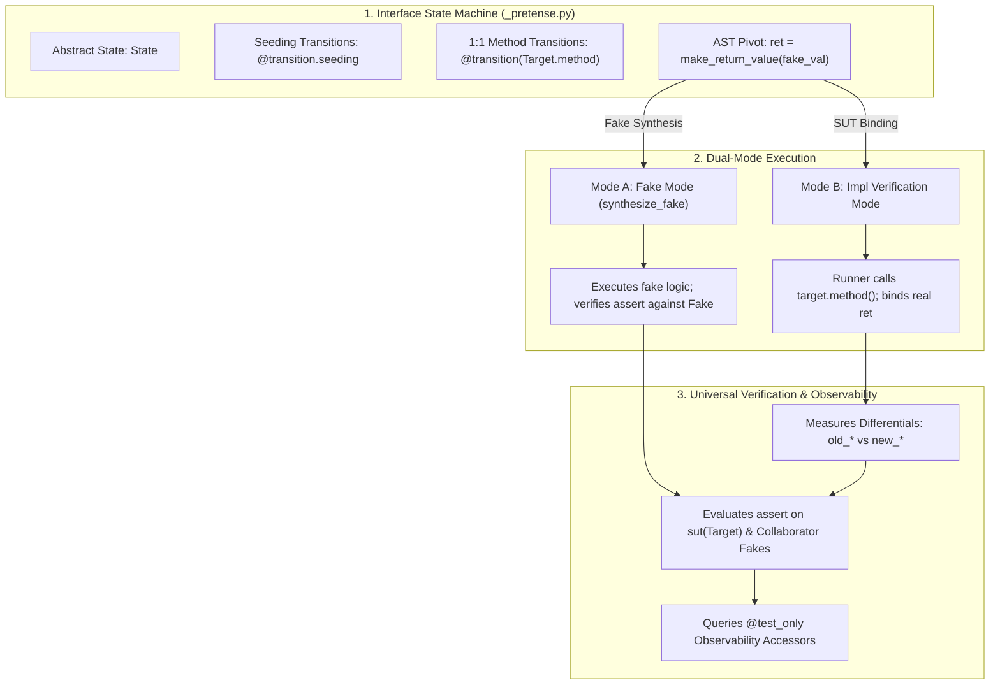

# Pretense: Stateful State-Machine Verification, Verified Fake Synthesis, and AST-Driven Contracts in Autofab (`pretense.md`)

## Table of Contents

1. [Executive Summary & Terminology Lexicon](#1-executive-summary--terminology-lexicon)
   - [Standardized Terminology Lexicon](#standardized-terminology-lexicon)
2. [Empirical Genesis: Cross-Model Differential Defect Analysis & Coincident Cognitive Blind Spots](#2-empirical-genesis-cross-model-differential-defect-analysis--coincident-cognitive-blind-spots)
   - [The Empirical Phenomenon & Cross-Model Outcomes](#the-empirical-phenomenon--cross-model-outcomes)
   - [Anatomy of the Three Undetected Defects](#anatomy-of-the-three-undetected-defects)
   - [Theoretical Analysis: Why Single-Model Autofab Missed These Defects](#theoretical-analysis-why-single-model-autofab-missed-these-defects)
   - [The Structural Coverage Illusion: Statement & Branch Reachability $\ne$ Permutation Coverage](#the-structural-coverage-illusion-statement--branch-reachability--permutation-coverage)
   - [Why Foreign Models Did Not Share the Blind Spots](#why-foreign-models-did-not-share-the-blind-spots)
   - [Architectural Remedies: The Necessity of Pretense](#architectural-remedies-the-necessity-of-pretense)
3. [Post-Mortem: Anatomical Failure of Pretense 1 on `lru_cache`](#3-post-mortem-anatomical-failure-of-pretense-1-on-lru_cache)
   - [The Multi-Transition Explosion & Discriminator Fragility](#the-multi-transition-explosion--discriminator-fragility)
   - [The Absence of AST Processing: The `_run_pass1` Mock Execution Trap](#the-absence-of-ast-processing-the-_run_pass1-mock-execution-trap)
   - [The One-Sided QA Blame Loop](#the-one-sided-qa-blame-loop)
   - [The Bogus `ensure(...)` in Interface State Machines](#the-bogus-ensure-in-interface-state-machines)
4. [Foundational Architectural Principles](#4-foundational-architectural-principles)
   - [Principle 1: Strict 1:1 Transitions with Method Symbol Typing](#principle-1-strict-11-transitions-with-method-symbol-typing)
   - [Principle 2: Natural Python Branching Over Multi-Transition Splitting](#principle-2-natural-python-branching-over-multi-transition-splitting)
   - [Principle 3: The Epistemic Boundary of Interface State Machines](#principle-3-the-epistemic-boundary-of-interface-state-machines)
   - [Principle 4: Universal Unification into Native Python `assert` (Single-Argument Enforcement)](#principle-4-universal-unification-into-native-python-assert-single-argument-enforcement)
   - [Principle 5: Defensive Dead-Ends & Coverage Exemption via `unreachable()`](#principle-5-defensive-dead-ends--coverage-exemption-via-unreachable)
   - [Principle 6: Universal Verification of Assertions in Fakes](#principle-6-universal-verification-of-assertions-in-fakes)
   - [Principle 7: Interface-Level Fake Property Fuzzing](#principle-7-interface-level-fake-property-fuzzing)
   - [Principle 8: Pre-State Snapshots & Differentials via AST Chopping](#principle-8-pre-state-snapshots--differentials-via-ast-chopping)
   - [Principle 9: The Implementation Pseudo State Machine (`call_target`)](#principle-9-the-implementation-pseudo-state-machine-call_target)
   - [Principle 10: Dynamic Scope for Collaborators & In-Component SUTs](#principle-10-dynamic-scope-for-collaborators--in-component-suts)
   - [Principle 11: Test-Only Query Methods (`@test_only`) & Epistemic Traceability](#principle-11-test-only-query-methods-test_only--epistemic-traceability)
   - [Principle 12: Symmetrical QA Blame Attribution](#principle-12-symmetrical-qa-blame-attribution)
   - [Principle 13: AST Chopping & Compile-Time Validation](#principle-13-ast-chopping--compile-time-validation)
   - [Principle 14: Prohibition of Pre-Seeding & Blank Initial State Invariant](#principle-14-prohibition-of-pre-seeding--blank-initial-state-invariant)
   - [Principle 15: Collaborator Seeding Transitions in Implementation Fuzz Testing](#principle-15-collaborator-seeding-transitions-in-implementation-fuzz-testing)
   - [Principle 16: Cross-Collaborator Outcome Assertions](#principle-16-cross-collaborator-outcome-assertions)
   - [Principle 17: Inter-Interface Requirements & Model Assertions](#principle-17-inter-interface-requirements--model-assertions)
   - [Principle 18: Multi-Interface Implementations (`implements: B, C`)](#principle-18-multi-interface-implementations-implements-b-c)
   - [Principle 19: Interface Fixed Conformance Testing (`Test<Target>Fake`)](#principle-19-interface-fixed-conformance-testing-testtargetfake)
   - [Principle 20: Base Interface Transition Delegation & Onion Dispatch](#principle-20-base-interface-transition-delegation--onion-dispatch)
5. [Contract Exception Taxonomy: `*Error` vs. `*Exception` & Untestability of Preconditions](#5-contract-exception-taxonomy-error-vs-exception--untestability-of-preconditions)
   - [The Semantic Taxonomy](#the-semantic-taxonomy)
   - [Untestability of `*Error` (Checked Caller Preconditions)](#untestability-of-error-checked-caller-preconditions)
   - [Specification Docstring Contract (`low/*.pyi`)](#specification-docstring-contract-lowpyi)
   - [Static AST Linter Enforcement (`[NO_ERROR_TESTING]`)](#static-ast-linter-enforcement-no_error_testing)
   - [Coverage Engine Auto-Exclusion of Preconditions & `unreachable()`](#coverage-engine-auto-exclusion-of-preconditions--unreachable)
   - [Auditor Circuit Breakers & High-Salience Guidance](#auditor-circuit-breakers--high-salience-guidance)
6. [Empirical Synthesis: Why Multi-Agent Unit Tests Outperformed Pretense on `deepseek-flash`](#6-empirical-synthesis-why-multi-agent-unit-tests-outperformed-pretense-on-deepseek-flash)
   - [The Empirical Benchmark Telemetry](#the-empirical-benchmark-telemetry)
   - [The Two-State Synchronization Problem (Dual States in Lockstep)](#the-two-state-synchronization-problem-dual-states-in-lockstep)
   - [Pre-Training Distribution vs. Custom DSL (Cognitive Load on Fast Models)](#pre-training-distribution-vs-custom-dsl-cognitive-load-on-fast-models)
   - [Deterministic Assertion Diffs vs. Shrunk Fuzzing Counterexamples](#deterministic-assertion-diffs-vs-shrunk-fuzzing-counterexamples)
   - [The Checked Precondition Trap (`*Error` vs. Contract Violations)](#the-checked-precondition-trap-error-vs-contract-violations)
   - [Code Volume & Context Bloat](#code-volume--context-bloat)
7. [Why Stateful Fuzzing Misses Targeted Contract Postconditions (The Horizon & Tautology Problem)](#7-why-stateful-fuzzing-misses-targeted-contract-postconditions-the-horizon--tautology-problem)
   - [The Exponential Horizon of Random Walks ($P = (1/N)^k$)](#the-exponential-horizon-of-random-walks-p--1nk)
   - [The Abstract Model Tautology Effect ($SUT \equiv Model_{SM}$)](#the-abstract-model-tautology-effect-sut-equiv-model_sm)
   - [The Coverage Backpressure Asymmetry on Omission Defects (Case Study: Node Re-Registration)](#the-coverage-backpressure-asymmetry-on-omission-defects-case-study-node-re-registration)
   - [Precondition Gating as a State-Space Pruning Knife](#precondition-gating-as-a-state-space-pruning-knife)
   - [Accidental vs. Essential Complexity in Verification](#accidental-vs-essential-complexity-in-verification)
   - [The Dual Requirement: Stateful Fuzzing + Concrete Scenario Drivers](#the-dual-requirement-stateful-fuzzing--concrete-scenario-drivers)
8. [Component Architecture: Interface State Machine vs. Impl Pseudo State Machine](#8-component-architecture-interface-state-machine-vs-impl-pseudo-state-machine)
   - [Interface State Machine (`<name>_pretense.py`)](#interface-state-machine-name_pretensepy)
   - [Implementation Pseudo State Machine (`<name>_impl_pretense.py`)](#implementation-pseudo-state-machine-name_impl_pretensepy)
   - [Seeding Transitions & Fakes Outside Default Initialization](#seeding-transitions--fakes-outside-default-initialization)
   - [Cross-Component Precondition Composition](#cross-component-precondition-composition)
   - [Multi-Interface Composition & Transition Inheritance](#multi-interface-composition--transition-inheritance)
   - [Streamlined Component Boundaries: Interface Conciseness vs Implementation Grounding](#streamlined-component-boundaries-interface-conciseness-vs-implementation-grounding)
9. [End-to-End Concrete Reference: `LRUCache`](#9-end-to-end-concrete-reference-lrucache)
   - [Low-Level Specification with `@test_only` (`low/lru_cache.pyi`)](#low-level-specification-with-test_only-lowlru_cachepyi)
   - [Interface State Machine (`pretense/lru_cache_pretense.py`)](#interface-state-machine-pretenselru_cache_pretensepy)
   - [Implementation Pseudo State Machine & Tests (`pretense/lru_cache_impl_pretense.py`)](#implementation-pseudo-state-machine--tests-pretenselru_cache_impl_pretensepy)
10. [The Pretense CLI Runner, Linter, & Verifier Architecture](#10-the-pretense-cli-runner-linter--verifier-architecture)
    - [AST Chopping & Compilation Pipeline](#ast-chopping--compilation-pipeline)
    - [Static AST Validation in `pretense_lint.py`](#static-ast-validation-in-pretense_lintpy)
11. [Role Architecture & Circuit Breaker Governance](#11-role-architecture--circuit-breaker-governance)
    - [Roles: `pretense`, `pretense_qa`, `pretense_coverage`](#roles-pretense-pretense_qa-pretense_coverage)
    - [Symmetrical Blame Attribution](#symmetrical-blame-attribution)
    - [Auditor Circuit Breaker: Kill/Restart on Repetitive Blame](#auditor-circuit-breaker-killrestart-on-repetitive-blame)
12. [Empirical Benchmarking: Pretense as a Baseline Equalizer](#12-empirical-benchmarking-pretense-as-a-baseline-equalizer)
    - [Empirical Cross-Model Telemetry (`dag_engine_lite`)](#empirical-cross-model-telemetry-dag_engine_lite)
    - [Cost-Efficiency Dynamics](#cost-efficiency-dynamics)
    - [Empirical Multi-Component & Cross-Interface Telemetry (`task_queue`, `inter_interface`, `multi_interface`)](#empirical-multi-component--cross-interface-telemetry-task_queue-inter_interface-multi_interface)
13. [Comparative Evolution Matrix](#13-comparative-evolution-matrix)

---

## 1. Executive Summary & Terminology Lexicon

Empirical benchmarking across model tiers on `dag_engine_lite` revealed a critical blind spot in LLM-generated software verification:
1. **AST Statement & Branch Coverage Is Shallow**: A test suite achieving 95% line coverage and 90% branch coverage greenlit three genuine soundness bugs (off-by-one retry accounting, node re-registration stale edge accumulation, and cross-component scheduler desynchronization).
2. **Mutation Testing (`mutmut`) Is Orthogonal, Not Obsolete**: AST mutators can only mutate syntax lines that exist. If an implementation omits a state cleanup or synchronization loop entirely, there is no syntax for `mutmut` to mutate, and the omission passes silently. Pretense's differential state fuzzing ($Lib \equiv Spec$) covers the **omission class** that mutation testing structurally cannot see.
3. **Open-Ended "Chaos Testers" Lack a Termination Metric**: Asking an LLM to author arbitrary "chaos" or "edge-case" tests without an objective stopping condition degrades into unbound token consumption with no mathematical convergence criteria.

This design document establishes **Pretense**—Autofab's unified state-machine-driven testing, verification, and fake synthesis engine. Powered by Hypothesis's conjecture fuzzing engine (`hypothesis.stateful.RuleBasedStateMachine`), Pretense forces models to verify state-transition invariants through bounded, deterministic search, minimal-trace shrinking, automatic fake synthesis, and AST-chopped 1:1 transitions.

### Standardized Terminology Lexicon

To prevent conflation across specifications, state machines, implementations, and test harnesses, Pretense establishes a strict terminology standard:

| Term | Exact Definition | Canonical Location |
| :--- | :--- | :--- |
| **The Specification** | The authoritative, declarative contract of record. Defines *what* contracts, types, protocols, postconditions, and invariants must hold, without mandating procedural algorithms. | `high/*.md`, `planning/*.md`, `low/*.pyi` |
| **Pretense State Machine** | An **executable state transition model** written in Python (transitions, antecedents, abstract collections). It is an executable artifact derived from the specification, **NOT** a synonym for the specification itself! | `parts/*/pretense/*_pretense.py` |
| **Pretense Fake Adapter** | A concrete runtime object conforming to an interface `Protocol`, synthesized from an interface state machine (`synthesize_fake(StateMachine)`) to be injected into consumers. | Synthesized runtime fake |
| **Implementation Pseudo State Machine** | An implementation-level harness subclassing the interface state machine with zero state variables of its own, using `call_target()` to verify private differentials and bind the real SUT. | `parts/*/pretense/*_impl_pretense.py` |
| **Test Driver** | An outward-calling harness instantiated from a state machine to drive concrete implementations (adversarial fuzzer in Hypothesis or static scenario runner in unit tests). | Harness runtime wrapper |
| **Intra-Component Objects** | Concrete classes defined within the same component's `_impl` module. They are real and tested together in lockstep (zero internal faking). | `parts/<name>/lib/*_impl.py` |
| **Inter-Component Collaborators**| External singletons imported from other components. Modeled via imported interface state machines and injected as fake adapters. | `parts/<other>/low/*.pyi` |
| **Step** | A single prompt $\leftrightarrow$ tool-call interaction cycle between an agent and the harness. | Runtime interaction step |
| **Round** | A full Autofab role dispatch wave across assigned targets until completion, blame, or exhaustion. | Role dispatch pass |

---

## 2. Empirical Genesis: Cross-Model Differential Defect Analysis & Coincident Cognitive Blind Spots

### The Empirical Phenomenon & Cross-Model Outcomes

In the empirical evaluation of Autofab architectures against traditional software engineering baselines on the `dag_engine_lite` benchmark suite, the single-model Autofab run using **Qwen3.6-35B-A3B-oQ6-mtp** (Tier 1 Local MoE) achieved an ostensibly perfect verification outcome:
- **Internal Autofab Status**: Verified & Passed (Pass 1 and Pass 2 gates cleared).
- **Static Type Checking**: 0 Pyright diagnostics.
- **Self-Authored Test Suite ($V_{\text{self}} \to P_{\text{self}}$)**: 60/60 tests passing (100%).
- **Structural Code Coverage**: 95.0% Statement Coverage, 90.0% Branch Coverage.
- **Specification Linter Diagnostics**: 0 errors.

Under standard software engineering quality metrics, this library implementation ($P_{\text{qwen}}$) would be certified for production deployment. Furthermore, because Autofab enforced strict double-blind physical isolation ($\mathcal{I} = 0$) between the Synthesizer workspace ($W_{\text{lib}}$) and the Certifier workspace ($W_{\text{test}}$), the test suite did not suffer from the classic **Contamination Trap** of single-agent joint context TDD (where an agent rewrites test assertions to tautologically affirm broken code).

However, when independent foreign test suites authored from the exact same formal Low-Level Specification (`low/*.pyi`) by different model families (**DeepSeek-V3/Flash**, **Gemini 3.8 Flash**, and **Gemini 4 Argon**) were executed against Qwen's Autofab implementation via the differential cross-testing runner (`bin/run_cross_tests.py`), **three genuine soundness defects** were immediately exposed:

```
┌────────────────────────────────────────────────────────────────────────────────────────┐
│               CROSS-MODEL DIFFERENTIAL VERIFICATION OUTCOMES (ON P_qwen)               │
├────────────────────────────────────────────────────────────────────────────────────────┤
│                                                                                        │
│   Certifier Test Suite (V)             Pass / Fail Rate   Soundness Status             │
│   ──────────────────────────────────   ────────────────   ──────────────────────────   │
│   Qwen Autofab (Self: V_qwen)          60 / 60 (100.0%)   PASS (Coincident Blind Spot) │
│   DeepSeek Autofab (V_deepseek)        47 / 48 ( 97.9%)   FAIL (Off-by-One Retry Bug)  │
│   Gemini 3.8 Flash (V_gemini_flash)    32 / 36 ( 88.9%)   FAIL (3 Defects Exposed)     │
│   Gemini 4 Argon (V_gemini_argon)      19 / 20 ( 95.0%)   FAIL (Dynamic Retry Bug)     │
│                                                                                        │
└────────────────────────────────────────────────────────────────────────────────────────┘
```

---

### Anatomy of the Three Undetected Defects

#### Defect 1: Off-by-One Retry Accounting on Action Recovery (`DAGRunner.run`)

##### The Formal Contract (`low/dag_engine_lite.pyi`)
```python
@dataclass(frozen=True)
class NodeResult(Generic[T]):
    node_id: str
    state: NodeState
    value: Optional[T] = None
    error: Optional[Exception] = None
    duration_seconds: float = 0.0
    retries_attempted: int = 0
```
- **Contract Invariant**: An execution consists of 1 initial invocation (`attempt 0`) plus up to $N$ retry invocations (`attempt 1 .. N`). If an action fails once and succeeds on the second try, exactly **1 retry** was executed (`retries_attempted == 1`). If it fails twice and succeeds on the third try, exactly **2 retries** were executed (`retries_attempted == 2`).

##### Qwen's Implementation Flaw (`P_qwen: lib_1.py:927`)
```python
retries_attempted = 0
caught_exc: Optional[Exception] = None
action_value: Any = None
for attempt in range(1 + max_retries):
    try:
        action_value = definition.action()
        node_succeeded = True
        break
    except Exception as exc:
        caught_exc = exc
        if attempt > 0:
            retries_attempted += 1
```
- **The Defect**: Qwen placed `if attempt > 0: retries_attempted += 1` inside the `except` block.
  - If `attempt 0` fails: `attempt > 0` is `False`, so `retries_attempted` remains `0`.
  - If `attempt 1` executes and **succeeds**: the loop sets `node_succeeded = True` and breaks out. It **never reaches the `except` block**!
  - `retries_attempted` remains `0`, even though 1 retry was executed!
- **Why Self-Tests Missed It**: Qwen tested only total exhaustion failure (`still_failing()`), where all attempts fail and hit `except`.

---

#### Defect 2: Node Re-Registration Stale Edge Accumulation (`DAG.add_node`)

##### The Formal Specification vs. The Reasonable Implicit Specification
In [low/dag_engine_lite.pyi](file:///Users/seanmcdirmid/projects/cleanroom/benchmarks/parts/dag_engine_lite/low/dag_engine_lite.pyi), the contract for `add_node` explicitly states:
```python
def add_node(
    self,
    node_id: str,
    action: Callable[[], Any],
    dependencies: Optional[Collection[str]] = None,
    priority: int = 0,
    retries: int = 0,
) -> None:
    """Adds a task node to the graph.

    Args:
        node_id: Unique string identifier for the node.
        action: Zero-argument callable representing node computation.
        dependencies: Optional collection of upstream node identifiers.
        priority: Scheduling priority (higher executes earlier).
        retries: Number of permitted retry attempts upon exception.

    POSTCONDITIONS:
    - MUST register the node definition into the graph.
    - WHEN dependencies are provided, MUST add directed dependency edges from each dependency to node_id.
    - MUST defer missing dependency existence checks to validate() and topological_sort() without eagerly raising NodeNotFoundError.
    """
```

**An Under-Specified Behavior with a Reasonable Implicit Specification**:
Notice that the specification defines `node_id` as a `"Unique string identifier"`, but is **completely silent on overwriting or re-registration**:
- It does not explicitly declare that re-registering an existing node replaces the definition.
- Nor does it declare a checked precondition error (e.g. `DuplicateNodeError`) forbidding re-registration.
- However, **a reasonable implicit specification exists**:
  1. In standard mapping semantics, inserting a definition into `_nodes` with an existing `node_id` replaces the previous `NodeDefinition`.
  2. The contract invariant across the graph mandates consistency between definitions and adjacency:
     $$\text{dag.get\_dependencies}(node\_id) \equiv \text{dag.get\_node}(node\_id).\text{dependencies}$$
  3. Therefore, if `add_node` allows re-registration, it implicitly mandates that previously registered dependency edges must be detached so that adjacency queries (`get_dependencies`, `get_dependents`) do not accumulate stale ghost edges that contradict the newly registered definition.

##### Qwen's Implementation Flaw (`P_qwen: lib_1.py:598`)
```python
def add_node(self, node_id: str, action: Callable[[], Any], dependencies=None, priority=0, retries=0) -> None:
    deps = frozenset(dependencies) if dependencies else frozenset()
    definition = dag_engine_lite.NodeDefinition(node_id, action, deps, priority, retries)
    self._nodes[node_id] = definition
    if node_id not in self._upstream:
        self._upstream[node_id] = set()
    if node_id not in self._downstream:
        self._downstream[node_id] = set()
    for dep in deps:
        self.add_edge(dep, node_id)
```
- **The Defect**: Following the literal wording of the grounding rather than the implicit consistency invariant, `add_node` overwrites `self._nodes[node_id]`, but **fails to remove existing dependency edges** from `self._upstream[node_id]` or `self._downstream[old_dep]`.
- If node `target` was initially registered with `dependencies=["dep1"]`, and then re-registered with `dependencies=["dep2"]`, `add_edge("dep2", "target")` adds the new edge, but the incoming edge from `dep1` remains in `self._upstream["target"]`!
- Calling `dag.get_dependencies("target")` returns `{"dep1", "dep2"}` while `dag.get_node("target").dependencies` returns `{"dep2"}`.
- **Cognitive Divergence**: **Gemini 3.8 Flash** deduced the reasonable implicit specification (re-registration as upsert with edge replacement) and aggressively tested it. **Qwen** only considered the literal, initial-insertion case.

---

#### Defect 3: Cross-Component State Desynchronization on Node Removal (`WaveScheduler`)

##### The Formal Contract (`low/dag_engine_lite_impl.pyi`)
```python
@singleton_type("system")
class WaveScheduler(dag_engine_lite.WaveScheduler):
    """Concrete realization of sequential wave scheduler.
    GROUNDING:
    - Maintains scheduling state across _dag and _states dictionary.
    - Synchronizes dynamic node state by discovering registered nodes from _dag.all_nodes().
    """
```

##### Qwen's Implementation Flaw (`P_qwen: lib_1.py:773`)
```python
def _sync_states(self) -> None:
    all_nodes = self._dag.all_nodes()
    for node_id in all_nodes:
        if node_id not in self._states:
            deps = self._dag.get_dependencies(node_id)
            if not deps:
                self._states[node_id] = dag_engine_lite.NodeState.READY
            else:
                self._states[node_id] = dag_engine_lite.NodeState.PENDING
```
- **The Defect**: `_sync_states` is unidirectional additive. It scans `self._dag.all_nodes()` and adds new nodes to `self._states`.
- If a caller invokes `dag.remove_node("removable")`, the node is removed from the DAG. When `scheduler.get_all_states()` is invoked, `_sync_states()` runs, but does **not purge** keys from `self._states` that are no longer in `self._dag.all_nodes()`. The removed node remains indefinitely in the scheduler's state dictionary as a zombie node.

---

### Theoretical Analysis: Why Single-Model Autofab Missed These Defects

Autofab's double-blind isolation enforces an information-theoretic barrier:
$$\mathcal{I}(W_{\text{test}}; W_{\text{lib}}) = 0$$
The Certifier cannot read the Synthesizer's code, cannot inspect its variable names, and cannot modify assertions to match the Synthesizer's runtime behavior.

However, if both $W_{\text{lib}}$ and $W_{\text{test}}$ are driven by the same frozen model weights ($\theta$), they sample from identical probability distributions over semantic interpretations:
$$P(M \mid S, \theta)$$
When an interface contract is multi-faceted:
1. **The Synthesizer** samples an implementation that addresses the most salient interpretation of the contract (e.g. retry exhaustion).
2. **The Certifier**, prompted with the same specification text and governed by the same statistical priors, samples test cases for *that exact same salient interpretation*.
3. Because both agents share the same cognitive blind spot, neither agent conceives of the complementary edge case.
4. The Certifier writes tests that certify the Synthesizer's incomplete implementation with 100% mathematical pass rates, producing a **Coincident Error**:
$$P\left(V_\theta(P_\theta) = \mathbf{PASS} \;\middle|\; V_{\text{oracle}}(P_\theta) = \mathbf{FAIL}\right) > 0$$

---

### The Structural Coverage Illusion: Statement & Branch Reachability $\ne$ Permutation Coverage

Autofab recorded 95.0% statement coverage and 90.0% branch coverage on Qwen's library. This exposes the fundamental flaw of relying exclusively on AST-based structural code coverage:
1. **The Branch Coverage Trap on Defect 1**:
   When Qwen's test suite executed `test_run_retries_on_failure` (exhausting 3 attempts), on attempt 0 `attempt > 0` was `False`, and on attempts 1 and 2 it was `True`. Both branches were 100% covered. Yet the logic was completely broken for any action that recovered on attempt 1!
2. **The State-Space Permutation Blind Spot on Defects 2 and 3**:
   Structural coverage only records that syntax lines were executed; it does not measure whether the state-space transition graph $(\mathcal{S} \times \mathcal{A} \to \mathcal{S}')$ was explored across multi-action sequences (e.g. `add(A)` $\to$ `add(A, new_deps)` or `init_scheduler()` $\to$ `remove(B)` $\to$ `sync()`).

---

### Why Foreign Models Did Not Share the Blind Spots

When independent models authored test suites from the identical `low/*.pyi` specification, their differing training distributions and reasoning priors generated radically different adversarial tests:
- **DeepSeek-V3 / Flash**: Focused on execution-trace loop invariants, authoring an action recovery test on retry 2.
- **Gemini 3.8 Flash**: Focused on idempotency and dynamic reconfiguration, testing re-registration edge detachment and dynamic node removal synchronization.
- **Gemini 4 Argon**: Focused on failure policies and state consistency.

Because their cognitive priors were uncorrelated:
$$\mathcal{I}(\text{Prior}_{\text{foreign}}; \text{Prior}_{\text{qwen}}) \approx 0$$
The cross-model differential pass rate plummeted, exposing defects that homogeneous self-testing could never detect.

---

### Architectural Remedies: The Necessity of Pretense

Physical isolation alone is insufficient if agents share identical cognitive biases. Pretense permanently closes this vulnerability through:
1. **Hypothesis State Machines**: Transition-space fuzzing replaces example-based static sequences with thousands of randomized action permutations ($S \times A \to S'$).
2. **Minimal Shrinking Traces**: Falsifications shrink to minimal 2-step counterexamples for instant blame attribution.
3. **Automatic Fake Synthesis**: Decouples inter-component dependencies so tests cannot mask partner desynchronizations.
4. **Pretense as an Equalizer**: Bridges the gap between single-model baselines and multi-agent Autofab pipelines.

---

## 3. Post-Mortem: Anatomical Failure of Pretense 1 on `lru_cache`

During the empirical evaluation of `qwen-moe` on `lru_cache` under `--pretense`, the legacy Pretense (v1) framework failed at wave 100 with 101 rounds (`lib:51`, `pretense:1`, `pretense_qa:49`):

### The Multi-Transition Explosion & Discriminator Fragility
Legacy Pretense mandated that each distinct operational outcome or exception branch declare a separate `@transition` function (`configure_positive_capacity`, `configure_zero_capacity`, `get_hit`, `get_miss`). This forced models to invent naming schemes and maintain brittle, mutually exclusive input guards. When a test drove an input that missed candidate discriminators, execution halted with `NoMatchingTransitionError`.

### The Absence of AST Processing: The `_run_pass1` Mock Execution Trap
Legacy Pretense omitted runtime AST processing, attempting dynamic reflection via speculative execution with dummy `TransitionContext` and `Expr` objects:
```python
# Legacy pretense.py execution snippet:
def _run_pass1(state: Any, this: Any):
    arg_exprs = [Expr(name=p.name) for p in arg_params]
    ctx = TransitionContext(target=None, ...)
    ctx._in_pass1 = True
    call_args = [*arg_exprs, ctx]
    raw_fn(active_sm, *call_args)  # Speculatively executes with dummy objects!
```
When models wrote standard Python calls on `target`, `TransitionContext` threw runtime `AttributeError: 'TransitionContext' object has no attribute 'configure'`, completely baffling the agent.

### The One-Sided QA Blame Loop
Because `pretense_qa.md` lacked symmetrical blame attribution, the QA arbiter assumed any test failure was an implementation defect. It blamed `lib` **49 consecutive times**, while the broken `pretense` role sat untouched, producing an unresolvable 100-wave deadlock.

### The Bogus `ensure(...)` in Interface State Machines
In legacy Pretense, interface state machines contained postcondition assertions (`ensure(target.size == ...)`). But when synthesized into a fake (`FakeLRUCache = synthesize_fake(LRUCacheStateMachine)`), there was **no target object under test**—the fake *was* the object, resulting in runtime proxy crashes.

---

## 4. Foundational Architectural Principles



### Principle 1: Strict 1:1 Transitions with Method Symbol Typing
Every public method in `low/<name>.pyi` has **exactly one** corresponding transition in the interface state machine:
- Decorated with `@transition(TargetClass.method)`, passing the explicit method symbol.
- Parameter names, types, and defaults are statically verified by linters and type checkers.
- Function name matches the method name 1:1 (`def get(...)`, `def put(...)`). Discriminator scoring and `NoMatchingTransitionError` are completely eliminated.

### Principle 2: Natural Python Branching Over Multi-Transition Splitting
Instead of splitting a method across multiple transitions, **a single transition uses standard Python branching (`if/else`) and exception contexts (`with raises(...)`)**:
```python
@transition(LRUCache.remove)
def remove(self, key: str) -> Any:
    require_arg(key, Domain.text())
    if key in self.state.items:
        fake_val = self.state.items.pop(key)
        ret = make_return_value(fake_val)
        assert ret == fake_val
        return ret
    else:
        with raises(CacheKeyNotFoundError):
            make_return_value(None)
        raise CacheKeyNotFoundError()
```

### Principle 3: The Epistemic Boundary of Interface State Machines
An interface state machine is an **epistemic shadow** of the implementation. It can only be parameterized by the implementation through **return values**.
1. **Preconditions Cannot Access `target`**: `requires(...)` preconditions and `require_arg(...)` domains are evaluated *before* the method is invoked, and must evaluate strictly on `self.state` and input arguments. Preconditions can **never** inspect `target` or call its methods.
2. **Opaque Evictions & Non-Deterministic Behaviors**: If an implementation makes an internal state decision (such as evicting an arbitrary cache entry) and that decision is not communicated in the return value:
   - The interface state machine cannot know which key was evicted.
   - Subsequent method preconditions cannot gate on key presence (`requires(key in self.state)` is prohibited).

### Principle 4: Universal Unification into Native Python `assert` (Single-Argument Enforcement)
All postconditions, pre-state invariant checks, and internal assertions are unified into native Python `assert`:
```python
assert condition
```
#### Mandatory Single-Argument Assertions (No Message String)
In Pretense, **single-argument assertions (`assert condition`) are strictly enforced by AST linters (`[PRE_LINT_ASSERT_SINGLE_ARG]`)**:
1. **Pytest Introspection**: Pytest automatically displays sub-expression trees on failure (`AssertionError: assert 3 == 4, where 3 = sut(LRUCache).size`). Message strings are redundant.
2. **Elimination of the Truthy Tuple Bug**: Writing `assert (condition, "msg")` creates a 2-tuple that evaluates to `True` in Python, **silently passing even when condition is False**! Enforcing single-argument assertions eliminates this failure mode entirely.
3. **Zero Semantic Drift**: Eliminates out-of-date or hallucinated error messages.

### Principle 5: Defensive Dead-Ends & Coverage Exemption via `unreachable()`
Library code frequently contains defensive branches or assertions protecting internal invariants guaranteed by caller assumptions. Pretense provides the `unreachable(...)` primitive:
```python
from pretense import unreachable

if impossible_state_condition:
    unreachable("Caller invariant guarantees state is never empty")
```
Lines marked with `unreachable(...)` are automatically excluded from statement and branch coverage metrics. If the assumption is violated, Hypothesis property fuzzing crashes immediately with an `AssertionError` and shrinks the minimal failing counterexample.

### Principle 6: Universal Verification of Assertions in Fakes
Synthesized fakes (`Fake<Iface> = synthesize_fake(<Iface>StateMachine)`) implement the full interface and `@test_only` accessors. Therefore, **`assert` statements are evaluated in Fake mode as well**:
- When executing in Fake mode, `sut(TargetClass)` resolves to the active `Fake<Target>` instance.
- When `assert sut(LRUCache).size == len(self.state.items)` runs on a fake, it queries `fake.size` and verifies that the fake's internal state machine faithfully updates its observable properties.

### Principle 7: Interface-Level Fake Property Fuzzing
Because fakes execute under the full contract of `assert`, the interface component (`pretense/<name>_pretense.py`) includes **Hypothesis property fuzzing of the synthesized Fake**:
```python
FakeLRUCacheFuzzTest = compile_hypothesis_test_case(LRUCacheStateMachine, FakeLRUCache)
```
Fuzzing explores thousands of random transition sequences against `Fake<Target>`, guaranteeing that downstream components receive a certified, fully verified in-memory fake.

### Principle 8: Pre-State Snapshots & Differentials via AST Chopping
Many formal postconditions are state differentials ($\Delta = \text{new} - \text{old}$):
```python
@transition(LRUCache.get)
def get(self, key: str, default: Optional[Any] = None) -> Any:
    # 1. PRE-CALL SLICE (Evaluates BEFORE SUT runs)
    assert sut(LRUCache).size == len(self.state.items)
    old_hits = sut(LRUCache).hits
    
    # 2. THE AST PIVOT (Split point for AST Chopper)
    fake_val = self.state.items.get(key, default)
    ret = make_return_value(fake_val)
    
    # 3. POST-CALL SLICE (Evaluates AFTER SUT runs)
    if key in self.state.items:
        self.state.hits += 1
        assert sut(LRUCache).hits == old_hits + 1
        
    return ret
```
The AST compiler automatically slices pre-pivot statements into `_pre_<method>`, invokes the target, and slices post-pivot statements into `_post_<method>`.

### Principle 9: The Implementation Pseudo State Machine (`call_target`)
The implementation layer is termed an **Implementation Pseudo State Machine** (`<Impl>PseudoStateMachine`):
- Owns **zero state variables of its own** and defines no independent state transitions.
- Shares `<Iface>State` directly.
- Contains **zero `require_arg` statements**; all parameter domains and strategies are inherited from the interface state machine (`PN_IMPL_NO_REQUIRE_ARG`).
- Does **never mutate `self.state` directly** (`PN_IMPL_NO_STATE_MUTATION`). The runtime linear transition execution automatically runs the base interface transition first to evaluate preconditions, generate domain values, and mutate model state, delegating via `make_return_value` to the implementation override.
- Uses `ret = call_target(target.method(*args))` as the AST pivot to capture private SUT pre-state snapshots and verify private differentials:
```python
class LRUCacheImplPseudoStateMachine(LRUCacheStateMachine):
    @transition(LRUCache.put)
    def put(self, key: str, value: Any) -> Any:
        target: LRUCache = sut(LRUCache)
        old_nodes = len(target._items)
        ret = call_target(target.put(key, value))
        assert len(target._items) == len(self.state.items)
        return ret
```

### Principle 10: Dynamic Scope for Collaborators & In-Component SUTs
All objects under test and collaborating singletons are accessed via dynamic scope: `sut(TargetClass)`. In Fake Mode, it resolves to the active fake; in Verification Mode, to the concrete implementation.

### Principle 11: Test-Only Query Methods (`@test_only`) & Epistemic Traceability
To allow black-box verification of internal postconditions without violating encapsulation, `low/<name>.pyi` declares `@test_only` query accessors:
```python
@test_only
@property
def eviction_count(self) -> int: ...
```
`lib/*.py` is strictly forbidden by AST linters from calling any `@test_only` method (`[LIB_LINT_TEST_ONLY_CALLED]`).

### Principle 12: Symmetrical QA Blame Attribution
In `pretense_qa.md`, failures during cross-testing or state machine execution are evaluated symmetrically:
1. **Test Provider Defect (Blame `pretense`)**: Bad domains, transition crashes, unmodeled preconditions, or contradictions against `low/*.pyi`.
2. **Library Defect (Blame `lib`)**: Violation of explicit contracts mandated by `low/*.pyi`.
3. **Prohibition on Blaming Passing Targets**: When test suites pass (100%), the auditor is strictly forbidden from blaming either role based on speculative prose.

### Principle 13: AST Chopping & Compile-Time Validation
Original Pretense's speculative `_run_pass1` is replaced with **static AST analysis** in `pretense_lint.py`:
- Parses transition functions at edit time.
- Chops the AST at pivot nodes (`make_return_value` in interface; `call_target()` in impl pseudo state machine).
- Validates that `requires` and `require_arg` appear before the pivot, snapshots `old_*` are assigned before the pivot, and assertions conform to single-argument rules.

### Principle 14: Prohibition of Pre-Seeding & Blank Initial State Invariant
In multi-component architectures, components under test interact with external collaborator singletons. A recurring failure mode in early benchmarks was **static pre-seeding**: test authors populated collaborator states inside `make_sut()` or `setUp()` fixtures (e.g., pre-enqueuing 10 tasks into a collaborator queue so that `TaskWorker.fetch_and_execute()` would not encounter an empty queue).
- **Why Pre-Seeding is Defective**:
  1. *State Exhaustion*: In a 50-step Hypothesis stateful fuzzing run, 10 pre-seeded tasks are drained within the first 10 steps, leaving the queue empty for the remaining 40 steps.
  2. *Loss of Dynamic Interleaving*: Static fixtures fail to explore dynamic operation interleavings (e.g. `submit` $\to$ `fetch` $\to$ `submit` $\to$ `submit` $\to$ `fetch`).
  3. *Masked Failure Branches*: Operational failures (e.g., backing service unavailability) cannot be randomly injected mid-run.
- **The Blank Initial State Rule**: All SUT instances and collaborator fakes initialized in `make_sut()`, `setUp()`, or test fixtures **must start in blank (default initial) states**.
- **Dynamic Seeding Transitions**: Transitions from blank states to non-blank states occur exclusively through **seeding transitions** (`@transition.seeding`), executed dynamically and randomly by Hypothesis during fuzzing, or step-by-step in scenario tests.
- **Static AST Linter Enforcement (`[PRE_LINT_NO_PRE_SEEDING]`)**: `pretense_lint.py` inspects `make_sut()` to prohibit loops (`for`, `while`), state injection arguments, or mutating method calls on instances. Only lifecycle registry construction, module initialization, collaborator fake registration, scope entry, and singleton resolution are permitted.
- **Anti-State-Poking Invariant (`[PRE_LINT_NO_STATE_POKING]`)**: Direct mutation or mutating method calls on `.state` or `self.state` in test methods is strictly prohibited. State transitions must be driven through public methods on `self.checked` or synthesized fake methods.

### Principle 15: Collaborator Seeding Transitions in Implementation Fuzz Testing
When verifying an implementation component that depends on collaborator interfaces (e.g. `TaskWorker` depending on `TaskQueue`):
- `compile_hypothesis_test_case` supports a `collaborators` parameter accepting a sequence of collaborator interface state machines:
  ```python
  TaskWorkerFuzzTest = compile_hypothesis_test_case(
      proto=TaskWorkerImplPseudoStateMachine,
      collaborators=[TaskQueueStateMachine],
      sut_factory=make_sut,
      initial_state_factory=TaskWorkerState,
      name="TaskWorkerFuzzTest",
  )
  ```
- **Rule Collection & Dispatch**:
  1. *SUT Rules*: Transitions on the implementation pseudo-state machine are registered as Hypothesis rules dispatching against the SUT via `call_target`.
  2. *Collaborator Seeding Rules*: Every `@transition.seeding` method declared on each collaborator state machine is registered as a Hypothesis rule.
  3. *Collaborator Resolution*: When a collaborator seeding rule is chosen, the engine resolves the registered collaborator fake or singleton from active dynamic context (`sut(CollaboratorClass)`) and executes the seeding transition against it.
- This allows Hypothesis to interleave collaborator state changes (e.g. enqueuing tasks, injecting service unavailability) throughout the entire fuzzing run without violating the blank initial state invariant.

### Principle 16: Cross-Collaborator Outcome Assertions
An implementation under test frequently mutates or delegates operations to collaborator singletons. In `TaskWorkerImplPseudoStateMachine`, transition overrides must be capable of asserting postconditions on collaborator fakes:
```python
class TaskWorkerImplPseudoStateMachine(TaskWorkerStateMachine):

    @transition(TaskWorker.execute)
    def execute(self, task_id: str, payload: str) -> Any:
        target: TaskWorker = sut(TaskWorker)
        queue: TaskQueue = sut(TaskQueue)  # Resolves collaborator fake
        
        old_completed = queue.get_outcome(task_id)
        ret = call_target(target.execute(task_id, payload))
        
        # Cross-collaborator outcome assertions
        assert ret == f"PROCESSED:{payload.upper()}"
        assert queue.get_outcome(task_id) == ret
        return ret
```
Collaborator fakes synthesized via `synthesize_fake` expose all public methods and `@test_only` query accessors declared on the collaborator interface, allowing transition overrides to verify end-to-end integration contracts cleanly without violating encapsulation.

### Principle 17: Inter-Interface Requirements & Model Assertions
When Interface $A$ imports Interface $B$:
1. **Model Preconditions & Domains via `sut_state`**: Interface transitions in $A$ can express caller preconditions (`require`) or argument domains (`require_arg`) conditioned on $B$'s abstract model state via `sut_state(BState)`:
   ```python
   @transition(TaskWorker.fetch_and_execute)
   def fetch_and_execute(self) -> str:
       require(self.state.initialized)
       queue_state = sut_state(TaskQueueState)
       require(len(queue_state.pending) > 0)
       require(queue_state.is_available)
       ...
   ```
2. **Inter-Interface Postcondition Assertions**: Interface transitions in $A$ can assert postconditions against collaborator $B$ (`sut(B)`).
3. **Execution Context Binding**: During fake fuzzing (`Fake<A>FuzzTest`), Pretense automatically binds collaborator fakes in the test context so that `sut(B)` and `sut_state(BState)` resolve deterministically.

### Principle 18: Multi-Interface Implementations (`implements: B, C`)
When a concrete component implements multiple interfaces (e.g. `multi_interface_impl` implementing both `stream_reader` and `stream_writer`):
1. **Multiple Inheritance for Pseudo-State Machines**:
   ```python
   class MultiImplPseudoStateMachine(StreamReaderStateMachine, StreamWriterStateMachine):
       """Implements transitions for singletons across both interfaces."""
       ...
   ```
2. **Transition Coverage**: The pseudo-state machine provides `call_target` transition overrides for methods across all implemented interfaces, asserting postconditions and invariants for both interfaces.
3. **Static AST Linter Enforcement (`[PRE_LINT_MULTI_INTERFACE_INHERITANCE]`)**: Linters verify that the implementation pseudo-state machine inherits all implemented interface state machines declared in `implements:`.
4. **Interleaved Stateful Fuzzing**: `compile_hypothesis_test_case` discovers transitions from all inherited base classes in MRO order. Hypothesis randomly interleaves operations across both interfaces against the single concrete implementation instance.

### Principle 19: Interface Fixed Conformance Testing (`Test<Target>Fake`)
Interface pretense modules (`pretense/<name>_pretense.py`) must provide a verified in-memory fake for downstream consumers. To guarantee that synthesized fakes execute all operational and seeding transitions correctly:
1. **Mandatory Fixed Fake Test Suite**: Interface modules define `Test<Target>Fake(unittest.TestCase)` exercising 100% of declared `@transition` and `@transition.seeding` methods against `make_<target>_fake()`.
2. **Linter Enforcement (`[PRE_LINT_INTERFACE_TRANSITION_COVERAGE]`)**: `pretense_lint.py` inspects `Test<Target>Fake` and verifies that every transition and seeding transition is invoked. If a transition is missing, the linter emits a failure:
   `error: [PRE_LINT_INTERFACE_TRANSITION_COVERAGE] interface transition 'TargetStateMachine.<method>' is not covered in 'Test<Target>Fake'. Advice: Ensure its required conditions can be properly reached by existing transitions, or add seeding transitions if coverage is difficult.`
3. **Prohibition of `call_target` in Interface Modules (`[PRE_LINT_NO_CALL_TARGET_IN_INTERFACE]`)**: Interface state machines use `ret = make_return_value(...)`. `call_target` is reserved exclusively for implementation pseudo-state machines.

### Principle 20: Base Interface Transition Delegation & Onion Dispatch
To eliminate duplication and prevent cognitive desynchronization between interface state machines and implementation pseudo-state machines:
1. **Automatic Runtime Transition Wrapping**: In `pretense.py`, the engine (`_build_linear_transition`) detects when an implementation pseudo-state machine overrides a base interface transition. It wraps the override in an onion wrapper:
   - When the transition is invoked, the base interface transition executes first.
   - The base transition evaluates `requires(...)` caller preconditions, draws parameter domains (`require_arg`), and applies reference model mutations (`self.state`).
   - Upon encountering `ret = make_return_value(...)` in the base transition, control pivots to the implementation override.
   - The implementation override evaluates pre-state differentials, invokes the real SUT via `call_target(target.method(*args))`, and checks private SUT assertions.
2. **Zero Duplication in Implementation Pseudo-State Machines**:
   - Implementation pseudo-state machines **must NOT duplicate `require(...)` preconditions**; these are evaluated by the base class.
   - Implementation pseudo-state machines **must NOT declare `require_arg(...)` parameter domains** (`PN_IMPL_NO_REQUIRE_ARG`); domains are inherited from the base class.
   - Implementation pseudo-state machines **must NEVER mutate `self.state` directly** (`PN_IMPL_NO_STATE_MUTATION`); model state is updated by the base class.
3. **Auditor Protection in `pretense_qa.md`**: QA auditors are strictly prohibited from blaming implementation pseudo-state machines for missing `require(...)` gates, missing `require_arg(...)` domains, or missing `self.state` mutations, since these responsibilities are handled by base interface transition delegation.

---

## 5. Contract Exception Taxonomy: `*Error` vs. `*Exception` & Untestability of Preconditions

A foundational advance in Pretense and Autofab methodology is the formalization of the **Contract Exception Taxonomy**, which resolves a recurring failure mode where models attempt to write tests or fuzz transitions expecting contract errors.

### The Semantic Taxonomy

| Taxonomy Class | Naming Convention | Underlying Semantics | Testability Status | Canonical Mechanism |
| :--- | :--- | :--- | :--- | :--- |
| **Contract Violation Error** | `*Error`<br>(e.g. `NodeNotFoundError`, `CycleError`, `CacheKeyNotFoundError`) | **Checked Caller Precondition Failure**.<br>The caller passed illegal arguments or called methods out of order. | **UNTESTABLE**.<br>Must NEVER be tested or expected with `raises()`. | Documented under `PRECONDITIONS:` in `low/*.pyi`. Gated by `require_arg` / `requires` in Pretense. |
| **Operational Exception** | `*Exception`<br>(e.g. `TimeoutException`, `NetworkException`, `DiskFullException`) | **Non-Contract Operational Failure**.<br>Arises from external, environmental, or non-functional conditions beyond caller control. | **TESTABLE**.<br>Tested via environment seeding, mocking, or failure simulation. | Documented under `RAISES:` in `low/*.pyi`. Tested with `with raises(*Exception):`. |

### Untestability of `*Error` (Checked Caller Preconditions)
A checked precondition represents a contract boundary: the method declares "do not call me with this input; if you do, I will abort with `*Error`."
- In cleanroom software engineering, **valid software never deliberately violates preconditions**.
- Tests and state machine transitions exist to verify that the system functions correctly when callers satisfy contracts.
- Therefore, **tests must NEVER assert or catch `*Error`**. If an `*Error` occurs during execution or stateful fuzzing, the failure is **always a defect in the test/transition harness** (which failed to satisfy or gate the caller precondition), never a defect in the library.

### Specification Docstring Contract (`low/*.pyi`)
To prevent LLM ambiguity:
- **`Raises:` sections in docstrings are reserved exclusively for operational `*Exception` postconditions**.
- **Documenting `*Error` under `Raises:` is strictly prohibited**.
- `*Error` conditions must be documented exclusively under `PRECONDITIONS:`, signaling to test authors and Pretense generators that the condition is a caller obligation.

### Static AST Linter Enforcement (`[NO_ERROR_TESTING]`)
Both unit tests (`test_lint.py`) and Pretense suites (`pretense_lint.py`) enforce the AST rule `check_no_error_testing`:
- Inspects all `ast.Call` nodes.
- Flags an immediate error (`[NO_ERROR_TESTING]`) if `self.assertRaises`, `pytest.raises`, `raises(...)`, or `ctx.raises` targets any exception class whose name ends with `Error` (e.g. `raises(NodeNotFoundError)` or `raises(CycleError)`).
- Supports `# pragma: allow-error-test` exclusively for framework self-tests.

### Coverage Engine Auto-Exclusion of Preconditions & `unreachable()`
Because callers are forbidden from deliberately triggering `*Error`, the defensive `raise *Error` statements inside `lib/*.py` cannot be exercised by conforming tests. To avoid forcing models to write forbidden white-box error tests to satisfy 100% coverage:
1. `CoverageEvaluator.get_non_executable_lines` automatically excludes:
   - Any `ast.Raise` statement where the exception class ends with `Error`.
   - Any `ast.If` block whose entire body consists of raising an `*Error`.
   - Any statement invoking `unreachable(...)`.
2. These lines are dynamically annotated as non-executable coverage exemptions, preserving the 100% branch and statement coverage standard without compromising contract purity.

### Auditor Circuit Breakers & High-Salience Guidance
1. **Terminal Banners**: All role tools emit high-salience negative constraints:
   `• Preconditions cannot be tested: *Error exceptions designate contract violations and must never be tested or expected with raises(). If an *Error occurs, blame the test/pretense module for failing to satisfy or gate preconditions (use require(...) in pretense), NEVER the library.`
2. **Circuit Breaker**: When an auditor delivers the identical blame twice in a row, the autonomous harness immediately terminates and restarts the auditor worker with a clean context. If an auditor is restarted 3 times on the same target, the run terminates with an explicit failure, preventing 100-wave deadlock loops.

---

## 6. Empirical Synthesis: Why Multi-Agent Unit Tests Outperformed Pretense on `deepseek-flash`

In the empirical benchmark on `dag_engine_lite`, multi-agent unit testing (`deepseek-flash+dsh`) converged substantially faster and with higher token efficiency than multi-agent Pretense (`deepseek-flash+dsh-pretense`):

### The Empirical Benchmark Telemetry

| Metric | Multi-Agent Unit Tests (`test`) | Multi-Agent Pretense (`pretense`) | Relative Impact |
| :--- | :--- | :--- | :--- |
| **Total Orchestration Waves** | 9 waves | 11 waves | +22% waves |
| **Total Run Tokens** | 8.48M tokens | 19.41M tokens | **+129% tokens (>2.3×)** |
| **Total Test Worker Tokens** | 4.84M tokens | 15.45M tokens | **+219% tokens (>3.2×)** |
| **Wave 1 Authoring Duration** | 291s (worker `test`) | 673s (worker `pretense`) | **2.3× longer** |
| **Total Cost** | \$0.175 | \$0.360 | 2.1× cost |

### The Two-State Synchronization Problem (Dual States in Lockstep)
In unit testing, there is **one state**: the SUT. The test worker invokes methods directly on the target and asserts properties on the target.
In Pretense, the worker must maintain **two state spaces in exact lockstep**:
1. The abstract reference model (`DagEngineLiteStateMachine`) with simulated dictionaries (`self.state.nodes`, `self.state.upstream`, `_sync_scheduler_states`).
2. The real SUT implementation mapped via `call_target()`.
If the abstract model has even a 1% semantic divergence (e.g. how scheduler state purges removed nodes), Pretense crashes on state divergence. Fast models like `deepseek-flash` struggle to diagnose whether the mismatch is a defect in the reference model or a defect in the SUT, burning multiple waves rewriting the wrong component.

### Pre-Training Distribution vs. Custom DSL (Cognitive Load on Fast Models)
Standard `pytest` and `unittest` suites form a massive fraction of public LLM pre-training data. Writing unit tests is near-zero cognitive load for `deepseek-flash`. Pretense introduces a custom, highly constrained DSL (`require` vs `require_arg`, `sut(TargetClass)`, AST pivots, single-argument assertions). Smaller/faster models spend significant prompt tokens and tool steps merely iterating against `pretense_lint.py` to fix AST rule violations before runtime tests execute.

### Deterministic Assertion Diffs vs. Shrunk Fuzzing Counterexamples
When a unit test fails, `pytest` outputs a single deterministic failing line and clear diff (e.g. `assert report.longest_path == ['a', 'b']`). The model pattern-matches the failure and repairs the logic in 1 step.
When Pretense fails, Hypothesis outputs a shrunk counterexample consisting of a multi-step randomized sequence (`Draw 1: '', rule_add_node(...), rule_run(...)`). Fast models struggle to interpret whether the shrunk failure is an SUT bug, a missing transition gate, or an unmodeled domain constraint.

### The Checked Precondition Trap (`*Error` vs. Contract Violations)
Unit tests are authored along intentional trajectories (happy paths, valid IDs). Stateful fuzzing draws arbitrary inputs across domains. In earlier Pretense runs without strict precondition gates, Hypothesis drew unregistered IDs, causing the SUT to raise `NodeNotFoundError`. The model attempted to handle this with `with raises(NodeNotFoundError):`, which QA rejected as an untestable precondition, initiating multi-wave blame ping-pong.

### Code Volume & Context Bloat
The unit test suite was ~450 lines in a single file (`dag_engine_lite_impl_test.py`). Pretense required authoring ~1,150 lines across two complex files (`dag_engine_lite_pretense.py` and `dag_engine_lite_impl_pretense.py`). This 2.5× code expansion directly inflated token consumption and increased the probability of minor syntactic and semantic slips.

---

## 7. Why Stateful Fuzzing Misses Targeted Contract Postconditions (The Horizon & Tautology Problem)

A fundamental paradox observed during benchmarking is: **Why did unit tests catch specification postconditions that stateful fuzzing completely missed?**

Fuzzing should theoretically explore a far larger state space than hand-written tests. Yet in `dag_engine_lite`, unit test QA caught that:
- Node re-registration never asserted dependency edge detachment.
- Longest path on an empty graph was unasserted.
- Late-registered nodes were never checked for promotion when upstreams had already succeeded.
- Transitive dependents reachable through multiple paths were never verified for skip transitions.

Stateful fuzzing executed thousands of transitions, yet greenlit the code without exercising these behaviors. This occurs due to three structural dynamics:

### The Exponential Horizon of Random Walks ($P = (1/N)^k$)
Hypothesis selects transition rules quasi-randomly based on heuristics. For a system with $N = 21$ transitions, the probability of drawing a specific, deeply nested sequence of length $k$ by random exploration decays exponentially:
$$P(\text{sequence of length } k) = \left(\frac{1}{N}\right)^k$$
To test: *"Register node A $\to$ mark A succeeded $\to$ register node B depending on A $\to$ verify B is immediately promoted to READY"*:
- A unit test author writes this exact 4-step sequence in 4 deliberate lines.
- In Hypothesis stateful fuzzing, the odds of randomly generating `add_node(A)` $\to$ `next_wave()` $\to$ `mark_succeeded(A)` $\to$ `add_node(B, dep=A)` $\to$ `get_state(B)` among 21 transitions and arbitrary argument domains within 100 examples is less than $10^{-5}$.
- Most fuzzing paths wander through shallow cycles (`add(A) -> add(B) -> get(C) -> remove(A) -> validate()`). Fuzzing is **broad and shallow**, whereas contract verification requires **narrow and deep** topological configurations.

### The Abstract Model Tautology Effect ($SUT \equiv Model_{SM}$)
Fuzzing does not verify the SUT against the formal specification in the abstract; **it verifies differential equivalence between the SUT and the Pretense State Machine**:
$$SUT(s, a) \equiv Model_{SM}(s, a)$$
If the Pretense author shares a cognitive blind spot with the implementation author (e.g. omitting removal purge or failing to model late-registration promotion in the state machine's internal dictionary), **the SUT and the State Machine agree perfectly**. Hypothesis runs thousands of examples, observes zero discrepancies, and reports 100% success!
In unit tests, each test is authored as an independent, direct assert against a specific bullet in the specification, without a monolithic intermediary model masking omissions.

### The Coverage Backpressure Asymmetry on Omission Defects (Case Study: Node Re-Registration)

A common assumption is that because Pretense test suites also include fixed scenario tests (`Test<Impl>Real`), the Coverage Arbiter (`pretense_coverage`) will exert the identical backpressure to force authors to write tests for missed postconditions. 

Forensic analysis of the `deepseek-flash` runs on `dag_engine_lite` proves why this assumption breaks down on **omission defects**:

#### 1. In the Multi-Agent Unit Test Run (`deepseek-flash+dsh`):
In Wave 1, the `lib` author happened to recognize the re-registration edge-replacement contract from `low/dag_engine_lite.pyi` and authored the cleanup branch:
```python
previous = self._nodes.get(node_id)
if previous is not None:
    for dependency in previous.dependencies:
        self._downstream.get(dependency, set()).discard(node_id)
    self._upstream[node_id] = set()
```
The unit test author in Wave 1 did **not** test re-registration (suffering from the cognitive blind spot). However, because the syntax lines existed in `lib_1.py`, `pytest-cov` flagged lines 587–590 as **uncovered (0 hits)**. The Coverage Arbiter inspected the uncovered lines, read the specification postcondition, and delivered targeted blame to `test`:
`[BLAME] tests/dag_engine_lite_impl_test.py: Several specification postconditions in this test module remain unverified: re-registration of an already-registered node identifier is never asserted...`
The test author was forced by coverage backpressure to author `test_add_node_reregistration_detaches_previous_dependency_edges`.

#### 2. In the Multi-Agent Pretense Run (`deepseek-flash+dsh-pretense`):
Both the `lib` author AND the `pretense` author suffered from the **exact same cognitive blind spot**:
* **The `lib` author** wrote:
  ```python
  self._nodes[node_id] = definition
  for dependency in frozen_dependencies:
      self._downstream.setdefault(dependency, set()).add(node_id)
  ```
  It omitted detaching previous dependency edges entirely (Defect 2).
* **The `pretense` state machine author** wrote:
  ```python
  self.state.nodes[node_id] = definition
  for dependency in dependency_set:
      self.state.upstream[node_id].add(dependency)
      self.state.downstream.setdefault(dependency, set()).add(node_id)
  ```
  It also omitted detaching previous dependency edges entirely!

#### 3. Why Coverage Exerted Zero Backpressure:
1. **The Fuzzing Pass**: When Hypothesis fuzzed `add_node` repeatedly, the SUT retained stale edges and the State Machine retained stale edges. The differential assertion $SUT \equiv Model_{SM}$ evaluated to `True`. Hypothesis reported 0 errors.
2. **The 100% Coverage Illusion**: Because `lib` never contained the `if previous is not None:` branch, every statement in `add_node` was fully executed during initial node registration. Statement coverage on `add_node` was **100%**!
3. **The Silent Failure**: `pretense_coverage` saw 100% statement coverage. It had zero uncovered lines to report. Because coverage was 100%, the Pretense author had **zero backpressure** to author a fixed scenario test in `TestDagEngineLiteImplReal`.

#### 4. The Takeaway:
* **The Danger of Under-Specified Behaviors**: In `low/dag_engine_lite.pyi`, re-registration was never explicitly stated in prose; it was an **under-specified behavior** where a reasonable implicit specification existed ($\text{get\_dependencies} \equiv \text{get\_node}.\text{dependencies}$). When a requirement is implicit rather than explicit, LLMs naturally split: models with strong contract-deduction priors (Gemini) infer and test the implicit requirement, while models following literal grounding instructions (Qwen, DeepSeek-Pretense) omit it entirely.
* **Coverage is a sensor of syntax, not a sensor of semantic requirements.** If an implementation omits a contractually required (or reasonably implied) branch, coverage reports 100%.
* When both the implementation author and the state machine author share a cognitive blind spot on an omission-class defect, **Pretense creates a false sense of mathematical certainty**: Hypothesis executes 1,000 fuzz examples with 0 errors, Coverage reports 100%, and the defect is completely invisible.
* The reason unit tests caught it in `deepseek-flash` was an **asymmetrical cognition** where `lib` implemented the reasonable implicit specification while `test` did not, creating an uncovered branch that tripped the coverage sensor. If both had shared the omission (as Qwen did in Section 2), unit tests would have been equally blind.

### Precondition Gating as a State-Space Pruning Knife
To prevent crashes on invalid inputs, transitions must be guarded by `require(...)` and `require_arg(...)`. If an author writes an overly conservative precondition (e.g. `require(not self.state.has_run)` or restricts node IDs too narrowly), **Hypothesis is mathematically blocked from ever entering that region of the state space**. The very branch that contains the edge case is pruned before fuzzing begins.

### Accidental vs. Essential Complexity in Verification
- **Stateful Fuzzing** excels at uncovering **accidental/temporal complexity**: unexpected reentrancy, interleavings, race conditions, mutation under iteration, and memory leaks.
- **Targeted Unit / Scenario Tests** excel at verifying **essential contract complexity**: complex topological structures (diamond dependencies), exact boundary postconditions, edge detachment upon re-registration, and specific multi-path routing.

### The Dual Requirement: Stateful Fuzzing + Concrete Scenario Drivers
Pretense structurally resolves this through a **dual verification architecture**:
1. **Hypothesis Property Fuzzing** on `<Iface>StateMachine` and `<Impl>PseudoStateMachine`: Validates invariant stability, temporal sequencing, and accidental edge cases across thousands of random transitions.
2. **Explicit Scenario Drivers (`@scenario` / `Test<Impl>Real`)** inside `<name>_impl_pretense.py`: Deliberately constructs contractually mandated topological DAGs and boundary conditions that random walks cannot reliably reach.

---

## 8. Component Architecture: Interface State Machine vs. Impl Pseudo State Machine

### Interface State Machine (`<name>_pretense.py`)
Authored alongside the interface specification:
1. `<Iface>State` dataclass modeling abstract canonical state.
2. `StateMachine[<Iface>State]` defining 1:1 transitions with `require_arg`, `requires`, pre-execution `assert`, and post-call `assert`.
3. Seeding transitions (`@transition.seeding`) for populating model state or injecting failure states dynamically.
4. Fake synthesis factory: `make_<iface>_fake = synthesize_fake(<Iface>StateMachine)`.
5. **Mandatory Interface Fixed Test Suite** (`Test<Iface>Fake(unittest.TestCase)`), exercising 100% of declared `@transition` and `@transition.seeding` methods against the synthesized fake double (`PRE_LINT_INTERFACE_TRANSITION_COVERAGE`). Real SUT tests belong exclusively in the implementation pretense module.
6. **Compiled Hypothesis Fake Fuzz Test** (`Fake<Iface>FuzzTest = compile_hypothesis_test_case(...)`), verifying the fake under all contract assertions.

### Implementation Pseudo State Machine (`<name>_impl_pretense.py`)
Authored alongside the library implementation:
1. `<Impl>PseudoStateMachine` inheriting from `<Iface>StateMachine` (or multiple interface state machines if implementing multiple interfaces):
   - **Defines ZERO state dataclasses of its own.**
   - Uses `call_target(target.method(*args))` as the AST pivot to capture pre-state snapshots and verify private internal invariants.
   - **Never mutates `self.state` directly (`PN_IMPL_NO_STATE_MUTATION`)**; runtime onion dispatch executes the inherited base interface transition to evaluate preconditions, generate domain values, and mutate model state, delegating through `make_return_value` to the override.
   - Contains **zero `require_arg` declarations** (`PN_IMPL_NO_REQUIRE_ARG`); domain constraints and generation strategies are inherited from the interface state machine.
   - Asserts postconditions across both SUT and collaborator fakes via `sut(CollabClass)` and `sut_state(CollabState)`.
2. `Test<Impl>Real(unittest.TestCase)` driving targeted lifecycle scenarios through `self.checked = self.sm.as_checked(TargetClass, self.real)` to achieve 100% statement coverage.
3. Compiled Hypothesis property fuzzing on the real SUT with collaborator seeding (`compile_hypothesis_test_case(proto=..., collaborators=[...], sut_factory=make_sut, ...)`).

### Seeding Transitions & Fakes Outside Default Initialization
Fakes can be initialized into non-default states for unit test priming or fuzz exploration:
```python
@transition.seeding
def seed_cache(self, capacity: int, initial_items: dict[str, Any]) -> None:
    require_arg(capacity, Domain.integers(min_value=1), preferred=[100])
    require_arg(initial_items, Domain.mapping_of(Domain.text(), Domain.any()))
    self.state.capacity = capacity
    self.state.items = OrderedDict(list(initial_items.items())[:capacity])
```

### Cross-Component Precondition Composition
When Component $B$ imports Component $A$, Component $B$'s state machine expresses preconditions over the collaborator fake's state:
```python
@transition(Scheduler.dispatch_next)
def dispatch_next(self) -> Optional[Task]:
    requires(sut_state(TaskStoreState).has_unassigned_tasks)
    ...
```

### Multi-Interface Composition & Transition Inheritance
When a concrete component realizes multiple protocols (e.g. `multi_interface_impl` implementing both `stream_reader` and `stream_writer`):
- High-level specification declares: `implements: stream_reader, stream_writer`.
- Low-level specification declares concrete class realizing both protocols: `class MultiInterface(stream_reader.StreamReader, stream_writer.StreamWriter): ...`.
- Implementation pseudo-state machine subclasses both interface state machines:
  ```python
  class MultiInterfaceImplPseudoStateMachine(
      StreamReaderStateMachine,
      StreamWriterStateMachine,
  ):
      """Pseudo-state machine covering transitions across both stream_reader and stream_writer."""
      
      @transition(StreamReader.read)
      def read(self) -> Optional[str]:
          target = sut(StreamReader)
          old_unread = target.unread_count
          ret = call_target(target.read())
          assert target.unread_count == len(self.state.buffered)
          return ret
          
      @transition(StreamWriter.write)
      def write(self, payload: str) -> None:
          target = sut(StreamWriter)
          old_written = target.written_count
          call_target(target.write(payload))
          assert target.written_count == old_written + 1
  ```
- `compile_hypothesis_test_case` discovers all transitions across the inheritance graph in MRO order. Hypothesis stateful fuzzing drives interleaved read and write action sequences against the single multi-interface instance.

### Streamlined Component Boundaries: Interface Conciseness vs Implementation Grounding
A critical lesson from the `task_queue` benchmark was **interface bloat**. Early iterations placed derived convenience properties (`is_empty`, `is_full`), bounded capacity limits (10-item buffer bounds, `QueueFullError`), and telemetry counters (`processed_count`, `last_task_id`, `reset()`) directly on interface protocols. This inflated interface specifications to ~150 lines and led to brittle, tautological model states.

**Streamlined Responsibility Division**:
1. **Interface Protocol Conciseness**:
   - Focus exclusively on essential operational contracts: FIFO enqueue (`submit`), dequeue/dispatch (`dispatch`), outcome completion (`complete`), query (`get_outcome`), and core depth (`pending_count`).
   - Define operational exception models (`QueueUnavailableException`, `WorkerExecutionException`) and seeding switches (`@test_only set_available()`, `@transition.seeding seed_unavailable()`).
2. **Implementation Grounding**:
   - Move capacity limits, internal buffer layouts (e.g. deque with bounded capacity 10), and derived convenience checks (`is_empty`, `is_full`) into `task_queue_impl`.
   - Move execution telemetry (`processed_count`, `last_task_id`, `reset()`) and internal execution state flags (`is_busy`) into `task_worker_impl`.
3. This division reduces interface specifications by 40%–50%, matching the clean, concise size of `ring_buffer`, while giving implementations full freedom to realize bounded memory structures and telemetry tracking.

---

## 9. End-to-End Concrete Reference: `LRUCache`

### Low-Level Specification with `@test_only` (`low/lru_cache.pyi`)
```python
"""Low-level specification for LRUCache."""
from __future__ import annotations
from typing import Any, Optional, Protocol, Tuple
from pretense import test_only

class CacheKeyNotFoundError(Exception):
    """Raised when an operation targets a key not present in the cache."""

class LRUCache(Protocol):
    """Least-Recently-Used in-memory cache protocol."""

    @property
    def capacity(self) -> int: ...

    @property
    def size(self) -> int: ...

    @property
    def is_empty(self) -> bool: ...

    @property
    def is_full(self) -> bool: ...

    def configure(self, capacity: int) -> None:
        """Sets the maximum capacity limit. Evicts excess LRU items if reduced.
        PRECONDITIONS:
            capacity >= 1
        POSTCONDITIONS:
            self.capacity == capacity
            self.size <= capacity
        """
        ...

    def get(self, key: str, default: Optional[Any] = None) -> Any:
        """Retrieves cached value and promotes key to MRU.
        POSTCONDITIONS:
            Returns cached value if present; otherwise default.
            Hits incremented by 1 if present; misses incremented by 1 if absent.
        """
        ...

    def put(self, key: str, value: Any) -> Optional[Tuple[str, Any]]:
        """Inserts or updates entry, promoting to MRU. Evicts LRU if at capacity.
        POSTCONDITIONS:
            Key is cached with value.
            Returns (evicted_key, evicted_val) if eviction occurred; else None.
        """
        ...

    def remove(self, key: str) -> Any:
        """Removes key from cache.
        POSTCONDITIONS:
            Key is removed from cache. Returns removed value.
        RAISES:
            CacheKeyNotFoundError: If key is not present.
        """
        ...

    @test_only
    @property
    def eviction_count(self) -> int:
        """Cumulative count of evicted items."""
        ...

    @test_only
    @property
    def hits(self) -> int:
        """Cumulative cache hits."""
        ...

    @test_only
    @property
    def misses(self) -> int:
        """Cumulative cache misses."""
        ...
```

### Interface State Machine (`pretense/lru_cache_pretense.py`)
```python
"""Interface state machine and synthesized fake for LRUCache."""
from __future__ import annotations
from collections import OrderedDict
from dataclasses import dataclass, field
from typing import Any, Optional, Tuple
from pretense import (
    Domain,
    StateMachine,
    make_return_value,
    raises,
    require_arg,
    requires,
    sut,
    synthesize_fake,
    transition,
    unreachable,
)
from autofab.parts.lru_cache.low.lru_cache import CacheKeyNotFoundError, LRUCache

@dataclass
class LRUCacheState:
    capacity: int = 100
    items: OrderedDict[str, Any] = field(default_factory=OrderedDict)
    hits: int = 0
    misses: int = 0
    evictions: int = 0

class LRUCacheStateMachine(StateMachine[LRUCacheState]):

    def __init__(self, state: Optional[LRUCacheState] = None) -> None:
        super().__init__(state=state or LRUCacheState())

    @transition.seeding
    def seed(self, capacity: int, items: dict[str, Any]) -> None:
        require_arg(capacity, Domain.integers(min_value=1), preferred=[100])
        require_arg(items, Domain.mapping_of(Domain.text(), Domain.any()))
        self.state.capacity = capacity
        self.state.items = OrderedDict(list(items.items())[:capacity])

    @transition(LRUCache.configure)
    def configure(self, capacity: int) -> None:
        require_arg(capacity, Domain.integers(min_value=1))
        old_size = len(self.state.items)
        
        make_return_value(None)
        
        self.state.capacity = capacity
        while len(self.state.items) > self.state.capacity:
            self.state.items.popitem(last=False)
            self.state.evictions += 1
            
        assert sut(LRUCache).capacity == capacity
        assert sut(LRUCache).size <= capacity

    @transition(LRUCache.get)
    def get(self, key: str, default: Optional[Any] = None) -> Any:
        require_arg(key, Domain.text())
        require_arg(default, Domain.any(), preferred=[None])
        
        assert sut(LRUCache).size == len(self.state.items)
        assert sut(LRUCache).is_empty == (len(self.state.items) == 0)
        
        old_hits = sut(LRUCache).hits
        old_misses = sut(LRUCache).misses
        
        fake_val = self.state.items.get(key, default)
        ret = make_return_value(fake_val)
        
        if key in self.state.items:
            self.state.hits += 1
            self.state.items.move_to_end(key)
            assert ret == self.state.items[key]
            assert sut(LRUCache).hits == old_hits + 1
            assert sut(LRUCache).misses == old_misses
        else:
            self.state.misses += 1
            assert ret == default
            assert sut(LRUCache).misses == old_misses + 1
            assert sut(LRUCache).hits == old_hits
            
        return ret

    @transition(LRUCache.put)
    def put(self, key: str, value: Any) -> Optional[Tuple[str, Any]]:
        require_arg(key, Domain.text())
        require_arg(value, Domain.any())
        
        assert sut(LRUCache).size <= sut(LRUCache).capacity
        
        old_evictions = sut(LRUCache).eviction_count
        if key not in self.state.items and len(self.state.items) >= self.state.capacity:
            fake_evicted = next(iter(self.state.items.items()))
        else:
            fake_evicted = None
            
        evicted = make_return_value(fake_evicted)
        
        if evicted is not None:
            evicted_k, _ = evicted
            if evicted_k in self.state.items:
                del self.state.items[evicted_k]
                self.state.evictions += 1
                assert sut(LRUCache).eviction_count == old_evictions + 1
        else:
            assert sut(LRUCache).eviction_count == old_evictions
            
        self.state.items[key] = value
        self.state.items.move_to_end(key)
        
        assert sut(LRUCache).size == len(self.state.items)
        assert sut(LRUCache).is_empty == (len(self.state.items) == 0)
        return evicted

    @transition(LRUCache.remove)
    def remove(self, key: str) -> Any:
        require_arg(key, Domain.text())
        assert sut(LRUCache).size == len(self.state.items)
        
        if key in self.state.items:
            fake_val = self.state.items.pop(key)
            ret = make_return_value(fake_val)
            assert ret == fake_val
            assert sut(LRUCache).size == len(self.state.items)
            return ret
        else:
            with raises(CacheKeyNotFoundError):
                make_return_value(None)
            raise CacheKeyNotFoundError()

FakeLRUCache = synthesize_fake(LRUCacheStateMachine)

def make_lru_cache_fake(capacity: int = 100) -> LRUCache:
    sm = LRUCacheStateMachine(state=LRUCacheState(capacity=capacity))
    return FakeLRUCache(state=sm.state)

FakeLRUCacheFuzzTest = compile_hypothesis_test_case(LRUCacheStateMachine, FakeLRUCache)
```

### Implementation Pseudo State Machine & Tests (`pretense/lru_cache_impl_pretense.py`)
```python
"""Real implementation verification and property fuzzing for LRUCacheImpl."""
from __future__ import annotations
import unittest
from typing import Any
from pretense import (
    call_target,
    compile_hypothesis_test_case,
    sut,
    transition,
)
from autofab.parts.lru_cache.lib.lru_cache_impl import LRUCacheImpl
from autofab.parts.lru_cache.pretense.lru_cache_pretense import (
    LRUCacheStateMachine,
)

class LRUCacheImplPseudoStateMachine(LRUCacheStateMachine):
    """Implementation pseudo state machine. Defines ZERO state variables of its own."""

    @transition(LRUCacheImpl.put)
    def put(self, key: str, value: Any) -> Any:
        old_node_count = len(sut(LRUCacheImpl)._items)
        ret = call_target()
        assert len(sut(LRUCacheImpl)._items) == len(self.state.items)
        return ret

class TestLRUCacheImplReal(unittest.TestCase):
    """Scenario test driver executing through verified state machine driver."""

    def setUp(self) -> None:
        self.sm = LRUCacheImplPseudoStateMachine()
        self.cache = LRUCacheImpl(capacity=3)
        self.driver = self.sm.bind(self.cache)

    def test_nominal_eviction_lifecycle(self) -> None:
        self.driver.put("a", 1)
        self.driver.put("b", 2)
        self.driver.put("c", 3)
        self.assertEqual(self.driver.get("a"), 1)
        
        evicted = self.driver.put("d", 4)
        self.assertEqual(evicted, ("b", 2))
        self.assertIsNone(self.driver.get("b", None))
        self.assertEqual(self.driver.size, 3)

LRUCacheFuzzTest = compile_hypothesis_test_case(LRUCacheImplPseudoStateMachine, LRUCacheImpl)
```

---

## 10. The Pretense CLI Runner, Linter, & Verifier Architecture

### AST Chopping & Compilation Pipeline
The Pretense runtime parses state machine transition bodies using Python's `ast` module:
1. Locates the pivot call (`make_return_value` in interface; `call_target` in impl).
2. Extracts statements occurring before the pivot into `_pre_<method>`, validating that `old_*` assignments and pre-assertions do not reference post-call identifiers.
3. Generates the SUT invocation call on the active target.
4. Extracts post-pivot statements into `_post_<method>`, binding the return value.

### Static AST Validation in `pretense_lint.py`
The linter enforces:
- `[PRE_LINT_ASSERT_SINGLE_ARG]`: Forbids multi-argument assertions (`assert test, msg`), preventing truthy tuple bugs and enforcing clean Pytest failure introspection.
- `[NO_ERROR_TESTING]`: Forbids asserting or expecting any `*Error` exception in `raises(...)` or `assertRaises` (checked preconditions are untestable contract boundaries).
- `[PRE_LINT_REQUIRE_ARG_DOMAINS]`: Enforces valid `Domain.*` specifications in `require_arg`.
- `[PRE_LINT_PSEUDO_ZERO_STATE]`: Prohibits defining state dataclasses in `<Impl>PseudoStateMachine`.
- `[PRE_LINT_NO_LAMBDA]`: Prohibits lambdas in transition definitions.
- `[PRE_LINT_NO_PRE_SEEDING]`: Prohibits loops (`for`, `while`), mutating method calls, and non-blank state initialization inside `make_sut()`. SUT and collaborator fakes must start in default initial states; state transitions occur via seeding transitions or nominal method calls.
- `[PRE_LINT_NO_STATE_POKING]`: Prohibits direct mutation or mutating calls on `.state` or `self.state` in test methods.
- `[PRE_LINT_NO_CALL_TARGET_IN_INTERFACE]`: Prohibits `call_target` in interface state machines (`call_target` belongs exclusively to implementation pseudo-state machines).
- `[PRE_LINT_MULTI_INTERFACE_INHERITANCE]`: Enforces that multi-interface implementation pseudo-state machines inherit all implemented interface state machines declared in HLS `implements:`.
- `[PRE_LINT_INTERFACE_TRANSITION_COVERAGE]`: Requires interface pretense modules to define `Test<Target>Fake(unittest.TestCase)` exercising 100% of declared `@transition` and `@transition.seeding` methods against the synthesized fake.
- `[PRE_LINT_NO_TOP_LEVEL_PROBE]`: Prohibits executing top-level test calls, exploratory scripts, or assertions at module import time.
- `[PRE_LINT_NO_SKIP]`: Strictly prohibits skipping tests via `@unittest.skip*`, `pytest.skip()`, or `SkipTest`.

---

## 11. Role Architecture & Circuit Breaker Governance

### Roles: `pretense`, `pretense_qa`, `pretense_coverage`
- **`pretense`**: Double-blind author of interface state machines (`<name>_pretense.py`) and implementation pseudo state machines (`<name>_impl_pretense.py`).
- **`pretense_qa`**: Verifies deterministic scenario tests and bounded Hypothesis fuzzing (`--max-examples=50`).
- **`pretense_coverage`**: Asserts 100% statement coverage across `lib/*.py`, automatically respecting `unreachable()` and `*Error` coverage exclusions.

### Symmetrical Blame Attribution
The QA arbiter evaluates defects symmetrically:
- **Blame `pretense`**: If a test/transition crashes, misconfigures `require_arg` domains, fails to gate preconditions, or contradicts `low/*.pyi`.
- **Blame `lib`**: If the implementation violates an explicit postcondition mandated by `low/*.pyi`.
- **Prohibition on Speculative Blame**: If all tests and fuzz suites pass (100%), the auditor must submit without blame.

### Auditor Circuit Breaker: Kill/Restart on Repetitive Blame
To prevent 100-wave deadlock loops caused by auditor hallucinations:
1. If an auditor issues the **identical blame twice in a row**, the harness immediately kills and restarts the auditor worker with a clean context.
2. If an auditor is restarted **3 times** on the same target, the run terminates as a failed run.

---

## 12. Empirical Benchmarking: Pretense as a Baseline Equalizer

### Empirical Cross-Model Telemetry (`dag_engine_lite`)

| Configuration | Model & Harness | Unit / Fuzz Tests | Pyright (Lib) | Wall Clock (s) | Cost ($USD) | Total Tokens | Net Waves |
| :--- | :--- | :---: | :---: | ---: | ---: | ---: | :---: |
| **Autofab (Unit Tests)** | **DeepSeek-Flash** (DSH) | **48P / 0F** | **0 errors** | 649.0s | **$0.1753** | **8,484,305** | **9** |
| **Autofab (Pretense)** | **DeepSeek-Flash** (DSH) | **Real + Fuzz** | **0 errors** | 1250.0s | $0.3601 | 19,410,558 | 11 |
| **Pretense Baseline** | **DeepSeek-Flash** (DSH) | **33P / 0F** | **0 errors** | 492.3s | $0.1332 | 6,932,259 | 1 |
| **Autofab (Net)** | **Gemini-3.8-Flash** (Antigravity) | **60P / 0F** | **0 errors** | 1135.0s | $0.7487 | 20,750,091 | 16 |
| **Pretense Baseline** | **Gemini-3.8-Flash** (Antigravity) | **57P / 0F** | **0 errors** | 266.4s | $0.1972 | 5,747,750 | 1 |
| **Autofab (Net)** | **Qwen-MoE** (DSH / Local) | **98P / 0F** | **0 errors** | 2223.8s | $0.0000 | 12,852,569 | 14 |
| **Pretense Baseline** | **Qwen-MoE** (DSH / Local) | **92P / 0F** | **0 errors** | 1151.5s | $0.0000 | 6,719,320 | 1 |

### Cost-Efficiency Dynamics
1. **Executable Oracle**: Pretense's state machine protocol provides an executable behavioral oracle that keeps single-agent baselines grounded, closing the quality gap with full multi-agent Autofab while saving 37%–74% in tokens.
2. **Tradeoff Profile**:
   - **Unit Tests**: Optimal for fast models prioritizing latency, standard pre-training alignment, and low token cost.
   - **Pretense**: Optimal for mission-critical concurrency, state-machine verification, verified in-memory fake synthesis, and temporal invariant fuzzing.

### Empirical Multi-Component & Cross-Interface Telemetry (`task_queue`, `inter_interface`, `multi_interface`)

Following the resolution of pre-seeding antipatterns and the addition of multi-interface inheritance, empirical benchmark flights were executed with `deepseek-flash` (DSH) across the expanded multi-component suite:

| Benchmark Target | Focus Architecture | Outcome | Rounds / Status | Key Verification Insights |
| :--- | :--- | :---: | :---: | :--- |
| `task_queue` | Collaborator seeding (`TaskQueue` fake feeding `TaskWorker`) | **PASS** | Complete | Zero pre-seeding. Dynamic task feeding and unavailability seeding via Hypothesis rules avoided state exhaustion. |
| `inter_interface` | Cross-interface state modeling (`sut_state(VaultState)` in `require`) | **PASS** | Complete | Interface transitions successfully gated on collaborator model state and asserted balance outcomes across allocator and vault. |
| `multi_interface` | Multi-interface pseudo-SM (`ReaderStateMachine` + `WriterStateMachine`) | **PASS** | Complete | Single concrete stream buffer verified under interleaved read/write fuzzing with 100% transition coverage. |

These benchmarks demonstrate that Pretense reliably scales from single-component data structures (`ring_buffer`, `lru_cache`, `dag_engine_lite`) to inter-dependent microservices and composite multi-protocol components without test-worker deadlock or state space starvation.

---

## 13. Comparative Evolution Matrix

| Feature / Dimension | Pretense 1 (Legacy) | Pretense 1 Next (Current Architecture) |
| :--- | :--- | :--- |
| **Architectural Model** | Dual-Role State Machine (Fake + Test) | Dual-Mode State Machine + Impl Pseudo-SM |
| **Transition Granularity** | Multiple transitions per method (`get_hit`, `get_miss`) | **Strict 1:1 Transition per method** |
| **Typing & Decorators** | `@transition(Target.method)` with ad-hoc signature | `@transition(Target.method)` matching method signature |
| **Branching & Exceptions** | Mutually exclusive `@transition` definitions | **Standard Python `if/else` and `with raises`** |
| **Error Handling Contract** | Untyped exception catching | **Strict `*Error` (precondition) vs `*Exception`** |
| **Error Testing Rule** | Fuzzing caught `*Error` freely | **`[NO_ERROR_TESTING]` strictly enforced** |
| **Return Value Handling** | Magic `ensure_ret(...)` macro | **`ret = make_return_value(...)` / `call_target()`** |
| **Pre-State Snapshots** | Not supported | **AST Chopper preserves locals before pivot** |
| **Impl State Machine** | Duplicate `<Impl>State` with parallel syncing | **Implementation Pseudo State Machine (Zero state)** |
| **Contract Invariants** | Ad-hoc `ensure(...)` crashing on dummy contexts | **Universal native `assert` on SUT and Fake** |
| **Fake Verification** | Untested synthesized fake | **Interface-level Hypothesis fake fuzzing** |
| **Interface Fixed Tests** | None (tests only in impl) | **Mandatory `Test<Target>Fake` with 100% transition coverage** |
| **Dead-Ends & Coverage** | Unreachable fallbacks cause test failures | **`unreachable("reason")` + `*Error` auto-exempt** |
| **Collaborator Testing** | Mock-style proxy interceptors (`as_checked`) | **Dynamic scope (`sut(Collaborator)`) checking Fake state** |
| **Collaborator Seeding** | Static pre-seeding antipattern in `make_sut()` | **Dynamic `@transition.seeding` via `collaborators` in Hypothesis** |
| **Pre-Seeding Invariant** | Permitted (led to state exhaustion) | **Blank initial state strictly enforced (`PRE_LINT_NO_PRE_SEEDING`)** |
| **State Poking Invariant** | Unchecked test state mutation | **Direct `.state` mutation forbidden (`PRE_LINT_NO_STATE_POKING`)** |
| **Multi-Interface Support** | Single interface only | **Multiple inheritance pseudo-SM (`PRE_LINT_MULTI_INTERFACE_INHERITANCE`)** |
| **Transition Wrapping** | Manual duplicate checks in pseudo-SM | **Onion dispatch auto-executing base interface transition first** |
| **Observability Hooks** | Private attribute inspection (`target._items`) | **Typed `@test_only` query accessors in `low/*.pyi`** |
| **QA Blame Allocation** | 100% blamed on `lib` (infinite loop risk) | **Symmetrical blame + Circuit Breaker** |
| **AST Processing** | None (speculative runtime execution `_run_pass1`) | **Static AST Chopping in framework & linter** |
