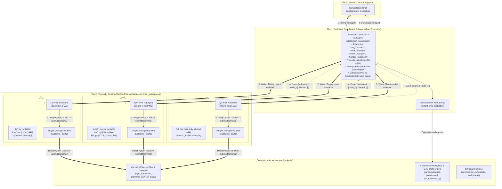
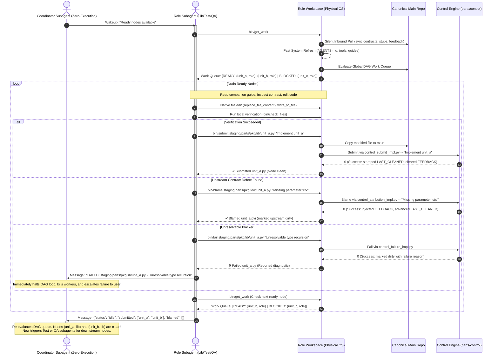
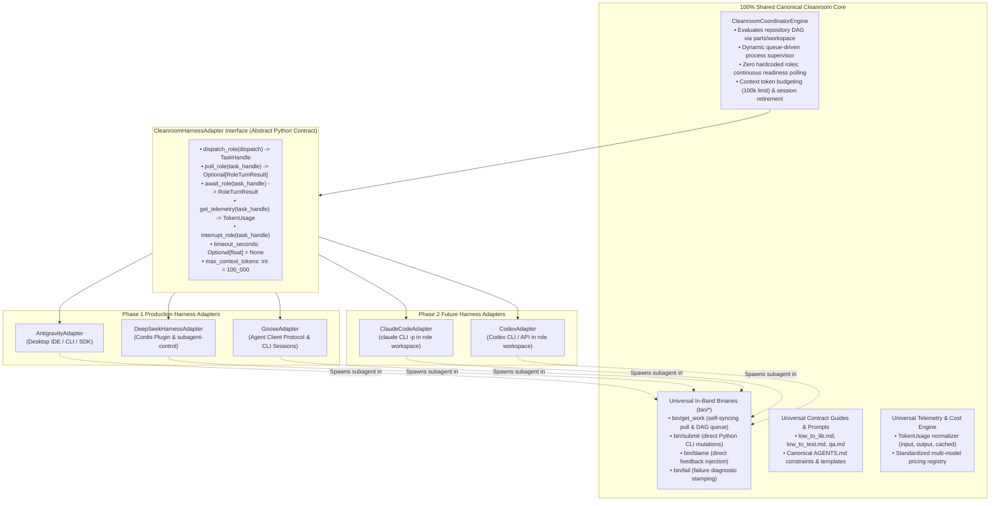
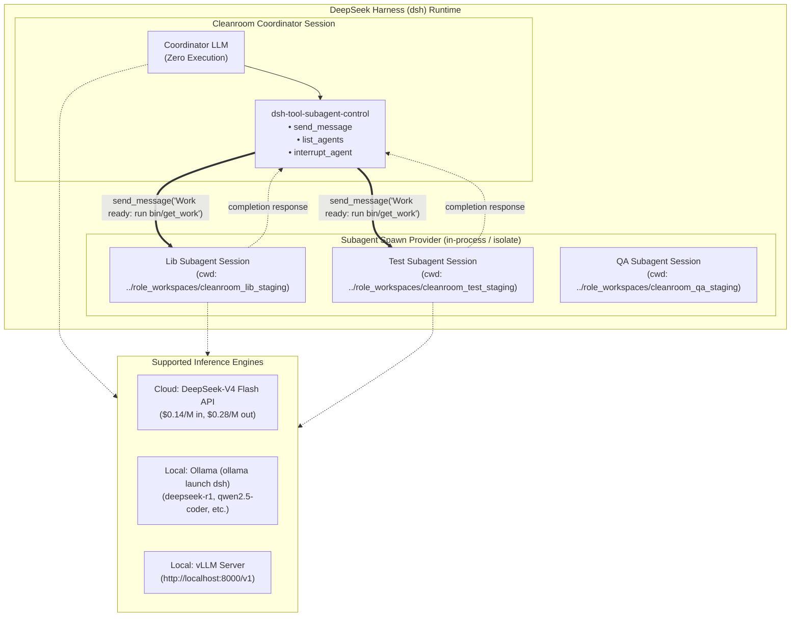
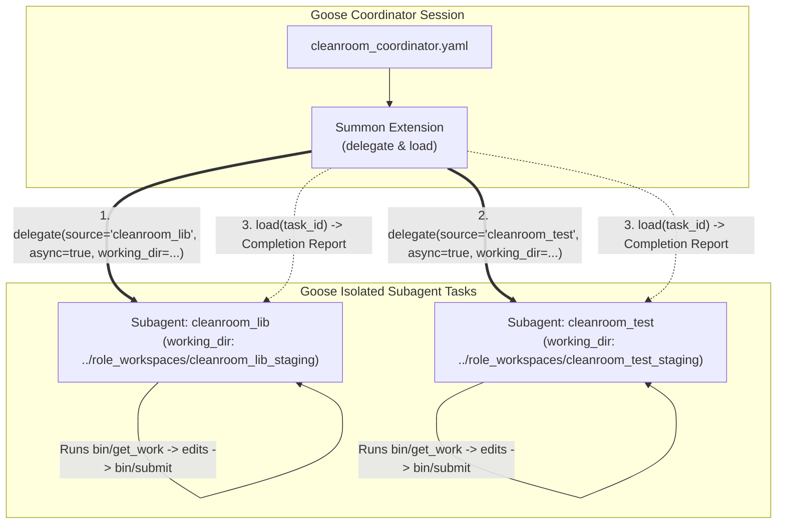
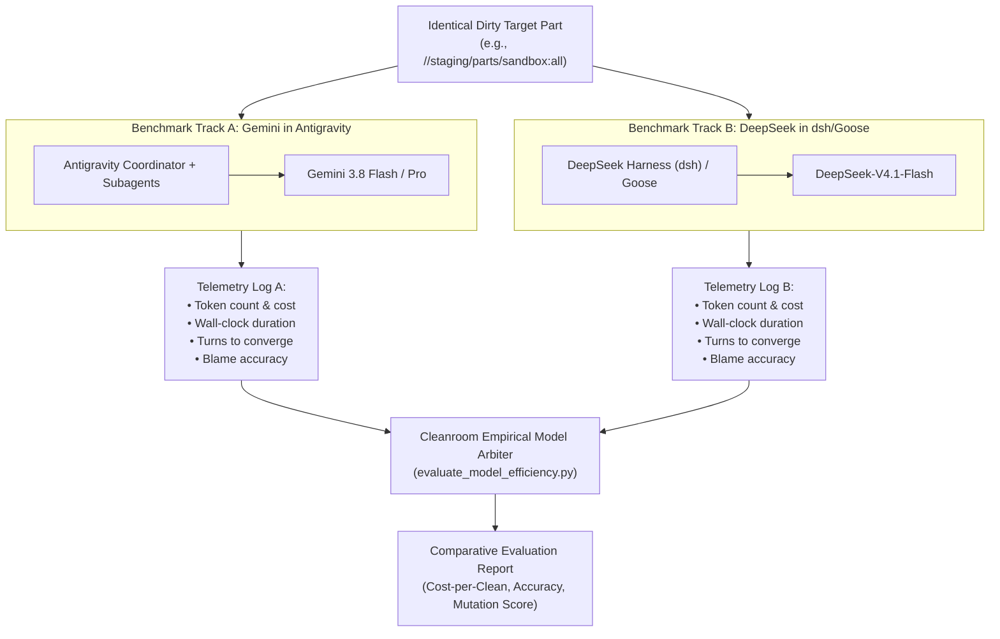
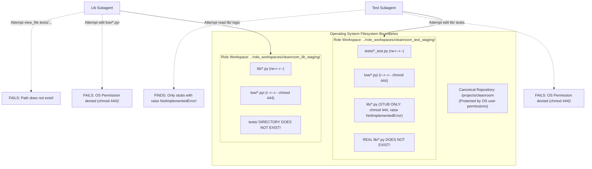

# Subagent-Driven Cleanroom Workspaces: Multi-Harness Autonomous Coordination Architecture

This document specifies the architecture for driving convention-based, isolated Cleanroom role workspaces autonomously via subagents across three major execution harnesses: **Google Antigravity**, **DeepSeek Harness (`dsh`)**, and **Goose**.

> [!NOTE]
> **Supercedes and Replaces [Archived Design: Antigravity Subagents & MCP Server](file:///Users/seanmcdirmid/projects/cleanroom/design-docs/antigravity_integration_failed.md)**
> This architecture formally supercedes the decommissioned Option 2 architecture. Instead of running fragile in-tree software hooks (`cleanroom_sandbox_hook.py`) and a dynamic FastMCP daemon that devolved into a shell-subprocess execution gateway, this design synthesizes the physical isolation of [Subagentless Cleanroom Workspaces (Option 3)](file:///Users/seanmcdirmid/projects/cleanroom/design-docs/subagentless_cleanroom_workspaces.md) with a **Zero-Execution Coordinator** and **Workspace-Bound Subagents**.
> 
> Furthermore, by decoupling Cleanroom orchestration from proprietary IDE environments, this design enables the use of cost-efficient, high-throughput models like **DeepSeek-V4 Flash** alongside **Google Gemini**, providing an empirical testbed for side-by-side model comparison.

---

## 1. Executive Summary & Architectural Motivation

### 1.1 The Cleanroom Dilemma: Autonomy vs. Double-Blind Isolation
Cleanroom enforces mathematical, double-blind isolation across software construction roles:
- **Specifications** (`high/*.md`, `scenarios/*.md`, `planning/*.md`, `low/*.pyi`) must be authored without implementation shortcuts.
- **Implementations** (`lib/*.py`) must adhere strictly to typed specifications without peeking at unit tests.
- **Unit Tests** (`tests/*_test.py`) must be derived exclusively from specification contracts without overfitting to implementation code.

In the previous subagent integration attempt (**Option 2**), Cleanroom attempted to enforce these boundaries dynamically within a **single shared working directory** using an external FastMCP daemon and Antigravity `PreToolUse` lifecycle hooks. As detailed in the post-mortem ([`antigravity_integration_failed.md`](file:///Users/seanmcdirmid/projects/cleanroom/design-docs/antigravity_integration_failed.md)), this failed because:
1. Dynamic MCP tool registration was brittle, forcing subagents to invoke shell commands (`run_command`) executing Python CLI client scripts against a local HTTP daemon.
2. The subagent instantiation tax, prompt preamble injection, and turn multiplication under Google One Ultra subscription quotas burned through 5-hour burst limits in under 45 minutes ($30–$50 token equivalent per pass).
3. Software-based confinement inside a single folder required complex, fragile interceptors, sentinel files (`.mcp.active`), and concurrency locks.

### 1.2 The Breakthrough: Physical Workspaces + Dedicated Coordinator Subagent
To solve these challenges, Cleanroom established **Option 3: Subagentless Cleanroom Workspaces** ([`subagentless_cleanroom_workspaces.md`](file:///Users/seanmcdirmid/projects/cleanroom/design-docs/subagentless_cleanroom_workspaces.md)), which moved isolation from the software runtime to the operating system filesystem:
- Role workspaces live in isolated sibling directories (`../role_workspaces/<ws>_<role>_<dir>/`).
- Implementers physically have no `tests/` directory; test authors physically have no real `lib/*.py` (replaced with `chmod 444` interface stubs containing `raise NotImplementedError`).
- In-band source metadata headers (`LAST_CLEANED`, `LAST_CHANGED`, `FEEDBACK:`) and direct Python CLI mutations (`bin/submit`, `bin/blame`, `bin/fail`) eliminate synchronization daemons and buffer files.
- Role sessions run `bin/get_work`, edit files with native editor tools, and call `bin/submit`, `bin/blame`, or `bin/fail`.

While Option 3 succeeded brilliantly for interactive, human-driven pair programming, it required a developer to manually switch between IDE chat tabs to prompt each role when upstream work was ready.

**The Subagent-Driven Cleanroom Workspaces Architecture** closes this loop via a strict three-tier hierarchy:
1. **Tier 0: Human Conversation Chat & CLI (`bin/cleanroom orchestrate`)**: The user-facing chat window. It **never** acts as the coordinator and never executes queue or build commands directly. Its sole responsibility upon receiving a cleaning request is triggering the CLI or invoking the dedicated Coordinator Subagent, then stepping completely out of the way.
2. **Tier 1: Dedicated Coordinator Subagent (`cleanroom_coordinator`)**: An autonomous, hyper-restricted subagent with **zero code custody**. It never reads source code, never runs tests, and never executes open-ended search tools (`find`, `grep`).
   - **Strict Tool Permissions**: The coordinator possesses **only 4 tools**: `run_command` (used strictly to query `bin/cleanroom work-queue`), `send_message`, `invoke_subagent`, and `manage_subagents`. It is explicitly stripped of all file viewing/editing tools (`view_file`, `write_to_file`, `replace_file_content`), web tools, image generation, notebooks, and timers.
   - **Instant Queue Evaluation**: It queries the global directed acyclic graph (DAG) for unblocked ready **nodes** via a single, fast CLI command: `bin/cleanroom work-queue <scope>`.
   - **Pre-Registered Worker Dispatch**: It dispatches or messages Tier 2 role subagents using the pre-registered `cleanroom_worker` subagent type, pinned strictly to each role's commissioned workspace directory (`../role_workspaces/<ws>_<role>_<scope>/`). Setting `TypeName: "self"` or `Workspace: "inherit"` is strictly forbidden.
   - **Reactive Convergence Loop**: It sleeps reactively until worker completion notifications arrive, re-checks `bin/cleanroom work-queue <scope>`, and repeats until all nodes in scope converge clean.
3. **Tier 2: Workspace-Bound Role Subagents (`cleanroom_worker`)**: Subagents persistently bound to their respective role workspace directories (`cwd = ../role_workspaces/<ws>_<role>_<dir>`). They possess standard native tools (read file, edit file, shell command) and **zero custom MCP or framework tools**. They execute role duties defined in their workspace `AGENTS.md` and companion guides, draining ready nodes and resolving them via `bin/submit`, `bin/blame`, or `bin/fail`.
4. **Self-Synchronizing In-Band Protocol**: Subagents communicate through existing workspace tools (`bin/get_work`, `bin/submit`, `bin/blame`, `bin/fail`). The subagent drains its ready nodes autonomously and sends a lean completion status back to the coordinator.
5. **Multi-Harness Flexibility**: The architecture runs identically across **Google Antigravity**, **DeepSeek Harness (`dsh`)**, and **Goose**, breaking vendor lock-in and slashing token costs via **DeepSeek-V4 Flash**.



---

## 2. Architectural Comparison: Why This Supercedes Failed Option 2

The table below contrasts the failed Option 2 architecture with Option 3 (Subagentless) and the new Subagent-Driven Workspaces architecture:

| Architectural Vector | Option 2: In-Tree Subagents & FastMCP (ARCHIVED FAILED) | Option 3: Subagentless Workspaces (BASELINE) | Subagent-Driven Workspaces (THIS ARCHITECTURE) |
| :--- | :--- | :--- | :--- |
| **Isolation Mechanism** | Software hooks (`cleanroom_sandbox_hook.py`) + HTTP AccessGate daemon in a single shared directory. | Physical OS filesystem separation (`../role_workspaces/`) + `chmod 444` kernel protection. | **Physical OS filesystem separation** (`../role_workspaces/`) + `chmod 444` kernel protection. |
| **Tool Infrastructure** | Complex FastMCP Starlette/SSE daemon (`127.0.0.1:8765`) + Dynamic tool export. | Zero custom tools. Standard host file editing tools + local shell binaries (`bin/get_work`, etc.). | **Zero custom tools**. Standard host file editing tools + local shell binaries (`bin/get_work`, etc.). |
| **Subagent Protocol** | Subagents executed shell subprocesses running Python CLI scripts (`python3 -m antigravity_mcp_client_impl`). | Interactive conversational human chat in each role workspace. | Host native inter-agent messaging (`send_message`, Cordis bus, or Goose CLI) without subprocess RPC daemons. |
| **Coordinator Role** | Complex scheduler running `antigravity_coordinator_impl.py`, executing step commands, parsing logs. | Human developer manually switching tabs and prompting roles. | **Zero-execution coordinator**: Evaluates DAG queue, wakes workspace-bound subagents, sleeps reactively. |
| **Subagent Lifespan** | Ephemeral: destroyed and respawned per unit batch, injecting massive system preambles repeatedly. | Persistent conversational chat tabs per role workspace. | **Persistent role sessions**: Initialized once per role workspace; context benefits from high KV prompt caching. |
| **Token Cost & Economics** | Extreme ($30–$50/pass); exhausted Google One Ultra 5-hour quota in 30–45 minutes. | Lowest for Gemini interactive chats, but requires constant human presence. | **Optimized for low-cost models**: Gemini Pro/Flash or **DeepSeek-V4 Flash** (~$0.15–$0.40/pass). |
| **Harness Portability** | Locked to Antigravity IDE and internal Google agent schemas. | Usable in any IDE (Antigravity, Cursor, VSCode) via manual chat. | **Portable across Antigravity, DeepSeek Harness (`dsh`), and Goose**. |

---

## 3. Core Principles & System Design

### 3.1 The Zero-Execution Coordinator Subagent
In traditional multi-agent systems, the supervisor agent frequently becomes a bottleneck: it reads source files, attempts to summarize diffs, runs test suites, and plans micro-steps. This burns exorbitant tokens and causes context degradation. Crucially, attempting to have the human-facing conversation chat act as a coordinator fails because the chat session is distractible, open-ended, and prone to exploratory rabbit holes (`grep`, `find`).

In this architecture, the Coordinator is a **dedicated, autonomous subagent** that is strictly **zero-execution**:
1. **No Code Custody**: The coordinator never opens, reads, or edits a source file (`lib/`, `tests/`, `low/`, etc.).
2. **No Build/Test Execution**: The coordinator never runs `pytest`, `pyright`, or test runners.
3. **No Exploratory Searching**: The coordinator never runs `find`, `grep`, `git diff`, or directory tree walks.
4. **Queue Evaluation Only**: The coordinator evaluates the repository DAG state exclusively by querying the DAG work queue for topologically ready **nodes** (each node representing a `(unit, role)` pair).
5. **Workspace Commissioning**: Ensures that all 9 role workspaces for the target scope are commissioned (`bin/cleanroom commission <role> <scope>`) prior to dispatch.
6. **Reactive Wakeup & Sleep**:
   - The coordinator identifies all roles with topologically unblocked, ready nodes.
   - It issues an asynchronous notification message to the subagents bound to those roles:
     ```json
     {
       "action": "wake",
       "role": "lib",
       "workspace": "cleanroom_lib_staging",
       "reason": "Ready nodes detected in global DAG"
     }
     ```
   - The coordinator enters an idle/sleep state, waiting for reactive wakeups from worker completions. It does **not** poll or loop.

### 3.2 Workspace-Bound Subagents
Subagents are not ephemeral workers dispatched arbitrarily into the repository; each subagent is permanently anchored to a commissioned role workspace:
- `LibSubagent` is anchored to `../role_workspaces/<ws>_lib_<dir>/`.
- `TestSubagent` is anchored to `../role_workspaces/<ws>_test_<dir>/`.
- `QASubagent` is anchored to `../role_workspaces/<ws>_qa_<dir>/`.

Because the workspace is physically isolated at the filesystem level:
- In `LibSubagent`'s workspace, `tests/` does not exist. There is no software filter to bypass; test files are physically absent.
- In `TestSubagent`'s workspace, `lib/*.py` files are read-only (`chmod 444`) interface stubs containing `raise NotImplementedError`. The test author cannot cheat or overfit to real implementation code.
- Upstream specifications (`high/*.md`, `scenarios/*.md`, `planning/*.md`, `low/*.pyi`) and configs are set to `chmod 444`. Any unauthorized modification is rejected directly by the OS kernel with `Permission denied`.
- **Command Execution Tripwire**: Role subagents are strictly restricted to running the 5 prescribed workspace binaries (`bin/get_work`, `bin/check_files`, `bin/submit`, `bin/blame`, `bin/fail`) in the terminal. Executing arbitrary shell commands (`python`, `bash`, `find`, `grep`, zip extraction, etc.) is strictly forbidden and triggers an immediate session abort.
- **In-Workspace File Inspection (Fully Permitted & Required)**: Role subagents (including auditors like QA) are explicitly permitted and expected to read in-workspace specifications (`low/*.pyi`), test suites (`tests/*_test.py`), implementation code (`lib/*.py`), and `# CHANGE:` commit headers using native file-viewing tools (`view_file`, `read_file`) to triage failures, locate line numbers/functions, and understand author reactions to prior blame. The Contamination Tripwire applies strictly to out-of-bounds files outside the workspace directory.
- **Unresolvable Impasse Protocol**: If a subagent determines that success is impossible or an unresolvable impasse occurs, it executes `bin/fail <target> "<reason>"`, immediately ceases work, and sends `FAILED: <target> - <reason>` to the coordinator. The coordinator immediately halts the loop, terminates workers, and escalates the failure to the user.

### 3.2.1 Absolute Host Path Isolation & Zero-Leaked Main Root Convention
To preserve double-blind integrity, **role workspaces must NEVER expose host filesystem paths or main repository roots to the subagent**:
- **Strict Prohibition on Exposing `main_workspace_root`**: Storing `"main_workspace_root": "/Users/..."` or `"repo_root": "/Users/..."` in `.cleanroom_role.json` or workspace files is strictly prohibited. Exposing host paths invites cheating: subagents reading their local configuration discover the main repository root and attempt cross-boundary file reads or out-of-band edits.
- **Convention-Driven Relative Traversal (`../../<workspace-short-name>`)**: Tooling dynamically resolves the canonical repository root strictly via relative structural convention: from `../role_workspaces/<ws>_<role>_<scope>/`, the canonical repository lives at `../../<ws>` where `<ws>` is the workspace short-name derived from the directory prefix (e.g. `cleanroom`), or via execution environment variables (`CLEANROOM_MAIN_ROOT`, `BUILD_WORKSPACE_DIRECTORY`).
- **Clean `.cleanroom_role.json` Schema**: Only role identity and execution constraints (`role`, `role_name`, `dir_scope`, `batch_size`, `max_feedback_chars`, `model`) are persisted. No host absolute paths ever appear in files readable by the agent.

### 3.2.2 Centralized Turn Logging & Prompt Storage (`logs/`)
To protect subagents from accidental self-contamination or peeking into execution histories:
- **Zero Turn Logs in Role Workspaces**: Execution logs (`.cleanroom_turn_<handle>.log`) and task prompt markdown files (`.dsh_prompt_<handle>.md`, `.goose_instructions_<handle>.md`) must **never** be written to the role workspace directory. Writing them in the workspace exposes past execution traces, tool call dumps, and prior turn dialogues to the active agent during directory scans or file listings.
- **Dedicated Centralized Logs Directory (`<main_root>/logs/`)**: All harness adapters (`DshHarnessAdapter`, `GooseHarnessAdapter`, `CommandHarnessAdapter`) resolve the canonical repository root and route execution logs and prompt files directly into `<main_root>/logs/` (ignored via `.gitignore`).
- **Clean Workspace Guarantee**: Role workspaces contain exclusively active source files, upstream read-only contracts, `bin/` runners, `AGENTS.md`, and unprivileged `.cleanroom_role.json`. The `.cleanroom_pending_work.json` buffer is strictly maintained, and no extraneous log or prompt files are ever visible to the agent.

### 3.3 The Autonomous Subagent Turn Loop
When woken by the coordinator, the workspace-bound subagent executes its standardized Cleanroom turn sequence, consulting its workspace `AGENTS.md` and resolving ready nodes via `bin/submit`, `bin/blame`, or `bin/fail`:



### 3.4 Multi-Node Processing Invariant & Batch-Bounded Queue Presentation
To prevent turn proliferation and conversational stalling, all subagents must adhere to the **Multi-Node Processing Invariant**:
- A subagent does **not** stop after submitting or resolving a single node to wait for coordinator approval.
- A subagent immediately calls `bin/get_work` after every submission, blame, or failure action.
- It continues processing ready nodes sequentially until `bin/get_work` confirms that all nodes in scope are clean or blocked on external roles.
- Only when zero ready units remain does the subagent emit its completion message and yield its turn.

#### Batch-Bounded Work Acquisition (`batch_size`)
To prevent overwhelming the role subagent with excessive context and cognitive load when many units are simultaneously ready:
- `bin/get_work` resolves `batch_size` from the model or role configuration in canonical main (defaulting to e.g. 1 or 2).
- Rather than dumping the entire ready queue into pending work, `bin/get_work` presents and marks pending at most `batch_size` ready units.
- If additional ready units remain in the queue beyond the current batch, `bin/get_work` displays the current batch and explicitly advises:
  > *"Completed units in this batch must be submitted via `bin/submit`; once submitted, run `bin/get_work` again to acquire the next batch of ready work."*
- This keeps the agent's editing and verification loop focused on a small, manageable unit batch while preserving autonomous multi-unit draining across turns.

#### Mandatory Resolution Invariant & Anti-Idle Reminders
A common failure mode observed in conversational LLM agents (particularly during auditor verification) is noticing that verification checks or test failures did not change, and merely outputting conversational commentary or complaints in chat without invoking a cleanroom resolution tool. Because conversational text never mutates graph state, this stalls the orchestration loop:
- **Strict Turn Resolution Requirement**: Every pending unit acquired via `bin/get_work` **must** be resolved before concluding the turn.
- **Three Resolution Pathways**:
  1. `bin/submit <target_file>` (when verification checks pass and contracts are certified)
  2. `bin/blame <culprit_file> "<actionable critique>"` (when verification fails or contracts are violated—attribute the defect to the authoring role immediately)
  3. `bin/fail <target_file> "<reason>"` (when an unresolvable impasse is reached or success is impossible)
- **Pending Work Anti-Idle Gate**: If an agent calls `bin/get_work` while pending dirty targets remain unresolved, `bin/get_work` rejects execution with an imperative advisory reminding the model of the mandatory resolution invariant and detailing the exact `bin/submit`, `bin/blame`, and `bin/fail` commands needed to proceed.
- **Confinement & Guide Enforcement**: Role `AGENTS.md` instructions and companion guides (e.g. `qa.md`) strictly prohibit concluding turns with conversational text when checks fail, enforcing immediate blame delivery.

### 3.5 Auditor Dirtiness Semantics & In-Band Certification
Cleanroom auditor roles (`qa`, `coverage`, `spec_qa`) evaluate dirtiness strictly based on temporal certification contracts in source metadata headers:
- An auditor node `(unit, auditor_role)` evaluates **dirty** if and only if:
  1. The feedback target lacks the required role audit attribute (e.g., missing `QA_AUDIT` or `COVERAGE_AUDIT`).
  2. The feedback target was modified after its audit timestamp (`fb_meta.last_changed > audit_ts`).
  3. A non-silent upstream contract dependency was modified after the audit timestamp (`contract_ts > audit_ts`).
  4. The feedback target does not exist or has an unparseable header.
- **Independence from Explicit Upstream Dirtiness Tags**: An auditor node is **never** marked dirty simply because its feedback target has an explicit `# DIRTY:` tag if the code itself has not been modified. If an upstream role (`lib`) inspects a target tagged `# DIRTY:`, verifies that all contracts and tests pass, and submits via `bin/submit` without modifying the code, `LAST_CHANGED` is unchanged, `# DIRTY:` is removed, and downstream auditor certification remains 100% valid without requiring a redundant re-audit.

### 3.6 Context Length Budgeting, In-Place Token Compaction, and Small Batches
For resource-constrained or local models (such as `custom_omlx Qwen3.6-35B-A3B-oQ6-mtp`), excessive context windows and monolithic task lists cause rapid cognitive degradation, reasoning loops, and instruction drift:
- **Declarative Model Configuration (`model_configs.toml`)**:
  Execution parameters are not hardcoded. Cleanroom dynamically inspects `model_configs.toml` in the repository root, matching either the section key (e.g. `qwen-moe-q6`) or the `model` identifier (e.g. `Qwen3.6-35B-A3B-oQ6-mtp`):
  ```toml
  [models.qwen-moe-q6]
  model = "Qwen3.6-35B-A3B-oQ6-mtp"
  subagent_batch_size = 3
  conversation_max_tokens = 100000
  max_feedback_chars = 600
  ```
- **Small Batch Size (`subagent_batch_size = 3`)**: Subagents must not be overwhelmed with 15+ ready units at once. Work acquisition via `bin/get_work` is bounded by `subagent_batch_size` resolved from `model_configs.toml` (or CLI `--batch-size`). The agent implements, verifies, and submits this small batch before acquiring subsequent work. Workspaces record this batch bound in `.cleanroom_role.json` on commissioning/dispatch so every `bin/get_work` invocation automatically respects the limit.
- **Throttling Blame Feedback & Defect Prioritization (`max_feedback_chars = 600`)**:
  Lower capable models (e.g., 35B models) suffer severe cognitive overload and paralysis when presented with monolithic 1,500+ character failure catalogs describing 10+ test failures at once. Cleanroom implements a dual-sided feedback protection architecture:
  - **Bounded Work Queue Presentation**: `bin/get_work` dynamically inspects the active model's `max_feedback_chars` and cleanly truncates oversized unacted feedback strings with a truncation indicator (`... [feedback throttled to N chars]`).
  - **Elimination of Redundant Header Tags**: `# DIRTY:` is strictly reserved for manual out-of-band marking (`bin/cleanroom dirty ...`) and failure terminal states (`bin/fail`). During in-band blame attributions (`bin/blame`), `# DIRTY:` is omitted entirely; the critique lives exclusively under `# FEEDBACK:`, and graph storage treats unacted feedback as dirty automatically without wasting tokens duplicating the text into `# DIRTY:`.
  - **Pure Critique Feedback Framing**: Redundant transport metadata prefixes such as `[<timestamp> from <sender>]: ` are stripped from `# FEEDBACK:` entries and `bin/get_work` reasons. File headers already record the attribution timestamp in `LAST_CLEANED:`. Stripping redundant metadata brackets eliminates transport overhead from the `max_feedback_chars` budget, avoids model confusion over critique targets (e.g. mistaking `BlameTool` for a tool mechanism rather than the class under test), and presents pure, distraction-free critique text to the authoring role.
  - **Blame Validation & Prioritization**: When a critique exceeds the configured character limit, `bin/blame` rejects the attribution with a structured error advising: *"Critique exceeds maximum length; you might prioritize contract discrepancies to report so the authoring role can make progress"*, preventing wave cascades while protecting downstream worker context.
- **In-Place Token Compaction Over Process Killing (`conversation_max_tokens = 100000`)**:
  Rather than killing and restarting the agent process when tokens accumulate, Goose natively supports in-place context compaction without tearing down the process:
  - **`GOOSE_AUTO_COMPACT_TOKEN_LIMIT`**: Configured in the subagent environment resolved from `conversation_max_tokens` (defaulting to 100,000 tokens for smaller models like Qwen3.6-35B). When cumulative session context nears this limit, Goose's built-in memory management **automatically summarizes older turns** into a concise block, keeping the context lean.
  - **Explicit Compaction via ACP (`/compact`)**: Goose supports slash commands over ACP. The Python coordinator can send `/compact` over the open stdio ACP pipe, prompting Goose to compress its token footprint while keeping the agent process and tool connections alive.
  - **Warm Process Preservation**: The agent process stays warm in memory, avoiding the initialization tax of respawning processes.
  - **Fallback Session Re-initialization**: Only if a harness completely lacks compaction capabilities or if context cannot be shrunk does the coordinator close the session and start fresh. Because Cleanroom stores all code and progress in-band in the filesystem (`bin/submit` updates main files; `LAST_CLEANED` and `FEEDBACK` headers reflect state), any new session resumes seamlessly with zero lost work.

### 3.7 Profile-Driven Workspace Commissioning & Manual Interactive Evaluation
To evaluate and debug subagent cognition and tooling behavior without running headless multi-hour orchestration loops, Cleanroom supports commissioning and resetting role workspaces configured for specific model and harness profiles:
- **Profile-Bound Role Workspaces**: Workspaces are provisioned and stamped with the designated model profile (`dsh models.qwen-moe-q6`, `dsh models.deepseek-v41-flash`, or `antigravity Gemini 3.8 Flash`).
- **Zero Stale State on Reset (`--reset`)**: All stale work buffers (`.cleanroom_pending_work`, `.cleanroom_blame_buffer.json`) and prior scratch artifacts are wiped, presenting an entirely clean starting queue for the target directory scope.
- **Direct Interactive Testing in DSH Desktop & Antigravity**: A developer can launch DSH Desktop or open an Antigravity session pointing directly to the provisioned role workspace directory (e.g. `role_workspaces/cleanroom_lib`), start an interactive conversation with the assigned model, and prompt:
  ```
  Immediately run bin/get_work to acquire pending ready nodes. Consult your workspace AGENTS.md, perform role verification via bin/check_files, resolve nodes via bin/submit, bin/blame, or bin/fail, and drain all ready nodes.
  ```
  This surfaces the subagent's internal reasoning, tool calls, and error handling in real time within the desktop UI before launching autonomous batch runs.

### 3.8 Elimination of Arbitrary Execution Timeouts
Multi-node cleanroom construction across deep dependency trees can legitimately run for multiple hours:
- **No Hardcoded Timeout Defaults**: Arbitrary time limits (such as the legacy 10-minute / 600-second kill switch) are completely eliminated (`timeout_seconds = None` by default). Subagents are never killed by wall-clock timers during ordinary operation.
- **Optional CLI Upper Bound (`--timeout <seconds>`)**: If a developer or automated CI job wishes to enforce a global ceiling to catch infinite loops or runaway processes, an explicit `--timeout` parameter may be supplied to `bin/cleanroom orchestrate`.
- **Tripwire & Blame as Primary Terminations**: Turn termination relies on explicit semantic signals (`bin/get_work` empty -> clean completion, `bin/blame` -> upstream feedback, `bin/fail` -> impasse escalation) rather than mechanistic timers.

---

## 4. Multi-Harness Integration & Common Code Architecture

### 4.1 Maximizing Common Code: The Core Cleanroom Abstraction

To avoid maintaining separate orchestration engines for each agent framework, Cleanroom enforces strict separation between **canonical business logic** (100% shared) and **harness adapters** (thin wrappers translating dispatch and telemetry).



#### What is 100% Common Across All Platforms:
1. **The Dynamic Queue-Driven Process Supervisor (`parts/subagent/`)**:
   - `subagent_coordinator`: Pure Python, zero external framework dependencies.
   - Evaluates the global DAG via `parts/workspace` (`workspace_work_impl.py`).
   - **Zero hardcoded role names or static wave partitions**: Roles are discovered dynamically from `cleanroom_roles.toml` and target arguments.
   - If `compute_role_work_queue` indicates a role has ready nodes and no active worker process, a worker is dispatched or prompted.
   - Independent roles (such as `lib` and `test` when `low` is clean, or `qa` auditing previously completed nodes while `lib` works on other units) execute concurrently and dynamically.
   - Workers are polled continuously, reaped upon turn completion, and re-dispatched when upstream nodes become clean.
   - Tracks session context tokens, retiring sessions at 100k tokens to maintain reasoning quality for smaller models.
2. **The Command Harness Adapter (`subagent_harness`)**:
   - Manages process-based subagent turn execution matching configurable platform command templates within isolated role workspaces.
   - Inspects blame buffers (`.cleanroom_blame_buffer.json`), extracts remaining pending work, and calculates token expenditures.
   - Removes arbitrary 600s timeouts (`timeout_seconds: Optional[float] = None`).
3. **The Universal In-Band Role Binaries (`bin/*`) and Support Tools**:
   - `bin/get_work`, `bin/check_files`, `bin/submit`, `bin/blame`, `bin/fail` are compiled as self-contained executable runner zipapps or shell scripts.
   - Any agent harness that can execute terminal shell commands or edit files calls these tools identically.
4. **The Role Guides and Behavioral Invariants**:
   - Role contracts, Pyright configurations, and companion guides (`low_to_lib.md`, `low_to_test.md`, `qa.md`) are completely agnostic to the model or agent platform.
5. **The Telemetry & Cost Engine (`subagent_coordinator`)**:
   - Normalizes token counts (`TokenUsage`) and computes monetary costs using a uniform rate registry.

#### The Abstract Adapter Protocol (`HarnessAdapter`):
```python
from typing import Optional, Protocol, Sequence
from update_with_ai.parts.subagent.lib.subagent_coordinator import (
    RoleDispatch,
    RoleTurnResult,
    TokenUsage,
)

class HarnessAdapter(Protocol):
    """Abstract interface implemented by external agent execution harnesses."""

    def dispatch_role(self, dispatch: RoleDispatch) -> str:
        """Dispatches work directive to a subagent bound to the role workspace."""
        ...

    def poll_role(self, task_handle: str) -> Optional[RoleTurnResult]:
        """Non-blocking poll: returns RoleTurnResult if completed, or None if still running."""
        ...

    def await_role(self, task_handle: str) -> RoleTurnResult:
        """Awaits subagent turn completion and returns outcome result."""
        ...

    def interrupt_role(self, task_handle: str) -> None:
        """Aborts active subagent task execution upon timeout or loop limit."""
        ...
```

---

### 4.2 Harness 1: Google Antigravity

Google Antigravity provides an interactive desktop IDE environment powered by Gemini models, featuring hierarchical subagents and reactive messaging without polling loops. Under **Option A**, all Antigravity-specific adapters, provisioning logic, and configuration generators are isolated in a dedicated part: `update_with_ai/parts/antigravity/`, preserving `update_with_ai/parts/subagent/` as a purely generic, multi-platform coordinator.

#### Topology & Hierarchical Subagent Separation
Antigravity enforces a strict two-tier subagent hierarchy that completely decouples the user-facing chat from the coordinator engine:
1. **Tier 0: Human Conversation Chat & `bin/cleanroom orchestrate <scope> [role]`**:
   - The user triggers orchestration either by running `bin/cleanroom orchestrate <scope> [role]` (e.g. `bin/cleanroom orchestrate staging qa --harness antigravity`) or by prompting the assistant to clean dirty nodes in `<scope>` up to `[role]`.
   - The CLI commissions any uncommissioned role workspaces up to the requested role boundary and emits the handover directive.
   - The conversation chat's **sole** action is invoking the dedicated Coordinator Subagent (`cleanroom_coordinator`) with the target scope and optional role boundary, then waiting for its completion report. The conversation chat never attempts to evaluate queues, search files, or coordinate directly.
2. **Tier 1: Coordinator Subagent (`cleanroom_coordinator`)**:
   - **4 Tools Only**: Possesses strictly `run_command` (solely for executing `bin/cleanroom work-queue <scope> [role]`), `send_message`, `invoke_subagent`, and `manage_subagents`. Has zero file reading, editing, or search tools.
   - **Instant Queue Inspection**: Evaluates DAG ready nodes `(unit, role)` via `bin/cleanroom work-queue <scope> [role] --json` without running exploratory shell loops or Python scripts. When a role boundary is provided (e.g. `qa`), only roles up to and including that role are evaluated; downstream roles (e.g. `coverage`) are excluded.
   - **Pre-Registered Worker Dispatch**: Wakes or spawns Tier 2 role worker subagents using `TypeName: "cleanroom_worker"` pinned strictly to each role workspace directory. Setting `TypeName: "self"` is forbidden.
   - **Worker Session Persistence Across Waves**: Tracks active worker `conversation_id`s in an internal map (`active_workers[role]`). When a role with an existing active subagent has ready work in subsequent waves, the coordinator sends a wakeup notification via `send_message` rather than invoking a new subagent.
   - **Unresolvable Impasse Escalation**: If any worker reports `FAILED: <target> - <reason>`, the coordinator immediately aborts convergence, calls `manage_subagents(Action="kill_all")`, and escalates the failure report directly to the parent/user.
   - **Reactive Convergence**: Enters reactive sleep until completion notifications arrive, re-evaluates `bin/cleanroom work-queue <scope> [role]`, and repeats until all nodes in scope converge clean across target roles.
3. **Tier 2: Role Worker Subagents (`cleanroom_worker`)**: Persistent subagents declared via `invoke_subagent` (or messaged via `send_message`), permanently mapped to role workspaces. Restricted strictly by the command execution tripwire to 5 workspace binaries (`bin/get_work`, `bin/check_files`, `bin/submit`, `bin/blame`, `bin/fail`). Executing arbitrary shell commands triggers an immediate session abort.

#### Workspace-Local Confinement & Policy (Strictly Inside Provisioned Workspaces)
All Antigravity configuration and safety boundaries live **strictly inside each provisioned workspace** (`../role_workspaces/<ws>_<role>_<scope>/`), never touching machine-global settings like `~/.gemini/config/projects/`:
- **Workspace-Local `.agents/rules/isolation.md`**: Enforces strict boundaries forbidding navigation or edits outside the role workspace root.
- **Workspace-Local `AGENTS.md`**: Provides the role guide, mandatory verification gates (`bin/check_files`), and submission/resolution protocols (`bin/submit`, `bin/blame`, `bin/fail`).
- **Kernel Permissions**: Physical OS absence of foreign directories (e.g. no `tests/` in `lib`) and `chmod 444` kernel protection on stubs make software bypass impossible.

#### Role Subagent Invocation & Workspace Binding
Role worker subagents are bound to their respective role workspaces through two supported dispatch modes:

1. **Interactive In-IDE Dispatch via Antigravity Skills & Subagents**:
   The Coordinator subagent uses `invoke_subagent` (or `send_message` for already running subagents). The role workspace directory is explicitly pinned in the worker prompt, and every command execution enforces `Cwd`:
   ```json
   {
     "TypeName": "cleanroom_worker",
     "Role": "Cleanroom Lib Worker",
     "Prompt": "You are an autonomous Cleanroom 'lib' worker executing in /Users/seanmcdirmid/projects/role_workspaces/cleanroom_lib_staging. You must operate strictly inside that directory, running all commands with Cwd set to your role workspace directory. Run bin/get_work to acquire pending ready nodes. Consult your workspace AGENTS.md, perform role verification, resolve nodes via bin/submit, bin/blame, or bin/fail, and drain all ready nodes before completing."
   }
   ```

2. **Programmatic Dispatch via Antigravity Harness Adapter (`parts/antigravity`)**:
   `AntigravityHarnessAdapter` implements `subagent_coordinator.HarnessAdapter` in Python:
   - Spawns and manages subagent turns targeted to the role workspace directory.
   - Extracts token metrics from `<appDataDir>/brain/<id>/.system_generated/logs/transcript.jsonl`.
   - Returns structured `RoleTurnResult` payloads to the coordinator.

#### Reactive Waking (No Polling)
The Coordinator never executes a busy-waiting loop or sleep timer to poll workers:
- When a role subagent sends a completion message or finishes its turn, Antigravity **reactively wakes** the Coordinator.
- The Coordinator parses the message, evaluates `bin/cleanroom work-queue`, and triggers downstream roles (e.g., waking `cleanroom_qa` once both `lib` and `test` have submitted).

---

### 4.3 Harness 2: DeepSeek Harness (`dsh`)

**DeepSeek Harness (`dsh`)** is the open-source, MIT-licensed agentic runtime framework released by DeepSeek AI, built on the **Cordis** modular plugin architecture. It provides an ideal execution environment for unattended, headless, and cost-effective Cleanroom cleaning, with first-class support for both **cloud models** (DeepSeek-V4 Flash) and **local models** (via Ollama and vLLM).

#### Native Subagent Control: `dsh-tool-subagent-control`
Rather than requiring bespoke communication scripts, DeepSeek Harness provides a dedicated, native subagent management subsystem:
- **`dsh-tool-subagent-control`**: The standard consumer toolset mounted by the parent Coordinator agent. It exposes global control functions directly to the LLM:
  - **`send_message(agent_id, message)`**: Dispatches follow-up instructions and wake notifications to active, running role subagents.
  - **`list_agents()`**: Discovers and inspects the live status of all active child agents.
  - **`interrupt_agent(agent_id)`**: Immediately halts a subagent's execution if an external loop guard or timeout triggers.
- **Provider Layer (`dsh-subagent-spawn-in-process` / `dsh-subagent-codex`)**: Spawns isolated role workers anchored in their pre-confined role workspace directories (`cwd = ../role_workspaces/<ws>_<role>_<dir>/`).



#### Dual Model Backends: Cloud API vs. 100% Local Inference
DeepSeek Harness is strictly model-agnostic via OpenAI-compatible API schemas. Cleanroom can be driven through:
1. **Cloud Hosted API (`deepseek-flash`)**: DeepSeek-V4.1-Flash for blazing fast cloud execution with 1M context.
2. **Local Ollama Inference**: Launchable via `ollama launch dsh` or by configuring the base URL to `http://127.0.0.1:11434/v1`. Enables running local weights (e.g. `deepseek-r1`, `qwen2.5-coder:32b`, `deepseek-coder-v2`) with **zero cloud egress and $0 token cost**.
3. **Local vLLM / SGLang Cluster**: High-throughput inference for enterprise CI/CD clusters (`vllm serve deepseek-ai/DeepSeek-R1` at `http://localhost:8000/v1`).

#### Headless CLI Architecture & Dynamic Overlay Patching
Cleanroom integrates with DeepSeek Harness via its headless runtime profile:
```bash
dsh --profile headless --patch .cleanroom/dsh_patch.yml --json "{task_prompt}"
```
Key architectural advantages of DeepSeek Harness for Cleanroom subagents:
1. **Append-Only Prefix Caching (Zero Cache Busting)**: Unlike agents that inject fluctuating timestamps (e.g. `current-time` updates) into initial messages on every turn, `dsh` maintains an append-only conversation history. For local inference (oMLX, vLLM), SSD prefix caching operates at 100% efficiency without invalidating tens of thousands of tokens of shared prompt context.
2. **Dynamic Overlay Patching (`--patch`)**: Role workspaces configure a targeted YAML patch layer (`.cleanroom/dsh_patch.yml`) overriding Cordis bundle settings:
   - Configures `@deepseek-ai/dsh-agent-default-model` to dynamically select the target model (`deepseek-flash` for cloud, or `Qwen3.6-35B-A3B-oQ6-mtp` for local oMLX).
   - Configures `@deepseek-ai/dsh-user-approval` with `policy: never` and `@deepseek-ai/dsh-permission-presets` with `defaultPreset: danger-full-access` so autonomous subagents execute tool calls without interactive prompts.
3. **Structured Event Streaming (`--json`)**: Headless execution emits newline-delimited JSON run events to stdout, enabling immediate token usage parsing (`usage.inputTokens`, `usage.cacheReadTokens`, `usage.outputTokens`, `usage.totalTokens`) alongside disk archives in `session.v4.jsonl.zstd`.
4. **Adaptive Context & Batch Bounds**:
   - `DeepSeek-V41-Flash`: `subagent_batch_size = 10`, `conversation_max_tokens = 256000`.
   - Local MoE models (`Qwen3.6-35B-A3B-oQ6-mtp`): `subagent_batch_size = 3`, `conversation_max_tokens = 100000`.

#### DSH Desktop Session Persistence & Lock Contention Protocol
DeepSeek Harness enforces a strict single-writer model: each session directory contains an OS-level file lock (`session.lock`) guarding the compressed event log (`session.v4.jsonl.zstd`).

- **Single-Writer Conflict with DSH Desktop**:
  When a session is active or selected in the DSH Desktop Electron application, the desktop app's background node service acquires an exclusive write lock (`flock(LOCK_EX)`) on `session.lock` to support interactive messaging.
  If the Cleanroom headless runner attempts to resume that session using `dsh --profile headless --session-id <saved_sid>`, the CLI process exits immediately with a fatal error: `session "..." is already owned by an active write handle`.
- **Defensive Fallback (Current Behavior)**:
  `DshHarnessAdapter` evaluates `session.lock` via non-blocking `fcntl.flock(LOCK_EX | LOCK_NB)` before dispatching. If the session is currently locked by DSH Desktop, the adapter defensively omits `--session-id` and boots a fresh turn session rather than aborting orchestration. While this avoids catastrophic crashes, it creates duplicate session threads in DSH Desktop across turns if the user is watching the session in the desktop UI.
- **Future Improvements**:
  1. *Desktop RPC Turn Dispatch*: Rather than invoking a headless CLI subprocess when DSH Desktop is active, evaluate dispatching turns directly over DSH Desktop's local RPC bridge (using the Chromium auth cookie) via a `session/prompt` or `turn/dispatch` RPC method, avoiding process and lock contention completely.
  2. *Spectator / Read-Only Mode in DSH Desktop*: Explore configuring or patching DSH Desktop to support read-only session monitoring tabs that don't hold exclusive write locks on background sessions.
  3. *Coordinated Lock Handoff*: Support signaling DSH Desktop over RPC to temporarily relinquish write ownership before headless CLI execution, re-mounting upon turn completion.

---

### 4.4 Harness 3: Goose (Block / Linux Foundation AAIF)

**Goose** is the open-source, general-purpose autonomous developer agent built by Block (Square/Cash App) and hosted under the Linux Foundation's Agentic AI Foundation (AAIF). Goose natively supports subagents through its built-in platform extension **`summon`**, as well as through **Recipes** and **Named Sessions**.

#### Subagent Delegation via the `summon` Platform Extension
Goose provides subagent orchestration through the default `summon` extension, exposing two primary tools to the agent:
- **`delegate(source, parameters, working_dir, async)`**:
  - `source`: The recipe name or path defining the subagent persona and instructions (e.g., `update_with_ai/recipes/cleanroom_lib.yaml`).
  - `working_dir`: Directs the subagent to run strictly inside the specified directory (`../role_workspaces/<ws>_<role>_<dir>/`), maintaining physical OS confinement.
  - `parameters`: Key-value parameters passed into the subagent (e.g., `{"parts_dir": "staging"}`).
  - `async: true`: Spawns the subagent asynchronously in the background, returning a `task_id` immediately so the Coordinator can dispatch multiple role workers in parallel.
- **`load(task_id)`**:
  - Awaits and retrieves the completion status, tool activity summary, and submitted unit reports from the background subagent.



#### Architecture: Native AGENTS.md Confinement & Zero-Recipe Deployment
In Goose, context files are discovered automatically via standard `AGENTS.md` and `.goosehints` files inside each role workspace (`cwd = ../role_workspaces/<ws>_<role>_<scope>/`). Cleanroom dispenses with proprietary YAML recipes entirely:
- **`AGENTS.md` Confinement**: Each role workspace contains an `AGENTS.md` file specifying role boundaries, the 5-command restriction tripwire (`bin/get_work`, `bin/check_files`, `bin/submit`, `bin/blame`, `bin/fail`), guide references, and submission instructions.
- **Physical Workspace Isolation**: The Goose process executes with `cwd` set strictly to the role workspace directory, operating under OS file permissions (`chmod 444` specs, missing `tests/` in `lib/`, interface stubs in `test/`).

#### Generic Python Communication with Agent Processes
To prevent the overhead of constantly restarting agent processes, Cleanroom communicates with Goose through two Python-driven modalities:

##### 1. Agent Client Protocol (ACP) over stdio (`goose acp`)
Goose natively implements the open **Agent Client Protocol (ACP)** over standard input/output (`stdio`) using JSON-RPC 2.0:
- **Long-Lived Process**: The Python harness launches `goose acp` once per role workspace as a persistent background process.
- **Protocol Handshake**: Python sends `initialize` and creates a role session (`session/new`).
- **Turn Prompting**: When `bin/get_work` identifies ready nodes, Python sends `session/prompt` (`"Work is available. Run bin/get_work and drain ready units."`).
- **Warm Idle State**: The Goose agent executes autonomously, drains ready units via `bin/submit`, and returns `status: idle` when `bin/get_work` is empty. **The process does not exit**; it remains warm in memory, retaining its loaded state and model connections.
- **Re-Prompting**: When upstream roles produce new clean artifacts, Python sends the next `session/prompt` to the existing idle ACP worker.
- **Context Budgeting**: When cumulative session tokens cross 100k tokens, Python closes the ACP session (`session/close`) and opens a fresh one to guarantee high reasoning quality.

##### 2. Persistent CLI Session Resumption (`goose run --name ... --resume`)
For environments where ACP is not used, Goose supports managing persistent named sessions anchored in distinct workspace directories:
```bash
# Dispatch turns into a persistent named session across waves
goose run --name cleanroom-lib --instructions .cleanroom_task_prompt.md --resume
```
This preserves conversation state and SQLite metrics across individual turns without requiring a long-running stdio daemon.

#### Dedicated Goose Part Architecture (`update_with_ai/parts/goose/`)
Adhering to Cleanroom's architectural rule (**Canonical `parts/` Over `support/lib/`**), Goose integration is encapsulated in a dedicated Cleanroom part: `update_with_ai/parts/goose/`, following the exact pattern of `update_with_ai/parts/antigravity/`:
- **`goose_workspace`**: Configures workspace-local isolation rules, generates `.goosehints` with boundary rules and 5-command restriction tripwires, and aligns role `AGENTS.md` directly inside commissioned role workspaces.
- **`goose_harness`**: Implements `subagent_coordinator.HarnessAdapter`, managing ACP / process-based execution, eliminating arbitrary timeouts (`timeout_seconds = None`), monitoring 100k context budgets, inspecting blame buffers (`.cleanroom_blame_buffer.json`), tracking submitted units, and normalizing SQLite session telemetry (`sessions.db` sessions & usage_ledger tables) into `TokenUsage`.
- **`goose_asm`**: Provides singleton lifecycle and assembly wiring to register Goose harness adapters into the subagent coordinator and CLI.

---

### 4.5 Phase 2 Future Harnesses: Anthropic Claude Code & OpenAI Codex

Because Cleanroom decouples orchestration via the `CleanroomHarnessAdapter` interface and relies strictly on physical OS workspace confinement, adding new agent backends requires **zero changes** to Cleanroom's core build graph, role definitions, or tools.

#### 1. Anthropic Claude Code (`ClaudeCodeAdapter`)
**Claude Code** is Anthropic's agentic CLI tool. It operates natively in a target directory with access to file viewing, file editing, and bash execution:
- **Workspace Binding**: The adapter spawns Claude Code in headless mode with `cwd` set strictly to the role workspace:
  ```bash
  claude -p "Work is available. Run bin/get_work, author code, verify, submit via bin/submit, and drain ready units." \
         --dangerously-skip-permissions \
         --output-format json
  ```
- **Confinement**: Claude Code cannot read counterpart files because `tests/` does not exist in `lib/`, real implementations do not exist in `test/`, and specs are `chmod 444`.
- **Telemetry Extraction**: Claude Code emits structured JSON execution summaries or logs into `~/.claude/projects/` containing exact token metrics:
  - `cache_read_input_tokens` $\to$ `TokenUsage.cached_tokens`
  - `input_tokens` $\to$ `TokenUsage.input_tokens`
  - `output_tokens` $\to$ `TokenUsage.output_tokens`

#### 2. OpenAI Codex / Canvas / Operator (`CodexAdapter`)
**OpenAI Codex** can be driven either through the standalone OpenAI Agent CLI / API or via DeepSeek Harness's built-in `dsh-subagent-codex` provider:
- **Workspace Binding**: Initialized with working directory set to `../role_workspaces/<ws>_<role>_<dir>/`.
- **Instruction Injection**: Ingests standard `AGENTS.md` and role companion guides as system preambles.
- **Telemetry Extraction**: Extracted directly from OpenAI API `completion.usage`:
  - `prompt_tokens_details.cached_tokens` $\to$ `TokenUsage.cached_tokens`
  - `prompt_tokens` - `cached_tokens` $\to$ `TokenUsage.input_tokens`
  - `completion_tokens` $\to$ `TokenUsage.output_tokens`

---

## 5. Universal Token Tracking, Cost Estimation, and Empirical Benchmarking

### 5.1 The Unified Token Telemetry Contract (`TokenUsage`)

To fairly and objectively compare performance and cost across all harnesses (Antigravity, DeepSeek Harness, Goose, Claude Code, Codex) and models (Gemini, DeepSeek, Claude, GPT, local models), Cleanroom defines a **Universal Telemetry Contract** in `update_with_ai/parts/subagent/lib/subagent_coordinator.py`:

```python
from dataclasses import dataclass
from typing import List, Optional

@dataclass(frozen=True)
class TokenUsage:
    """Normalized token telemetry for a single turn or complete cleaning session."""
    input_tokens: int = 0        # Uncached prompt tokens (cache miss)
    cached_tokens: int = 0       # Cached prompt tokens (cache hit)
    output_tokens: int = 0       # Generated completion tokens
    total_tokens: int = 0        # input_tokens + cached_tokens + output_tokens
    cost_usd: float = 0.0        # Standardized monetary expenditure in USD

@dataclass(frozen=True)
class RoleTurnResult:
    """Outcome of an autonomous role subagent turn."""
    role: str
    status: str = "clean"        # "clean", "blamed", or "failed"
    units_submitted: List[str] = field(default_factory=list)
    units_blamed: List[str] = field(default_factory=list)
    failure_reason: Optional[str] = None
    telemetry: TokenUsage = field(default_factory=TokenUsage)
    wall_clock_seconds: float = 0.0
```

### 5.2 Harvesting Telemetry Across Harnesses

Each harness adapter extracts raw token metrics from its native logging infrastructure and normalizes them into `TokenUsage`:

| Harness | Native Telemetry Source | Extraction Mechanism |
| :--- | :--- | :--- |
| **Google Antigravity** | `<appDataDir>/brain/<id>/.system_generated/logs/transcript.jsonl` | Parses `MODEL` and `PLANNER_RESPONSE` steps for token metadata fields (`input_tokens`, `output_tokens`, `cache_read_tokens`). |
| **DeepSeek Harness (`dsh`)** | Cordis LLM provider response objects | Inspects `usage.prompt_cache_hit_tokens` (cached), `usage.prompt_cache_miss_tokens` (input), and `usage.completion_tokens` (output). |
| **Goose** | Goose session database / `goose session info --json` | Reads `session.metrics.input_tokens`, `session.metrics.output_tokens`, and cache efficiency ratios. |
| **Claude Code** | CLI JSON stdout / `~/.claude/` session transcripts | Extracts `usage.cache_read_input_tokens`, `usage.input_tokens`, and `usage.output_tokens`. |
| **OpenAI Codex** | OpenAI API response payloads (`completion.usage`) | Maps `usage.prompt_tokens_details.cached_tokens`, `usage.prompt_tokens`, and `usage.completion_tokens`. |

### 5.3 Standardized Rate Card & Cost Calculation Formula

The cost in USD is calculated deterministically by `CleanroomTelemetry` using a centralized rate card:

$$\text{Cost} = \frac{(\text{input\_tokens} \times P_{\text{in}}) + (\text{cached\_tokens} \times P_{\text{cache}}) + (\text{output\_tokens} \times P_{\text{out}})}{1{,}000{,}000}$$

#### Canonical Pricing Table (per 1,000,000 Tokens)

| Model Identifier | Provider / Platform | Cached Input ($/1M) | Uncached Input ($/1M) | Output ($/1M) |
| :--- | :--- | :--- | :--- | :--- |
| **`deepseek-flash`** (V4.1-Flash) | DeepSeek API (`dsh` / Goose) | **\$0.014** | **\$0.14** | **\$0.28** |
| **`deepseek-r1-local`** | Ollama / vLLM (Local GPU) | **\$0.000** | **\$0.000** | **\$0.000** |
| **`gemini-3.8-flash`** | Google Cloud / Antigravity | **\$0.025** | **\$0.10** | **\$0.40** |
| **`gemini-3.8-pro`** | Google Cloud / Antigravity | **\$0.3125** | **\$1.25** | **\$5.00** |
| **`claude-3-7-sonnet`** | Anthropic API / Claude Code | **\$0.30** | **\$3.00** | **\$15.00** |
| **`gpt-4o`** | OpenAI API / Codex | **\$1.25** | **\$2.50** | **\$10.00** |

---

### 5.4 Comprehensive Paradigm Cost & Token Comparison

| Metric / Attribute | Option 1: Custom Loop (OpenAI API) | Option 2: In-Tree Subagents (ARCHIVED FAILED) | Option 3: Subagentless Workspaces (Gemini Ultra) | Subagent Workspaces (Gemini 3.8 Ultra/Pro) | Subagent Workspaces (DeepSeek-V4 Flash) | Subagent Workspaces (Local Ollama / vLLM in dsh) |
| :--- | :--- | :--- | :--- | :--- | :--- | :--- |
| **Model Backend** | GPT-4o / Claude 3.5 Sonnet | Gemini 1.5/2.0 Ultra (Antigravity) | Gemini 3.8 Ultra (Interactive Chat) | Gemini 3.8 Flash / Pro (Antigravity Subagents) | **DeepSeek-V4.1-Flash** (Cloud API via `dsh`) | **DeepSeek-R1 / Qwen2.5-Coder** (Local GPU) |
| **Preamble Overhead / Turn** | ~8k tokens (Injected per node session) | ~35k tokens (Injected per ephemeral subagent) | ~12k tokens (Cached in persistent tab) | ~12k tokens (High cache hit rate) | **~12k tokens (90% cached at \$0.014/M)** | **~12k tokens (Local KV cache)** |
| **Tool Definition Tokens** | ~4k tokens (OpenAI tool schemas) | ~15k tokens (FastMCP dynamic schemas + hooks) | 0 tokens (No custom tool schemas) | 0 tokens (Standard host tools only) | **0 tokens (Standard host tools only)** | **0 tokens (Standard host tools only)** |
| **Context Bloat Rate** | Moderate (Reset per DAG node) | Extreme (Sequential shell CLI logs up to 100k) | Low (Single role focus per tab) | Low (Single role focus per subagent) | **Ultra-Low (Asymmetric Causal KV cache)** | **Low (Bounded by role context)** |
| **Average Turns per Unit** | 3–5 turns | 8–14 turns (RPC handshakes) | 2–3 turns | 2–3 turns | **2–3 turns** | **2–4 turns** |
| **Est. Cost per 5-Node Pass**| \$12.00 – \$25.00 | \$35.00 – \$55.00 (or Quota Lockout) | Included in Google One Ultra (Manual) | Included in Google One Ultra (Autonomous) | **\$0.18 – \$0.45 (Total API expenditure)** | **\$0.00 (100% Local / Zero API Cost)** |
| **Human Labor Required** | Zero (Headless) | High (Babysitting socket crashes) | High (Manual prompt switching) | **Zero (Autonomous)** | **Zero (Autonomous & Scriptable)** | **Zero (Autonomous & Air-Gapped)** |

---

### 5.5 Side-by-Side Model Comparison Methodology

With support for both Google Gemini (in Antigravity) and DeepSeek-V4 Flash (in `dsh` / Goose), Cleanroom establishes an empirical, reproducible testbed to benchmark model performance on rigorous, double-blind software engineering.



#### Evaluation Metrics & Scoring
The comparison arbiter records six objective, deterministic dimensions:
1. **Total Monetary Cost**: Total expenditure in API tokens or quota fractions required to achieve clean state across all nodes.
2. **Convergence Speed (Turns & Wall-Clock)**: Number of model turns and elapsed seconds required to transition all units from dirty to clean.
3. **Double-Blind Contract Fidelity**:
   - Number of Pyright static type errors on first submission.
   - Number of Cleanroom linter violations (`lib_lint.py`, `test_lint.py`, `low_lint.py`, `spec_lint.py`, `high_lint.py`).
4. **Upstream Blame Precision**:
   - When given an intentionally incomplete or contradictory specification contract, does the model identify the exact requirement gap and issue a valid `bin/blame`, or does it hallucinate an ad-hoc local workaround?
5. **Test Mutation Resistance**:
   - For tests authored by `TestSubagent` (blind to implementation), what percentage of intentionally injected implementation mutations (via mutation testing) are caught by the generated test suite?
6. **Hallucination & Repetition Rate**:
   - Number of repetitive, non-progress turns intercepted by loop guardrails.

---

## 6. Confinement & Security Architecture

Because Cleanroom workspaces physically segregate code at the operating system level, double-blind confinement does not rely on model trustworthiness or complex interceptors.



### 6.1 Kernel-Enforced Immutability (`chmod 444`)
- All contract files (`low/*.pyi`, `high/*.md`, `planning/*.md`) and guides are set to read-only mode (`chmod 444`) when copied into the role workspace.
- Any attempt by an LLM tool (`write_to_file`, `replace_file_content`) or shell redirection (`>`) to alter an upstream specification triggers an immediate OS-level `Permission denied` error.
- The `AGENTS.md` instruction file explicitly forbids running `chmod` or changing file permissions.
- Inbound pull routines verify the SHA-256 hashes of read-only files before each turn, terminating immediately if unauthorized tampering is detected.

### 6.2 Structural Non-Existence
- Rather than policing access to unauthorized files, Cleanroom ensures they do not exist:
  - **In Lib Workspaces**: The `tests/` directory is never created.
  - **In Test Workspaces**: Real implementation files (`lib/*.py`) are never copied. Instead, `parts/workspace` (`workspace_provision_impl.py`) generates typed interface stubs where all method bodies contain `raise NotImplementedError("Cleanroom Test Stub")`.

### 6.3 Pathless Workspace Descriptors
Role workspaces store no absolute host paths:
```json
{
  "role_address": "//update_python_with_ai:lib",
  "role_name": "lib",
  "parts_dir": "staging"
}
```
All references to the canonical main workspace are resolved via relative convention (`../../<workspace_name>`), preventing directory path leakage into model context windows.

---

## 7. Lifecycle State Machine & Coordinator Logic

### 7.1 Dynamic Queue-Driven Process Supervision (Zero-Hardcoding Supervisor)
Cleanroom enforces mathematical, double-blind isolation while eliminating rigid wave execution and role hardcoding:
- **Zero Role Hardcoding**: The supervisor never hardcodes role names, role categories, or execution wave schedules. Roles, permissions, and dependencies are resolved dynamically from `cleanroom_roles.toml` and target arguments.
- **Node-Level Readiness & Fine-Grained Concurrency**: Work readiness is evaluated at the `(unit, role)` node level via `workspace_work.compute_role_work_queue`. If multiple roles have topologically unblocked ready nodes, they are all eligible to run concurrently. For example:
  - When `low` contracts are clean, both `lib` and `test` run in parallel.
  - While `lib` and `test` are working on unit 2, `qa` can concurrently audit unit 1 whose implementation and test are already submitted and clean!
- **Continuous Supervisor Loop**:
  1. **Startup Reset**: Cleans and resets preexisting role workspaces in scope to eliminate stale work or partial edits from previous aborted runs.
  2. **Active Worker Registry**: Maintains `active_workers: Dict[str, TaskHandle]` tracking live subagent processes or interactive ACP sessions.
  3. **Continuous Polling Tick**: On every supervisor tick:
     - **Poll Active Workers**: Checks `poll_role(handle)`. When a worker completes its turn, the supervisor harvests submitted targets, blame feedback, failure diagnostics, and token telemetry.
     - **Context Budget Gate**: If a worker session crosses **100,000 tokens**, the session is retired (`close_session`), ensuring that subsequent turns start with a clean context.
     - **Evaluate Work Queue**: Queries `compute_role_work_queue` across all declared roles up to `target_role`.
     - **Dispatch Ready Workers**: For any role with ready work and no active worker, commissions the workspace on demand and launches a worker process (or sends a new prompt to an existing idle ACP session).
     - **Convergence Check**: When `active_workers` is empty:
       - If all roles have 0 ready and 0 blocked units $\to$ **Clean Convergence!** Delete provisioned role workspaces and return success.
       - If all roles have 0 ready units but blocked units remain $\to$ **Deadlock Impasse!** Abort and report unresolved prerequisites.
     - **Tick Sleep**: If workers are active, the supervisor sleeps briefly (e.g., 1–2 seconds) before the next polling tick.

### 7.2 Blame & Defect Routing
When a downstream role identifies a specification ambiguity or contradiction:
1. The role agent executes `bin/blame <culprit_file> "<critique>"`.
2. The attribution engine directly injects the critique into the culprit file's `FEEDBACK:` header in canonical main and advances its `LAST_CLEANED` timestamp.
3. The culprit file is immediately marked **dirty** in the global DAG.
4. The role agent reports `blamed` in its completion message to the Coordinator.
5. The Coordinator detects that an upstream role has become dirty, suspends execution of dependent roles, and re-wakes the upstream role subagent to address the feedback.

```mermaid
stateDiagram-v2
    [*] --> EvaluatingDAG: Coordinator Wakes
    EvaluatingDAG --> DispatchingRoles: Ready Units Found
    EvaluatingDAG --> TerminatingClean: All Units Clean
    
    DispatchingRoles --> WaitingForRoles: Emit Wake Messages
    
    state WaitingForRoles {
        [*] --> RoleRunning
        RoleRunning --> RoleCompleted: Subagent emits idle status
        RoleRunning --> RoleBlamed: Subagent emits blame status
    }
    
    RoleCompleted --> EvaluatingDAG: Update DAG State
    RoleBlamed --> RouteFeedback: Mark Upstream Node Dirty
    RouteFeedback --> EvaluatingDAG: Re-schedule Upstream Role
    
---

## 8. Deployment Architecture: Zero-Repo-Pollution via uv & Antigravity Plugins

A core requirement of Cleanroom is that consumer repositories must never be polluted with framework boilerplate, temporary folders, or mandatory in-tree scripts. Cleanroom deploys as a lean, dual-mode system:

```mermaid
flowchart TD
    subgraph DeploymentModes ["Cleanroom Distribution & Execution Layers"]
        subgraph UVLayer ["1. Python / uv Package (Headless Core)"]
            UVTool["uv tool install cleanroom / uvx cleanroom"]
            GlobalCLI["Global CLI executable on PATH: 'cleanroom'"]
            UVTool --> GlobalCLI
        end

        subgraph AntigravityPlugin ["2. Global Antigravity Plugin (Subagents)"]
            PluginDir["~/.gemini/config/plugins/cleanroom/"]
            CoordAgent["Global Subagents:\n• cleanroom_coordinator\n• cleanroom_worker"]
            PluginDir --> CoordAgent
        end

        subgraph ConsumerRepo ["3. Clean Consumer Project Repository (/projects/my_project)"]
            RepoSource["Project Source Files & Contracts\n(No bin/ directory! No .agents/ directory!)"]
            CleanroomConfig["parts/cleanroom.toml"]
        end

        subgraph ProvisionedWorkspaces ["4. External Role Workspaces (../role_workspaces/)"]
            RoleWS["Commissioned Sibling Directories\n• Contains auto-generated bin/ (get_work, submit, blame)\n• Contains role AGENTS.md & workspace .agents/\n• Physically outside the consumer repo"]
        end
    end

    GlobalCLI -->|"cleanroom commission --all"| RoleWS
    GlobalCLI -->|"cleanroom orchestrate"| RoleWS
    CoordAgent -->|"invoke_subagent(Workspace=...)"| RoleWS
```

### 8.1 No `bin/` Directory in Consumer Repositories
- The `bin/` directory in Cleanroom's own codebase is purely a developer convenience for local repo workflows (`bin/test`, `bin/cleanroom`).
- Consumer projects running Cleanroom via `uv` install the package globally via `uv tool install cleanroom` or run it ephemerally with `uvx cleanroom`.
- The CLI command `cleanroom` lives on the user's system `PATH`.
- The **only place `bin/` directories exist** is inside the **commissioned role workspaces** (`../role_workspaces/<ws>_<role>_<scope>/bin/`), where `WorkspaceProvisioner` automatically packages self-contained executable runner zipapps (`bin/get_work`, `bin/submit`, `bin/blame`, `bin/fail`). The consumer repo remains completely untouched.

### 8.2 Zero-Repo-Pollution: Complete Removal of `.agents/` and Direct CLI Coordination Entrypoint
A critical design requirement is **zero repository pollution**: neither consumer repositories nor Cleanroom's canonical repository may contain repository-local `.agents/` directories or IDE-specific configuration files.

#### Global Plugin Architecture (`~/.gemini/config/plugins/cleanroom/`)
Instead of scaffolding `.agents/` in every project root, Antigravity subagent definitions are installed globally as an Antigravity Plugin:
- Location: `~/.gemini/config/plugins/cleanroom/` (configured via `ANTIGRAVITY_CONFIG_DIR` or defaulting to `~/.gemini/config`).
- Manifest: `plugin.json` declaring the Cleanroom plugin metadata.
- Coordinator Subagent: `agents/cleanroom_coordinator/agent.md` defines the Tier 1 zero-execution coordinator, equipped only with `run_command`, `send_message`, `invoke_subagent`, and `manage_subagents`.
- Role Worker Subagent: `agents/cleanroom_worker/agent.md` defines the Tier 2 workspace-bound role worker, equipped with native file tools, `send_message`, and `run_command`.
- **No Global Skill Required**: Cleanroom avoids creating or registering global chat skills (`skills/`). Running orchestration directly through `bin/cleanroom orchestrate` eliminates skill indirection and saves system prompt tokens.

#### Automatic On-Demand Provisioning (`ensure_antigravity_plugin_installed`)
Subagent definitions are maintained and refreshed on every execution without manual setup:
- Whenever `bin/cleanroom` is invoked, it automatically validates and writes the latest templates for `plugin.json`, `cleanroom_coordinator`, and `cleanroom_worker` into `~/.gemini/config/plugins/cleanroom/`.
- If any legacy `skills/` directory exists, it is automatically purged.
- This ensures subagent definitions are always synchronized with the canonical codebase without requiring manual installation commands, discoverability polling, or in-tree repository clutter.

#### Direct Execution Flow via `bin/cleanroom orchestrate`
The execution procedure is lean and deterministic:
1. **Run CLI Pre-Flight**: The user or assistant runs `bin/cleanroom orchestrate <scope> [target_role]`.
2. **Global Agent Refresh**: The CLI automatically ensures `cleanroom_coordinator` and `cleanroom_worker` definitions are up to date in `~/.gemini/config/plugins/cleanroom/`.
3. **Workspace Commissioning & DAG Pre-flight**: The CLI commissions all necessary role workspaces up to `target_role` and evaluates DAG dirtiness.
4. **Handoff to Coordinator**: The CLI outputs the autonomous coordination directive, prompting the Tier 0 chat to invoke `cleanroom_coordinator` using `invoke_subagent`.

### 8.3 Role-Boundary Filtering (`[target_role]`)
Orchestration supports explicit role boundary targeting across both CLI commands and DAG evaluations:
```bash
bin/cleanroom orchestrate staging qa --harness antigravity
bin/cleanroom work-queue staging qa --json
```
- When a target role boundary is specified (e.g. `qa`), only roles in the topological sequence up to and including that role (`high -> scenario -> planning -> low -> spec_qa -> lib/test -> qa`) are commissioned and evaluated.
- Downstream roles (such as `coverage`) are excluded from queue inspection, preventing unnecessary workspace provisioning and avoiding stalls on unrequested auditor roles during iterative implementation.

### 8.4 Command Execution Tripwire & Unresolvable Impasse Protocol
To prevent hallucinations, tool tampering, and runaway shell execution:
- **Command Restriction Tripwire**: Role worker subagents are strictly restricted by system instruction to run only 5 workspace binaries (`bin/get_work`, `bin/check_files`, `bin/submit`, `bin/blame`, `bin/fail`). Executing arbitrary shell commands (`python`, `bash`, `find`, `grep`, zip inspections) is an immediate abort violation.
- **Unresolvable Impasse Protocol**: If a worker detects an impossible task, unresolvable type error, or specification deadlock:
  1. It executes `bin/fail <target_file> "<reason>"`.
  2. It immediately ceases work and messages the coordinator: `FAILED: <target_file> - <reason>`.
  3. The coordinator immediately aborts the convergence loop, kills active workers via `manage_subagents(Action="kill_all")`, and escalates the failure report to the user.

### 8.5 Worker Session Persistence Across Waves
To avoid turn proliferation and the token tax of repeated subagent instantiation:
- The coordinator maintains an internal mapping of active subagent conversations (`active_workers[role] = conversation_id`).
- When downstream progress or blame causes a role to have ready nodes in subsequent waves, the coordinator re-wakes the existing subagent using `send_message` instead of spawning a new worker via `invoke_subagent`.
- This leverages KV prompt caching and maintains role context across convergence cycles.

### 8.6 Dual Execution Modalities
1. **Headless / CI Mode (`cleanroom orchestrate <scope>`)**:
   - Executes purely via Python and `uv` from the terminal.
   - Evaluates the DAG, auto-commissions missing role workspaces, dispatches subagents, and monitors convergence without opening any IDE.
2. **In-IDE Interactive Chat Mode**:
   - The developer invokes `/cleanroom` or runs `bin/cleanroom orchestrate <scope> [target_role] --harness antigravity`.
   - The coordinator agent evaluates the queue and dispatches worker subagents via `invoke_subagent` targeted to the external role workspaces.

---

## 9. Implementation Roadmap

The implementation of Subagent-Driven Cleanroom Workspaces proceeds across four distinct phases:

### Phase 0: Workspace & Packaging Decoupling (COMPLETED)
- **[COMPLETED] 100% Native Python / uv Runtime**: Cleanroom workspace lifecycle, role provisioning, and in-band synchronization (`parts/workspace`) operate purely via native Python and `uv`.
- **[COMPLETED] Scaffolding vs. Verification Decoupling**: Missing files are safely scaffolded via `get_work --scaffold` from upstream `low/*.pyi` stubs; `check_files` strictly fails on missing or incomplete source code.
- **[COMPLETED] Native Python / uv Verification & Pyright Clean**: Passed 354 Pytest tests with 0 Pyright errors across all packages.
- **[COMPLETED] Zero Hardcoded Paths**: Dynamic upward hierarchical search (`parts/cleanroom.toml` and package namespace detection) enables isolated workspaces anywhere on the filesystem.
- **[COMPLETED] Pure-uv Architecture Operational**: Sibling role workspaces (`../role_workspaces/<ws>_<role>_<dir>/`) are fully decoupled from Bazel manifests and ready for direct subagent binding.

### Phase 1: Shared Canonical Core & Telemetry Engine (COMPLETED)
- **[COMPLETED] Zero-Repo-Pollution via Global Plugin Auto-Installation**: Removed `.agents/` completely from repository root; `bin/cleanroom` automatically deploys and refreshes global agent definitions in `~/.gemini/config/plugins/cleanroom/`.
- **[COMPLETED] Role-Boundary Filtering (`[target_role]`)**: Implemented across `bin/cleanroom orchestrate` and `bin/cleanroom work-queue --json`, scoping commissioning and DAG convergence up to a specified role.
- **[COMPLETED] Command Restriction Tripwire & Failure Escalation**: Enforced 5-binary restriction for workers; integrated `bin/fail` with `FAILED: <target> - <reason>` immediate escalation and abort.
- **[COMPLETED] Direct CLI Coordination Entrypoint**: Orchestration is driven directly via `bin/cleanroom orchestrate`, eliminating the need for a global chat skill.
- **[COMPLETED] Canonical Coordinator Core (`parts/subagent/`)**:
  - Implemented `subagent_coordinator` and `subagent_coordinator_impl`: pure Cleanroom part managing topological execution waves, wave clustering (sequential spec roles vs parallel implementation roles), turn outcome aggregation, blame defect propagation, and token rate-card accounting.
  - Implemented `subagent_harness` and `subagent_harness_impl`: command harness adapter, template resolution, blame buffer reading, process execution, and log-based token parsing.
  - Implemented `subagent_tool` and `subagent_tool_impl`: CLI tool integration for running subagent orchestration.
  - Implemented `subagent_asm`: assembly wiring and singleton lifecycle management.
- **[COMPLETED] Batch-Bounded `bin/get_work` Presentation (`workspace_tool_impl.py` & `workspace_work_impl.py`)**:
  - Exposes model/role `batch_size` configuration to `bin/get_work` (resolving from canonical main workspace configuration).
  - Limits the number of presented and pending targets to `batch_size`.
  - Formats actionable diagnostic guidance advising the subagent to submit the active batch and call `bin/get_work` again to drain the remaining queue.
- **[COMPLETED] Unified Telemetry & Rate-Card Accounting (`parts/subagent/`)**:
  - Normalized token telemetry (`input_tokens`, `output_tokens`, `cached_tokens`) across all harnesses into `TokenUsage`.
  - Centralized rate registry and calculated exact USD costs.
- **[COMPLETED] Dynamic Queue-Driven Process Supervision & Session Budgeting (`parts/subagent/`)**:
  - Transitioned `subagent_coordinator` from static wave clustering to continuous dynamic process supervision with zero hardcoded roles.
  - Implemented non-blocking worker polling (`poll_role`) across `CommandHarnessAdapter`, `GooseHarnessAdapter`, and `AntigravityHarnessAdapter`.
  - Eliminated hardcoded 600s timeouts (`timeout_seconds = None` default), exposing optional `--timeout` CLI flag.
  - Dynamically resolved model parameters (`subagent_batch_size = 3`, `conversation_max_tokens = 100000`) from `model_configs.toml`, persisting batch bounds to `.cleanroom_role.json` on commissioning and dispatch.
  - Injected `GOOSE_AUTO_COMPACT_TOKEN_LIMIT` into subagent environments to trigger in-place token compaction rather than tearing down processes.
  - Automatically deletes provisioned role workspaces upon clean DAG convergence.
- **[COMPLETED] 100% Verification Clean**: Passed 438 Pytest unit tests across the entire repository with 0 Pyright type errors and 100% specification linter conformance (`high_lint`, `spec_lint`, `low_lint`).
- **[COMPLETED] Universal CLI Command**:
  - `bin/cleanroom orchestrate` fully operational; legacy aliases removed.

### Phase 2: Platform-Specific Harness Parts
1. **Google Antigravity Part (`update_with_ai/parts/antigravity/`) (COMPLETED)**:
   - **[COMPLETED] Coordinator & Worker Agent Definitions**: Packaged into global plugin with 4-tool coordinator restrictions, worker persistence, and failure handlers.
   - **[COMPLETED] `antigravity_workspace`**: Generates workspace-local isolation rules (`.agents/rules/isolation.md`) directly inside each commissioned role workspace (`../role_workspaces/<ws>_<role>_<scope>/`).
   - **[COMPLETED] `antigravity_harness`**: Implements `subagent_coordinator.HarnessAdapter` in Python for programmatic session dispatch, non-blocking `poll_role`, and parses token telemetry from `<appDataDir>/brain/<id>/.system_generated/logs/transcript.jsonl` with Gemini 3.8 Flash/Pro rate-cards.
   - **[COMPLETED] `antigravity_asm`**: Complete assembly component integrating Antigravity coordinator and harness into Cleanroom runtime.
2. **Goose Part (`update_with_ai/parts/goose/`) (TURNED DOWN / DECOMMISSIONED)**:
   - *Status*: Goose support has been turned down to exclusively support Google Antigravity and DeepSeek Harness (DSH).
   - Historical implementation delivered native `AGENTS.md` confinement, `goose_workspace`, `goose_harness` with ACP/SQLite session parsing, and `goose_asm`. The part and `.goosehints` have been decommissioned and removed from active assemblies.
3. **DeepSeek Harness Part (`update_with_ai/parts/dsh/`) (IN PROGRESS / ACTIVE)**:
   - **`dsh_workspace` / `dsh_workspace_impl`**: Configures workspace-local isolation rules in `AGENTS.md` and generates targeted Cordis overlay patch `.cleanroom/dsh_patch.yml` configuring model routing (`deepseek-official` or `omlx`), `approval: never`, and `permission: danger-full-access`.
   - **`dsh_harness` / `dsh_harness_impl`**: Implements `subagent_coordinator.HarnessAdapter` for DeepSeek Harness subagent execution via `dsh --profile headless --patch .cleanroom/dsh_patch.yml --json`, non-blocking `poll_role`, process supervision, blame inspection via `.cleanroom_blame_buffer.json`, and token telemetry extraction from `--json` event streams and `session.v4.jsonl.zstd`.
   - **Append-Only Prefix Cache Preservation**: Eliminates dynamic timestamp injection into early messages, providing 100% prefix caching hit rates on local models (oMLX/vLLM).
   - **Dynamic Model Parameter Resolution**: Configured in `model_configs.toml`:
     - `DeepSeek-V41-Flash`: `subagent_batch_size = 10`, `conversation_max_tokens = 256000`.
     - `qwen-moe-q6` (`Qwen3.6-35B-A3B-oQ6-mtp`): `subagent_batch_size = 3`, `conversation_max_tokens = 100000`.
   - **`dsh_asm`**: Singleton lifecycle and assembly wiring registering DeepSeek Harness adapters into Cleanroom CLI and subagent resolver.
   - **Future Improvement — Desktop Session Lock Reconciliation**: Currently, viewing active role sessions in DSH Desktop causes `session.lock` contention, forcing headless turns to fork into fresh session IDs. Implement direct RPC turn dispatch or spectator mode to preserve single-session continuity across turns when DSH Desktop is open.


### Phase 3: Phase 2 Harness Adapters (Anthropic Claude Code & OpenAI Codex)
1. **Anthropic Claude Code Adapter (`claude_code_adapter.py`)**:
   - Implements headless driver: `claude -p "..." --dangerously-skip-permissions` with `cwd` set to role workspace.
   - Harvests prompt caching and completion tokens from `.claude/` session records.
2. **OpenAI Codex Adapter (`codex_adapter.py`)**:
   - Implements dispatch via `dsh-subagent-codex` or standalone Codex CLI / API socket.
   - Maps `prompt_tokens_details.cached_tokens` and completion usage.

### Phase 4: Cross-Model Empirical Benchmarking Suite
- **Arbiter Engine (`evaluate_model_efficiency.py`)**:
  - Runs automated, identical cleaning passes across Gemini 3.8, DeepSeek-V4 Flash, DeepSeek-R1 (Local), Claude 3.7 Sonnet, and GPT-4o.
  - Records cost-per-clean, convergence turns, static typing violation counts, and test mutation kill rates.
  - Publishes comparative markdown evaluation reports.

---

## 10. Conclusion

The Subagent-Driven Cleanroom Workspaces architecture combines the best of both worlds:
1. **Impenetrable Double-Blind Isolation**: Enforced by physical OS directory separation and kernel `chmod 444` permissions, completely eliminating the brittle software hooks and HTTP daemons of Option 2.
2. **Autonomous Multi-Agent Velocity**: Driven by a zero-execution coordinator that schedules role subagents without bloating context or burning unnecessary tokens.
3. **Model & Harness Agnosticism**: Liberated from proprietary single-model dependencies, enabling seamless deployment across **Google Antigravity** and **DeepSeek Harness**, and unleashing the dramatic cost efficiencies of **DeepSeek-V4 Flash**.
