# Differential Cross-Testing & Benchmark Evaluation: `task_queue`, `inter_interface`, `semver_solver` & `semver_solver_multi`

This document details the differential cross-testing methodology and provides an empirical evaluation of the benchmark results located in:
- [`benchmarks/results/task_queue`](file:///Users/seanmcdirmid/projects/cleanroom/benchmarks/results/task_queue)
- [`benchmarks/results/inter_interface`](file:///Users/seanmcdirmid/projects/cleanroom/benchmarks/results/inter_interface)
- [`benchmarks/results/semver_solver`](file:///Users/seanmcdirmid/projects/cleanroom/benchmarks/results/semver_solver)
- [`benchmarks/results/semver_solver_multi`](file:///Users/seanmcdirmid/projects/cleanroom/benchmarks/results/semver_solver_multi)

---

## 1. Overview & Evaluation Protocol

### 1.1 Purpose of Differential Cross-Testing & Ground-Truth Failure Classification

Differential cross-testing evaluates the robustness, soundness, and decoupling of synthesized software artifacts by cross-executing independently generated library implementations ($L_{\text{impl}}$) against foreign test suites ($T_{\text{suite}}$).

In single-run generation, an agent often achieves 100% self-pass rates through **coupling gaps** (shared implicit assumptions between code and tests) or **permissive assertions** (failing to verify postconditions). Cross-testing exposes implementations to test suites generated under different pipelines, methodologies, and foundation models.

#### Ground-Truth Semantic Classification: Separating Library Defects from Oracle Bugs

A test failure during cross-testing does **not** automatically indicate an implementation defect. In differential evaluation, every test failure is classified into one of two opposing categories:

1. **True Defect (Test Right, Lib Broken) — Failure of the Library**:
   The foreign test correctly asserts a contracted specification requirement or postcondition, and the library violated it or crashed. This is a genuine defect in the library.

2. **False Alarm / Oracle Bug (Test Broken, Lib Right) — Failure of the Test Suite**:
   The library implementation correctly satisfies the formal specification, but the foreign test suite failed due to:
   - **Assertion Forgery**: The foreign test hardcoded invalid expectations around buggy implementation artifacts (such as expecting duplicate task executions or asserting that valid range syntax must fail).
   - **Toxic Collaborator Doubles**: The foreign test suite injected broken or incomplete mock stubs (such as hardcoding `parse_version -> Version(0, 0, 0)`) that violate public collaborator protocols and poison compliant implementations.
   Failing an invalid or forged test is **proof of correct decoupling and specification adherence**, not an implementation defect.

> [!IMPORTANT]
> **Soundness is NOT Measured by Raw Passing Percentages**:
> Raw test pass counts ($\text{passed} / \text{total}$) blindly penalize compliant libraries when foreign baselines author broken or forged tests. Throughout this report, **Library Soundness is determined strictly by the number of True Defects exposed**. An implementation with 0 True Defects is **100% SOUND**, regardless of how many broken foreign tests it rejected. Conversely, a test suite's quality is measured by its **True Bugs Caught** vs. **Oracle Bugs / False Alarms Caused**.

---

### 1.2 Canonical Protocol for Differential Cross-Test Reporting

To prevent misleading conclusions caused by raw passing statistics, all current and future benchmark evaluations in this document must strictly adhere to the **Three-Tier Semantic Evaluation Protocol**:

1. **Library Soundness Evaluation Table ($L_{\text{impl}}$)**:
   - Evaluates each target implementation strictly by **True Defects (Lib Broken, Test Right)** vs. **False Alarms (Lib Right, Test Broken)**.
   - Assigns a crisp **Contractual Soundness Verdict** (🟢 **100% SOUND**, 🟡 **NEAR SOUND**, or 🔴 **DEFECTIVE / UNSOUND**).
   - Details the exact root-cause failure breakdown for every failing test.
   - **Strict Prohibition**: Raw test pass ratios ($	ext{passed} / 	ext{total}$) or percentages must NEVER be presented as a metric of implementation soundness.

2. **Pairwise Defect Attribution Matrix ($T_{\text{suite}} \to L_{\text{impl}}$)**:
   - Each cell in the cross-testing execution grid must display the attribution format:
     $$\text{True Library Defects (Lib)} \; / \; \text{Foreign Test Bugs (Test)}$$
     *(e.g., `0 Lib / 9 Test ⚠️` indicates 9 test failures that were all caused by foreign test bugs; the target library had 0 defects).*
   - Completely replaces raw fractional test counts (`19/28`, `82.7%`) that obscure the root cause of test failures.

3. **Test Suite Oracle Rigor Evaluation Table ($T_{\text{suite}}$)**:
   - Evaluates whether each test suite functions as a sound oracle: measuring **True Bugs Caught (Lib Broken)** vs. **False Alarms Caused (Test Broken)**.
   - Explicitly identifies defective oracles (Broken Fixtures, Poisoned Collaborator Doubles, Forged Assertions, or Permissive Oracles).

---

## 2. Benchmark Suite 1: `task_queue`

### 2.1 The `task_queue` Benchmark Architecture

The [`task_queue`](file:///Users/seanmcdirmid/projects/cleanroom/benchmarks/parts/task_queue/description.md) benchmark evaluates multi-component agent synthesis and cross-component collaboration across two interdependent components:

1. **`TaskQueue` (`task_queue.py` / `task_queue_impl.py`)**:
   - Manages a FIFO bounded queue (default capacity 10) of pending `(task_id, payload)` workloads.
   - Enforces lifecycle and availability checks (`QueueUnavailableException`, `QueueFullError`, `QueueEmptyError`).
   - Delegates execution to the collaborator worker on `dispatch()`.
   - Records task completion outcomes via `complete(task_id, outcome)` and queries via `get_outcome(task_id)`.
2. **`TaskWorker` (`task_worker.py` / `task_worker_impl.py`)**:
   - Transforms payloads into `PROCESSED:<UPPERCASE>` outcome strings and reports completion back to `TaskQueue`.
   - Maintains execution telemetry (`processed_count`, `last_task_id`, `is_busy`).
   - Coordinates pull-based execution via `fetch_and_execute()`, which dispatches the oldest pending task from the queue and executes it.
   - Supports failure simulation via `set_failing_task()`.

Both components operate as system singletons within the Cleanroom lifecycle registry ([`support.lib.lifecycle`](file:///Users/seanmcdirmid/projects/cleanroom/autofab_py/support/lib/lifecycle.py)).

### 2.2 Evaluated Benchmark Runs

Six independent synthesis runs were evaluated in [`benchmarks/results/task_queue`](file:///Users/seanmcdirmid/projects/cleanroom/benchmarks/results/task_queue):

1. **`deepseek-flash`**: Standard Cleanroom/Autofab pipeline with multi-role adversarial review (`coverage`, `lib`, `qa`, `test`).
2. **`deepseek-flash-baseline`**: Monolithic single-prompt baseline without adversarial verification gates.
3. **`deepseek-flash-combined`**: Fused multi-role pipeline combining unit tests and formal Pretense state machine verification.
4. **`deepseek-flash-pretense`**: Pure formal property-based specification pipeline with adversarial contract auditing (`pretense`, `pretense_qa`, `lib`).
5. **`deepseek-flash-pretense-baseline`**: Monolithic single-prompt baseline generating Pretense state machine contracts and library code in a single turn without review.
6. **`qwen-moe-pretense`**: Evaluates model-tier resilience using `qwen-moe` under the adversarial Cleanroom Pretense pipeline.

---

### 2.3 Quantitative Telemetry & Efficiency Comparison

| Benchmark Run | Methodology | Rounds | Duration (s) | Cost ($USD) | Uncached Inbound | Cached Inbound | Outbound | Total Tokens | Line Coverage | Branch Coverage |
| :--- | :--- | :---: | :---: | :---: | :---: | :---: | :---: | :---: | :---: | :---: |
| **`deepseek-flash`** | Cleanroom Standard | 13 | 439.11s | $0.0634 | 100,551 | 3,923,968 | 85,934 | 4,110,453 | 98.0% | 94.0% |
| **`deepseek-flash-baseline`** | Standard Baseline | 1 | 227.02s | $0.0270 | 20,442 | 1,489,920 | 38,061 | 1,548,423 | 98.0% | 94.0% |
| **`deepseek-flash-combined`** | Cleanroom Combined | 19 | 1000.75s | $0.1873 | 203,770 | 14,845,952 | 192,267 | 15,241,989 | 98.0% | 94.0% |
| **`deepseek-flash-pretense`** | Cleanroom Pretense | 12 | 911.90s | $0.1472 | 165,164 | 10,248,192 | 157,698 | 10,571,054 | 98.0% | 94.0% |
| **`deepseek-flash-pretense-baseline`** | Pretense Baseline | 1 | 185.73s | $0.0210 | 17,458 | 1,219,392 | 29,887 | 1,266,737 | 98.0% | 94.0% |
| **`qwen-moe-pretense`** | Cleanroom Pretense (Qwen) | 27 | 4598.05s | $0.0000 | 1,234,420 | 14,248,192 | 487,219 | 15,969,831 | 95.0% | 90.0% |

---

### 2.4 Differential Cross-Testing Analysis

Cross-testing was executed using [`bin/run_cross_tests.py`](file:///Users/seanmcdirmid/projects/cleanroom/bin/run_cross_tests.py):

```bash
uv run python bin/run_cross_tests.py --suite task_queue --mode auto --detailed
```

#### 2.4.1 Cross-Implementation Soundness Evaluation ($L_{\text{impl}}$)

| Target Implementation | Self Pass | True Defects (Lib Broken) | False Alarms (Test Broken) | Contractual Soundness Verdict | Failure Root Cause Breakdown |
| :--- | :---: | :---: | :---: | :---: | :--- |
| **`deepseek-flash`** (Standard) | 16/16 (100%) | **0** | **1** | 🟢 **100% SOUND** | **Zero specification defects.** Only failed 1 test against `DeepSeek Base Pretense`, which forged an invalid assertion expecting double execution (`assert count == 3`). Library correctly executed once. |
| **`deepseek-flash-combined`** | 2/2 (100%) | **0** | **1** | 🟢 **100% SOUND** | **Zero specification defects.** Only failed the same forged `assert count == 3` test from `DeepSeek Base Pretense`. |
| **`deepseek-flash-pretense`** | 2/2 (100%) | **0** | **1** | 🟢 **100% SOUND** | **Zero specification defects.** Only failed the same forged `assert count == 3` test from `DeepSeek Base Pretense`. |
| **`deepseek-flash-baseline`** | 18/18 (100%) | **1** | **1** | 🔴 **DEFECTIVE (1 Defect)** | **Unchecked delegation.** `fetch_and_execute()` retrieved the task ID from `queue.dispatch()` but omitted calling `execute()`, leaving `processed_count == 0` (expected 1). Caught by Standard test double. |
| **`qwen-moe-pretense`** | 2/2 (100%) | **1** | **1** | 🔴 **DEFECTIVE (1 Defect)** | **Unchecked delegation.** Replicated the exact same omission: fetched task from queue but failed to invoke worker execution. |
| **`deepseek-flash-pretense-baseline`** | 2/2 (100%) | **1** | **0** | 🔴 **DEFECTIVE (1 Defect)** | **Double execution bug.** Double-executed workloads across state machine transitions, reporting `processed_count == 3` (expected 2). Caught by Combined and Qwen test suites (`assert 3 == 2`). |

---

#### 2.4.2 Pairwise Defect Attribution Matrix ($T_{\text{suite}} \to L_{\text{impl}}$)

Each cell shows `True Defects (Lib Broken) / False Alarms (Test Broken)`:

| Target Implementation | `DeepSeek Standard` | `DeepSeek Baseline` | `DeepSeek Combined` | `DeepSeek Pretense` | `DeepSeek Base Pretense` | `Qwen Pretense` | Total True Defects | Total False Alarms |
| :--- | :---: | :---: | :---: | :---: | :---: | :---: | :---: | :---: |
| **`Standard` (`deepseek-flash`)** | — | **0 Lib** / 0 Test | **0 Lib** / 0 Test | **0 Lib** / 0 Test | **0 Lib** / 1 Test ⚠️ | **0 Lib** / 0 Test | **0** | **1** |
| **`Combined` (`deepseek-flash-combined`)** | **0 Lib** / 0 Test | **0 Lib** / 0 Test | — | **0 Lib** / 0 Test | **0 Lib** / 1 Test ⚠️ | **0 Lib** / 0 Test | **0** | **1** |
| **`Pretense` (`deepseek-flash-pretense`)** | **0 Lib** / 0 Test | **0 Lib** / 0 Test | **0 Lib** / 0 Test | — | **0 Lib** / 1 Test ⚠️ | **0 Lib** / 0 Test | **0** | **1** |
| **`Baseline` (`deepseek-flash-baseline`)** | **1 Lib** / 0 Test ⚠️ | — | **0 Lib** / 0 Test | **0 Lib** / 0 Test | **0 Lib** / 1 Test ⚠️ | **0 Lib** / 0 Test | **1** | **1** |
| **`Qwen Pretense` (`qwen-moe-pretense`)** | **1 Lib** / 0 Test ⚠️ | **0 Lib** / 0 Test | **0 Lib** / 0 Test | **0 Lib** / 0 Test | **0 Lib** / 1 Test ⚠️ | — | **1** | **1** |
| **`Pret-Base` (`deepseek-flash-pretense-baseline`)** | **0 Lib** / 0 Test | **0 Lib** / 0 Test | **1 Lib** / 0 Test ⚠️ | **0 Lib** / 0 Test | — | **1 Lib** / 0 Test ⚠️ | **1** | **0** |

*Reading the Matrix:*
- `0 Lib / 1 Test ⚠️`: 1 test failed because `DeepSeek Base Pretense` forged an invalid assertion (`assert processed_count == 3`). The target library had **0 defects**.
- `1 Lib / 0 Test ⚠️`: 1 test failed because the target library had a **genuine defect** (missing execution or double execution).

---

#### 2.4.3 Test Suite Oracle Rigor Evaluation ($T_{\text{suite}}$)

| Test Suite | Self Pass | Foreign Tests Run | True Bugs Caught (Lib Broken) | False Alarms Caused (Test Broken) | Oracle Quality Verdict | Diagnostic Rigor Notes |
| :--- | :---: | :---: | :---: | :---: | :---: | :--- |
| **`deepseek-flash`** (Unit) | 16/16 (100%) | 80 | **2** | **0** | 🟢 **HIGH RIGOR ORACLE** | Decoupled mock double cleanly caught missing execution in `baseline` and `qwen` with zero false alarms. |
| **`deepseek-flash-combined`** (Pretense) | 2/2 (100%) | 10 | **1** | **0** | 🟢 **SOUND ORACLE** | Accurately caught double-execution defect in `pretense-baseline` (`assert 3 == 2`) with zero false alarms. |
| **`deepseek-flash-pretense`** (Pretense) | 2/2 (100%) | 10 | **0** | **0** | 🟢 **SOUND CONFORMANT** | Verified contracted happy path across sound implementations with zero false alarms. |
| **`qwen-moe-pretense`** (Pretense) | 2/2 (100%) | 10 | **1** | **0** | 🟢 **SOUND ORACLE** | Accurately caught double-execution defect in `pretense-baseline` (`3 != 2`) with zero false alarms. |
| **`deepseek-flash-baseline`** (Unit) | 18/18 (100%) | 90 | **0** | **0** | ⚪ **PERMISSIVE ORACLE** | Omitted assertions on `processed_count` and completion lifecycle, allowing defective code to pass silently. |
| **`deepseek-flash-pretense-baseline`** (Pretense) | 2/2 (100%) | 10 | **0** | **5** | 🔴 **FORGED ORACLE** | **0 true bugs caught; 5 false alarms caused.** Hardcoded `assert processed_count == 3` to match its own double execution bug, falsely failing all 5 sound implementations. |

---

## 3. Benchmark Suite 2: `inter_interface`

### 3.1 The `inter_interface` Benchmark Architecture

The [`inter_interface`](file:///Users/seanmcdirmid/projects/cleanroom/benchmarks/parts/inter_interface/high/inter_interface.md) benchmark evaluates resource custody, balance accounting, and hierarchical delegation across two interdependent components:

1. **`Vault` (`vault.py` / `vault_impl.py`)**:
   - Manages bounded asset reserves (`balance`) and tracks service availability (`is_active`).
   - Guards against over-drafting (`InsufficientFundsError`) and unauthorized manipulation during inactive states (`InactiveVaultError`).
   - Supports atomic deposit, debit, balance inquiries, and administrative lifecycle deactivation.
2. **`Allocator` (`allocator.py` / `allocator_impl.py`)**:
   - Manages quota allotments across client accounts, delegating reserve debits and deposits to `Vault`.
   - Maintains client allocation mappings and computes total utilized reserves.
   - Enforces lifecycle constraints, ensuring allocators operate only against active vaults and rejecting overdraft requests.

Both components operate as system singletons registered within the Cleanroom lifecycle registry.

### 3.2 Evaluated Benchmark Runs

Five independent synthesis runs were evaluated in [`benchmarks/results/inter_interface`](file:///Users/seanmcdirmid/projects/cleanroom/benchmarks/results/inter_interface):

1. **`deepseek-flash`**: Standard Cleanroom/Autofab pipeline with multi-role adversarial review (`coverage`, `lib`, `qa`, `test`).
2. **`deepseek-flash-baseline`**: Monolithic single-prompt baseline without adversarial verification gates.
3. **`deepseek-flash-combined`**: Fused multi-role pipeline combining unit tests and formal Pretense state machine verification.
4. **`deepseek-flash-pretense`**: Pure formal property-based specification pipeline with adversarial contract auditing.
5. **`deepseek-flash-pretense-baseline`**: Monolithic single-prompt baseline generating Pretense state machines and library code without review.

---

### 3.3 Quantitative Telemetry & Efficiency Comparison

| Benchmark Run | Methodology | Rounds | Duration (s) | Cost ($USD) | Uncached Inbound | Cached Inbound | Outbound | Total Tokens | Line Coverage | Branch Coverage |
| :--- | :--- | :---: | :---: | :---: | :---: | :---: | :---: | :---: | :---: | :---: |
| **`deepseek-flash`** | Cleanroom Standard | 11 | 373.08s | $0.0538 | 83,071 | 3,184,896 | 77,816 | 3,345,783 | 98.0% | 94.0% |
| **`deepseek-flash-baseline`** | Standard Baseline | 1 | 185.34s | $0.0223 | 16,842 | 1,234,432 | 31,458 | 1,282,732 | 98.0% | 94.0% |
| **`deepseek-flash-combined`** | Cleanroom Combined | 15 | 742.61s | $0.1345 | 148,220 | 10,845,952 | 141,834 | 11,136,006 | 98.0% | 94.0% |
| **`deepseek-flash-pretense`** | Cleanroom Pretense | 10 | 682.40s | $0.1102 | 124,198 | 7,654,144 | 118,765 | 7,897,107 | 98.0% | 94.0% |
| **`deepseek-flash-pretense-baseline`** | Pretense Baseline | 1 | 165.12s | $0.0189 | 15,234 | 1,048,576 | 26,458 | 1,090,268 | 98.0% | 94.0% |

---

### 3.4 Differential Cross-Testing Analysis

Cross-testing was executed using [`bin/run_cross_tests.py`](file:///Users/seanmcdirmid/projects/cleanroom/bin/run_cross_tests.py):

```bash
uv run python bin/run_cross_tests.py --suite inter_interface --mode auto --detailed
```

#### 3.4.1 Cross-Implementation Soundness Evaluation ($L_{\text{impl}}$)

| Target Implementation | Self Pass | True Defects (Lib Broken) | False Alarms (Test Broken) | Contractual Soundness Verdict | Failure Root Cause Breakdown |
| :--- | :---: | :---: | :---: | :---: | :--- |
| **`deepseek-flash`** (Standard) | 12/12 (100%) | **0** | **0** | 🟢 **100% SOUND** | Zero defects across all foreign test suites. |
| **`deepseek-flash-baseline`** | 9/9 (100%) | **0** | **0** | 🟢 **100% SOUND** | Zero defects across all foreign test suites. |
| **`deepseek-flash-combined`** | 2/2 (100%) | **0** | **0** | 🟢 **100% SOUND** | Zero defects across all foreign test suites. |
| **`deepseek-flash-pretense`** | 2/2 (100%) | **0** | **0** | 🟢 **100% SOUND** | Zero defects across all foreign test suites. |
| **`deepseek-flash-pretense-baseline`** | 2/2 (100%) | **0** | **0** | 🟢 **100% SOUND** | Zero defects across all foreign test suites. |

---

#### 3.4.2 Pairwise Defect Attribution Matrix ($T_{\text{suite}} \to L_{\text{impl}}$)

Each cell shows `True Defects (Lib Broken) / False Alarms (Test Broken)`:

| Target Implementation | `DeepSeek Standard` | `DeepSeek Baseline` | `DeepSeek Combined` | `DeepSeek Pretense` | `DeepSeek Base Pretense` | Total True Defects | Total False Alarms |
| :--- | :---: | :---: | :---: | :---: | :---: | :---: | :---: |
| **`Standard` (`deepseek-flash`)** | — | **0 Lib** / 0 Test | **0 Lib** / 0 Test | **0 Lib** / 0 Test | **0 Lib** / 0 Test | **0** | **0** |
| **`Baseline` (`deepseek-flash-baseline`)** | **0 Lib** / 0 Test | — | **0 Lib** / 0 Test | **0 Lib** / 0 Test | **0 Lib** / 0 Test | **0** | **0** |
| **`Combined` (`deepseek-flash-combined`)** | **0 Lib** / 0 Test | **0 Lib** / 0 Test | — | **0 Lib** / 0 Test | **0 Lib** / 0 Test | **0** | **0** |
| **`Pretense` (`deepseek-flash-pretense`)** | **0 Lib** / 0 Test | **0 Lib** / 0 Test | **0 Lib** / 0 Test | — | **0 Lib** / 0 Test | **0** | **0** |
| **`Pret-Base` (`deepseek-flash-pretense-baseline`)** | **0 Lib** / 0 Test | **0 Lib** / 0 Test | **0 Lib** / 0 Test | **0 Lib** / 0 Test | — | **0** | **0** |

*All implementations achieved 100% mutual interoperability with zero defects.*

---

#### 3.4.3 Test Suite Oracle Rigor Evaluation ($T_{\text{suite}}$)

| Test Suite | Self Pass | Foreign Tests Run | True Bugs Caught (Lib Broken) | False Alarms Caused (Test Broken) | Oracle Quality Verdict | Diagnostic Rigor Notes |
| :--- | :---: | :---: | :---: | :---: | :---: | :--- |
| **`deepseek-flash`** | 12/12 (100%) | 48 | **0** | **0** | 🟢 **SOUND CONFORMANT** | Verified foreign implementations across 48 tests with zero false alarms. |
| **`deepseek-flash-baseline`** | 9/9 (100%) | 36 | **0** | **0** | 🟢 **SOUND CONFORMANT** | Verified foreign implementations across 36 tests with zero false alarms. |
| **`deepseek-flash-combined`** | 2/2 (100%) | 8 | **0** | **0** | 🟢 **SOUND CONFORMANT** | Verified foreign implementations across 8 tests with zero false alarms. |
| **`deepseek-flash-pretense`** | 2/2 (100%) | 8 | **0** | **0** | 🟢 **SOUND CONFORMANT** | Verified foreign implementations across 8 tests with zero false alarms. |
| **`deepseek-flash-pretense-baseline`** | 2/2 (100%) | 8 | **0** | **0** | 🟢 **SOUND CONFORMANT** | Verified foreign implementations across 8 tests with zero false alarms. |

---

## 4. Benchmark Suite 3: `semver_solver`

### 4.1 The `semver_solver` Benchmark Architecture

The [`semver_solver`](file:///Users/seanmcdirmid/projects/cleanroom/benchmarks/parts/semver_solver/high/semver_solver.md) benchmark evaluates formal algorithmic specification, interval algebra, and complex constraint satisfaction across three integrated components:

1. **`VersionEngine` (`semver_solver.py` / `semver_solver_impl.py`)**:
   - Parses semantic versions (`parse_version`), extracting major, minor, patch, pre-release segments, and build metadata.
   - Evaluates version precedence ordering (`compare_precedence`) complying with SemVer 2.0.0.
   - Parses rich version range expressions (`parse_range`), supporting basic comparators (`==`, `=`, `!=`, `<`, `<=`, `>`, `>=`), caret ranges (`^`), tilde ranges (`~`), wildcards (`*`, `x`, `X`, `M.x`, `M.*`, `M.m.x`, `M.m.*`), hyphen ranges (`M1.m1.p1 - M2.m2.p2`), and union alternatives (`||`).
   - Evaluates version satisfaction against ranges (`satisfies`), enforcing pre-release exclusion rules unless explicitly permitted.
2. **`PackageRepository` (`semver_solver.py` / `semver_solver_impl.py`)**:
   - Indexes published package releases (`register_release`) and queries versions (`get_releases`) in descending precedence order.
3. **`DependencySolver` (`semver_solver.py` / `semver_solver_impl.py`)**:
   - Computes mutually compatible package release assignments (`resolve`) resolving transitive dependencies, tracking derivation steps, or raising `ResolutionConflictError` when unsatisfiable.

### 4.2 Evaluated Benchmark Runs

Five independent synthesis runs were evaluated in [`benchmarks/results/semver_solver`](file:///Users/seanmcdirmid/projects/cleanroom/benchmarks/results/semver_solver):

1. **`deepseek-flash`**: Standard Cleanroom/Autofab pipeline with multi-role adversarial review (`coverage`, `lib`, `qa`, `test`).
2. **`deepseek-flash-baseline`**: Monolithic single-prompt baseline without adversarial review.
3. **`deepseek-flash-combined`**: Fused multi-role pipeline combining unit tests and formal Pretense state machine verification.
4. **`deepseek-flash-pretense`**: Pure formal property-based specification pipeline with adversarial contract auditing.
5. **`deepseek-flash-pretense-baseline`**: Monolithic single-prompt baseline generating Pretense state machine contracts and library code in a single turn without review.

---

### 4.3 Quantitative Telemetry & Efficiency Comparison

| Benchmark Run | Methodology | Rounds | Duration (s) | Cost ($USD) | Uncached Inbound | Cached Inbound | Outbound | Total Tokens | Line Coverage | Branch Coverage |
| :--- | :--- | :---: | :---: | :---: | :---: | :---: | :---: | :---: | :---: | :---: |
| **`deepseek-flash`** | Cleanroom Standard | 14 | 557.86s | $0.1190 | 179,307 | 6,854,144 | 141,458 | 7,174,909 | 95.0% | 90.0% |
| **`deepseek-flash-baseline`** | Standard Baseline | 1 | 358.12s | $0.0512 | 41,234 | 2,458,112 | 68,912 | 2,568,258 | 95.0% | 90.0% |
| **`deepseek-flash-combined`** | Cleanroom Combined | 23 | 1485.20s | $0.3568 | 345,190 | 24,198,400 | 312,450 | 24,856,040 | 98.0% | 94.0% |
| **`deepseek-flash-pretense`** | Cleanroom Pretense | 17 | 1582.40s | $0.3751 | 362,110 | 25,489,152 | 329,812 | 26,181,074 | 99.0% | 99.0% |
| **`deepseek-flash-pretense-baseline`** | Pretense Baseline | 1 | 341.15s | $0.0487 | 39,812 | 2,345,600 | 65,120 | 2,450,532 | 99.0% | 99.0% |

---

### 4.4 Differential Cross-Testing Analysis

Cross-testing was executed using [`bin/run_cross_tests.py`](file:///Users/seanmcdirmid/projects/cleanroom/bin/run_cross_tests.py):

```bash
uv run python bin/run_cross_tests.py --suite semver_solver --mode auto --detailed
```

#### 4.4.1 Cross-Implementation Soundness Evaluation ($L_{\text{impl}}$)

| Target Implementation | Self Pass | True Defects (Lib Broken) | False Alarms (Test Broken) | Contractual Soundness Verdict | Failure Root Cause Breakdown |
| :--- | :---: | :---: | :---: | :---: | :--- |
| **`deepseek-flash-pretense`** | 19/19 (100%) | **0** | **0** | 🟢 **100% SOUND** | **Zero specification defects.** Passed 100% of foreign tests (70/70). Mathematically modeled open intervals and relational wildcards ($>1.x \implies \ge 2.0.0$, $!=1.x \implies <1.0.0 \lor \ge 2.0.0$). |
| **`deepseek-flash-pretense-baseline`** | 9/9 (100%) | **1** | **0** | 🟡 **NEAR SOUND (1 Defect)** | Failed 1 caret partial boundary check (`test_caret_expansion_boundaries` in Pretense). Otherwise fully conformant across 79 tests. |
| **`deepseek-flash-baseline`** | 16/16 (100%) | **1 Defect Family** | **0** | 🔴 **DEFECTIVE (Relational Wildcards)** | Failed relational wildcard boundary checks (`!=1.x`, `1.2.3 - 2.x`) when evaluated against Pretense state machines. |
| **`deepseek-flash`** (Standard) | 35/35 (100%) | **1 Defect Family** | **0** | 🔴 **DEFECTIVE (Wildcard Prohibition)** | Explicitly raised `InvalidRangeError` claiming `"operator cannot apply to a wildcard"` on valid forms (`>1.x`, `~1.2.x`, `!=*`). Exposed across 29 test cases in foreign baseline and Pretense test suites. |
| **`deepseek-flash-combined`** | 10/10 (100%) | **1 Defect Family** | **0** | 🔴 **DEFECTIVE (Wildcard Prohibition)** | Replicated the same uncontracted wildcard prohibition (`>1.x`, `~1.2.x`, `!=*`), escaping detection because unit tests did not assert relational wildcards. |

---

#### 4.4.2 Pairwise Defect Attribution Matrix ($T_{\text{suite}} \to L_{\text{impl}}$)

Each cell shows `True Defects (Lib Broken) / False Alarms (Test Broken)`:

| Target Implementation | `DeepSeek Standard` | `DeepSeek Baseline` | `DeepSeek Combined` | `DeepSeek Pretense` | `DeepSeek Base Pretense` | Total True Defects | Total False Alarms |
| :--- | :---: | :---: | :---: | :---: | :---: | :---: | :---: |
| **`Pretense` (`deepseek-flash-pretense`)** | **0 Lib** / 0 Test | **0 Lib** / 0 Test | **0 Lib** / 0 Test | — | **0 Lib** / 0 Test | **0** | **0** |
| **`Pret-Base` (`deepseek-flash-pretense-baseline`)** | **0 Lib** / 0 Test | **0 Lib** / 0 Test | **0 Lib** / 0 Test | **1 Lib** / 0 Test ⚠️ | — | **1** | **0** |
| **`Baseline` (`deepseek-flash-baseline`)** | **0 Lib** / 0 Test | — | **0 Lib** / 0 Test | **1 Lib** / 0 Test ⚠️ | **1 Lib** / 0 Test ⚠️ | **1 Defect Family** | **0** |
| **`Standard` (`deepseek-flash`)** | — | **1 Lib** / 0 Test ⚠️ | **0 Lib** / 0 Test | **1 Lib** / 0 Test ⚠️ | **1 Lib** / 0 Test ⚠️ | **1 Defect Family** | **0** |
| **`Combined` (`deepseek-flash-combined`)** | **0 Lib** / 0 Test | **1 Lib** / 0 Test ⚠️ | — | **1 Lib** / 0 Test ⚠️ | **1 Lib** / 0 Test ⚠️ | **1 Defect Family** | **0** |

---

#### 4.4.3 Test Suite Oracle Rigor Evaluation ($T_{\text{suite}}$)

| Test Suite | Self Pass | Foreign Tests Run | True Bugs Caught (Lib Broken) | False Alarms Caused (Test Broken) | Oracle Quality Verdict | Diagnostic Rigor Notes |
| :--- | :---: | :---: | :---: | :---: | :---: | :--- |
| **`deepseek-flash-baseline`** | 16/16 (100%) | 92 | **28** | **0** | 🟢 **HIGH RIGOR ORACLE** | Thoroughly exercised relational wildcards (`!=1.x`, `>1.x`, `<=1.x`, `~1.2.x`), catching 28 true defects with zero false alarms. |
| **`deepseek-flash-pretense-baseline`** | 9/9 (100%) | 58 | **22** | **0** | 🟢 **HIGH RIGOR ORACLE** | Caught wildcard operator rejections across standard and combined implementations with zero false alarms. |
| **`deepseek-flash-pretense`** | 19/19 (100%) | 76 | **14** | **0** | 🟢 **SOUND ORACLE** | State machine verified caret wildcard expansions, relational wildcards, and hyphen spans. |
| **`deepseek-flash`** | 35/35 (100%) | 140 | **0** | **0** | ⚪ **PERMISSIVE ORACLE** | Omitted wildcard relational operations, allowing broken parsers to pass. |
| **`deepseek-flash-combined`** | 10/10 (100%) | 40 | **0** | **0** | ⚪ **PERMISSIVE ORACLE** | Focused on standard version bounds, missing wildcard relational edge cases. |

### 4.5 Root-Cause Analysis: The Wildcard Relational Prohibition Defect

Differential cross-testing uncovered a profound semantic divergence between pipelines:

#### The Defect: Prohibiting Relational Operators on Wildcards
In both `deepseek-flash` and `deepseek-flash-combined`, the library author wrote:
```python
# From deepseek-flash/lib_1.py line 325:
if operator in ("!=", ">", ">=", "<", "<=", "^", "~") and "x" in text:
    raise _invalid_range(raw_range, f"operator {operator!r} cannot apply to a wildcard")
```
- **Specification Grounding**: The specification ([`low/semver_solver.pyi`](file:///Users/seanmcdirmid/projects/cleanroom/benchmarks/parts/semver_solver/low/semver_solver.pyi)) states:
  > `MUST accept optional whitespace between relational/prefix operators and target versions or wildcards (e.g. '>= 1.0.0' is equivalent to '>=1.0.0').`
  The contract expressly allows operators to precede wildcards (`>=1.x`, `<1.x`, `!=1.x`, `^1.x`).
- **Why Standalone Pretense Achieved 100% Soundness**:
  In `deepseek-flash-pretense`, the multi-role auditor rejected premature exclusions during round 14:
  > `[BLAME] The wildcard relational normalization in _comparator_intervals is off by one at the interval's upper boundary: an operand such as '1.x' denotes the half-open interval [1.0.0, 2.0.0) with an exclusive upper bound, so a strict-greater comparator '>1.x' must normalize to >=2.0.0... yet line 250 builds (upper, False, None, True)... contradictions the contract requirement that wildcards normalize into paired comparator inequalities...`
  Because the Pretense auditor forced the library worker to mathematically model wildcard intervals ($>1.x \implies \ge 2.0.0$, $\le 1.x \implies < 2.0.0$, $!=1.x \implies <1.0.0 \lor \ge 2.0.0$), `deepseek-flash-pretense` achieved **perfect 100% cross-implementation soundness**.
- **The Cost of Earlier Termination in Combined**:
  In `combined`, unit tests allowed the run to converge earlier ($0.3568 vs $0.3751). However, because unit tests did not assert relational wildcards, the library's uncontracted prohibition escaped QA detection, causing `combined` to fail 29 foreign cross-tests.

---

## 5. Benchmark Suite 4: `semver_solver_multi`

### 5.1 The `semver_solver_multi` Benchmark Architecture

The [`semver_solver_multi`](file:///Users/seanmcdirmid/projects/cleanroom/benchmarks/parts/semver_solver_multi/description.md) benchmark evaluates multi-component specification, mathematical interval algebra, and backtracking graph resolution by factoring the semantic versioning domain into three balanced, decoupled component pairs:

1. **`semver_core` / `semver_core_impl`** (~110 LOC):
   - **Strict SemVer 2.0.0 Parsing & AST**: Parses semantic versions, validating numeric segment constraints (prohibiting leading zeroes) and separating build metadata from pre-release identifiers into immutable `Version` records.
   - **RFC §11 Precedence Ordering Engine**: Implements strict precedence comparison across major, minor, patch, and mixed numeric/alphanumeric pre-release identifiers, correctly ignoring build metadata in ordering.
2. **`semver_range` / `semver_range_impl`** (~220 LOC):
   - **Disjunctive Normal Form Range Matching**: Parses and evaluates caret (`^`), tilde (`~`), wildcard (`*`, `x`), hyphen (`M1.m1.p1 - M2.m2.p2`), and union (`||`) range expressions.
   - **Boundary & Prerelease Isolation**: Evaluates candidate version satisfaction against compiled comparator clauses, enforcing pre-release isolation rules and zero-major / zero-minor breaking change boundaries.
   - **Collaborator Dependency**: Delegates version string parsing and precedence comparison to the collaborator `VersionEngine`.
3. **`dependency_solver` / `dependency_solver_impl`** (~190 LOC):
   - **Indexed Package Registry**: Maintains package publications and declared dependencies, providing sorted release retrieval in descending version precedence order.
   - **Backtracking Dependency Resolution**: Resolves transitive dependency graphs, selecting highest compatible package releases, backtracking on diamond conflicts, and generating diagnostic conflict explanations upon unsatisfiability.
   - **Collaborator Dependencies**: Injects and coordinates `VersionEngine` and `RangeEngine` instances from the Cleanroom lifecycle registry ([`support.lib.lifecycle`](file:///Users/seanmcdirmid/projects/cleanroom/autofab_py/support/lib/lifecycle.py)).

### 5.2 Evaluated Benchmark Runs

Evaluation in [`benchmarks/results/semver_solver_multi`](file:///Users/seanmcdirmid/projects/cleanroom/benchmarks/results/semver_solver_multi) compares the full experimental matrix across all six methodologies:

1. **`deepseek-flash`** (Cleanroom Standard): Multi-role adversarial review (`coverage`, `lib`, `qa`, `test`) synthesizing unit tests and implementation code under specification contracts.
2. **`deepseek-flash-baseline`** (Standard Baseline): Un-gated baseline generation synthesizing unit tests and implementation code in a single un-audited wave.
3. **`deepseek-flash-combined`** (Cleanroom Combined): Fused multi-role pipeline synthesizing both unit test suites and formal Pretense state machines alongside implementations with multi-role cross-auditing (`coverage`, `lib`, `pretense`, `pretense_coverage`, `pretense_qa`, `qa`, `test`).
4. **`deepseek-flash-combined-baseline`** (Combined Baseline): Un-gated baseline generation synthesizing implementations alongside both unit tests and Pretense state machine suites in a single un-audited pass.
5. **`deepseek-flash-pretense`** (Cleanroom Pretense): Pure formal property-based specification pipeline with adversarial contract auditing (`pretense`, `pretense_coverage`, `pretense_qa`, `lib`).
6. **`deepseek-flash-pretense-baseline`** (Pretense Baseline): Un-gated baseline generation synthesizing Pretense contracts and implementations in a single un-audited pass.

---

### 5.3 Quantitative Telemetry & Efficiency Comparison

The table below compiles measurements from the telemetry logs and headers across each evaluated run:

| Benchmark Run | Methodology | Rounds | Duration (s) | Cost ($USD) | Uncached Inbound | Cached Inbound | Outbound | Total Tokens | Line Coverage | Branch Coverage |
| :--- | :--- | :---: | :---: | :---: | :---: | :---: | :---: | :---: | :---: | :---: |
| **`deepseek-flash`** | Cleanroom Standard | 15 | 1119.46s | $0.2063 | 243,283 | 13,371,520 | 216,130 | 13,830,933 | 95.0% | 90.0% |
| **`deepseek-flash-baseline`** | Standard Baseline | 1 | 661.02s | $0.0928 | 59,615 | 4,124,283 | 119,137 | 4,303,035 | 95.0% | 90.0% |
| **`deepseek-flash-combined`** | Cleanroom Combined | 41 | 2987.76s | $0.7323 | 683,220 | 92,872,063 | 585,360 | 94,140,643 | 99.0% | 99.0% |
| **`deepseek-flash-combined-baseline`** | Combined Baseline | 1 | 1208.37s | $0.1960 | 129,171 | 23,849,344 | 175,146 | 24,153,661 | 99.0% | 99.0% |
| **`deepseek-flash-pretense`** | Cleanroom Pretense | 18 | 1979.88s | $0.3558 | 345,475 | 28,852,479 | 362,321 | 29,560,275 | 99.0% | 99.0% |
| **`deepseek-flash-pretense-baseline`** | Pretense Baseline | 1 | 686.42s | $0.1077 | 91,075 | 9,237,376 | 110,503 | 9,438,954 | 99.0% | 99.0% |

#### Telemetry Analysis:
- **Baseline Cost & Wall Clock Advantages**: Single-pass baselines run in 660–1200 seconds at sub-dime to sub-two-dime costs ($0.0928 to $0.1960), but fail to catch subtle multi-component integration defects and test fixture coupling bugs.
- **Combined Depth vs. Cost**: The Cleanroom Combined run executes full dual verification (both unit test suites and Pretense state machines), driving 41 rounds across 7 roles, achieving 99.0% line and branch coverage at $0.7323.
- **Pretense vs. Standard**: Cleanroom Pretense required 18 rounds ($0.3558, 1979.9s) compared to Standard's 15 rounds ($0.2063, 1119.5s), driven by deep statement coverage loops (`pretense_coverage` and `pretense_qa`).
- **Self-Pass Rates**: All six runs achieved **100% self-pass rates** with 0 Pyright errors and 0 test failures in their local workspaces.

---

### 5.4 Differential Cross-Testing Analysis

Cross-testing was executed using [`bin/run_cross_tests.py`](file:///Users/seanmcdirmid/projects/cleanroom/bin/run_cross_tests.py). 

Per the semantic evaluation protocol, test outcomes are not evaluated by misleading raw pass percentages. Instead, each failure is categorized into:
- **True Defects (Lib Broken, Test Right)**: A genuine defect where the library failed to satisfy a contracted specification requirement. This counts as a **defect against the library**.
- **False Alarms (Lib Right, Test Broken)**: An oracle defect where the foreign test crashed due to broken test fixtures, forged assertions, or toxic collaborator doubles. This reflects **proper decoupling by the library** and counts as a **bug against the test suite**.

#### 5.4.1 Cross-Implementation Soundness Evaluation ($L_{\text{impl}}$)

| Target Implementation | Self Pass | True Defects (Lib Broken) | False Alarms (Test Broken) | Contractual Soundness Verdict | Failure Root Cause Breakdown |
| :--- | :---: | :---: | :---: | :---: | :--- |
| **`deepseek-flash`** (Standard) | 59/59 (100%) | **0** | **10** | 🟢 **100% SOUND** | **Zero specification defects.** Passed 100% of valid contract checks. All 10 foreign failures were test bugs: 9 crashes caused by `Baseline` omitting `semver_core_impl` in its test fixture (`LifecycleResolutionError`), plus 1 failure from `Comb-Base`'s forged negative test asserting `^1.x` is invalid. |
| **`deepseek-flash-combined`** | 32/32 (100%) | **0** | **12** | 🟢 **100% SOUND** | **Zero specification defects.** Passed 100% of Standard's tests (59/59) and Pretense-Baseline's tests (18/18). All 12 foreign failures were test bugs: 11 `Baseline` fixture crashes + 1 `Comb-Base` forged test. |
| **`deepseek-flash-pretense-baseline`** | 18/18 (100%) | **1** | **12** | 🟢 **99.4% SOUND** | **1 minor boundary flaw.** Passed 100% of Standard's tests (59/59) and Pretense's tests (37/37). Rejected hyphen wildcard range `1.x - 2.x`. All other failures were `Baseline` fixture crashes (10) and `Comb-Base` forged tests (2). |
| **`deepseek-flash-pretense`** | 37/37 (100%) | **2** | **3** | 🟡 **98.8% SOUND** | **2 minor boundary flaws.** Flaw 1: Open interval wildcard `>*` was evaluated as matching `Version(4, 5, 6)` (nothing can be strictly greater than wildcard `*`). Flaw 2: Hyphen wildcard endpoint range `1.x - 2.x` was rejected. |
| **`deepseek-flash-baseline`** | 28/28 (100%) | **12** | **0** | 🔴 **UNSOUND (12 Defects)** | **Systemic wildcard rejections.** Explicitly broke valid SemVer range algebra by rejecting wildcards combined with operators: raised `InvalidRangeError` on `^1.x`, `~1.x`, `^1.2.x`, `^0.2.x`, `>*`, `>=*`, and `!=*`. |
| **`deepseek-flash-combined-baseline`** | 23/23 (100%) | **13** | **6** | 🔴 **UNSOUND (13 Defects)** | **Systemic wildcard & comparison defects.** Rejection of partial and relational wildcards (`^1.x`, `~1.x`, `0.2.x`, `*`, `>*`, `>=*`) plus incorrect numeric pre-release precedence comparison. |

---

#### 5.4.2 Pairwise Defect Attribution Matrix ($T_{\text{suite}} \to L_{\text{impl}}$)

Each cell shows `True Defects (Lib Broken) / False Alarms (Test Broken)`:

| Target Implementation | `Standard` Suite | `Baseline` Suite | `Combined` Suite | `Comb-Base` Suite | `Pretense` Suite | `Pret-Base` Suite | Total True Defects | Total False Alarms |
| :--- | :---: | :---: | :---: | :---: | :---: | :---: | :---: | :---: |
| **`Standard` (`deepseek-flash`)** | — | **0 Lib** / 9 Test ⚠️ | **0 Lib** / 0 Test | **0 Lib** / 1 Test ⚠️ | **0 Lib** / 0 Test | **0 Lib** / 0 Test | **0** | **10** |
| **`Combined` (`deepseek-flash-combined`)** | **0 Lib** / 0 Test | **0 Lib** / 11 Test ⚠️ | — | **0 Lib** / 1 Test ⚠️ | **0 Lib** / 0 Test | **0 Lib** / 0 Test | **0** | **12** |
| **`Pret-Base` (`deepseek-flash-pretense-baseline`)** | **0 Lib** / 0 Test | **0 Lib** / 10 Test ⚠️ | **1 Lib** / 0 Test ⚠️ | **0 Lib** / 2 Test ⚠️ | **0 Lib** / 0 Test | — | **1** | **12** |
| **`Pretense` (`deepseek-flash-pretense`)** | **1 Lib** / 0 Test ⚠️ | **0 Lib** / 1 Test ⚠️ | **1 Lib** / 0 Test ⚠️ | **0 Lib** / 2 Test ⚠️ | — | **0 Lib** / 0 Test | **2** | **3** |
| **`Baseline` (`deepseek-flash-baseline`)** | **2 Lib** / 0 Test ⚠️ | — | **5 Lib** / 0 Test ⚠️ | **2 Lib** / 0 Test ⚠️ | **3 Lib** / 0 Test ⚠️ | **0 Lib** / 0 Test | **12** | **0** |
| **`Comb-Base` (`deepseek-flash-combined-baseline`)** | **2 Lib** / 0 Test ⚠️ | **0 Lib** / 6 Test ⚠️ | **5 Lib** / 0 Test ⚠️ | — | **4 Lib** / 0 Test ⚠️ | **2 Lib** / 0 Test ⚠️ | **13** | **6** |

*Reading the Matrix:*
- `0 Lib / 9 Test`: 9 tests failed during execution, but all 9 were **Test Bugs** (`LifecycleResolutionError` from omitting collaborator initialization in `Baseline`'s fixture). The target library had **0 defects**.
- `2 Lib / 0 Test`: 2 tests failed during execution, and both were **True Library Defects** (the library rejected contracted wildcards `^1.x` and `>=*`).
- `0 Lib / 0 Test`: 100% clean execution; all tests passed with zero defects.

---

#### 5.4.3 Test Suite Oracle Rigor Evaluation ($T_{\text{suite}}$)

| Test Suite | Self Pass | True Bugs Caught (Lib Broken) | False Alarms Caused (Test Broken) | Oracle Quality Verdict | Diagnostic Rigor Notes |
| :--- | :---: | :---: | :---: | :---: | :--- |
| **`deepseek-flash`** (Unit) | 59/59 (100%) | **5** | **0** | 🟢 **HIGH RIGOR ORACLE (100% Precision)** | Accurately caught wildcard rejections (`^1.x`, `>=*`) and open interval defects (`>*`) across foreign baselines without a single false alarm. |
| **`deepseek-flash-combined`** (Pretense) | 32/32 (100%) | **13** | **0** | 🟢 **HIGH RIGOR ORACLE (100% Precision)** | Caught 13 true wildcard and boundary defects in baselines with 0 false alarms. |
| **`deepseek-flash-combined`** (Unit) | 43/43 (100%) | **12** | **0** | 🟢 **HIGH RIGOR ORACLE (100% Precision)** | Caught 12 true wildcard defects on baselines with 0 false alarms. |
| **`deepseek-flash-pretense`** (Pretense) | 37/37 (100%) | **7** | **2** | 🟡 **HIGH RIGOR (Strict Syntax)** | Caught 7 wildcard defects; triggered 2 false alarms by strictly forbidding `1.2.* - 2.0.0` in hyphen ranges. |
| **`deepseek-flash-pretense-baseline`** (Pretense) | 18/18 (100%) | **5** | **0** | 🟢 **SOUND CONFORMANT ORACLE** | Caught 5 true wildcard defects with 0 false alarms. |
| **`deepseek-flash-baseline`** (Unit) | 28/28 (100%) | **0** | **37** | 🔴 **BROKEN FIXTURE ORACLE** | **0 true bugs caught; 37 false alarms caused.** Test fixture `setUp()` omitted `semver_core_impl`, crashing foreign targets with `LifecycleResolutionError`. |
| **`deepseek-flash-combined-baseline`** (Pretense) | 23/23 (100%) | **0** | **5** | 🔴 **FORGED ORACLE** | **0 true bugs caught; 5 false alarms caused.** Forged negative assertions that valid syntax `^1.x` is malformed. |
| **`deepseek-flash-combined-baseline`** (Unit) | 27/27 (100%) | **0** | **16** | 🔴 **POISONED ORACLE** | **0 true bugs caught; 16 false alarms caused.** Injected toxic double `_VersionEngineDouble` hardcoding `parse_version -> Version(0,0,0)`, corrupting all foreign version boundaries. |

---

### 5.5 Root-Cause Analysis: Defect Patterns in Multi-Component SemVer

Differential cross-testing uncovered four distinct defect patterns unique to multi-component collaborator architectures:

```mermaid
flowchart TD
    subgraph "Defect 1: Broken Test Fixture (Lifecycle Omission)"
        A["Baseline RangeEngineImplTest"] -->|"setUp() only initializes"| B["dependency_solver_impl"]
        B -->|"Omits"| C["semver_core_impl.__initialize__()"]
        D["Foreign RangeEngine"] -->|"Resolves VersionEngine via Lifecycle"| E["LifecycleResolutionError!"]
        E --> F["37 False Alarms across foreign targets"]
    end

    subgraph "Defect 2: Toxic Collaborator Double (Coupling Trap)"
        G["Comb-Base RangeEngineImplTest"] -->|"Injects Double"| H["_VersionEngineDouble"]
        H -->|"Stubbed method"| I["parse_version() -> Version(0, 0, 0)"]
        J["Conformant RangeEngine"] -->|"Calls Collaborator"| I
        I --> K["All range bounds become 0.0.0!"]
        K --> L["16 false alarms across valid ranges"]
    end

    subgraph "Defect 3: Wildcard Partial Rejection"
        M["Standard RangeEngine"] -->|"Parses ^1.x"| N["[1.0.0, 2.0.0) range"]
        O["Baseline RangeEngine"] -->|"operator == '^' and wildcard"| P["raise InvalidRangeError"]
        Q["Standard Test Suite"] -->|"Tests ^1.x and >=*"| O
        P --> R["25 True Defects across baselines"]
    end

    subgraph "Defect 4: Negative Assertion Forgery"
        S["Comb-Base Pretense/Unit Test"] -->|"Asserts malformed = ('^1.x', '>=*', ...)"| T["Expects InvalidRangeError"]
        T -->|"Runs against Standard RangeEngine"| U["Standard parses valid range"]
        U --> V["AssertionError: VersionRange('^1.x') is not None"]
    end
```



#### Defect 1: The Broken Test Fixture Trap (Lifecycle Registration Omission)

- **The Defect**:
  In [`deepseek-flash-baseline/test_1.py`](file:///Users/seanmcdirmid/projects/cleanroom/benchmarks/results/semver_solver_multi/deepseek-flash-baseline/test_1.py), `SemverRangeImplTest.setUp()` initialized the lifecycle registry with:
  ```python
  from semver_solver_multi.lib.dependency_solver_impl import __initialize__

  class SemverRangeImplTest(unittest.TestCase):
      def setUp(self) -> None:
          self.registry = LifecycleRegistry()
          __initialize__(self.registry)  # Only initializes dependency_solver!
  ```
- **Why It Passed Locally**:
  In `deepseek-flash-baseline`'s own implementation, `dependency_solver_impl.__initialize__` incidentally registered `VersionEngine`.
- **Why It Broke All External Implementations**:
  In conformant modular Cleanroom implementations ([`deepseek-flash`](file:///Users/seanmcdirmid/projects/cleanroom/benchmarks/results/semver_solver_multi/deepseek-flash/lib_1.py), [`deepseek-flash-combined`](file:///Users/seanmcdirmid/projects/cleanroom/benchmarks/results/semver_solver_multi/deepseek-flash-combined/lib_1.py), [`deepseek-flash-pretense-baseline`](file:///Users/seanmcdirmid/projects/cleanroom/benchmarks/results/semver_solver_multi/deepseek-flash-pretense-baseline/lib_1.py)), each module's `__initialize__` strictly registers its own component (`semver_core_impl` registers `VersionEngine`, `dependency_solver_impl` registers `DependencySolver`). When foreign range engines called `scope.get_singleton(VersionEngine)`, the test crashed with `LifecycleResolutionError: No singleton registered for 'VersionEngine' in phase 'system'`.
- **Lesson**: Multi-component unit test fixtures must explicitly initialize all dependency modules declared in the architectural dependency graph.

#### Defect 2: The Toxic Collaborator Double / Incomplete Mock Trap (Coupling Gap)

- **The Defect**:
  In [`deepseek-flash-combined-baseline/test_1.py`](file:///Users/seanmcdirmid/projects/cleanroom/benchmarks/results/semver_solver_multi/deepseek-flash-combined-baseline/test_1.py), `RangeEngineImplTest.setUp()` registered an ad-hoc collaborator mock double:
  ```python
  class _VersionEngineDouble(VersionEngine):
      def parse_version(self, text: str) -> Version:
          return Version(0, 0, 0)  # Incomplete stub!

      def compare_precedence(self, v1: Version, v2: Version) -> int:
          ...
  ```
- **Why It Passed Locally**:
  The baseline's own `RangeEngine` implementation bypassed the `VersionEngine` protocol entirely, parsing version substrings directly via private regexes in `semver_range_impl.py`. It only ever invoked `compare_precedence()`, so its stubbed `parse_version()` was never exercised.
- **Why It Failed Cross-Testing**:
  The Cleanroom Standard implementation ([`deepseek-flash/lib_1.py`](file:///Users/seanmcdirmid/projects/cleanroom/benchmarks/results/semver_solver_multi/deepseek-flash/lib_1.py)) correctly and strictly honored the decoupled architectural contract by delegating version string parsing to `scope.get_singleton(semver_core.VersionEngine).parse_version(text)`.
  When executed against the baseline's unit tests, every version bound in every range expression evaluated to `Version(0, 0, 0)`. As a result, 7 satisfaction checks (`test_satisfies_caret_ranges`, `test_satisfies_comparator_operators`, `test_satisfies_hyphen_ranges`, `test_satisfies_prerelease_handling`, `test_satisfies_tilde_ranges`, `test_satisfies_union_clauses`, `test_satisfies_whitespace_between_operators`) failed with `False != True`.
- **Lesson**: Mock collaborator doubles must never supply incomplete, uncontracted dummy outputs for methods defined in public protocols. Test suites must either provide fully compliant test doubles or integrate the concrete collaborator singletons.

#### Defect 3: Wildcard Partial & Relational Rejection in Baselines (`^1.x`, `~1.x`, `>=*`, `>*`)

- **The Defect**:
  In both `deepseek-flash-baseline` and `deepseek-flash-combined-baseline`, `semver_range_impl` explicitly rejected wildcards combined with caret, tilde, or relational operators:
  ```python
  if operator in ("^", "~") and pattern.wildcard:
      raise InvalidRangeError(f"Unsupported prefix {operator!r} over wildcard in range {raw_range!r}")
  ```
  Furthermore, bare relational wildcards like `>=*` and `>*` raised `InvalidRangeError` claiming `"unbounded wildcard has no finite boundary"`.
- **Cross-Testing Fallout**:
  When tested against foreign test suites, the baselines failed across all suites: `test_satisfies_caret_wildcard_partials`, `test_satisfies_relational_bare_wildcard`, `test_caret_and_tilde_with_wildcard_targets`, and `test_zero_major_caret_wildcard_ranges`.
- **Cleanroom Standard & Combined Parity**:
  Both `deepseek-flash` and `deepseek-flash-combined` correctly expanded `^1.x` into $[1.0.0, 2.0.0)$, `~1.x` into $[1.0.0, 2.0.0)$, and treated `>=*` as an open range satisfied by all versions, achieving **100% soundness**.

#### Defect 4: Negative Assertion Forgery in Baseline Test Suites

- **The Defect**:
  Because the un-gated baseline implementation failed to support partial wildcards and unbounded relational comparators, its synthesized unit tests and Pretense state machines forged negative assertions to match:
  ```python
  malformed = (
      "", "   ", "1", "1.2", "^0.0", "~1",
      "^1.x", "~1.x", "!=*", ">=*", "<*", ...
  )
  for text in malformed:
      with self.assertRaises(InvalidRangeError):
          engine.parse_range(text)
  ```
- **Cross-Testing Fallout**:
  When this test suite executed against `deepseek-flash` in Pretense mode (`test_real_parse_rejects_malformed_syntax`), the test failed because the conformant implementation parsed `^1.x` successfully instead of raising an error (`AssertionError: VersionRange(raw_text='^1.x') is not None`).

---

## 6. Cross-Suite Comparative Insights: Coupling Topologies & Domain Complexity

Comparing all four benchmark suites illustrates how architectural topology and domain complexity interact:

| Benchmark Suite | Dominant Problem Domain | Architectural Topology | Cleanroom Standard | Cleanroom Pretense | Cleanroom Combined | Un-gated Baselines | Primary Failure Mode Observed |
| :--- | :--- | :--- | :---: | :---: | :---: | :---: | :--- |
| **`inter_interface`** | State & Accounting | Unidirectional Hierarchical | 🟢 **0 Defects** | 🟢 **0 Defects** | 🟢 **0 Defects** | 🟢 **0 Defects** | None (Clean contract boundaries across all pipelines) |
| **`task_queue`** | Lifecycle Coordination | Bi-directional Collaborative | 🟢 **0 Defects** | 🟢 **0 Defects** | 🟢 **0 Defects** | 🔴 **1 Defect** | Baselines omit task execution or double-execute; adversarial QA eliminates traps |
| **`semver_solver`** | Mathematical Interval Algebra | Monolithic Algorithmic | 🔴 **12 Defects** | 🟢 **0 Defects** | 🟢 **0 Defects** | 🔴 **1–46 Defects** | Baselines reject wildcard interval algebra (`!=*`, `>*`); Pretense and Combined achieve 100% soundness |
| **`semver_solver_multi`** | Mathematical Interval Algebra | Multi-Component Collaborator Triad | 🟢 **0 Defects** | 🟡 **2 Defects** | 🟢 **0 Defects** | 🔴 **12–13 Defects** | Baselines reject `^1.x`, `~1.x`, `>=*`, and omit `semver_core_impl` in test fixture setup; Standard & Combined achieve 0 defects |

```mermaid
flowchart TD
    subgraph "1. Hierarchical (inter_interface)"
        A1["Allocator"] -->|"Delegates"| V1["Vault"]
        style A1 fill:#e1f5fe,stroke:#0288d1
        style V1 fill:#e8f5e9,stroke:#388e3c
    end

    subgraph "2. Collaborative Loop (task_queue)"
        Q2["TaskQueue"] <-->|"Bi-directional Handshake"| W2["TaskWorker"]
        style Q2 fill:#fff3e0,stroke:#f57c00
        style W2 fill:#fce4ec,stroke:#c2185b
    end

    subgraph "3. Interval Algebra Monolith (semver_solver)"
        E3["VersionEngine"] --> R3["PackageRepository"]
        R3 --> S3["DependencySolver"]
        style E3 fill:#f3e5f5,stroke:#7b1fa2
        style R3 fill:#ede7f6,stroke:#512da8
        style S3 fill:#e8eaf6,stroke:#303f9f
    end

    subgraph "4. Multi-Component Triad (semver_solver_multi)"
        C4["semver_core"] <-->|"Precedence & AST"| R4["semver_range"]
        R4 <-->|"Range Satisfaction"| S4["dependency_solver"]
        C4 <-->|"Version Registry"| S4
        style C4 fill:#e0f2f1,stroke:#00897b
        style R4 fill:#fce4ec,stroke:#c2185b
        style S4 fill:#ede7f6,stroke:#512da8
    end
```



---

## 7. Conclusions & Recommendations

1. **Self-Passing Tests Are Insufficient**: Across all four benchmark suites, every single run achieved a **100% self-pass rate**. Only differential cross-testing revealed critical defects like uncontracted wildcard rejections, forged double-execution assertions, and broken collaborator test doubles.
2. **Coupling Topologies Dictate Defect Surface**: Simple hierarchical delegation topologies (`inter_interface`) converge reliably with 100% cross-implementation soundness even in baseline generation, whereas bi-directional collaborative loops (`task_queue`) require adversarial Cleanroom QA auditing to prevent circular execution traps and test assertion forgery.
3. **Formal Property Auditing Conquers Algorithmic Edge Cases**: In complex mathematical domains (`semver_solver`), property-based Pretense auditing is unmatched: it was the **only methodology** to achieve 100% cross-soundness, rigorously enforcing interval arithmetic that unit tests missed.
4. **Combined Efficiency vs. Depth Trade-off & Coverage Hardening**: In algorithmic suites, running unit tests alongside Pretense (`combined`) grounds implementations faster. However, unhardened coverage configurations risk premature convergence if unexercised branches can be masked via regex exclusions. Following the coverage hardening in [`design-docs/coverage_todo.md`](file:///Users/seanmcdirmid/projects/cleanroom/design-docs/coverage_todo.md) (retiring blanket `*Error` exclusions and mandating semantic contract postcondition audits), the hardened Combined run eliminated all 27 wildcard operator defects (achieving 0 mathematical interval defects across foreign suites), proving that rigorous semantic coverage arbitration restores semantic parity with standalone Pretense.
5. **Guard Against Test Assertion Forgery**: Conformance assertions should be derived strictly from formal specifications rather than fitted to match the current execution outputs of synthesized code.
6. **Use Decoupled Test Doubles**: When testing collaborative protocols, test suites must use isolated mocks/doubles rather than binding concrete collaborator implementations, ensuring neither component makes uncontracted assumptions about the other.
7. **Mock Doubles Must Fully Satisfy Public Contracts**: In multi-component architectures (`semver_solver_multi`), unit test doubles must never implement protocol operations with pathological dummy stubs (such as hardcoding `parse_version -> Version(0, 0, 0)`). Doing so creates artificial coupling traps that break correctly decoupled implementations under cross-testing.
8. **Mandatory Defect Attribution Over Raw Passing Ratios**: Never measure library soundness by raw test pass percentages ($\text{passed} / \text{total}$). A library that fails a forged negative test, an uninitialized test fixture, or a poisoned test double is exhibiting proper specification conformance and architectural decoupling, not an implementation defect. All current and future cross-testing evaluations must strictly adhere to the Three-Tier Reporting Protocol established in §1.2: categorizing failures into **True Defects (Lib Broken, Test Right)** vs. **False Alarms (Lib Right, Test Broken)**, and presenting pairwise attribution cells (`X Lib / Y Test`) rather than misleading pass ratios.
