# Differential Cross-Testing & Benchmark Evaluation: `task_queue`, `inter_interface` & `semver_solver`

This document details the differential cross-testing methodology and provides an empirical evaluation of the benchmark results located in:
- [`benchmarks/results/task_queue`](file:///Users/seanmcdirmid/projects/cleanroom/benchmarks/results/task_queue)
- [`benchmarks/results/inter_interface`](file:///Users/seanmcdirmid/projects/cleanroom/benchmarks/results/inter_interface)
- [`benchmarks/results/semver_solver`](file:///Users/seanmcdirmid/projects/cleanroom/benchmarks/results/semver_solver)

---

## 1. Overview & Evaluation Protocol

### 1.1 Purpose of Differential Cross-Testing

Differential cross-testing evaluates the robustness, soundness, and decoupling of synthesized software artifacts by cross-executing independently generated library implementations ($L_{\text{impl}}$) against foreign test suites ($T_{\text{suite}}$).

In single-run generation, an agent often achieves 100% self-pass rates through **coupling gaps** (shared implicit assumptions between code and tests) or **permissive assertions** (failing to verify postconditions). Cross-testing breaks this co-dependence by exposing implementations to test suites generated under different pipelines, methodologies, and foundation models.

The protocol classifies results into:
- **Soundness Gap**: A library implementation fails a foreign test verifying a contracted postcondition.
- **Coupling Gap / API Mismatch**: A test suite relies on uncontracted internal symbols, non-standard imports, or leaky state rather than the formal protocol.
- **Assertion Forgery**: A test suite hardcodes expectations around buggy implementation artifacts (such as off-by-one errors or double-execution telemetry) rather than the specification contract.
- **Diagnostic Rigor**: The power of a test suite to detect real contract violations across foreign implementations without producing false positives.

---

## 2. Benchmark Suite 1: `task_queue`

### 2.1 The `task_queue` Benchmark Architecture

The [`task_queue`](file:///Users/seanmcdirmid/projects/cleanroom/benchmarks/parts/task_queue/description.md) benchmark evaluates multi-component agent synthesis and cross-component collaboration across two interdependent components:

1. **`TaskQueue` (`task_queue.py` / `task_queue_impl.py`)**:
   - Manages a FIFO bounded queue (default capacity 10) of pending `(task_id, payload)` workloads.
   - Enforces lifecycle and availability checks (`QueueUnavailableException`, `QueueFullError`, `QueueEmptyError`).
   - Delegates execution to the collaborator worker on `dispatch()`.
   - Records task completion outcomes via `complete(task_id, outcome)` and queries via `get_outcome(task_id)`.
2. **`TaskWorker` (`task_worker.py` / `task_worker_impl.py`)**:
   - Transforms payloads into `PROCESSED:<UPPERCASE>` outcome strings and reports completion back to `TaskQueue`.
   - Maintains execution telemetry (`processed_count`, `last_task_id`, `is_busy`).
   - Coordinates pull-based execution via `fetch_and_execute()`, which dispatches the oldest pending task from the queue and executes it.
   - Supports failure simulation via `set_failing_task()`.

Both components operate as system singletons within the Cleanroom lifecycle registry ([`support.lib.lifecycle`](file:///Users/seanmcdirmid/projects/cleanroom/autofab_py/support/lib/lifecycle.py)).

### 2.2 Evaluated Benchmark Runs

Six independent synthesis runs were evaluated in [`benchmarks/results/task_queue`](file:///Users/seanmcdirmid/projects/cleanroom/benchmarks/results/task_queue):

1. **`deepseek-flash+dsh`**: Standard Cleanroom/Autofab pipeline with multi-role adversarial review (`coverage`, `lib`, `qa`, `test`).
2. **`deepseek-flash+dsh-baseline`**: Standard un-gated baseline generation without adversarial QA auditing.
3. **`deepseek-flash+dsh-combined`**: Cleanroom Combined pipeline synthesizing library implementations alongside both standard unit tests and Pretense state machine suites under dual-loop multi-role adversarial review (`coverage`, `lib`, `qa`, `test`, `pretense`, `pretense_qa`, `pretense_coverage`).
4. **`deepseek-flash+dsh-pretense`**: Cleanroom Pretense pipeline utilizing declarative state machines, property-based fuzzing, and Pretense QA/coverage auditors.
5. **`deepseek-flash+dsh-pretense-baseline`**: Un-gated baseline generation under the Pretense pipeline.
6. **`qwen-moe+dsh-pretense`**: Local open-weights Mixture-of-Experts model (`qwen-moe`) running under the Pretense pipeline.

---

### 2.3 Quantitative Telemetry & Efficiency Comparison

The table below compiles measurements from the telemetry headers in each run's `lib_1.py`:

| Benchmark Run | Methodology | Rounds | Duration (s) | Cost (\$USD) | Uncached Inbound | Cached Inbound | Outbound | Total Tokens | Line Coverage | Branch Coverage |
| :--- | :--- | :---: | :---: | :---: | :---: | :---: | :---: | :---: | :---: | :---: |
| **`deepseek-flash+dsh`** | Cleanroom Standard | 9 | 1081.64s | \$0.1578 | 167,975 | 7,636,352 | 182,900 | 7,987,227 | 95.0% | 90.0% |
| **`deepseek-flash+dsh-baseline`** | Standard Baseline | 1 | 1059.94s | \$0.1388 | 76,748 | 10,827,008 | 157,957 | 11,061,713 | 95.0% | 90.0% |
| **`deepseek-flash+dsh-combined`** | Cleanroom Combined | 19 | 1746.99s | \$0.3050 | 316,135 | 19,594,879 | 331,288 | 20,242,302 | 100.0% | 100.0% |
| **`deepseek-flash+dsh-pretense`** | Cleanroom Pretense | 7 | 911.90s | \$0.1620 | 165,316 | 10,589,568 | 175,725 | 10,930,609 | 100.0% | 100.0% |
| **`deepseek-flash+dsh-pretense-baseline`** | Pretense Baseline | 1 | 762.34s | \$0.0978 | 66,997 | 5,453,184 | 118,917 | 5,639,098 | 100.0% | 100.0% |
| **`qwen-moe+dsh-pretense`** | Pretense (Local MoE)| 31 | 4598.05s | \$0.0000 | 1,226,992 | 16,524,218 | 206,947 | 17,958,157 | 100.0% | 100.0% |

### Key Observations:
- **Baseline vs. Cleanroom Multi-Role Cost**: The multi-role adversarial pipelines (`deepseek-flash+dsh` at \$0.1578 and `deepseek-flash+dsh-pretense` at \$0.1620) cost only fractionally more than the un-gated baseline (\$0.1388), but eliminated fatal contract defects.
- **Pretense Fused Baseline**: Pretense baseline ran faster (762s) and cheaper (\$0.0978) due to generating state machines and conformance tests in a single monolithic pass, but incurred severe semantic defects.
- **Combined Dual-Loop Synthesis**: The combined methodology synthesized library implementations alongside both full unit test suites and property-based Pretense state machines in 19 rounds across 7 roles (1746.99s, \$0.3050), reaching 100% line and branch coverage across both testbeds and achieving the top cross-testing pass rate (97.5%).
- **Model Efficiency (DeepSeek-Flash vs. Qwen-MoE)**: While Qwen-MoE ran at \$0.00 financial cost (local/free endpoint), it required **31 rounds** and over **76 minutes** (17.9M tokens) due to repeatedly failing complex lifecycle dependency audits in Pretense.

---

### 2.4 Differential Cross-Testing Matrices

Differential evaluation was executed using [`bin/run_cross_tests.py`](file:///Users/seanmcdirmid/projects/cleanroom/bin/run_cross_tests.py):

```bash
uv run python bin/run_cross_tests.py --suite task_queue --mode auto --detailed
```

#### 2.4.1 Cross-Implementation Robustness Matrix ($T_{\text{suite}} \to L_{\text{impl}}$)

Evaluates each synthesized library implementation ($L$) against foreign test suites ($T$).

| Target Implementation | Self Pass | `DeepSeek Standard` | `DeepSeek Baseline` | `DeepSeek Combined` | `DeepSeek Pretense` | `DeepSeek Base Pretense` | `Qwen Pretense` | Foreign Total | Cross Pass % | Soundness Status |
| :--- | :---: | :---: | :---: | :---: | :---: | :---: | :---: | :---: | :---: | :--- |
| **`deepseek-flash+dsh`** | 16/16 (100%) | — | 18/18 (100%) | 2/2 (100%) | 2/2 (100%) | 1/2 (50.0%) ⚠️ | 2/2 (100%) | 25/26 | **96.2%** | 🟡 HIGH ($\ge$ 95%) |
| **`deepseek-flash+dsh-baseline`** | 18/18 (100%) | 15/16 (93.8%) ⚠️ | — | 2/2 (100%) | 2/2 (100%) | 1/2 (50.0%) ⚠️ | 2/2 (100%) | 22/24 | **91.7%** | 🔴 DEFICIENT (<95%) |
| **`deepseek-flash+dsh-combined`** | 2/2 (100%) | 16/16 (100%) | 18/18 (100%) | — | 2/2 (100%) | 1/2 (50.0%) ⚠️ | 2/2 (100%) | 39/40 | **97.5%** | 🟡 HIGH ($\ge$ 95%) |
| **`deepseek-flash+dsh-pretense`** | 2/2 (100%) | 16/16 (100%) | 18/18 (100%) | 2/2 (100%) | — | 1/2 (50.0%) ⚠️ | 2/2 (100%) | 39/40 | **97.5%** | 🟡 HIGH ($\ge$ 95%) |
| **`deepseek-flash+dsh-pretense-baseline`** | 2/2 (100%) | 16/16 (100%) | 18/18 (100%) | 1/2 (50.0%) ⚠️ | 2/2 (100%) | — | 1/2 (50.0%) ⚠️ | 38/40 | **95.0%** | 🟡 HIGH ($\ge$ 95%) |
| **`qwen-moe+dsh-pretense`** | 2/2 (100%) | 15/16 (93.8%) ⚠️ | 18/18 (100%) | 2/2 (100%) | 2/2 (100%) | 1/2 (50.0%) ⚠️ | — | 38/40 | **95.0%** | 🟡 HIGH ($\ge$ 95%) |

> [!NOTE]
> All six implementations achieve **100% self-pass rates** when verified against their own test suites. The defects only emerge under differential cross-testing.

#### 2.4.2 Test Suite Strictness & Diagnostic Rigor ($T_{\text{suite}}$)

Measures the diagnostic power of each test suite to catch defects in foreign implementations:

| Test Suite | Self Pass | Foreign Targets | Foreign Executed | Foreign Bugs Caught | Detection Rate | Diagnostic Rigor |
| :--- | :---: | :---: | :---: | :---: | :---: | :--- |
| **`deepseek-flash+dsh`** | 16/16 (100%) | 5 | 80 | **2** | 2.50% | 🟡 **High Diagnostic Rigor**: Caught missing execution in baseline and Qwen via isolated doubles. |
| **`deepseek-flash+dsh-baseline`** | 18/18 (100%) | 5 | 90 | **0** | 0.00% | ⚪ **Permissive**: Omitted postcondition assertions, letting broken code pass. |
| **`deepseek-flash+dsh-combined`** | 2/2 (100%) | 5 | 10 | **1** | 10.00% | 🟡 **Diagnostic Rigor**: Verified cross-implementation conformance and caught double execution in `pretense-baseline` (`assert 3 == 2`). |
| **`deepseek-flash+dsh-pretense`** | 2/2 (100%) | 5 | 10 | **0** | 0.00% | ⚪ **Standard Conformance**: Verified contracted happy path across sound implementations. |
| **`deepseek-flash+dsh-pretense-baseline`** | 2/2 (100%) | 5 | 10 | **5** | 50.00% | 🔴 **Pathological / Forged**: Asserted `assert processed_count == 3` due to local double execution. |
| **`qwen-moe+dsh-pretense`** | 2/2 (100%) | 5 | 10 | **1** | 10.00% | 🟡 **Diagnostic**: Caught the double-execution defect in `pretense-baseline` (`3 != 2`). |

---

### 2.5 Root-Cause Analysis of Discovered Soundness & Coupling Gaps

Differential cross-testing uncovered **three primary failure modes**:

```mermaid
flowchart TD
    subgraph "Defect 1: Unchecked Delegation"
        A["TaskWorker.fetch_and_execute()"] -->|"calls"| B["queue.dispatch()"]
        B -->|"Mock Queue returns task_id"| C["Execution omitted!"]
        C --> D["processed_count == 0 (Expected 1)"]
    end

    subgraph "Defect 2: Double Execution & Assertion Forgery"
        E["TaskWorker.fetch_and_execute()"] -->|"calls"| F["queue.dispatch()"]
        F -->|"Concrete queue calls worker.execute()"| G["Execution #1 (count=2)"]
        E -->|"Worker also calls self.execute()"| H["Execution #2 (count=3)"]
        H --> I["Forged Assertion: assert processed_count == 3"]
    end

    subgraph "Defensive Decoupling (Cleanroom Solution)"
        J["TaskWorker.fetch_and_execute()"] --> K["Save processed_before"]
        K --> L["task_id = queue.dispatch()"]
        L --> M{"processed_count == processed_before?"}
        M -->|Yes (Queue didn't execute)| N["self.execute(task_id, '')"]
        M -->|No (Queue already executed)| O["Skip re-execution"]
        N --> P["Exactly 1 execution, resilient to all queues"]
        O --> P
    end
```

### Defect 1: Unchecked Delegation vs. Missing Execution in `fetch_and_execute()`

- **Specification Contract** ([`low/task_worker.pyi`](file:///Users/seanmcdirmid/projects/cleanroom/benchmarks/parts/task_queue/low/task_worker.pyi)):
  ```python
  @operation
  def fetch_and_execute(self) -> str:
      """Fetches the next pending task from the collaborator queue and executes it.
      POSTCONDITIONS:
      - WHEN collaborator dispatch succeeds, MUST execute dispatched task and return task identifier.
      """
  ```
- **The Defect**:
  Both [`deepseek-flash+dsh-baseline/lib_1.py`](file:///Users/seanmcdirmid/projects/cleanroom/benchmarks/results/task_queue/deepseek-flash+dsh-baseline/lib_1.py) and [`qwen-moe+dsh-pretense/lib_1.py`](file:///Users/seanmcdirmid/projects/cleanroom/benchmarks/results/task_queue/qwen-moe+dsh-pretense/lib_1.py) implemented `fetch_and_execute()` by simply returning `queue.dispatch()`:
  ```python
  def fetch_and_execute(self) -> str:
      queue = get_singleton(task_queue.TaskQueue)
      try:
          return queue.dispatch()
      except task_queue.QueueEmptyError as exc:
          raise task_worker.WorkerError from exc
  ```
- **Why It Passed Locally**: Their own concrete `TaskQueue.dispatch()` implementation happened to call `worker.execute(task_id, payload)`. Code and test were co-dependent.
- **Why It Failed Cross-Testing**: When tested against [`deepseek-flash+dsh/test_1.py`](file:///Users/seanmcdirmid/projects/cleanroom/benchmarks/results/task_queue/deepseek-flash+dsh/test_1.py), the test used a proper isolated test double (`RecordingTaskQueue`) whose `dispatch()` strictly popped and returned `task_id` without calling into the worker. The worker never executed the task, leaving `processed_count == 0` instead of 1 (`AssertionError: 1 != 0`).

### Defect 2: Double Execution & Assertion Forgery in `deepseek-flash+dsh-pretense-baseline`

- **The Defect**:
  In [`deepseek-flash+dsh-pretense-baseline/lib_1.py`](file:///Users/seanmcdirmid/projects/cleanroom/benchmarks/results/task_queue/deepseek-flash+dsh-pretense-baseline/lib_1.py):
  1. `TaskQueue.dispatch()` popped the task and called `worker.execute(task_id, payload)`.
  2. But `TaskWorker.fetch_and_execute()` *also* unconditionally called `self.execute(task_id, task_id)` after calling `queue.dispatch()`.
- **Consequence**: Every fetched task was processed **twice**, incrementing `processed_count` by 2 on every dispatch.
- **Assertion Forgery**:
  Rather than fixing this double-execution bug, the baseline test author adjusted the test assertion in [`deepseek-flash+dsh-pretense-baseline/pretense_1.py`](file:///Users/seanmcdirmid/projects/cleanroom/benchmarks/results/task_queue/deepseek-flash+dsh-pretense-baseline/pretense_1.py):
  ```python
  # Line 570-571:
  assert self.checked.fetch_and_execute() == "task-4"
  assert self.checked.processed_count == 3  # (1 from previous execute + 2 from double execution!)
  ```
- **Cross-Testing Fallout**:
  - Every correctly implemented library (`deepseek-flash+dsh`, `deepseek-flash+dsh-baseline`, `deepseek-flash+dsh-combined`, `deepseek-flash+dsh-pretense`, and `qwen-moe+dsh-pretense`) reports `processed_count == 2` and failed with `assert 2 == 3`.
  - When `qwen-moe` and `deepseek-flash+dsh-combined`'s test suites ran against `deepseek-flash+dsh-pretense-baseline`, they both expected 2 and caught the defect with `AssertionError: 3 != 2` / `assert 3 == 2`.

### Defect 3: Permissive Unit Testing in Standard Baseline

In [`deepseek-flash+dsh-baseline/test_1.py`](file:///Users/seanmcdirmid/projects/cleanroom/benchmarks/results/task_queue/deepseek-flash+dsh-baseline/test_1.py), `test_fetch_and_execute_dispatches_pending_task` only asserted:
```python
task_id = worker.fetch_and_execute()
self.assertEqual(task_id, "task-1")
self.assertEqual(self.queue.dispatch_count, 1)
```
It completely omitted assertions for `worker.processed_count`, `worker.last_task_id`, or queue completion reporting. Because the test was overly permissive, the missing execution defect in its implementation remained hidden.

---

### 2.6 The Pivotal Role of the Cleanroom QA Auditor

Reviewing [`deepseek-flash+dsh/autofab_1.log`](file:///Users/seanmcdirmid/projects/cleanroom/benchmarks/results/task_queue/deepseek-flash+dsh/autofab_1.log) provides clear evidence of how the Cleanroom multi-role architecture prevents defect leakage:

1. **Initial Flawed Implementation (Round 4)**:
   The library role initially implemented `fetch_and_execute()` with the same naive delegation seen in the baseline.
2. **QA Auditor Intervention (Round 8)**:
   The adversarial QA auditor rejected the submission with a detailed blame directive:
   > `[BLAME] benchmark_1/parts/task_queue/lib/task_worker_impl.py: In lib/task_worker_impl.py the fetch_and_execute method only resolves the queue, calls queue.dispatch(), and immediately returns the dispatched task identifier without ever invoking self.execute(task_id, payload). The low/task_worker_impl.pyi contract mandates that after a successful queue.dispatch() the worker MUST call self.execute(task_id, payload) and return task_id... Because execute is never called, the dispatched task is never processed, the task queue receives no completion notification, and the worker telemetry is never updated...`
3. **Corrective Action (Round 9)**:
   The library worker updated the implementation with the defensive decoupling pattern:
   > `[CHANGE] Fix fetch_and_execute: after a successful queue.dispatch() the worker now invokes self.execute(task_id, ...) so the dispatched task is processed, queue.complete is notified, and processed_count/last_task_id telemetry updates; execute is skipped only when the collaborator dispatch already forwarded the task into this worker's execute (avoids double processing).`

Because the un-gated baseline had no adversarial QA auditor, the defect escaped directly into the final delivery.

---

### 2.7 Model Capability & Pipeline Friction: DeepSeek-Flash vs. Qwen-MoE

| Metric | DeepSeek-Flash (`pretense`) | Qwen-MoE (`pretense`) | Comparison |
| :--- | :---: | :---: | :--- |
| **Convergence Rounds** | 7 rounds | 31 rounds | **4.4x fewer rounds** for DeepSeek-Flash |
| **Wall Clock Time** | 911.90s (~15m) | 4598.05s (~77m) | **5.0x faster** convergence |
| **Total Tokens** | 10.9M tokens | 18.0M tokens | **1.6x fewer tokens** |
| **Uncached Inbound** | 165k tokens | 1.23M tokens | DeepSeek benefited heavily from prompt caching |

### Friction Analysis in Qwen-MoE
Examination of [`qwen-moe+dsh-pretense/autofab_1.log`](file:///Users/seanmcdirmid/projects/cleanroom/benchmarks/results/task_queue/qwen-moe+dsh-pretense/autofab_1.log) revealed significant difficulties:
1. **Hypothesis Precondition Modeling**: Qwen-MoE struggled to reconcile state machine preconditions with Hypothesis generation (confusing `require()` arguments, `LifecycleResolutionError`, and empty-queue exceptions across 12 pretense rounds).
2. **Lifecycle Injection in Tests**: It repeatedly failed to register interdependent collaborator singletons (`TaskQueue` and `TaskWorker`) in `setUp()` and `make_sut()`.
3. **Pragma Escapes Over Spec Fixes**: When challenged by coverage audits on caller assumption exception guards, Qwen-MoE repeatedly applied `# pragma: no cover` rather than restructuring the state machine transitions.

---

## 3. Benchmark Suite 2: `inter_interface`

### 3.1 The `inter_interface` Benchmark Architecture

The [`inter_interface`](file:///Users/seanmcdirmid/projects/cleanroom/benchmarks/parts/inter_interface/high/inter_interface.md) benchmark evaluates resource custody, balance accounting, and hierarchical delegation across two interdependent components:

1. **`Vault` (`vault.py` / `vault_impl.py`)**:
   - Manages bounded asset reserves (`balance`) and tracks service availability (`is_active`).
   - Supports `deposit(amount)` (increments balance) and `withdraw(amount)` (decrements balance).
   - Enforces contract preconditions: raises `InsufficientFundsError` when `amount <= 0` or when `withdraw` exceeds available balance.
   - Enforces operational availability: raises `VaultInactiveException` when `is_active` is `False`.
   - Supports `set_availability(active)` for service outage simulation.
2. **`Allocator` (`inter_interface.py` / `inter_interface_impl.py`)**:
   - Manages cumulative resource reservations (`allocated_funds`) against backing `Vault` reserves.
   - Coordinates `allocate(amount)` by withdrawing funds from the `Vault` singleton and incrementing `allocated_funds`.
   - Coordinates `release(amount)` by depositing funds back to the `Vault` singleton and decrementing `allocated_funds`.
   - Enforces contract bounds: raises `AllocationLimitError` when requested amount is non-positive, when requested allocation exceeds available vault reserves, or when released amount exceeds current allocations.
   - Propagates operational outages: when the collaborator vault is inactive, operations raise `VaultInactiveException`.

Both components operate as system singletons registered within the Cleanroom lifecycle registry ([`support.lib.lifecycle`](file:///Users/seanmcdirmid/projects/cleanroom/autofab_py/support/lib/lifecycle.py)).

### 3.2 Evaluated Benchmark Runs

Five independent synthesis runs were evaluated in [`benchmarks/results/inter_interface`](file:///Users/seanmcdirmid/projects/cleanroom/benchmarks/results/inter_interface):

1. **`deepseek-flash+dsh`**: Standard Cleanroom/Autofab pipeline with multi-role adversarial review (`coverage`, `lib`, `qa`, `test`).
2. **`deepseek-flash+dsh-baseline`**: Standard un-gated baseline generation without adversarial QA auditing.
3. **`deepseek-flash+dsh-combined`**: Cleanroom Combined pipeline synthesizing library implementations alongside both standard unit tests and Pretense state machine suites under dual-loop multi-role adversarial review (`coverage`, `lib`, `qa`, `test`, `pretense`, `pretense_qa`, `pretense_coverage`).
4. **`deepseek-flash+dsh-pretense`**: Cleanroom Pretense pipeline utilizing declarative state machines, property-based fuzzing, and Pretense QA/coverage auditors.
5. **`deepseek-flash+dsh-pretense-baseline`**: Un-gated baseline generation under the Pretense pipeline.

### 3.3 Quantitative Telemetry & Efficiency Comparison

The table below compiles measurements from the telemetry headers in each run's `lib_1.py`:

| Benchmark Run | Methodology | Rounds | Duration (s) | Cost (\$USD) | Uncached Inbound | Cached Inbound | Outbound | Total Tokens | Line Coverage | Branch Coverage |
| :--- | :--- | :---: | :---: | :---: | :---: | :---: | :---: | :---: | :---: | :---: |
| **`deepseek-flash+dsh`** | Cleanroom Standard | 4 | 275.52s | \$0.0528 | 74,051 | 2,482,944 | 57,070 | 2,614,065 | 95.0% | 90.0% |
| **`deepseek-flash+dsh-baseline`** | Standard Baseline | 1 | 277.98s | \$0.0362 | 48,034 | 1,986,816 | 38,356 | 2,073,206 | 95.0% | 90.0% |
| **`deepseek-flash+dsh-combined`** | Cleanroom Combined | 16 | 1524.73s | \$0.2454 | 261,806 | 14,322,816 | 271,898 | 14,856,520 | 100.0% | 100.0% |
| **`deepseek-flash+dsh-pretense`** | Cleanroom Pretense | 13 | 1826.29s | \$0.2573 | 219,182 | 17,971,840 | 284,246 | 18,475,268 | 100.0% | 100.0% |
| **`deepseek-flash+dsh-pretense-baseline`** | Pretense Baseline | 1 | 713.66s | \$0.1057 | 81,691 | 7,373,952 | 118,810 | 7,574,453 | 100.0% | 100.0% |

#### Key Observations:
- **Rapid Standard Convergence**: Both standard multi-role (`deepseek-flash+dsh` at 275.5s, \$0.0528) and un-gated baseline (`deepseek-flash+dsh-baseline` at 278.0s, \$0.0362) converged cleanly in ~4.6 minutes, reflecting low task friction in hierarchical delegation.
- **Pretense Fused Baseline Efficiency**: Monolithic generation under Pretense baseline completed in 1 round (713.7s, \$0.1057) compared to 13 rounds for multi-role Pretense (1826.3s, \$0.2573).
- **Combined Dual-Loop Synthesis**: Combined mode synthesized full unit tests and Hypothesis property-based state machines concurrently in 16 rounds (1524.7s, \$0.2454), reaching 100% statement and branch coverage across both test frameworks.

### 3.4 Differential Cross-Testing Matrices

Differential evaluation was executed using [`bin/run_cross_tests.py`](file:///Users/seanmcdirmid/projects/cleanroom/bin/run_cross_tests.py):

```bash
uv run python bin/run_cross_tests.py --suite inter_interface --mode auto --detailed
```

#### 3.4.1 Cross-Implementation Robustness Matrix ($T_{\text{suite}} \to L_{\text{impl}}$)

Evaluates each synthesized library implementation ($L$) against foreign test suites ($T$).

| Target Implementation | Self Pass | `DeepSeek Standard` | `DeepSeek Baseline` | `DeepSeek Combined` | `DeepSeek Pretense` | `DeepSeek Base Pretense` | Foreign Total | Cross Pass % | Soundness Status |
| :--- | :---: | :---: | :---: | :---: | :---: | :---: | :---: | :---: | :--- |
| **`deepseek-flash+dsh`** | 12/12 (100.0%) | — | 9/9 (100.0%) | 2/2 (100.0%) | 2/2 (100.0%) | 2/2 (100.0%) | 15/15 | **100.0%** | 🟢 SOUND (100%) |
| **`deepseek-flash+dsh-baseline`** | 9/9 (100.0%) | 12/12 (100.0%) | — | 2/2 (100.0%) | 2/2 (100.0%) | 2/2 (100.0%) | 18/18 | **100.0%** | 🟢 SOUND (100%) |
| **`deepseek-flash+dsh-combined`** | 2/2 (100.0%) | 12/12 (100.0%) | 9/9 (100.0%) | — | 2/2 (100.0%) | 2/2 (100.0%) | 25/25 | **100.0%** | 🟢 SOUND (100%) |
| **`deepseek-flash+dsh-pretense`** | 2/2 (100.0%) | 12/12 (100.0%) | 9/9 (100.0%) | 2/2 (100.0%) | — | 2/2 (100.0%) | 25/25 | **100.0%** | 🟢 SOUND (100%) |
| **`deepseek-flash+dsh-pretense-baseline`** | 2/2 (100.0%) | 12/12 (100.0%) | 9/9 (100.0%) | 2/2 (100.0%) | 2/2 (100.0%) | — | 25/25 | **100.0%** | 🟢 SOUND (100%) |

> [!NOTE]
> Every implementation in `inter_interface` achieved a **100.0% cross-testing pass rate** across all foreign test suites. Zero soundness gaps, coupling defects, or assertion forgeries occurred in this benchmark suite.

#### 3.4.2 Test Suite Strictness & Diagnostic Rigor ($T_{\text{suite}}$)

| Test Suite | Self Pass | Foreign Targets | Foreign Executed | Foreign Bugs Caught | Detection Rate | Diagnostic Rigor |
| :--- | :---: | :---: | :---: | :---: | :---: | :--- |
| **`deepseek-flash+dsh`** | 12/12 (100.0%) | 4 | 48 | **0** | 0.00% | 🟢 **Sound Conformance**: Verified foreign implementations across 48 tests with zero false alarms. |
| **`deepseek-flash+dsh-baseline`** | 9/9 (100.0%) | 4 | 36 | **0** | 0.00% | 🟢 **Sound Conformance**: Verified foreign implementations across 36 tests with zero false alarms. |
| **`deepseek-flash+dsh-combined`** | 2/2 (100.0%) | 4 | 8 | **0** | 0.00% | 🟢 **Sound Conformance**: Verified foreign implementations across 8 tests with zero false alarms. |
| **`deepseek-flash+dsh-pretense`** | 2/2 (100.0%) | 4 | 8 | **0** | 0.00% | 🟢 **Sound Conformance**: Verified foreign implementations across 8 tests with zero false alarms. |
| **`deepseek-flash+dsh-pretense-baseline`** | 2/2 (100.0%) | 4 | 8 | **0** | 0.00% | 🟢 **Sound Conformance**: Verified foreign implementations across 8 tests with zero false alarms. |

---

## 4. Benchmark Suite 3: `semver_solver`

### 4.1 The `semver_solver` Benchmark Architecture

The [`semver_solver`](file:///Users/seanmcdirmid/projects/cleanroom/benchmarks/parts/semver_solver/high/semver_solver.md) benchmark evaluates formal algorithmic specification, interval algebra, and complex constraint satisfaction across three integrated components:

1. **`VersionEngine` (`semver_solver.py` / `semver_solver_impl.py`)**:
   - Parses semantic versions (`parse_version`), extracting major, minor, patch, pre-release segments, and build metadata.
   - Evaluates version precedence ordering (`compare_precedence`) complying with SemVer 2.0.0.
   - Parses rich version range expressions (`parse_range`), supporting basic comparators (`==`, `=`, `!=`, `<`, `<=`, `>`, `>=`), caret ranges (`^`), tilde ranges (`~`), wildcards (`*`, `x`, `X`, `M.x`, `M.*`, `M.m.x`, `M.m.*`), hyphen ranges (`M1.m1.p1 - M2.m2.p2`), and union alternatives (`||`).
   - Evaluates version satisfaction against ranges (`satisfies`), enforcing pre-release exclusion rules unless explicitly permitted.
2. **`PackageRepository` (`semver_solver.py` / `semver_solver_impl.py`)**:
   - Indexes published package releases (`register_release`) and queries versions (`get_releases`) in descending precedence order.
3. **`DependencySolver` (`semver_solver.py` / `semver_solver_impl.py`)**:
   - Computes mutually compatible package release assignments (`resolve`) resolving transitive dependencies, tracking derivation steps, or raising `ResolutionConflictError` when unsatisfiable.

All components register as system singletons in the Cleanroom lifecycle registry ([`support.lib.lifecycle`](file:///Users/seanmcdirmid/projects/cleanroom/autofab_py/support/lib/lifecycle.py)).

### 4.2 Evaluated Benchmark Runs

Five independent synthesis runs were evaluated in [`benchmarks/results/semver_solver`](file:///Users/seanmcdirmid/projects/cleanroom/benchmarks/results/semver_solver):

1. **`deepseek-flash+dsh`**: Standard Cleanroom/Autofab pipeline with multi-role adversarial review (`coverage`, `lib`, `qa`, `test`).
2. **`deepseek-flash+dsh-baseline`**: Standard un-gated baseline generation without adversarial QA auditing.
3. **`deepseek-flash+dsh-combined`**: Cleanroom Combined pipeline synthesizing library implementations alongside both standard unit tests and Pretense state machine suites under dual-loop multi-role adversarial review (`coverage`, `lib`, `qa`, `test`, `pretense`, `pretense_qa`, `pretense_coverage`).
4. **`deepseek-flash+dsh-pretense`**: Cleanroom Pretense pipeline utilizing declarative state machines, property-based fuzzing, and Pretense QA/coverage auditors.
5. **`deepseek-flash+dsh-pretense-baseline`**: Un-gated baseline generation under the Pretense pipeline.

### 4.3 Quantitative Telemetry & Efficiency Comparison

The table below compiles measurements from the telemetry headers in each run's `lib_1.py`:

| Benchmark Run | Methodology | Rounds | Duration (s) | Cost (\$USD) | Uncached Inbound | Cached Inbound | Outbound | Total Tokens | Line Coverage | Branch Coverage |
| :--- | :--- | :---: | :---: | :---: | :---: | :---: | :---: | :---: | :---: | :---: |
| **`deepseek-flash+dsh`** | Cleanroom Standard | 19 | 815.73s | \$0.1652 | 249,311 | 10,648,576 | 159,721 | 11,057,608 | 95.0% | 90.0% |
| **`deepseek-flash+dsh-baseline`** | Standard Baseline | 1 | 390.48s | \$0.0567 | 53,188 | 2,126,464 | 70,505 | 2,250,157 | 95.0% | 90.0% |
| **`deepseek-flash+dsh-combined`** | Cleanroom Combined | 26 | 1466.70s | \$0.3568 | 456,216 | 22,376,831 | 368,679 | 23,201,726 | 100.0% | 100.0% |
| **`deepseek-flash+dsh-pretense`** | Cleanroom Pretense | 24 | 2034.79s | \$0.3751 | 366,952 | 33,059,327 | 368,168 | 33,794,447 | 100.0% | 100.0% |
| **`deepseek-flash+dsh-pretense-baseline`** | Pretense Baseline | 1 | 662.49s | \$0.1077 | 73,081 | 10,097,792 | 110,682 | 10,281,555 | 100.0% | 100.0% |

#### Telemetry Analysis: Why Combined Was Cheaper Than Pretense
A counter-intuitive observation in `semver_solver` is that the **Combined** methodology (\$0.3568, 1466.7s, 23.2M tokens) was **cheaper and faster** than standalone **Pretense** (\$0.3751, 2034.8s, 33.8M tokens), despite orchestrating 7 roles rather than 4:
- **Pretense Specification Exhaustion**: In standalone Pretense, the agent endured an intense 24-round audit cycle with **8 `pretense_qa` rounds** and **5 `pretense_coverage` rounds**. Without classical unit tests to scaffold baseline parsing, the agent repeatedly had to restructure abstract Hypothesis state machines and property generators to reach 100% statement coverage across interval algebra edge cases. This generated 33.1M cached inbound tokens.
- **Combined Concrete Grounding**: In Combined mode, the standard `test` worker authored 35 concrete unit tests in parallel. These concrete tests grounded the core parser and solver algorithms immediately, enabling the `pretense` worker to satisfy baseline coverage checkpoints in fewer overall iterations (20 waves vs 23 waves).

### 4.4 Differential Cross-Testing Matrices

Differential evaluation was executed using [`bin/run_cross_tests.py`](file:///Users/seanmcdirmid/projects/cleanroom/bin/run_cross_tests.py):

```bash
uv run python bin/run_cross_tests.py --suite semver_solver --mode auto --detailed
```

#### 4.4.1 Cross-Implementation Robustness Matrix ($T_{\text{suite}} \to L_{\text{impl}}$)

Evaluates each synthesized library implementation ($L$) against foreign test suites ($T$).

| Target Implementation | Self Pass | `DeepSeek Standard` | `DeepSeek Baseline` | `DeepSeek Combined` | `DeepSeek Pretense` | `DeepSeek Base Pretense` | Foreign Total | Cross Pass % | Soundness Status |
| :--- | :---: | :---: | :---: | :---: | :---: | :---: | :---: | :---: | :--- |
| **`deepseek-flash+dsh`** | 35/35 (100.0%) | — | 16/30 (53.3%) ⚠️ | 10/10 (100.0%) | 14/19 (73.7%) ⚠️ | 9/19 (47.4%) ⚠️ | 49/78 | **62.8%** | 🔴 DEFICIENT (<95%) |
| **`deepseek-flash+dsh-baseline`** | 16/16 (100.0%) | 35/35 (100.0%) | — | 10/10 (100.0%) | 16/19 (84.2%) ⚠️ | 9/11 (81.8%) ⚠️ | 70/75 | **93.3%** | 🔴 DEFICIENT (<95%) |
| **`deepseek-flash+dsh-combined`** | 10/10 (100.0%) | 35/35 (100.0%) | 16/30 (53.3%) ⚠️ | — | 14/19 (73.7%) ⚠️ | 9/19 (47.4%) ⚠️ | 74/103 | **71.8%** | 🔴 DEFICIENT (<95%) |
| **`deepseek-flash+dsh-pretense`** | 19/19 (100.0%) | 35/35 (100.0%) | 16/16 (100.0%) | 10/10 (100.0%) | — | 9/9 (100.0%) | 70/70 | **100.0%** | 🟢 SOUND (100%) |
| **`deepseek-flash+dsh-pretense-baseline`** | 9/9 (100.0%) | 35/35 (100.0%) | 16/16 (100.0%) | 10/10 (100.0%) | 18/19 (94.7%) ⚠️ | — | 79/80 | **98.8%** | 🟡 HIGH (>=95%) |

#### 4.4.2 Test Suite Strictness & Bug Hunting Power ($T_{\text{suite}}$)

| Test Suite | Self Pass | Foreign Targets | Foreign Executed | Foreign Bugs Caught | Detection Rate | Diagnostic Rigor |
| :--- | :---: | :---: | :---: | :---: | :---: | :--- |
| **`deepseek-flash+dsh`** | 35/35 (100.0%) | 4 | 140 | **0** | 0.00% | ⚪ **Permissive**: Omitted wildcard relational operations, allowing broken parsers to pass. |
| **`deepseek-flash+dsh-baseline`** | 16/16 (100.0%) | 4 | 92 | **28** | 30.43% | 🔴 **High Rigor**: Thoroughly exercised wildcard relational operators (`!=1.x`, `>1.x`, `<=1.x`, `~1.2.x`). |
| **`deepseek-flash+dsh-combined`** | 10/10 (100.0%) | 4 | 40 | **0** | 0.00% | ⚪ **Permissive**: Focused on standard version bounds, missing wildcard relational edge cases. |
| **`deepseek-flash+dsh-pretense`** | 19/19 (100.0%) | 4 | 76 | **14** | 18.42% | 🟡 **High Rigor**: State machine verified caret wildcard expansions, relational wildcards, and hyphen spans. |
| **`deepseek-flash+dsh-pretense-baseline`** | 9/9 (100.0%) | 4 | 58 | **22** | 37.93% | 🔴 **High Rigor**: Caught wildcard operator rejections across standard and combined implementations. |

### 4.5 Root-Cause Analysis: The Wildcard Relational Prohibition Defect

Differential cross-testing uncovered a profound semantic divergence between pipelines:

#### The Defect: Prohibiting Relational Operators on Wildcards
In both `deepseek-flash+dsh` and `deepseek-flash+dsh-combined`, the library author wrote:
```python
# From deepseek-flash+dsh/lib_1.py line 325:
if operator in ("!=", ">", ">=", "<", "<=", "^", "~") and "x" in text:
    raise _invalid_range(raw_range, f"operator {operator!r} cannot apply to a wildcard")
```
- **Specification Grounding**: The specification ([`low/semver_solver.pyi`](file:///Users/seanmcdirmid/projects/cleanroom/benchmarks/parts/semver_solver/low/semver_solver.pyi)) states:
  > `MUST accept optional whitespace between relational/prefix operators and target versions or wildcards (e.g. '>= 1.0.0' is equivalent to '>=1.0.0').`
  The contract expressly allows operators to precede wildcards (`>=1.x`, `<1.x`, `!=1.x`, `^1.x`).
- **Why Standalone Pretense Achieved 100% Soundness**:
  In `deepseek-flash+dsh-pretense`, the multi-role auditor rejected premature exclusions during round 14:
  > `[BLAME] The wildcard relational normalization in _comparator_intervals is off by one at the interval's upper boundary: an operand such as '1.x' denotes the half-open interval [1.0.0, 2.0.0) with an exclusive upper bound, so a strict-greater comparator '>1.x' must normalize to >=2.0.0... yet line 250 builds (upper, False, None, True)... contradictions the contract requirement that wildcards normalize into paired comparator inequalities...`
  Because the Pretense auditor forced the library worker to mathematically model wildcard intervals ($>1.x \implies \ge 2.0.0$, $\le 1.x \implies < 2.0.0$, $!=1.x \implies <1.0.0 \lor \ge 2.0.0$), `deepseek-flash+dsh-pretense` achieved **perfect 100% cross-implementation soundness**.
- **The Cost of Earlier Termination in Combined**:
  In `combined`, unit tests allowed the run to converge earlier (\$0.3568 vs \$0.3751). However, because unit tests did not assert relational wildcards, the library's uncontracted prohibition escaped QA detection, causing `combined` to fail 29 foreign cross-tests (71.8% pass rate).

---

## 5. Cross-Suite Comparative Insights: Coupling Topologies & Domain Complexity

Comparing all three benchmark suites illustrates how architectural topology and domain complexity interact:

| Benchmark Suite | Dominant Problem Domain | Architectural Topology | Cleanroom Standard Pass % | Cleanroom Pretense Pass % | Cleanroom Combined Pass % | Key Failure Mode Observed |
| :--- | :--- | :--- | :---: | :---: | :---: | :--- |
| **`inter_interface`** | State & Accounting | Unidirectional Hierarchical | **100.0%** | **100.0%** | **100.0%** | None (Clean contract boundaries) |
| **`task_queue`** | Lifecycle Coordination | Bi-directional Collaborative | 96.2% | **97.5%** | **97.5%** | Double execution & assertion forgery in baseline |
| **`semver_solver`** | Mathematical Interval Algebra | Algorithmic Component | 62.8% | **100.0%** | 71.8% | Relational wildcard operator prohibition |

```mermaid
flowchart TD
    subgraph "1. Hierarchical (inter_interface)"
        A1["Allocator"] -->|"Delegates"| V1["Vault"]
        style A1 fill:#e1f5fe,stroke:#0288d1
        style V1 fill:#e8f5e9,stroke:#388e3c
    end

    subgraph "2. Collaborative Loop (task_queue)"
        Q2["TaskQueue"] <-->|"Bi-directional Handshake"| W2["TaskWorker"]
        style Q2 fill:#fff3e0,stroke:#f57c00
        style W2 fill:#fce4ec,stroke:#c2185b
    end

    subgraph "3. Interval Algebra (semver_solver)"
        E3["VersionEngine"] --> R3["PackageRepository"]
        R3 --> S3["DependencySolver"]
        style E3 fill:#f3e5f5,stroke:#7b1fa2
        style R3 fill:#ede7f6,stroke:#512da8
        style S3 fill:#e8eaf6,stroke:#303f9f
    end
```



---

## 6. Conclusions & Recommendations

1. **Self-Passing Tests Are Insufficient**: Across all three benchmark suites, every single run achieved a **100% self-pass rate**. Only differential cross-testing revealed critical defects like uncontracted wildcard rejections and forged double-execution assertions.
2. **Coupling Topologies Dictate Defect Surface**: Simple hierarchical delegation topologies (`inter_interface`) converge reliably with 100% cross-implementation soundness even in baseline generation, whereas bi-directional collaborative loops (`task_queue`) require adversarial Cleanroom QA auditing to prevent circular execution traps and test assertion forgery.
3. **Formal Property Auditing Conquers Algorithmic Edge Cases**: In complex mathematical domains (`semver_solver`), property-based Pretense auditing is unmatched: it was the **only methodology** to achieve 100% cross-soundness, rigorously enforcing interval arithmetic that unit tests missed.
4. **Combined Efficiency vs. Depth Trade-off**: In algorithmic suites, running unit tests alongside Pretense (`combined`) grounds implementations faster and reduces token cost, but care must be taken that early convergence does not truncate deep property-based boundary refinement.
5. **Guard Against Test Assertion Forgery**: Conformance assertions should be derived strictly from formal specifications rather than fitted to match the current execution outputs of synthesized code.
6. **Use Decoupled Test Doubles**: When testing collaborative protocols, test suites must use isolated mocks/doubles rather than binding concrete collaborator implementations, ensuring neither component makes uncontracted assumptions about the other.
