# Differential Cross-Testing & Benchmark Evaluation: `task_queue`, `inter_interface`, `semver_solver`, `semver_solver_multi` & `dag_engine_lite`

This document details the differential cross-testing methodology and provides an empirical evaluation of the benchmark results located in:
- [`benchmarks/results/task_queue`](file:///Users/seanmcdirmid/projects/cleanroom/benchmarks/results/task_queue)
- [`benchmarks/results/inter_interface`](file:///Users/seanmcdirmid/projects/cleanroom/benchmarks/results/inter_interface)
- [`benchmarks/results/semver_solver`](file:///Users/seanmcdirmid/projects/cleanroom/benchmarks/results/semver_solver)
- [`benchmarks/results/semver_solver_multi`](file:///Users/seanmcdirmid/projects/cleanroom/benchmarks/results/semver_solver_multi)
- [`benchmarks/results/dag_engine_lite`](file:///Users/seanmcdirmid/projects/cleanroom/benchmarks/results/dag_engine_lite)

---

## 1. Overview & Evaluation Protocol

### 1.1 Purpose of Differential Cross-Testing & Ground-Truth Failure Classification

Differential cross-testing evaluates the robustness, soundness, and decoupling of synthesized software artifacts by cross-executing independently generated library implementations ($L_{\text{impl}}$) against foreign test suites ($T_{\text{suite}}$).

In single-run generation, an agent often achieves 100% self-pass rates through **coupling gaps** (shared implicit assumptions between code and tests) or **permissive assertions** (failing to verify postconditions). Cross-testing exposes implementations to test suites generated under different pipelines, methodologies, and foundation models.

#### Ground-Truth Semantic Classification: Separating Library Defects from Oracle Bugs

A test failure during cross-testing does **not** automatically indicate an implementation defect. In differential evaluation, every test failure is classified into one of two opposing categories:

1. **True Defect (Test Right, Lib Broken) — Failure of the Library**:
   The foreign test correctly asserts a contracted specification requirement or postcondition, and the library violated it or crashed. This is a genuine defect in the library.

2. **False Alarm / Oracle Bug (Test Broken, Lib Right) — Failure of the Test Suite**:
   The library implementation correctly satisfies the formal specification, but the foreign test suite failed due to:
   - **Assertion Forgery**: The foreign test hardcoded invalid expectations around buggy implementation artifacts (such as expecting duplicate task executions or asserting that valid range syntax must fail).
   - **Toxic Collaborator Doubles**: The foreign test suite injected broken or incomplete mock stubs (such as hardcoding `parse_version -> Version(0, 0, 0)`) that violate public collaborator protocols and poison compliant implementations.
   Failing an invalid or forged test is **proof of correct decoupling and specification adherence**, not an implementation defect.

> [!IMPORTANT]
> **Soundness is NOT Measured by Raw Passing Percentages**:
> Raw test pass counts ($\text{passed} / \text{total}$) blindly penalize compliant libraries when foreign baselines author broken or forged tests. Throughout this report, **Library Soundness is determined strictly by the number of True Defects exposed**. An implementation with 0 True Defects is **100% SOUND**, regardless of how many broken foreign tests it rejected. Conversely, a test suite's quality is measured by its **True Bugs Caught** vs. **Oracle Bugs / False Alarms Caused**.

---

### 1.2 Canonical Protocol for Differential Cross-Test Reporting

To prevent misleading conclusions caused by raw passing statistics, all current and future benchmark evaluations in this document must strictly adhere to the **Three-Tier Semantic Evaluation Protocol**:

1. **Library Soundness Evaluation Table ($L_{\text{impl}}$)**:
   - Evaluates each target implementation strictly by **True Defects (Lib Broken, Test Right)** vs. **False Alarms (Lib Right, Test Broken)**.
   - Assigns a crisp **Contractual Soundness Verdict** (🟢 **100% SOUND**, 🟡 **NEAR SOUND**, or 🔴 **DEFECTIVE / UNSOUND**).
   - Details the exact root-cause failure breakdown for every failing test.
   - **Strict Prohibition**: Raw test pass ratios ($	ext{passed} / 	ext{total}$) or percentages must NEVER be presented as a metric of implementation soundness.

2. **Pairwise Defect Attribution Matrix ($T_{\text{suite}} \to L_{\text{impl}}$)**:
   - Each cell in the cross-testing execution grid must display the attribution format:
     $$\text{True Library Defects (Lib)} \; / \; \text{Foreign Test Bugs (Test)}$$
     *(e.g., `0 Lib / 9 Test ⚠️` indicates 9 test failures that were all caused by foreign test bugs; the target library had 0 defects).*
   - Completely replaces raw fractional test counts (`19/28`, `82.7%`) that obscure the root cause of test failures.

3. **Test Suite Oracle Rigor Evaluation Table ($T_{\text{suite}}$)**:
   - Evaluates whether each test suite functions as a sound oracle: measuring **True Bugs Caught (Lib Broken)** vs. **False Alarms Caused (Test Broken)**.
   - Explicitly identifies defective oracles (Broken Fixtures, Poisoned Collaborator Doubles, Forged Assertions, or Permissive Oracles).

---

## 2. Benchmark Suite 1: `task_queue`

### 2.1 The `task_queue` Benchmark Architecture

The [`task_queue`](file:///Users/seanmcdirmid/projects/cleanroom/benchmarks/parts/task_queue/description.md) benchmark evaluates multi-component agent synthesis and cross-component collaboration across two interdependent components:

1. **`TaskQueue` (`task_queue.py` / `task_queue_impl.py`)**:
   - Manages a FIFO bounded queue (default capacity 10) of pending `(task_id, payload)` workloads.
   - Enforces lifecycle and availability checks (`QueueUnavailableException`, `QueueFullError`, `QueueEmptyError`).
   - Delegates execution to the collaborator worker on `dispatch()`.
   - Records task completion outcomes via `complete(task_id, outcome)` and queries via `get_outcome(task_id)`.
2. **`TaskWorker` (`task_worker.py` / `task_worker_impl.py`)**:
   - Transforms payloads into `PROCESSED:<UPPERCASE>` outcome strings and reports completion back to `TaskQueue`.
   - Maintains execution telemetry (`processed_count`, `last_task_id`, `is_busy`).
   - Coordinates pull-based execution via `fetch_and_execute()`, which dispatches the oldest pending task from the queue and executes it.
   - Supports failure simulation via `set_failing_task()`.

Both components operate as system singletons within the Cleanroom lifecycle registry ([`support.lib.lifecycle`](file:///Users/seanmcdirmid/projects/cleanroom/autofab_py/support/lib/lifecycle.py)).

### 2.2 Evaluated Benchmark Runs

Six independent synthesis runs were evaluated in [`benchmarks/results/task_queue`](file:///Users/seanmcdirmid/projects/cleanroom/benchmarks/results/task_queue):

1. **`deepseek-flash`**: Standard Cleanroom/Autofab pipeline with multi-role adversarial review (`coverage`, `lib`, `qa`, `test`).
2. **`deepseek-flash-baseline`**: Monolithic single-prompt baseline without adversarial verification gates.
3. **`deepseek-flash-combined`**: Fused multi-role pipeline combining unit tests and formal Pretense state machine verification.
4. **`deepseek-flash-pretense`**: Pure formal property-based specification pipeline with adversarial contract auditing (`pretense`, `pretense_qa`, `lib`).
5. **`deepseek-flash-pretense-baseline`**: Monolithic single-prompt baseline generating Pretense state machine contracts and library code in a single turn without review.
6. **`qwen-moe-pretense`**: Evaluates model-tier resilience using `qwen-moe` under the adversarial Cleanroom Pretense pipeline.

---

### 2.3 Quantitative Telemetry & Efficiency Comparison

| Benchmark Run | Methodology | Rounds | Duration (s) | Cost ($USD) | Uncached Inbound | Cached Inbound | Outbound | Total Tokens | Line Coverage | Branch Coverage |
| :--- | :--- | :---: | :---: | :---: | :---: | :---: | :---: | :---: | :---: | :---: |
| **`deepseek-flash`** | Cleanroom Standard | 13 | 439.11s | $0.0634 | 100,551 | 3,923,968 | 85,934 | 4,110,453 | 98.0% | 94.0% |
| **`deepseek-flash-baseline`** | Standard Baseline | 1 | 227.02s | $0.0270 | 20,442 | 1,489,920 | 38,061 | 1,548,423 | 98.0% | 94.0% |
| **`deepseek-flash-combined`** | Cleanroom Combined | 19 | 1000.75s | $0.1873 | 203,770 | 14,845,952 | 192,267 | 15,241,989 | 98.0% | 94.0% |
| **`deepseek-flash-pretense`** | Cleanroom Pretense | 12 | 911.90s | $0.1472 | 165,164 | 10,248,192 | 157,698 | 10,571,054 | 98.0% | 94.0% |
| **`deepseek-flash-pretense-baseline`** | Pretense Baseline | 1 | 185.73s | $0.0210 | 17,458 | 1,219,392 | 29,887 | 1,266,737 | 98.0% | 94.0% |
| **`qwen-moe-pretense`** | Cleanroom Pretense (Qwen) | 27 | 4598.05s | $0.0000 | 1,234,420 | 14,248,192 | 487,219 | 15,969,831 | 95.0% | 90.0% |

---

### 2.4 Differential Cross-Testing Analysis

Cross-testing was executed using [`bin/run_cross_tests.py`](file:///Users/seanmcdirmid/projects/cleanroom/bin/run_cross_tests.py):

```bash
uv run python bin/run_cross_tests.py --suite task_queue --mode auto --detailed
```

#### 2.4.1 Cross-Implementation Soundness Evaluation ($L_{\text{impl}}$)

| Target Implementation | Self Pass | True Defects (Lib Broken) | False Alarms (Test Broken) | Contractual Soundness Verdict | Failure Root Cause Breakdown |
| :--- | :---: | :---: | :---: | :---: | :--- |
| **`deepseek-flash`** (Standard) | 16/16 (100%) | **0** | **1** | 🟢 **100% SOUND** | **Zero specification defects.** Only failed 1 test against `DeepSeek Base Pretense`, which forged an invalid assertion expecting double execution (`assert count == 3`). Library correctly executed once. |
| **`deepseek-flash-combined`** | 2/2 (100%) | **0** | **1** | 🟢 **100% SOUND** | **Zero specification defects.** Only failed the same forged `assert count == 3` test from `DeepSeek Base Pretense`. |
| **`deepseek-flash-pretense`** | 2/2 (100%) | **0** | **1** | 🟢 **100% SOUND** | **Zero specification defects.** Only failed the same forged `assert count == 3` test from `DeepSeek Base Pretense`. |
| **`deepseek-flash-baseline`** | 18/18 (100%) | **1** | **1** | 🔴 **DEFECTIVE (1 Defect)** | **Unchecked delegation.** `fetch_and_execute()` retrieved the task ID from `queue.dispatch()` but omitted calling `execute()`, leaving `processed_count == 0` (expected 1). Caught by Standard test double. |
| **`qwen-moe-pretense`** | 2/2 (100%) | **1** | **1** | 🔴 **DEFECTIVE (1 Defect)** | **Unchecked delegation.** Replicated the exact same omission: fetched task from queue but failed to invoke worker execution. |
| **`deepseek-flash-pretense-baseline`** | 2/2 (100%) | **1** | **0** | 🔴 **DEFECTIVE (1 Defect)** | **Double execution bug.** Double-executed workloads across state machine transitions, reporting `processed_count == 3` (expected 2). Caught by Combined and Qwen test suites (`assert 3 == 2`). |

---

#### 2.4.2 Pairwise Defect Attribution Matrix ($T_{\text{suite}} \to L_{\text{impl}}$)

Each cell shows `True Defects (Lib Broken) / False Alarms (Test Broken)`:

| Target Implementation | `DeepSeek Standard` | `DeepSeek Baseline` | `DeepSeek Combined` | `DeepSeek Pretense` | `DeepSeek Base Pretense` | `Qwen Pretense` | Total True Defects | Total False Alarms |
| :--- | :---: | :---: | :---: | :---: | :---: | :---: | :---: | :---: |
| **`Standard` (`deepseek-flash`)** | — | **0 Lib** / 0 Test | **0 Lib** / 0 Test | **0 Lib** / 0 Test | **0 Lib** / 1 Test ⚠️ | **0 Lib** / 0 Test | **0** | **1** |
| **`Combined` (`deepseek-flash-combined`)** | **0 Lib** / 0 Test | **0 Lib** / 0 Test | — | **0 Lib** / 0 Test | **0 Lib** / 1 Test ⚠️ | **0 Lib** / 0 Test | **0** | **1** |
| **`Pretense` (`deepseek-flash-pretense`)** | **0 Lib** / 0 Test | **0 Lib** / 0 Test | **0 Lib** / 0 Test | — | **0 Lib** / 1 Test ⚠️ | **0 Lib** / 0 Test | **0** | **1** |
| **`Baseline` (`deepseek-flash-baseline`)** | **1 Lib** / 0 Test ⚠️ | — | **0 Lib** / 0 Test | **0 Lib** / 0 Test | **0 Lib** / 1 Test ⚠️ | **0 Lib** / 0 Test | **1** | **1** |
| **`Qwen Pretense` (`qwen-moe-pretense`)** | **1 Lib** / 0 Test ⚠️ | **0 Lib** / 0 Test | **0 Lib** / 0 Test | **0 Lib** / 0 Test | **0 Lib** / 1 Test ⚠️ | — | **1** | **1** |
| **`Pret-Base` (`deepseek-flash-pretense-baseline`)** | **0 Lib** / 0 Test | **0 Lib** / 0 Test | **1 Lib** / 0 Test ⚠️ | **0 Lib** / 0 Test | — | **1 Lib** / 0 Test ⚠️ | **1** | **0** |

*Reading the Matrix:*
- `0 Lib / 1 Test ⚠️`: 1 test failed because `DeepSeek Base Pretense` forged an invalid assertion (`assert processed_count == 3`). The target library had **0 defects**.
- `1 Lib / 0 Test ⚠️`: 1 test failed because the target library had a **genuine defect** (missing execution or double execution).

---

#### 2.4.3 Test Suite Oracle Rigor Evaluation ($T_{\text{suite}}$)

| Test Suite | Self Pass | Foreign Tests Run | True Bugs Caught (Lib Broken) | False Alarms Caused (Test Broken) | Oracle Quality Verdict | Diagnostic Rigor Notes |
| :--- | :---: | :---: | :---: | :---: | :---: | :--- |
| **`deepseek-flash`** (Unit) | 16/16 (100%) | 80 | **2** | **0** | 🟢 **HIGH RIGOR ORACLE** | Decoupled mock double cleanly caught missing execution in `baseline` and `qwen` with zero false alarms. |
| **`deepseek-flash-combined`** (Pretense) | 2/2 (100%) | 10 | **1** | **0** | 🟢 **SOUND ORACLE** | Accurately caught double-execution defect in `pretense-baseline` (`assert 3 == 2`) with zero false alarms. |
| **`deepseek-flash-pretense`** (Pretense) | 2/2 (100%) | 10 | **0** | **0** | 🟢 **SOUND CONFORMANT** | Verified contracted happy path across sound implementations with zero false alarms. |
| **`qwen-moe-pretense`** (Pretense) | 2/2 (100%) | 10 | **1** | **0** | 🟢 **SOUND ORACLE** | Accurately caught double-execution defect in `pretense-baseline` (`3 != 2`) with zero false alarms. |
| **`deepseek-flash-baseline`** (Unit) | 18/18 (100%) | 90 | **0** | **0** | ⚪ **PERMISSIVE ORACLE** | Omitted assertions on `processed_count` and completion lifecycle, allowing defective code to pass silently. |
| **`deepseek-flash-pretense-baseline`** (Pretense) | 2/2 (100%) | 10 | **0** | **5** | 🔴 **FORGED ORACLE** | **0 true bugs caught; 5 false alarms caused.** Hardcoded `assert processed_count == 3` to match its own double execution bug, falsely failing all 5 sound implementations. |

---

## 3. Benchmark Suite 2: `inter_interface`

### 3.1 The `inter_interface` Benchmark Architecture

The [`inter_interface`](file:///Users/seanmcdirmid/projects/cleanroom/benchmarks/parts/inter_interface/high/inter_interface.md) benchmark evaluates resource custody, balance accounting, and hierarchical delegation across two interdependent components:

1. **`Vault` (`vault.py` / `vault_impl.py`)**:
   - Manages bounded asset reserves (`balance`) and tracks service availability (`is_active`).
   - Guards against over-drafting (`InsufficientFundsError`) and unauthorized manipulation during inactive states (`InactiveVaultError`).
   - Supports atomic deposit, debit, balance inquiries, and administrative lifecycle deactivation.
2. **`Allocator` (`allocator.py` / `allocator_impl.py`)**:
   - Manages quota allotments across client accounts, delegating reserve debits and deposits to `Vault`.
   - Maintains client allocation mappings and computes total utilized reserves.
   - Enforces lifecycle constraints, ensuring allocators operate only against active vaults and rejecting overdraft requests.

Both components operate as system singletons registered within the Cleanroom lifecycle registry.

### 3.2 Evaluated Benchmark Runs

Five independent synthesis runs were evaluated in [`benchmarks/results/inter_interface`](file:///Users/seanmcdirmid/projects/cleanroom/benchmarks/results/inter_interface):

1. **`deepseek-flash`**: Standard Cleanroom/Autofab pipeline with multi-role adversarial review (`coverage`, `lib`, `qa`, `test`).
2. **`deepseek-flash-baseline`**: Monolithic single-prompt baseline without adversarial verification gates.
3. **`deepseek-flash-combined`**: Fused multi-role pipeline combining unit tests and formal Pretense state machine verification.
4. **`deepseek-flash-pretense`**: Pure formal property-based specification pipeline with adversarial contract auditing.
5. **`deepseek-flash-pretense-baseline`**: Monolithic single-prompt baseline generating Pretense state machines and library code without review.

---

### 3.3 Quantitative Telemetry & Efficiency Comparison

| Benchmark Run | Methodology | Rounds | Duration (s) | Cost ($USD) | Uncached Inbound | Cached Inbound | Outbound | Total Tokens | Line Coverage | Branch Coverage |
| :--- | :--- | :---: | :---: | :---: | :---: | :---: | :---: | :---: | :---: | :---: |
| **`deepseek-flash`** | Cleanroom Standard | 11 | 373.08s | $0.0538 | 83,071 | 3,184,896 | 77,816 | 3,345,783 | 98.0% | 94.0% |
| **`deepseek-flash-baseline`** | Standard Baseline | 1 | 185.34s | $0.0223 | 16,842 | 1,234,432 | 31,458 | 1,282,732 | 98.0% | 94.0% |
| **`deepseek-flash-combined`** | Cleanroom Combined | 15 | 742.61s | $0.1345 | 148,220 | 10,845,952 | 141,834 | 11,136,006 | 98.0% | 94.0% |
| **`deepseek-flash-pretense`** | Cleanroom Pretense | 10 | 682.40s | $0.1102 | 124,198 | 7,654,144 | 118,765 | 7,897,107 | 98.0% | 94.0% |
| **`deepseek-flash-pretense-baseline`** | Pretense Baseline | 1 | 165.12s | $0.0189 | 15,234 | 1,048,576 | 26,458 | 1,090,268 | 98.0% | 94.0% |

---

### 3.4 Differential Cross-Testing Analysis

Cross-testing was executed using [`bin/run_cross_tests.py`](file:///Users/seanmcdirmid/projects/cleanroom/bin/run_cross_tests.py):

```bash
uv run python bin/run_cross_tests.py --suite inter_interface --mode auto --detailed
```

#### 3.4.1 Cross-Implementation Soundness Evaluation ($L_{\text{impl}}$)

| Target Implementation | Self Pass | True Defects (Lib Broken) | False Alarms (Test Broken) | Contractual Soundness Verdict | Failure Root Cause Breakdown |
| :--- | :---: | :---: | :---: | :---: | :--- |
| **`deepseek-flash`** (Standard) | 12/12 (100%) | **0** | **0** | 🟢 **100% SOUND** | Zero defects across all foreign test suites. |
| **`deepseek-flash-baseline`** | 9/9 (100%) | **0** | **0** | 🟢 **100% SOUND** | Zero defects across all foreign test suites. |
| **`deepseek-flash-combined`** | 2/2 (100%) | **0** | **0** | 🟢 **100% SOUND** | Zero defects across all foreign test suites. |
| **`deepseek-flash-pretense`** | 2/2 (100%) | **0** | **0** | 🟢 **100% SOUND** | Zero defects across all foreign test suites. |
| **`deepseek-flash-pretense-baseline`** | 2/2 (100%) | **0** | **0** | 🟢 **100% SOUND** | Zero defects across all foreign test suites. |

---

#### 3.4.2 Pairwise Defect Attribution Matrix ($T_{\text{suite}} \to L_{\text{impl}}$)

Each cell shows `True Defects (Lib Broken) / False Alarms (Test Broken)`:

| Target Implementation | `DeepSeek Standard` | `DeepSeek Baseline` | `DeepSeek Combined` | `DeepSeek Pretense` | `DeepSeek Base Pretense` | Total True Defects | Total False Alarms |
| :--- | :---: | :---: | :---: | :---: | :---: | :---: | :---: |
| **`Standard` (`deepseek-flash`)** | — | **0 Lib** / 0 Test | **0 Lib** / 0 Test | **0 Lib** / 0 Test | **0 Lib** / 0 Test | **0** | **0** |
| **`Baseline` (`deepseek-flash-baseline`)** | **0 Lib** / 0 Test | — | **0 Lib** / 0 Test | **0 Lib** / 0 Test | **0 Lib** / 0 Test | **0** | **0** |
| **`Combined` (`deepseek-flash-combined`)** | **0 Lib** / 0 Test | **0 Lib** / 0 Test | — | **0 Lib** / 0 Test | **0 Lib** / 0 Test | **0** | **0** |
| **`Pretense` (`deepseek-flash-pretense`)** | **0 Lib** / 0 Test | **0 Lib** / 0 Test | **0 Lib** / 0 Test | — | **0 Lib** / 0 Test | **0** | **0** |
| **`Pret-Base` (`deepseek-flash-pretense-baseline`)** | **0 Lib** / 0 Test | **0 Lib** / 0 Test | **0 Lib** / 0 Test | **0 Lib** / 0 Test | — | **0** | **0** |

*All implementations achieved 100% mutual interoperability with zero defects.*

---

#### 3.4.3 Test Suite Oracle Rigor Evaluation ($T_{\text{suite}}$)

| Test Suite | Self Pass | Foreign Tests Run | True Bugs Caught (Lib Broken) | False Alarms Caused (Test Broken) | Oracle Quality Verdict | Diagnostic Rigor Notes |
| :--- | :---: | :---: | :---: | :---: | :---: | :--- |
| **`deepseek-flash`** | 12/12 (100%) | 48 | **0** | **0** | 🟢 **SOUND CONFORMANT** | Verified foreign implementations across 48 tests with zero false alarms. |
| **`deepseek-flash-baseline`** | 9/9 (100%) | 36 | **0** | **0** | 🟢 **SOUND CONFORMANT** | Verified foreign implementations across 36 tests with zero false alarms. |
| **`deepseek-flash-combined`** | 2/2 (100%) | 8 | **0** | **0** | 🟢 **SOUND CONFORMANT** | Verified foreign implementations across 8 tests with zero false alarms. |
| **`deepseek-flash-pretense`** | 2/2 (100%) | 8 | **0** | **0** | 🟢 **SOUND CONFORMANT** | Verified foreign implementations across 8 tests with zero false alarms. |
| **`deepseek-flash-pretense-baseline`** | 2/2 (100%) | 8 | **0** | **0** | 🟢 **SOUND CONFORMANT** | Verified foreign implementations across 8 tests with zero false alarms. |

---

## 4. Benchmark Suite 3: `semver_solver`

### 4.1 The `semver_solver` Benchmark Architecture

The [`semver_solver`](file:///Users/seanmcdirmid/projects/cleanroom/benchmarks/parts/semver_solver/high/semver_solver.md) benchmark evaluates formal algorithmic specification, interval algebra, and complex constraint satisfaction across three integrated components:

1. **`VersionEngine` (`semver_solver.py` / `semver_solver_impl.py`)**:
   - Parses semantic versions (`parse_version`), extracting major, minor, patch, pre-release segments, and build metadata.
   - Evaluates version precedence ordering (`compare_precedence`) complying with SemVer 2.0.0.
   - Parses rich version range expressions (`parse_range`), supporting basic comparators (`==`, `=`, `!=`, `<`, `<=`, `>`, `>=`), caret ranges (`^`), tilde ranges (`~`), wildcards (`*`, `x`, `X`, `M.x`, `M.*`, `M.m.x`, `M.m.*`), hyphen ranges (`M1.m1.p1 - M2.m2.p2`), and union alternatives (`||`).
   - Evaluates version satisfaction against ranges (`satisfies`), enforcing pre-release exclusion rules unless explicitly permitted.
2. **`PackageRepository` (`semver_solver.py` / `semver_solver_impl.py`)**:
   - Indexes published package releases (`register_release`) and queries versions (`get_releases`) in descending precedence order.
3. **`DependencySolver` (`semver_solver.py` / `semver_solver_impl.py`)**:
   - Computes mutually compatible package release assignments (`resolve`) resolving transitive dependencies, tracking derivation steps, or raising `ResolutionConflictError` when unsatisfiable.

### 4.2 Evaluated Benchmark Runs

Eight independent synthesis runs were evaluated in [`benchmarks/results/semver_solver`](file:///Users/seanmcdirmid/projects/cleanroom/benchmarks/results/semver_solver):

1. **`deepseek-flash`**: Standard Cleanroom/Autofab pipeline with multi-role adversarial review (`coverage`, `lib`, `qa`, `test`).
2. **`deepseek-flash-baseline`**: Monolithic single-prompt baseline without adversarial review.
3. **`deepseek-flash-combined`**: Fused multi-role pipeline combining unit tests and formal Pretense state machine verification.
4. **`deepseek-flash-combined-baseline`**: Monolithic single-prompt baseline generating implementations alongside both unit tests and Pretense state machine suites without review.
5. **`deepseek-flash-pretense`**: Pure formal property-based specification pipeline with adversarial contract auditing.
6. **`deepseek-flash-pretense-baseline`**: Monolithic single-prompt baseline generating Pretense state machine contracts and library code in a single pass without review.
7. **`gemini-argon-combined`**: Fused multi-role Cleanroom Combined pipeline executed on `gemini-argon` (Tier 4) across all 7 roles (`coverage`, `lib`, `pretense`, `pretense_coverage`, `pretense_qa`, `qa`, `test`).
8. **`gemini-argon-combined-baseline`**: Monolithic single-prompt Combined Baseline executed on `gemini-argon` (Tier 4) in a single un-audited round.

---

### 4.3 Quantitative Telemetry & Efficiency Comparison

| Benchmark Run | Methodology | Rounds | Duration (s) | Cost (\$USD) | Uncached Inbound | Cached Inbound | Outbound | Total Tokens | Line Coverage | Branch Coverage |
| :--- | :--- | :---: | :---: | :---: | :---: | :---: | :---: | :---: | :---: | :---: |
| **`deepseek-flash`** | Cleanroom Standard | 14 | 557.86s | \$0.1190 | 179,307 | 6,854,144 | 141,458 | 7,174,909 | 95.0% | 90.0% |
| **`deepseek-flash-baseline`** | Standard Baseline | 1 | 358.12s | \$0.0512 | 41,234 | 2,458,112 | 68,912 | 2,568,258 | 95.0% | 90.0% |
| **`deepseek-flash-combined`** | Cleanroom Combined | 23 | 1485.20s | \$0.3568 | 345,190 | 24,198,400 | 312,450 | 24,856,040 | 98.0% | 94.0% |
| **`deepseek-flash-combined-baseline`** | Combined Baseline | 1 | 618.68s | \$0.0958 | 78,386 | 7,398,656 | 103,002 | 7,580,044 | 100.0% | 100.0% |
| **`deepseek-flash-pretense`** | Cleanroom Pretense | 17 | 1582.40s | \$0.3751 | 362,110 | 25,489,152 | 329,812 | 26,181,074 | 99.0% | 99.0% |
| **`deepseek-flash-pretense-baseline`** | Pretense Baseline | 1 | 341.15s | \$0.0487 | 39,812 | 2,345,600 | 65,120 | 2,450,532 | 99.0% | 99.0% |
| **`gemini-argon-combined`** | Cleanroom Combined (Gemini Argon) | 27 | 3064.83s | \$12.2584 | 1,462,505 | 12,627,543 | 301,962 | 14,392,010 | 100.0% | 100.0% |
| **`gemini-argon-combined-baseline`** | Combined Baseline (Gemini Argon) | 1 | 1416.77s | \$4.3439 | 279,964 | 5,215,337 | 117,631 | 5,612,932 | 97.6% | 95.8% |

---

### 4.4 Differential Cross-Testing Analysis

Cross-testing was executed using [`bin/run_cross_tests.py`](file:///Users/seanmcdirmid/projects/cleanroom/bin/run_cross_tests.py):

```bash
uv run python bin/run_cross_tests.py --suite semver_solver --mode auto --detailed
uv run python bin/run_cross_tests.py --suite semver_solver --mode unit --detailed
```

#### 4.4.1 Cross-Implementation Soundness Evaluation ($L_{\text{impl}}$)

| Target Implementation | Self Pass (Auto / Unit) | True Defects (Lib Broken) | False Alarms (Test Broken) | Contractual Soundness Verdict | Failure Root Cause Breakdown |
| :--- | :---: | :---: | :---: | :---: | :--- |
| **`deepseek-flash-pretense`** | 10/10 (100%) | **0** | **2** | 🟢 **100% SOUND** | **Zero specification defects.** Mathematically modeled open intervals and relational wildcards ($>1.x \implies \ge 2.0.0$, $!=1.x \implies <1.0.0 \lor \ge 2.0.0$). Only failed 2 false alarms: `deepseek-flash` asserting `raw_range == ''` instead of `'   '` on whitespace-only input, and `gemini-argon-combined` forging negative assertions that `>1.*` and `^1.*` must raise `InvalidRangeError`. |
| **`deepseek-flash-combined`** | 17/17 · 37/37 (100%) | **0** | **3** | 🟢 **100% SOUND** | **Zero specification defects.** Passed 100% of `deepseek-flash-pretense`, `deepseek-flash-combined-baseline`, `deepseek-flash-pretense-baseline`, and `gemini-argon-combined-baseline` Pretense suites. Only failed 3 false alarms: (1) `raw_range == ''` vs `'   '` in `deepseek-flash`, (2) non-SemVer leading-zero numeric comparison (`"01"` vs `"1"`) in `deepseek-flash-baseline`, and (3) `gemini-argon-combined`'s forged negative assertion on `>1.*`. |
| **`deepseek-flash-combined-baseline`** | 15/15 · 17/17 (100%) | **2** | **2** | 🟡 **NEAR SOUND (2 Defects)** | Passed 100% of relational wildcard checks, but suffered 2 semantic defects: (1) `satisfies(Version("1.0.0-alpha.1"), VersionRange("*"), include_prerelease=False)` returned `True`, violating pre-release exclusion on bare wildcards (caught by `gemini-argon-combined-baseline`, `gemini-argon-combined`, and `deepseek-flash`), and (2) selected lower compatible release `1.2.0` instead of highest `2.0.0` during transitive dependency resolution (caught by `deepseek-flash-combined` unit tests). |
| **`deepseek-flash`** (Standard) | 30/30 (100%) | **1 Defect Family** | **1** | 🔴 **DEFECTIVE (Unbounded Wildcard Prohibition)** | Supported partial relational wildcards (`>=1.x`, `!=1.x`, `^0.x`, `1.2.3 - 2.x`), but explicitly raised `InvalidRangeError` on bare unbounded wildcard comparators (`>=*`, `!=*`, `>*`, `<*`, `<=*`, `^x`, `1.2.3 - *`) claiming `"unbounded wildcard has no finite boundary"`. |
| **`deepseek-flash-baseline`** | 18/18 (100%) | **1 Defect Family** | **1** | 🔴 **DEFECTIVE (Relational Wildcards)** | Raised `InvalidRangeError("Unsupported wildcard comparator")` on `!=1.x`, `!=*`, `^0.x`, `^x`, and rejected wildcard hyphen bounds (`1.2.3 - 2.x`, `1.x - 2.x`). |
| **`deepseek-flash-pretense-baseline`** | 13/13 (100%) | **1 Defect Family** | **1** | 🔴 **DEFECTIVE (Wildcard Prohibition)** | Rejected all operator-prefixed wildcards (`==1.x`, `== *`, `>=1.x`, `!=1.x`, `^0.x`, `= *`, `^x`) and wildcard hyphen endpoints (`1.2.3 - 2.x`). |
| **`gemini-argon-combined`** | 3/3 · 15/15 (100%) | **1 Defect Family** | **1** | 🔴 **DEFECTIVE (Wildcard Operator Prohibition)** | Passed 100% of standard SemVer 2.0, pre-release, and dependency backtracking tests (including `1.2.0 - 1.4.0 != 1.3.0`), plus `^x`/`^0.x` in Pretense/Unit suites where applicable, but explicitly rejected relational operators combined with wildcards (`>=1.x`, `!=1.x`, `>=*`, `!=*`) with `InvalidRangeError("Relational operator with wildcard ... is invalid")` and delegated hyphen endpoints directly to `parse_version`, rejecting `1.2.3 - 2.x`. |
| **`gemini-argon-combined-baseline`** | 4/4 · 13/13 (100%) | **1 Defect Family** | **1** | 🔴 **DEFECTIVE (Wildcard Operator Prohibition)** | Exhibited the exact same family of rejections on operator-prefixed wildcards (`>=1.x`, `!=1.x`, `^0.x`, `>=*`, `!=*`, `^x`) and wildcard hyphen bounds (`1.2.3 - 2.x`, `1.x - 2.x`). |

---

#### 4.4.2 Pairwise Defect Attribution Matrix ($T_{\text{suite}} \to L_{\text{impl}}$)

Each cell shows `True Defects (Lib Broken) / False Alarms (Test Broken)` under `--mode auto`:

| Target Implementation | `DS Standard` | `DS Baseline` | `DS Combined` | `DS Comb-Base` | `DS Pretense` | `DS Pret-Base` | `GA Combined` | `GA Comb-Base` | Total True Defects | Total False Alarms |
| :--- | :---: | :---: | :---: | :---: | :---: | :---: | :---: | :---: | :---: | :---: |
| **`DS Pretense` (`deepseek-flash-pretense`)** | **0 Lib** / 1 Test ⚠️ | **0 Lib** / 0 Test | **0 Lib** / 0 Test | **0 Lib** / 0 Test | — | **0 Lib** / 0 Test | **0 Lib** / 1 Test ⚠️ | **0 Lib** / 0 Test | **0** | **2** |
| **`DS Combined` (`deepseek-flash-combined`)** | **0 Lib** / 1 Test ⚠️ | **0 Lib** / 1 Test ⚠️ | — | **0 Lib** / 0 Test | **0 Lib** / 0 Test | **0 Lib** / 0 Test | **0 Lib** / 1 Test ⚠️ | **0 Lib** / 0 Test | **0** | **3** |
| **`DS Comb-Base` (`deepseek-flash-combined-baseline`)** | **1 Lib** / 1 Test ⚠️ | **0 Lib** / 0 Test | **0 Lib** / 0 Test | — | **0 Lib** / 0 Test | **0 Lib** / 0 Test | **0 Lib** / 1 Test ⚠️ | **1 Lib** / 0 Test ⚠️ | **2** | **2** |
| **`DS Standard` (`deepseek-flash`)** | — | **0 Lib** / 0 Test | **3 Lib** / 0 Test ⚠️ | **9 Lib** / 0 Test ⚠️ | **2 Lib** / 0 Test ⚠️ | **0 Lib** / 0 Test | **0 Lib** / 1 Test ⚠️ | **0 Lib** / 0 Test | **14 (1 Family)** | **1** |
| **`DS Baseline` (`deepseek-flash-baseline`)** | **3 Lib** / 1 Test ⚠️ | — | **4 Lib** / 0 Test ⚠️ | **16 Lib** / 0 Test ⚠️ | **2 Lib** / 0 Test ⚠️ | **0 Lib** / 0 Test | **0 Lib** / 1 Test ⚠️ | **0 Lib** / 0 Test | **25 (1 Family)** | **2** |
| **`DS Pret-Base` (`deepseek-flash-pretense-baseline`)** | **3 Lib** / 1 Test ⚠️ | **2 Lib** / 1 Test ⚠️ | **4 Lib** / 0 Test ⚠️ | **33 Lib** / 0 Test ⚠️ | **2 Lib** / 0 Test ⚠️ | — | **1 Lib** / 0 Test ⚠️ | **0 Lib** / 0 Test | **45 (1 Family)** | **2** |
| **`GA Combined` (`gemini-argon-combined`)** | **3 Lib** / 0 Test ⚠️ | **2 Lib** / 1 Test ⚠️ | **4 Lib** / 0 Test ⚠️ | **33 Lib** / 0 Test ⚠️ | **2 Lib** / 0 Test ⚠️ | **0 Lib** / 0 Test | — | **0 Lib** / 0 Test | **44 (1 Family)** | **1** |
| **`GA Comb-Base` (`gemini-argon-combined-baseline`)** | **3 Lib** / 0 Test ⚠️ | **2 Lib** / 1 Test ⚠️ | **4 Lib** / 0 Test ⚠️ | **33 Lib** / 0 Test ⚠️ | **2 Lib** / 0 Test ⚠️ | **0 Lib** / 0 Test | **0 Lib** / 0 Test | — | **44 (1 Family)** | **1** |

---

#### 4.4.3 Test Suite Oracle Rigor Evaluation ($T_{\text{suite}}$)

| Test Suite | Self Pass | Foreign Tests Run | True Bugs Caught (Lib Broken) | False Alarms Caused (Test Broken) | Oracle Quality Verdict | Diagnostic Rigor Notes |
| :--- | :---: | :---: | :---: | :---: | :---: | :--- |
| **`deepseek-flash-combined`** (Pretense & Unit) | 17/17 · 37/37 (100%) | 119 / 186 | **19 / 18** | **0** | 🟢 **HIGH RIGOR ORACLE (100% Precision)** | Exercised relational wildcards (`!=1.x`, `>=*`), wildcard hyphen bounds (`1.x - 2.x`), and transitive highest-version selection with zero false alarms. |
| **`deepseek-flash-combined-baseline`** (Pretense) | 15/15 (100%) | 229 | **124** | **0** | 🟢 **HIGH RIGOR ORACLE (100% Precision)** | Parameterized subtests thoroughly exercised every combination of relational operator and wildcard (`!=1.x`, `>=1.x`, `>1.x`, `<1.x`, `<=1.x`, `!=*`, `>=*`, `1.2.3 - 2.x`, `1.2.3 - *`) with zero false alarms. |
| **`deepseek-flash-pretense`** (Pretense) | 10/10 (100%) | 70 | **10** | **0** | 🟢 **SOUND ORACLE (100% Precision)** | Verified `>=*`, `!=*`, `=*`, and `^x` algebra across all foreign implementations with zero false alarms. |
| **`gemini-argon-combined-baseline`** (Pretense) | 4/4 (100%) | 28 | **1** | **0** | 🟢 **SOUND CONFORMANT ORACLE** | Caught pre-release leakage on bare wildcard `*` in `deepseek-flash-combined-baseline` (`test_version_engine_conformance`) with zero false alarms in Pretense mode. |
| **`deepseek-flash`** (Unit) | 30/30 (100%) | 210 | **13** | **5** | 🟡 **HIGH RIGOR (1 Minor Oracle Flaw)** | Caught 13 true wildcard and pre-release bugs, but asserted `ctx.exception.raw_range == ''` when passing `'   '` to `parse_range('   ')`, causing 5 false alarms on implementations that preserve the original unparsed `raw_range='   '`. |
| **`deepseek-flash-baseline`** (Unit) | 18/18 (100%) | 126 | **6** | **4** | 🟡 **MODERATE RIGOR (1 Invalid Input Test)** | Caught `>=1.x` and `==1.x` rejections, but constructed `Version(1, 0, 0, prerelease=("01",))` directly (violating SemVer 2.0's no-leading-zeroes precondition on numeric pre-release identifiers) and asserted `compare_precedence` treated `"01" == "1"`, causing 4 false alarms. |
| **`gemini-argon-combined`** (Pretense & Unit) | 3/3 · 15/15 (100%) | 21 / 75 | **2** | **5** | 🔴 **FORGED WILDCARD EXCLUSION ORACLE** | Unit suite caught pre-release leakage on `*` in `deepseek-flash-combined-baseline` and tested compound hyphen-comparator clauses (`1.2.0 - 1.4.0 != 1.3.0`), but Pretense suite forged negative assertions that valid wildcard ranges (`>1.*`, `>=1.2.*`, `^1.*`, `~1.2.*`, `1.0.0 - *`) must raise `InvalidRangeError`, causing 5 false alarms across sound implementations. |
| **`deepseek-flash-pretense-baseline`** (Pretense) | 13/13 (100%) | 91 | **0** | **0** | ⚪ **PERMISSIVE ORACLE** | Tested only standard non-wildcard comparators and caret/tilde ranges, allowing all wildcard-prohibiting parsers to pass. |

### 4.5 Root-Cause Analysis: Cross-Model Wildcard Interval Algebra vs. Syntactic Prohibition

Adding `gemini-argon-combined` and `gemini-argon-combined-baseline` reveals a striking cross-model phenomenon:

1. **Both `gemini-argon` Runs Restricted Wildcards to Standalone / Equality Forms**:
   - In [`gemini-argon-combined/lib_1.py`](file:///Users/seanmcdirmid/projects/cleanroom/benchmarks/results/semver_solver/gemini-argon-combined/lib_1.py), the parser explicitly rejected relational operators combined with wildcards:
     ```python
     raise InvalidRangeError(
         f"Relational operator with wildcard '{token}' is invalid in range: {raw_range!r}",
         raw_range=raw_range,
     )
     ```
   - And for hyphen ranges (`low_part - high_part`), both `gemini-argon-combined` and `gemini-argon-combined-baseline` invoked `self.parse_version(low_part)` and `self.parse_version(high_part)` directly, which rejected wildcard endpoints like `1.2.3 - 2.x` or `1.x - 2.x` with `InvalidVersionError` $\to$ `InvalidRangeError`.
2. **Coverage-Driven Negative Assertion Forgery in `gemini-argon-combined`**:
   - Why did `gemini-argon-combined`'s multi-role verification pipeline not catch this restriction? Because during the `coverage` and `pretense_coverage` rounds, the test and Pretense workers inspected the uncovered `raise InvalidRangeError("Relational operator with wildcard...")` branch in `semver_solver_impl.py` and **added `">1.*"`, `">=1.2.*"`, `"^1.*"`, `"~1.2.*"`, and `"1.0.0 - *"` to the `bad_range` list in `test_range_parsing_and_satisfaction`** to achieve 100% branch coverage!
   - Meanwhile, in `deepseek-flash-pretense` and `deepseek-flash-combined`, the Pretense state machine modeled wildcard tokens as half-open mathematical intervals ($1.\text{x} \equiv [1.0.0, 2.0.0)$) *before* applying relational or prefix operators, achieving **0 true defects (100% soundness)** across the entire 8-run ensemble.

---

## 5. Benchmark Suite 4: `semver_solver_multi`

### 5.1 The `semver_solver_multi` Benchmark Architecture

The [`semver_solver_multi`](file:///Users/seanmcdirmid/projects/cleanroom/benchmarks/parts/semver_solver_multi/description.md) benchmark evaluates multi-component specification, mathematical interval algebra, and backtracking graph resolution by factoring the semantic versioning domain into three balanced, decoupled component pairs:

1. **`semver_core` / `semver_core_impl`** (~110 LOC):
   - **Strict SemVer 2.0.0 Parsing & AST**: Parses semantic versions, validating numeric segment constraints (prohibiting leading zeroes) and separating build metadata from pre-release identifiers into immutable `Version` records.
   - **RFC §11 Precedence Ordering Engine**: Implements strict precedence comparison across major, minor, patch, and mixed numeric/alphanumeric pre-release identifiers, correctly ignoring build metadata in ordering.
2. **`semver_range` / `semver_range_impl`** (~220 LOC):
   - **Disjunctive Normal Form Range Matching**: Parses and evaluates caret (`^`), tilde (`~`), wildcard (`*`, `x`), hyphen (`M1.m1.p1 - M2.m2.p2`), and union (`||`) range expressions.
   - **Boundary & Prerelease Isolation**: Evaluates candidate version satisfaction against compiled comparator clauses, enforcing pre-release isolation rules and zero-major / zero-minor breaking change boundaries.
   - **Collaborator Dependency**: Delegates version string parsing and precedence comparison to the collaborator `VersionEngine`.
3. **`dependency_solver` / `dependency_solver_impl`** (~190 LOC):
   - **Indexed Package Registry**: Maintains package publications and declared dependencies, providing sorted release retrieval in descending version precedence order.
   - **Backtracking Dependency Resolution**: Resolves transitive dependency graphs, selecting highest compatible package releases, backtracking on diamond conflicts, and generating diagnostic conflict explanations upon unsatisfiability.
   - **Collaborator Dependencies**: Injects and coordinates `VersionEngine` and `RangeEngine` instances from the Cleanroom lifecycle registry ([`support.lib.lifecycle`](file:///Users/seanmcdirmid/projects/cleanroom/autofab_py/support/lib/lifecycle.py)).

### 5.2 Evaluated Benchmark Runs

Evaluation in [`benchmarks/results/semver_solver_multi`](file:///Users/seanmcdirmid/projects/cleanroom/benchmarks/results/semver_solver_multi) compares eight synthesis runs across six methodologies and two model tiers:

1. **`deepseek-flash`** (Cleanroom Standard): Multi-role adversarial review (`coverage`, `lib`, `qa`, `test`) synthesizing unit tests and implementation code under specification contracts.
2. **`deepseek-flash-baseline`** (Standard Baseline): Un-gated baseline generation synthesizing unit tests and implementation code in a single un-audited wave.
3. **`deepseek-flash-combined`** (Cleanroom Combined): Fused multi-role pipeline synthesizing both unit test suites and formal Pretense state machines alongside implementations with multi-role cross-auditing (`coverage`, `lib`, `pretense`, `pretense_coverage`, `pretense_qa`, `qa`, `test`).
4. **`deepseek-flash-combined-baseline`** (Combined Baseline): Un-gated baseline generation synthesizing implementations alongside both unit tests and Pretense state machine suites in a single un-audited pass.
5. **`deepseek-flash-pretense`** (Cleanroom Pretense): Pure formal property-based specification pipeline with adversarial contract auditing (`pretense`, `pretense_coverage`, `pretense_qa`, `lib`).
6. **`deepseek-flash-pretense-baseline`** (Pretense Baseline): Un-gated baseline generation synthesizing Pretense contracts and implementations in a single un-audited pass.
7. **`gemini-argon-combined`** (Cleanroom Combined on Gemini Argon): Fused multi-role pipeline executed on `gemini-argon` (Tier 4) across 18 rounds (`coverage:4, lib:4, pretense:1, pretense_qa:3, qa:3, test:3`).
8. **`gemini-argon-combined-baseline`** (Combined Baseline on Gemini Argon): Un-gated baseline generation executed on `gemini-argon` (Tier 4) in a single un-audited round.

---

### 5.3 Quantitative Telemetry & Efficiency Comparison

The table below compiles measurements from the telemetry logs and headers across each evaluated run:

| Benchmark Run | Methodology | Rounds | Duration (s) | Cost (\$USD) | Uncached Inbound | Cached Inbound | Outbound | Total Tokens | Line Coverage | Branch Coverage |
| :--- | :--- | :---: | :---: | :---: | :---: | :---: | :---: | :---: | :---: | :---: |
| **`deepseek-flash`** | Cleanroom Standard | 15 | 1119.46s | \$0.2063 | 243,283 | 13,371,520 | 216,130 | 13,830,933 | 95.0% | 90.0% |
| **`deepseek-flash-baseline`** | Standard Baseline | 1 | 661.02s | \$0.0928 | 59,615 | 4,124,283 | 119,137 | 4,303,035 | 95.0% | 90.0% |
| **`deepseek-flash-combined`** | Cleanroom Combined | 41 | 2987.76s | \$0.7323 | 683,220 | 92,872,063 | 585,360 | 94,140,643 | 99.0% | 99.0% |
| **`deepseek-flash-combined-baseline`** | Combined Baseline | 1 | 1208.37s | \$0.1960 | 129,171 | 23,849,344 | 175,146 | 24,153,661 | 99.0% | 99.0% |
| **`deepseek-flash-pretense`** | Cleanroom Pretense | 18 | 1979.88s | \$0.3558 | 345,475 | 28,852,479 | 362,321 | 29,560,275 | 99.0% | 99.0% |
| **`deepseek-flash-pretense-baseline`** | Pretense Baseline | 1 | 686.42s | \$0.1077 | 91,075 | 9,237,376 | 110,503 | 9,438,954 | 99.0% | 99.0% |
| **`gemini-argon-combined`** | Cleanroom Combined (Gemini Argon) | 18 | 1798.01s | \$7.1417 | 875,649 | 6,774,214 | 200,331 | 7,850,194 | 100.0% | 100.0% |
| **`gemini-argon-combined-baseline`** | Combined Baseline (Gemini Argon) | 1 | 1471.60s | \$10.9338 | 952,951 | 12,524,136 | 276,585 | 13,753,672 | 100.0% | 100.0% |

#### Telemetry Analysis:
- **Multi-Role Efficiency vs. Monolithic Baseline on `gemini-argon`**: Remarkably, `gemini-argon-combined` (18 targeted role rounds across `lib`, `test`, `pretense`, `qa`, `pretense_qa`, and `coverage`) cost **34.7% less** (`\$7.1417` vs. `\$10.9338`) and consumed **42.9% fewer total tokens** (`7.85M` vs. `13.75M`) than `gemini-argon-combined-baseline`. Because the single-round monolithic baseline had to synthesize 3 library implementations, 3 unit test suites, and 6 Pretense state machine/test files in one massive context window, its per-step cached context accumulated `12.52M` cached inbound tokens and `276.6K` outbound tokens, whereas decomposed role workspaces kept each round's context lean (`6.77M` cached inbound, `200.3K` outbound).
- **Combined Depth vs. Cost on `deepseek-flash`**: On `deepseek-flash`, Cleanroom Combined drove 41 rounds across 7 roles (`\$0.7323`, `2987.8s`) compared to `gemini-argon-combined` converging in 18 rounds (`1798.0s`) with `100.0%` line and branch coverage.
- **Self-Pass Rates**: All eight runs achieved **100% self-pass rates** with 0 Pyright errors and 0 test failures in their local workspaces.

---

### 5.4 Differential Cross-Testing Analysis

Cross-testing was executed using [`bin/run_cross_tests.py`](file:///Users/seanmcdirmid/projects/cleanroom/bin/run_cross_tests.py):

```bash
uv run python bin/run_cross_tests.py --suite semver_solver_multi --mode auto --detailed
uv run python bin/run_cross_tests.py --suite semver_solver_multi --mode unit --detailed
```

Per the semantic evaluation protocol, test outcomes are not evaluated by misleading raw pass percentages. Instead, each failure is categorized into:
- **True Defects (Lib Broken, Test Right)**: A genuine defect where the library failed to satisfy a contracted specification requirement. This counts as a **defect against the library**.
- **False Alarms (Lib Right, Test Broken)**: An oracle defect where the foreign test crashed due to broken test fixtures, forged assertions, or toxic collaborator doubles. This reflects **proper decoupling by the library** and counts as a **bug against the test suite**.

#### 5.4.1 Cross-Implementation Soundness Evaluation ($L_{\text{impl}}$)

| Target Implementation | Self Pass (Auto / Unit) | True Defects (Lib Broken) | False Alarms (Test Broken) | Contractual Soundness Verdict | Failure Root Cause Breakdown |
| :--- | :---: | :---: | :---: | :---: | :--- |
| **`deepseek-flash`** (Standard) | 59/59 (100%) | **0** | **13** | 🟢 **100% SOUND** | **Zero specification defects.** Passed 100% of `deepseek-flash-combined` (32/32 Pretense, 43/43 Unit), `deepseek-flash-pretense-baseline` (18/18), `gemini-argon-combined` Unit (22/22), and `gemini-argon-combined-baseline` Pretense (3/3). All 13 foreign failures in `auto` mode were test bugs: 9 `Baseline` fixture crashes (`LifecycleResolutionError`), 1 `Comb-Base` forged `^1.x` rejection, 1 `Pretense` uncontracted check, and 2 `gemini-argon-combined` Pretense false alarms (forged `>1.x`/`^1.x` rejection and uncontracted `1.x.x` syntax). |
| **`deepseek-flash-combined`** | 32/32 · 43/43 (100%) | **0** | **15** | 🟢 **100% SOUND** | **Zero specification defects.** Passed 100% of Standard's tests (59/59), Pretense-Baseline's tests (18/18), `gemini-argon-combined` Unit (22/22), and `gemini-argon-combined-baseline` Pretense (3/3). All 15 foreign failures in `auto` mode were test bugs: 11 `Baseline` fixture crashes + 1 `Comb-Base` forged test + 1 `Pretense` check + 2 `gemini-argon-combined` Pretense false alarms. |
| **`deepseek-flash-pretense-baseline`** | 18/18 (100%) | **1** | **14** | 🟢 **99.4% SOUND** | **1 minor boundary flaw.** Passed 100% of Standard's tests (59/59), Pretense's tests (37/37), and `gemini-argon-combined-baseline` Pretense (3/3). Rejected hyphen wildcard range `1.x - 2.x`. All other 14 failures were `Baseline` fixture crashes (10), `Comb-Base` domain/forged test bugs (3), and `gemini-argon-combined` forged `>1.x` negative assertion (1). |
| **`deepseek-flash-pretense`** | 37/37 (100%) | **2** | **7** | 🟡 **98.8% SOUND** | **2 minor boundary flaws.** Flaw 1: Open interval wildcard `>*` was evaluated as matching `Version(4, 5, 6)` (nothing can be strictly greater than wildcard `*`). Flaw 2: Hyphen wildcard endpoint range `1.x - 2.x` was rejected. |
| **`deepseek-flash-baseline`** | 28/28 (100%) | **12 (1 Family)** | **4** | 🔴 **UNSOUND (Wildcard Operator Prohibition)** | Explicitly rejected wildcards combined with operators (`^1.x`, `~1.x`, `^1.2.x`, `^0.2.x`, `>*`, `>=*`, `!=*`, `1.x - 2.x`). Passed 100% of `gemini-argon-combined` Unit (22/22) and `gemini-argon-combined-baseline` Pretense (3/3). |
| **`gemini-argon-combined`** | 11/11 · 22/22 (100%) | **13 (1 Family)** | **16** | 🔴 **UNSOUND (Wildcard Operator Prohibition)** | **100% sound across core SemVer 2.0, pre-release rules, and backtracking dependency resolution** (passed 56/59 on `deepseek-flash` and 100% on `gemini-argon-combined-baseline`). Suffered the single defect family of rejecting non-equality operators combined with wildcards (`^1.x`, `~1.x`, `^0.2.x`, `^1.2.x`, `>=1.x`, `>=1.2.x`, `!=1.2.x`, `>=*`, `^*`) and wildcard hyphen endpoints (`1.x - 2.x`). The remaining 16 failures in `auto` mode were foreign test bugs: 11 `deepseek-flash-baseline` fixture crashes (`LifecycleResolutionError`) + 5 `deepseek-flash-combined-baseline` Pretense domain validation crashes. |
| **`gemini-argon-combined-baseline`** | 3/3 · 10/10 (100%) | **13 (1 Family)** | **16** | 🔴 **UNSOUND (Wildcard Operator Prohibition)** | Exhibited the exact same wildcard-operator rejection family across `deepseek-flash`, `deepseek-flash-combined`, `deepseek-flash-pretense`, and `deepseek-flash-pretense-baseline`, while passing 100% of `gemini-argon-combined` (11/11 Pretense, 22/22 Unit) and suffering the same 16 foreign fixture/domain false alarms. |
| **`deepseek-flash-combined-baseline`** | 23/23 · 27/27 (100%) | **13** | **8** | 🔴 **UNSOUND (Wildcard & Precedence Defects)** | Rejected partial and relational wildcards (`^1.x`, `~1.x`, `0.2.x`, `*`, `>*`, `>=*`) and failed numeric pre-release precedence comparison (`test_compare_numeric_prerelease_identifiers`). |

---

#### 5.4.2 Pairwise Defect Attribution Matrix ($T_{\text{suite}} \to L_{\text{impl}}$)

Each cell shows `True Defects (Lib Broken) / False Alarms (Test Broken)` under `--mode auto`:

| Target Implementation | `DS Standard` | `DS Baseline` | `DS Combined` | `DS Comb-Base` | `DS Pretense` | `DS Pret-Base` | `GA Combined` | `GA Comb-Base` | Total True Defects | Total False Alarms |
| :--- | :---: | :---: | :---: | :---: | :---: | :---: | :---: | :---: | :---: | :---: |
| **`DS Standard` (`deepseek-flash`)** | — | **0 Lib** / 9 Test ⚠️ | **0 Lib** / 0 Test | **0 Lib** / 1 Test ⚠️ | **0 Lib** / 1 Test ⚠️ | **0 Lib** / 0 Test | **0 Lib** / 2 Test ⚠️ | **0 Lib** / 0 Test | **0** | **13** |
| **`DS Combined` (`deepseek-flash-combined`)** | **0 Lib** / 0 Test | **0 Lib** / 11 Test ⚠️ | — | **0 Lib** / 1 Test ⚠️ | **0 Lib** / 1 Test ⚠️ | **0 Lib** / 0 Test | **0 Lib** / 2 Test ⚠️ | **0 Lib** / 0 Test | **0** | **15** |
| **`DS Pret-Base` (`deepseek-flash-pretense-baseline`)** | **0 Lib** / 0 Test | **0 Lib** / 10 Test ⚠️ | **1 Lib** / 0 Test ⚠️ | **0 Lib** / 3 Test ⚠️ | **0 Lib** / 0 Test | — | **0 Lib** / 1 Test ⚠️ | **0 Lib** / 0 Test | **1** | **14** |
| **`DS Pretense` (`deepseek-flash-pretense`)** | **1 Lib** / 0 Test ⚠️ | **0 Lib** / 1 Test ⚠️ | **2 Lib** / 0 Test ⚠️ | **0 Lib** / 3 Test ⚠️ | — | **1 Lib** / 0 Test ⚠️ | **0 Lib** / 1 Test ⚠️ | **0 Lib** / 0 Test | **2 (4 hits)** | **5** |
| **`DS Baseline` (`deepseek-flash-baseline`)** | **2 Lib** / 0 Test ⚠️ | — | **5 Lib** / 0 Test ⚠️ | **0 Lib** / 2 Test ⚠️ | **3 Lib** / 0 Test ⚠️ | **2 Lib** / 0 Test ⚠️ | **0 Lib** / 2 Test ⚠️ | **0 Lib** / 0 Test | **12 (1 Family)** | **4** |
| **`GA Combined` (`gemini-argon-combined`)** | **3 Lib** / 0 Test ⚠️ | **0 Lib** / 11 Test ⚠️ | **5 Lib** / 0 Test ⚠️ | **0 Lib** / 5 Test ⚠️ | **3 Lib** / 0 Test ⚠️ | **2 Lib** / 0 Test ⚠️ | — | **0 Lib** / 0 Test | **13 (1 Family)** | **16** |
| **`GA Comb-Base` (`gemini-argon-combined-baseline`)** | **3 Lib** / 0 Test ⚠️ | **0 Lib** / 11 Test ⚠️ | **5 Lib** / 0 Test ⚠️ | **0 Lib** / 5 Test ⚠️ | **3 Lib** / 0 Test ⚠️ | **2 Lib** / 0 Test ⚠️ | **0 Lib** / 0 Test | — | **13 (1 Family)** | **16** |
| **`DS Comb-Base` (`deepseek-flash-combined-baseline`)** | **2 Lib** / 0 Test ⚠️ | **0 Lib** / 6 Test ⚠️ | **5 Lib** / 0 Test ⚠️ | — | **3 Lib** / 1 Test ⚠️ | **2 Lib** / 0 Test ⚠️ | **0 Lib** / 2 Test ⚠️ | **0 Lib** / 0 Test | **12** | **9** |

*Reading the Matrix:*
- `0 Lib / 11 Test ⚠️`: 11 tests failed during execution, but all 11 were **Test Bugs** (`LifecycleResolutionError` from omitting collaborator initialization in `DS Baseline`'s fixture). The target library had **0 defects** on those tests.
- `3 Lib / 0 Test ⚠️`: 3 tests failed during execution, and all 3 were **True Library Defects** (the library rejected contracted wildcards `^1.x`, `>=1.2.x`, and `>=*`).
- `0 Lib / 0 Test`: 100% clean execution; all tests passed with zero defects.

---

#### 5.4.3 Test Suite Oracle Rigor Evaluation ($T_{\text{suite}}$)

| Test Suite | Self Pass | True Bugs Caught (Lib Broken) | False Alarms Caused (Test Broken) | Oracle Quality Verdict | Diagnostic Rigor Notes |
| :--- | :---: | :---: | :---: | :---: | :--- |
| **`deepseek-flash`** (Unit) | 59/59 (100%) | **11** | **0** | 🟢 **HIGH RIGOR ORACLE (100% Precision)** | Accurately caught wildcard rejections (`^1.x`, `>=1.2.x`, `>=*`) and open interval defects (`>*`) across all foreign runs without a single false alarm. |
| **`deepseek-flash-combined`** (Pretense) | 32/32 (100%) | **23** | **0** | 🟢 **HIGH RIGOR ORACLE (100% Precision)** | Caught 23 true wildcard, hyphen-wildcard, and pre-release precedence defects across foreign implementations with 0 false alarms. |
| **`deepseek-flash-combined`** (Unit) | 43/43 (100%) | **161** | **0** | 🟢 **HIGH RIGOR ORACLE (100% Precision)** | Parameterized subtests caught 161 wildcard operator and boundary rejections across foreign baselines and `gemini-argon` runs with 0 false alarms. |
| **`deepseek-flash-pretense-baseline`** (Pretense) | 18/18 (100%) | **9** | **0** | 🟢 **SOUND CONFORMANT ORACLE (100% Precision)** | Caught 9 true wildcard defects (`~1.x`, `!=1.2.x`, `>*`) across foreign runs with 0 false alarms. |
| **`gemini-argon-combined`** (Unit) | 22/22 (100%) | **0** | **0** | 🟢 **SOUND CONFORMANT ORACLE (Zero Fixture/Mock Bugs)** | Unlike `deepseek-flash` baselines, properly registered all collaborator singletons and implemented a fully compliant `_FakeVersionEngine` double; passed 22/22 across all 5 foreign implementations with 0 false alarms. |
| **`gemini-argon-combined-baseline`** (Pretense) | 3/3 (100%) | **0** | **0** | 🟢 **SOUND CONFORMANT ORACLE** | Cleanly verified all 7 foreign implementations across 21 cross-tests with 0 false alarms. |
| **`deepseek-flash-pretense`** (Pretense) | 37/37 (100%) | **12** | **3** | 🟡 **HIGH RIGOR (1 Strict Syntax Check)** | Caught 12 wildcard defects (`^1.x`, `^1.2.x`, `>=1.x`, `!=*`); caused 3 false alarms on `test_parse_range_rejects_invalid_identifiers`. |
| **`gemini-argon-combined-baseline`** (Unit) | 10/10 (100%) | **0** | **4** | 🟡 **CLEAN FIXTURE / FORGED WILDCARD EXCLUSION** | Registered a fully compliant `_StubVersionEngine` collaborator double (0 fixture crashes), but included `">= 1.x"` and `"1.0.0 - 2.x"` in `invalid_ranges` (`test_parse_range_invalid_raises_error`), causing 1 false alarm on each of the 4 foreign implementations that support them. |
| **`gemini-argon-combined`** (Pretense) | 11/11 (100%) | **0** | **10** | 🔴 **FORGED WILDCARD EXCLUSION ORACLE** | Properly wired collaborator fakes in `make_sut()`, but forged negative assertions in `test_parse_invalid_ranges` that `>1.x`, `>=*`, `^1.x`, `~1.2.x` must raise `InvalidRangeError` (6 false alarms) and asserted uncontracted `1.x.x` syntax in `test_satisfies_comparators_and_expansions` (4 false alarms). |
| **`deepseek-flash-baseline`** (Unit) | 28/28 (100%) | **0** | **59** | 🔴 **BROKEN FIXTURE ORACLE** | **0 true bugs caught; 59 false alarms caused.** Test fixture `setUp()` omitted `semver_core_impl`, crashing all 6 modular foreign targets with `LifecycleResolutionError`. |
| **`deepseek-flash-combined-baseline`** (Pretense) | 23/23 (100%) | **0** | **20** | 🔴 **FORGED & RESTRICTIVE DOMAIN ORACLE** | **0 true bugs caught; 20 false alarms caused.** Forged negative assertions that `^1.x` is malformed, and used overly restrictive `require_arg` domains in its state machine that raised `PretenseSpecificationError` when foreign parsers rejected invalid ranges. |
| **`deepseek-flash-combined-baseline`** (Unit) | 27/27 (100%) | **0** | **41** | 🔴 **POISONED ORACLE** | **0 true bugs caught; 41 false alarms caused.** Injected toxic double `_VersionEngineDouble` hardcoding `parse_version -> Version(0,0,0)`, corrupting all foreign version boundaries. |

---

### 5.5 Root-Cause Analysis: Defect Patterns in Multi-Component SemVer

Differential cross-testing across `deepseek-flash` and `gemini-argon` uncovered four distinct defect patterns unique to multi-component collaborator architectures:

```mermaid
flowchart TD
    subgraph "Defect 1: Broken Test Fixture (Lifecycle Omission)"
        A["DS Baseline RangeEngineImplTest"] -->|"setUp() only initializes"| B["dependency_solver_impl"]
        B -->|"Omits"| C["semver_core_impl.__initialize__()"]
        D["Foreign RangeEngine (DS & GA)"] -->|"Resolves VersionEngine via Lifecycle"| E["LifecycleResolutionError!"]
        E --> F["59 False Alarms across 6 foreign targets"]
    end

    subgraph "Defect 2: Toxic Collaborator Double (Coupling Trap)"
        G["DS Comb-Base RangeEngineImplTest"] -->|"Injects Double"| H["_VersionEngineDouble"]
        H -->|"Stubbed method"| I["parse_version() -> Version(0, 0, 0)"]
        J["Conformant RangeEngine (DS & GA)"] -->|"Calls Collaborator"| I
        I --> K["All range bounds become 0.0.0!"]
        K --> L["28 false alarms across valid ranges"]
    end

    subgraph "Defect 3: Wildcard Partial Rejection"
        M["DS Standard & Combined RangeEngine"] -->|"Parses ^1.x & >=*"| N["[1.0.0, 2.0.0) & [0.0.0, inf)"]
        O["DS Baselines & GA Runs"] -->|"Non-equality op with wildcard"| P["raise InvalidRangeError"]
        Q["DS Standard & Combined Suites"] -->|"Tests ^1.x, >=1.2.x, >=*"| O
        P --> R["True Defects exposed across baselines & GA"]
    end

    subgraph "Defect 4: Negative Assertion Forgery"
        S["DS Comb-Base & GA Pretense/Unit Tests"] -->|"Asserts invalid = ('^1.x', '>=*', '>1.x')"| T["Expects InvalidRangeError"]
        T -->|"Runs against DS Standard & Combined"| U["Conformant engine parses valid range"]
        U --> V["AssertionError: InvalidRangeError not raised"]
    end
```



#### Defect 1: The Broken Test Fixture Trap (`deepseek-flash-baseline` vs. `gemini-argon` Fixture Hygiene)

- **The Defect in `deepseek-flash-baseline`**:
  In [`deepseek-flash-baseline/test_1.py`](file:///Users/seanmcdirmid/projects/cleanroom/benchmarks/results/semver_solver_multi/deepseek-flash-baseline/test_1.py), `SemverRangeImplTest.setUp()` initialized the lifecycle registry with:
  ```python
  from semver_solver_multi.lib.dependency_solver_impl import __initialize__

  class SemverRangeImplTest(unittest.TestCase):
      def setUp(self) -> None:
          self.registry = LifecycleRegistry()
          __initialize__(self.registry)  # Only initializes dependency_solver!
  ```
- **Why It Broke All 6 External Implementations (Including Both `gemini-argon` Runs)**:
  In conformant modular Cleanroom implementations ([`deepseek-flash`](file:///Users/seanmcdirmid/projects/cleanroom/benchmarks/results/semver_solver_multi/deepseek-flash/lib_1.py), [`deepseek-flash-combined`](file:///Users/seanmcdirmid/projects/cleanroom/benchmarks/results/semver_solver_multi/deepseek-flash-combined/lib_1.py), [`gemini-argon-combined`](file:///Users/seanmcdirmid/projects/cleanroom/benchmarks/results/semver_solver_multi/gemini-argon-combined/lib_1.py), [`gemini-argon-combined-baseline`](file:///Users/seanmcdirmid/projects/cleanroom/benchmarks/results/semver_solver_multi/gemini-argon-combined-baseline/lib_1.py)), each module's `__initialize__` strictly registers its own component (`semver_core_impl` registers `VersionEngine`, `dependency_solver_impl` registers `DependencySolver`). When foreign range engines called `scope.get_singleton(VersionEngine)`, the test crashed with `LifecycleResolutionError: No singleton registered for 'VersionEngine' in phase 'system'` (causing 59 false alarms across the 6 foreign targets).
- **How `gemini-argon` Avoided This Trap**:
  Both [`gemini-argon-combined/test_1.py`](file:///Users/seanmcdirmid/projects/cleanroom/benchmarks/results/semver_solver_multi/gemini-argon-combined/test_1.py) and [`gemini-argon-combined-baseline/test_1.py`](file:///Users/seanmcdirmid/projects/cleanroom/benchmarks/results/semver_solver_multi/gemini-argon-combined-baseline/test_1.py) explicitly registered compliant collaborator instances (`_FakeVersionEngine` / `_StubVersionEngine` and `_FakeRangeEngine` / `_StubRangeEngine`) into `self.registry` in every `setUp()` method, resulting in **zero `LifecycleResolutionError` crashes** against any foreign implementation.

#### Defect 2: The Toxic Collaborator Double Trap (`deepseek-flash-combined-baseline` vs. `gemini-argon` Compliant Doubles)

- **The Defect in `deepseek-flash-combined-baseline`**:
  In [`deepseek-flash-combined-baseline/test_1.py`](file:///Users/seanmcdirmid/projects/cleanroom/benchmarks/results/semver_solver_multi/deepseek-flash-combined-baseline/test_1.py), `RangeEngineImplTest.setUp()` registered an ad-hoc collaborator mock double that hardcoded `parse_version(text) -> Version(0, 0, 0)`.
- **Why It Failed Cross-Testing Against `deepseek-flash` and `gemini-argon`**:
  Every properly decoupled implementation (`deepseek-flash`, `deepseek-flash-combined`, `gemini-argon-combined`, and `gemini-argon-combined-baseline`) delegates version string parsing to `scope.get_singleton(semver_core.VersionEngine).parse_version(text)`. When executed against `deepseek-flash-combined-baseline`'s unit tests, every version bound in every range expression evaluated to `Version(0, 0, 0)`, causing 7 satisfaction tests (`test_satisfies_caret_ranges`, `test_satisfies_comparator_operators`, `test_satisfies_hyphen_ranges`, `test_satisfies_prerelease_handling`, `test_satisfies_tilde_ranges`, `test_satisfies_union_clauses`, `test_satisfies_whitespace_between_operators`) to fail with `False != True` across all four implementations.
- **How `gemini-argon` Avoided This Trap**:
  In both `gemini-argon-combined` and `gemini-argon-combined-baseline`, the unit test doubles (`_FakeVersionEngine` and `_StubVersionEngine`) implemented full SemVer 2.0 parsing and precedence ordering rather than returning dummy `Version(0, 0, 0)` constants, enabling 100% collaborator interoperability across all foreign implementations.

#### Defect 3: Wildcard Partial & Relational Rejection (`^1.x`, `~1.x`, `>=1.x`, `>=*`, `>*`)

- **The Defect**:
  In `deepseek-flash-baseline`, `deepseek-flash-combined-baseline`, `gemini-argon-combined`, and `gemini-argon-combined-baseline`, `semver_range_impl` restricted wildcards to standalone or equality forms (`*`, `1.x`, `1.2.*`, `==1.x`) and rejected wildcards combined with caret, tilde, or relational operators (`^1.x`, `~1.x`, `>=1.x`, `>=1.2.x`, `!=1.2.x`, `>=*`, `>*`, `^*`).
- **Cleanroom Standard & Combined (`deepseek-flash`) Parity**:
  Both `deepseek-flash` and `deepseek-flash-combined` expanded `^1.x` into $[1.0.0, 2.0.0)$, `~1.x` into $[1.0.0, 2.0.0)$, `>=1.2.x` into $\ge 1.2.0$, and treated `>=*` as an open range satisfied by all versions, achieving **0 true library defects (100% soundness)**.

#### Defect 4: Coverage-Driven Negative Assertion Forgery

- **The Defect**:
  When a library implementation includes a defensive guard rejecting operator-wildcard combinations (e.g., `raise InvalidRangeError(f"Malformed wildcard expression {token!r}...")`), the 100% branch coverage gate requires the test suite to exercise that exception branch. Consequently, `gemini-argon-combined`'s `test_parse_invalid_ranges` in `pretense_1.py` added `">1.x"`, `">=*"`, `"<1.2.*"`, `"<=1.x"`, `"!=*"`, `"^1.x"`, and `"~1.2.x"` to `invalid_ranges`:
  ```python
  # Non-equality operators combined with wildcards or >3 segments
  ">1.x", ">=*", "<1.2.*", "<=1.x", "!=*", "^1.x", "~1.2.x",
  ```
- **Cross-Testing Fallout**:
  When executed against implementations that support operator-wildcard interval algebra (`deepseek-flash`, `deepseek-flash-combined`, `deepseek-flash-pretense`, `deepseek-flash-pretense-baseline`), `test_parse_invalid_ranges` failed with `AssertionError: Expected exception InvalidRangeError was not raised`. This illustrates why **100% branch coverage alone cannot prevent uncontracted precondition restrictions**: if the library adds an uncontracted rejection branch, coverage pressure incentivizes the test author to lock in that rejection with a negative test unless the QA/Pretense auditor rejects the uncontracted guard against the specification.

#### 5.5.1 Deep-Dive: Consistent Reasoning Error in Gemini Argon (SemVer Interval Algebra vs. Disjoint Grammar Partitioning)

The identical defect patterns observed across all four Gemini Argon runs—[`semver_solver/gemini-argon-combined`](file:///Users/seanmcdirmid/projects/cleanroom/benchmarks/results/semver_solver/gemini-argon-combined), [`semver_solver/gemini-argon-combined-baseline`](file:///Users/seanmcdirmid/projects/cleanroom/benchmarks/results/semver_solver/gemini-argon-combined-baseline), [`semver_solver_multi/gemini-argon-combined`](file:///Users/seanmcdirmid/projects/cleanroom/benchmarks/results/semver_solver_multi/gemini-argon-combined), and [`semver_solver_multi/gemini-argon-combined-baseline`](file:///Users/seanmcdirmid/projects/cleanroom/benchmarks/results/semver_solver_multi/gemini-argon-combined-baseline)—raise a key question: **Could this be a result of Gemini Argon possessing an intrinsic, consistent error in reasoning for this particular feature domain?**

The benchmark data confirms that the answer is **yes**. The root cause is a convergence of three consistent cognitive and behavioral biases:

1. **Disjoint BNF Enumeration vs. Composable Interval Algebra**:
   In both benchmark specifications, the low-level contract lists supported features as:
   > `MUST parse range expression text supporting basic comparators (==, =, !=, <, <=, >, >=), caret ranges (^), tilde ranges (~), wildcards (*, x, X, M.x, M.*, M.m.x, M.m.*), hyphen ranges (M1.m1.p1 - M2.m2.p2), and unions (||).`
   Gemini Argon consistently parses this enumeration as a **disjoint partition of mutually exclusive token types** rather than a composable algebra of operators over interval sets:
   - A *basic comparator* is strictly an operator applied to a 3-part version (e.g. `>= 1.0.0`).
   - A *wildcard* is strictly a standalone token (`1.x`, `*`) or equality comparison (`== 1.x`).
   - A *hyphen range* is strictly two 3-part versions (`M1.m1.p1 - M2.m2.p2`).
   Because composite forms like `>= 1.x`, `!= 1.x`, `^1.x`, or `1.x - 2.x` are not explicitly written out in the list, Gemini Argon's internal reasoning categorizes them as uncontracted syntax violations. In contrast, models like DeepSeek treat wildcards as mathematical half-open intervals ($1.\text{x} \equiv [1.0.0, 2.0.0)$) that inherently compose with any relational or range operator.

2. **Auditor Blame Bias (Pruning Compliant Code under Cleanroom Contracts)**:
   The execution traces in `autofab_1.log` reveal an extraordinary dynamic: in both multi-role runs, Gemini Argon's implementation worker initially *did* draft wildcard expansion logic for hyphen ranges and operator prefixes!
   However, when Gemini Argon was dispatched in the **QA Auditor** role, it actively flagged this code as a contractual violation:
   > `[BLAME] semver_solver_impl.py: ... includes uncontracted wildcard expansion branches ... in _expand_hyphen and _expand_single_token that are unreachable under the specification closure ... Because low/semver_solver.pyi contracts hyphen ranges strictly as full semantic version pairs (M1.m1.p1 - M2.m2.p2), caret (^) and tilde (~) prefixes on full semantic versions, and wildcards as standalone comparator expressions, wildcard branches inside hyphen, caret, and tilde expansion are unreachable under the contract and must be pruned as dead code...`
   The implementation worker promptly complied and removed the code (`Prune uncontracted wildcard expansion branches...`). The same occurred in `semver_solver_multi`, where the auditor declared that `_try_expand_wildcard` *"improperly permits '^' and '~' operators on wildcard tokens, whereas low/semver_range.pyi restricts wildcards to bare or equality-prefixed forms"*. Cleanroom's strict anti-uncontracted-code mandate amplified Gemini Argon's narrow grammatical interpretation into an aggressive code purge.

3. **Overlooked Postcondition Clauses & Baseline Replication**:
   Gemini Argon consistently overlooked the explicit postcondition:
   > `MUST accept optional whitespace between relational/prefix operators and target versions or wildcards (e.g. '>= 1.0.0' is equivalent to '>=1.0.0').`
   The explicit phrasing (*"operators and target versions or wildcards"*) proves that relational and prefix operators apply to wildcards. Yet, in both un-audited baseline runs (`gemini-argon-combined-baseline`), without any QA role intervention, Gemini Argon independently synthesized the exact same restriction:
   ```python
   if op_str in ("", "=", "=="):
       # expand wildcard...
   else:
       raise InvalidRangeError(...)
   ```
   This confirms that the error is an intrinsic prior of the model rather than an artifact of role prompting.

4. **Resolution via Specification Hardening**:
   To prevent models with literalist grammatical biases from misinterpreting composable interval algebras:
   - **Explicit Operator-Wildcard Composition**: Specifications must explicitly state that relational (`>`, `>=`, `<`, `<=`, `!=`) and prefix (`^`, `~`) operators apply to wildcard operands as well as full versions.
   - **Explicit Wildcard Hyphen Bounds**: Hyphen range specifications must explicitly permit wildcard bounds (`1.0.0 - 2.x`, `1.x - 2.x`) rather than writing `(M1.m1.p1 - M2.m2.p2)`.
   - **Unambiguous Precondition Distinctions**: Preconditions must explicitly contrast invalid bare partial versions lacking wildcards (`1`, `1.2`, `>1.2`) with valid partial versions containing wildcards (`1.x`, `>=1.x`).
   These updates eliminate the loophole that allows the QA auditor to classify interval algebra as "uncontracted dead code."

### 5.6 Benchmark Flight Telemetry: DeepSeek-Flash-Combined (Clarified Specification Run)

Following the specification clarifications across High, Planning, Scenarios, and Low contracts (defining explicit wildcard operator compositions, bounded wildcards, and hyphen range expansions), a full Cleanroom benchmark flight was executed with `DeepSeek-Flash` under the combined pipeline:
- **Command**: `uv run autofab benchmark --suite semver_solver --combined --model deepseek-flash`
- **Flight Identifier**: `flight_20261107_004437_deepseek-flash_semver_solver_combined`
- **Convergence**: 28 waves across 7 roles (`lib`, `test`, `qa`, `coverage`, `pretense`, `pretense_qa`, `pretense_coverage`) with **0 errors**.
- **Internal Verification**: 37 unit tests passed (0 failed), 0 pyright diagnostic errors.
- **Resource Footprint**: 43.8M tokens ($0.5032 cost), 2,756.8s total duration.
- **Materialized Artifacts**: [`benchmarks/results/semver_solver/deepseek-flash-combined/`](file:///Users/seanmcdirmid/projects/cleanroom/benchmarks/results/semver_solver/deepseek-flash-combined/) (`lib_4.py`, `test_4.py`, `pretense_4.py`, `autofab_4.log`).

#### 5.6.1 Differential Cross-Testing Validation Results

Executing the differential cross-testing protocol (`uv run python bin/run_cross_tests.py --suite semver_solver --mode auto --detailed`) confirmed that the clarified specification directly eliminated the soundness defects:

| Target Implementation | Self Pass | Foreign Cross Pass | Cross Pass % | Soundness Classification |
| :--- | :---: | :---: | :---: | :--- |
| **`deepseek-flash-combined` (Run 4)** | **21/21 (100.0%)** | **91/93** | **97.8%** | 🟡 **HIGH Soundness (>=95%)** |
| `deepseek-flash-pretense` | 10/10 (100.0%) | 102/104 | 98.1% | 🟡 HIGH Soundness (>=95%) |
| `deepseek-flash-combined-baseline` | 15/15 (100.0%) | 94/99 | 94.9% | 🔴 DEFICIENT (<95%) |
| `deepseek-flash` | 30/30 (100.0%) | 79/93 | 84.9% | 🔴 DEFICIENT (<95%) |
| `deepseek-flash-baseline` | 18/18 (100.0%) | 87/112 | 77.7% | 🔴 DEFICIENT (<95%) |
| `gemini-argon-combined` | 3/3 (100.0%) | 101/144 | 70.1% | 🔴 DEFICIENT (<95%) |
| `gemini-argon-combined-baseline` | 4/4 (100.0%) | 100/143 | 69.9% | 🔴 DEFICIENT (<95%) |
| `deepseek-flash-pretense-baseline` | 13/13 (100.0%) | 89/134 | 66.4% | 🔴 DEFICIENT (<95%) |

#### 5.6.2 Key Verification Takeaways

1. **Resolution of Wildcard Operator Parsing**: Under the clarified specification, `deepseek-flash-combined` cleanly parses and evaluates relational wildcards (`!=1.x`, `^0.x`), partial wildcard hyphen bounds (`1.2.3 - 2.3.x`), and bounded tildes (`~1.x`), passing 91 of 93 foreign tests without any regress in self-consistency (100%).
2. **Defect Elimination vs. Baseline**: Compared to un-clarified baselines (`gemini-argon-combined` at 70.1% and `deepseek-flash-baseline` at 77.7%), the clarified contracts eliminated ambiguous grammar partitioning and auditor dead-code pruning, moving implementation soundness into the **HIGH** tier (97.8%).

---

## 6. Benchmark Suite 5: `dag_engine_lite`

### 6.1 The `dag_engine_lite` Benchmark Architecture

The [`dag_engine_lite`](file:///Users/seanmcdirmid/projects/cleanroom/benchmarks/parts/dag_engine_lite/description.md) benchmark evaluates synchronous directed acyclic graph execution, deterministic wave scheduling, and dynamic dependency management across three integrated system singletons:

1. **`DAG` (`dag_engine_lite.py` / `dag_engine_lite_impl.py`)**:
   - Manages graph topology, node definitions, and directed dependency edges (`add_node`, `add_edge`, `remove_node`, `get_node`, `get_dependencies`, `get_dependents`, `all_nodes`, `find_roots`, `find_leaves`).
   - Enforces strict precondition contracts: raises `DuplicateNodeError` when re-registering an existing node ID, and raises `NodeNotFoundError` on unregistered node references in queries and edge operations.
   - Validates graph invariants (`validate`) for acyclicity and completeness, deferring missing dependency checks until validation.
   - Computes deterministic Kahn topological sorting (`topological_sort`) broken by priority (descending) then node ID (ascending), raising `CycleError(cycle)` upon cyclic dependencies.
   - Calculates dynamic programming longest paths via `compute_critical_path(estimated_durations)`.
2. **`WaveScheduler` (`dag_engine_lite.py` / `dag_engine_lite_impl.py`)**:
   - Partitions ready nodes into sequential execution waves (`next_wave`), returning nodes in `READY` state whose prerequisites are `SUCCEEDED`, ordered by priority descending.
   - Manages node lifecycle states (`PENDING`, `READY`, `RUNNING`, `SUCCEEDED`, `FAILED`, `CANCELLED`, `SKIPPED`).
   - Enforces three failure policies upon `mark_failed()`:
     - `FAIL_FAST`: Transitions all remaining non-terminal nodes in the graph to `CANCELLED`.
     - `SKIP_DOWNSTREAM`: Traverses transitive downstream dependents and marks them `SKIPPED`.
     - `CONTINUE_ON_ERROR`: Leaves independent unblocked nodes eligible for execution while transitioning blocked dependents of failed nodes to `SKIPPED`.
   - Evaluates terminal progress (`is_finished`), returning `True` when all nodes have reached terminal states or remaining unexecuted nodes are blocked by failed dependencies.
3. **`DAGRunner` (`dag_engine_lite.py` / `dag_engine_lite_impl.py`)**:
   - Executes the DAG to completion through iterative wave dispatches, supporting per-node action retries up to configured retry limits upon exception.
   - Enforces failure policies on failure, captures execution wall-clock time and critical path, and compiles outcomes into an immutable `DAGRunReport`.

All three components operate as system singletons registered within the Cleanroom lifecycle registry.

### 6.2 Evaluated Benchmark Runs

Eight independent synthesis runs were evaluated in [`benchmarks/results/dag_engine_lite`](file:///Users/seanmcdirmid/projects/cleanroom/benchmarks/results/dag_engine_lite):

1. **`deepseek-flash`** (Cleanroom Standard - Nov 2): Multi-role adversarial review (`coverage`, `lib`, `qa`, `test`) synthesizing unit tests and implementation code under legacy specification.
2. **`deepseek-flash-baseline`** (Standard Baseline - Nov 2): Monolithic single-prompt baseline synthesizing unit tests and implementation code without review.
3. **`deepseek-flash-combined`** (Cleanroom Combined - Nov 5): Fused multi-role pipeline synthesizing both unit test suites and formal Pretense state machines alongside implementations with 7-role cross-auditing (`coverage`, `lib`, `pretense`, `pretense_coverage`, `pretense_qa`, `qa`, `test`).
4. **`deepseek-flash-combined-baseline`** (Combined Baseline - Nov 5): Monolithic single-prompt baseline generating implementations alongside unit tests and Pretense suites in a single un-audited pass.
5. **`deepseek-flash-pretense`** (Cleanroom Pretense - Nov 5): Pure formal property-based specification pipeline with adversarial contract auditing (`pretense`, `pretense_coverage`, `pretense_qa`, `lib`).
6. **`deepseek-flash-pretense-baseline`** (Pretense Baseline - Nov 2): Single-prompt baseline generating Pretense contracts and implementations without review.
7. **`qwen-moe-pretense`** (Cleanroom Pretense on Qwen - Nov 3): Evaluates model-tier resilience using local `qwen-moe` via MLX.
8. **`tiel-coder-qwen-moe-pretense`** (Cleanroom Pretense on Tiel Coder - Nov 3): Fine-tuned local coder under Cleanroom Pretense.

---

### 6.3 Quantitative Telemetry & Efficiency Comparison

The table below compiles measurements from the telemetry logs and headers across each evaluated run:

| Benchmark Run | Methodology | Rounds | Duration (s) | Cost ($USD) | Uncached Inbound | Cached Inbound | Outbound | Total Tokens | Line Coverage | Branch Coverage |
| :--- | :--- | :---: | :---: | :---: | :---: | :---: | :---: | :---: | :---: | :---: |
| **`deepseek-flash`** | Cleanroom Standard (Nov 2) | 11 | 666.57s | $0.1295 | 167,722 | 8,183,552 | 133,031 | 8,484,305 | 95.0% | 90.0% |
| **`deepseek-flash-baseline`** | Standard Baseline (Nov 2) | 1 | 293.74s | $0.0435 | 46,100 | 1,750,016 | 52,252 | 1,848,368 | 95.0% | 90.0% |
| **`deepseek-flash-combined`** | Cleanroom Combined (Nov 5) | 51 | 3428.50s | $0.7310 | 674,312 | 70,502,527 | 697,200 | 71,874,039 | 100.0% | 100.0% |
| **`deepseek-flash-combined-baseline`** | Combined Baseline (Nov 5) | 1 | 789.98s | $0.1262 | 101,900 | 12,465,920 | 122,553 | 12,690,373 | 100.0% | 100.0% |
| **`deepseek-flash-pretense`** | Cleanroom Pretense (Nov 5) | 33 | 3447.98s | $0.5457 | 376,407 | 53,805,183 | 546,428 | 54,728,018 | 100.0% | 100.0% |
| **`deepseek-flash-pretense-baseline`** | Pretense Baseline (Nov 2) | 1 | 1058.30s | $0.1111 | 87,962 | 6,586,496 | 130,307 | 6,804,765 | 100.0% | 100.0% |
| **`qwen-moe-pretense`** | Cleanroom Pretense (Qwen) | 51 | 5629.50s | $0.0000 | 1,298,007 | 18,920,867 | 264,463 | 20,483,337 | 99.0% | 99.0% |
| **`tiel-coder-qwen-moe-pretense`** | Cleanroom Pretense (Tiel) | 35 | 9474.98s | $0.0000 | 1,042,105 | 18,522,401 | 477,264 | 20,041,770 | 100.0% | 100.0% |

#### Telemetry Analysis:
- **Baseline Speed & Economics**: Single-pass baselines run in 290–1060 seconds ($0.0435–$0.1262), but miss subtle dynamic state synchronization invariants and prior-state aggregation contracts.
- **Combined Thoroughness**: The Cleanroom Combined run required 51 rounds across 7 roles, converging in 3428.5s at $0.7310 with 59 passing unit tests and 100% statement and branch coverage.
- **Local Model Resilience**: Local MLX runs (`qwen-moe` and `tiel-coder`) achieved convergence with zero financial cost ($0.0000), executing 35–51 rounds over 1.5–2.6 hours of local compute.
- **100% Self-Pass Rate**: Every evaluated run achieved a **100% self-pass rate** in its isolated local workspace.

---

### 6.4 Differential Cross-Testing Analysis

Cross-testing was executed using [`bin/run_cross_tests.py`](file:///Users/seanmcdirmid/projects/cleanroom/bin/run_cross_tests.py):

```bash
uv run python bin/run_cross_tests.py --suite dag_engine_lite --mode auto --detailed
```

#### 6.4.1 Cross-Implementation Soundness Evaluation ($L_{\text{impl}}$)

| Target Implementation | Self Pass | True Defects (Lib Broken) | False Alarms (Test Broken) | Contractual Soundness Verdict | Failure Root Cause Breakdown |
| :--- | :---: | :---: | :---: | :---: | :--- |
| **`deepseek-flash-combined`** | 23/23 (100%) | **0** | **78** | 🟢 **100% SOUND** | **Zero specification defects.** Passed 100% of conformant foreign suites (`Comb-Base`, `Tiel-Coder`). Failed 73 tests against Nov 2 legacy suites due to specification evolution signature mismatch (legacy tests calling `add_node(id, action)` with 2 args without default parameters, missing `dependencies`, `priority`, `retries`), plus 5 tests against `Pretense` and `Qwen Pretense` due to test oracle bugs (forging `CycleError` on missing nodes, asserting `is_finished() == True` on running node, or asserting `f2` remains `READY` after `FAIL_FAST`). |
| **`deepseek-flash-pretense`** | 29/29 (100%) | **2** | **75** | 🟡 **NEAR SOUND (2 Defects)** | Passed 100% of conformant baseline suites. Failed 73 legacy signature tests + 2 oracle bugs. Suffered 2 subtle edge defects: (1) omitted prior-failed nodes from `DAGRunReport.failed_nodes` when nodes were failed in scheduler prior to `DAGRunner.run()`, and (2) missed retroactive `READY` promotion when a node was added to the DAG after its prerequisite had already succeeded. |
| **`tiel-coder-qwen-moe-pretense`** | 15/15 (100%) | **1** | **78** | 🟡 **NEAR SOUND (1 Defect)** | Passed 100% of `Comb-Base`, 95.7% of `Combined`, 94.1% of `Pret-Base`. Failed 73 legacy signature tests + 5 oracle bugs. Suffered 1 defect: raised unhandled `KeyError: 'ghost'` instead of contracted `NodeNotFoundError` on unregistered dependency validation. |
| **`deepseek-flash-pretense-baseline`** | 17/17 (100%) | **2** | **5** | 🟡 **NEAR SOUND (2 Defects)** | Implemented optional parameter defaults, so it executed against legacy tests. Suffered 2 defects: (1) raised `CycleError` instead of `NodeNotFoundError` on unregistered dependencies in `validate()`, and (2) re-registration failed to detach incident edges correctly. Failed 4 modern tests due to `ImportError` on `DuplicateNodeError`. |
| **`deepseek-flash-combined-baseline`** | 18/18 (100%) | **3** | **77** | 🔴 **UNSOUND (3 Defects)** | Failed 73 legacy signature tests + 4 oracle bugs. Suffered 3 defects: (1) premature termination in `run_halts_without_ready_nodes`, (2) omitted prior-failed nodes from `DAGRunReport.failed_nodes`, and (3) raised `KeyError` on deferred dependency topological sorting. |
| **`qwen-moe-pretense`** | 21/21 (100%) | **3** | **85** | 🔴 **UNSOUND (3 Defects)** | Failed 73 legacy signature tests. Suffered 3 defects: (1) failed to cancel remaining `READY` nodes under `FAIL_FAST` policy, (2) raised `KeyError` on deferred dependency topological sort, and (3) broke critical path calculation on edge cases. |
| **`deepseek-flash-baseline`** | 30/30 (100%) | **4** | **4** | 🔴 **UNSOUND (4 Defects)** | Suffered 4 defects: (1) re-registering node replaced it instead of raising `DuplicateNodeError`, (2) detached edges incorrectly, (3) failed state sync for late nodes with succeeded upstreams, (4) premature `is_finished` reporting. |
| **`deepseek-flash`** (Standard) | 48/48 (100%) | **1 Defect Family** | **4** | 🟡 **LEGACY SOUND / 🔴 CONTRACT GAP** | Generated prior to specification tightening; replaced nodes instead of raising `DuplicateNodeError` and provided uncontracted defaults on `add_node`. |

---

#### 6.4.2 Pairwise Defect Attribution Matrix ($T_{\text{suite}} \to L_{\text{impl}}$)

Each cell shows `True Defects (Lib Broken) / False Alarms (Test Broken)`:

| Target Implementation | `Standard` (Nov 2) | `Baseline` (Nov 2) | `Combined` (Nov 5) | `Comb-Base` (Nov 5) | `Pretense` (Nov 5) | `Pret-Base` (Nov 2) | `Qwen Pret` (Nov 3) | `Tiel Pret` (Nov 3) | Total True Defects | Total False Alarms |
| :--- | :---: | :---: | :---: | :---: | :---: | :---: | :---: | :---: | :---: | :---: |
| **`Combined` (`deepseek-flash-combined`)** | **0 Lib** / 44 Test ⚠️ | **0 Lib** / 29 Test ⚠️ | — | **0 Lib** / 0 Test | **0 Lib** / 3 Test ⚠️ | **0 Lib** / 1 Test ⚠️ | **0 Lib** / 1 Test ⚠️ | **0 Lib** / 0 Test | **0** | **78** |
| **`Pretense` (`deepseek-flash-pretense`)** | **0 Lib** / 44 Test ⚠️ | **0 Lib** / 29 Test ⚠️ | **2 Lib** / 0 Test ⚠️ | **0 Lib** / 0 Test | — | **1 Lib** / 0 Test ⚠️ | **0 Lib** / 1 Test ⚠️ | **0 Lib** / 0 Test | **2** | **75** |
| **`Tiel Pret` (`tiel-coder-qwen-moe-pretense`)** | **0 Lib** / 44 Test ⚠️ | **0 Lib** / 29 Test ⚠️ | **1 Lib** / 0 Test ⚠️ | **0 Lib** / 0 Test | **0 Lib** / 2 Test ⚠️ | **1 Lib** / 0 Test ⚠️ | **0 Lib** / 1 Test ⚠️ | — | **1** | **78** |
| **`Pret-Base` (`deepseek-flash-pretense-baseline`)** | **1 Lib** / 0 Test ⚠️ | **0 Lib** / 0 Test | **0 Lib** / 1 Test ⚠️ | **0 Lib** / 1 Test ⚠️ | **0 Lib** / 1 Test ⚠️ | — | **0 Lib** / 1 Test ⚠️ | **0 Lib** / 0 Test | **2** | **5** |
| **`Comb-Base` (`deepseek-flash-combined-baseline`)** | **0 Lib** / 44 Test ⚠️ | **0 Lib** / 29 Test ⚠️ | **3 Lib** / 0 Test ⚠️ | — | **1 Lib** / 1 Test ⚠️ | **1 Lib** / 0 Test ⚠️ | **0 Lib** / 1 Test ⚠️ | **0 Lib** / 0 Test | **3** | **77** |
| **`Qwen Pret` (`qwen-moe-pretense`)** | **0 Lib** / 44 Test ⚠️ | **0 Lib** / 29 Test ⚠️ | **4 Lib** / 0 Test ⚠️ | **1 Lib** / 0 Test ⚠️ | **3 Lib** / 1 Test ⚠️ | **3 Lib** / 0 Test ⚠️ | — | **3 Lib** / 0 Test ⚠️ | **3** | **85** |
| **`Baseline` (`deepseek-flash-baseline`)** | **3 Lib** / 0 Test ⚠️ | — | **0 Lib** / 1 Test ⚠️ | **0 Lib** / 1 Test ⚠️ | **0 Lib** / 1 Test ⚠️ | **1 Lib** / 0 Test ⚠️ | **0 Lib** / 1 Test ⚠️ | **0 Lib** / 0 Test | **4** | **4** |
| **`Standard` (`deepseek-flash`)** | — | **0 Lib** / 0 Test | **0 Lib** / 1 Test ⚠️ | **0 Lib** / 1 Test ⚠️ | **0 Lib** / 1 Test ⚠️ | **0 Lib** / 0 Test | **0 Lib** / 1 Test ⚠️ | **0 Lib** / 0 Test | **1 Family** | **4** |

*Reading the Matrix:*
- `0 Lib / 44 Test ⚠️` & `0 Lib / 29 Test ⚠️`: Test failures caused entirely by legacy test suites invoking `add_node()` with 2 arguments instead of 5, triggering `TypeError`. The target library had **0 defects**.
- `0 Lib / 1 Test ⚠️`: Modern test suites failing on legacy targets because `DuplicateNodeError` was added in the canonical specification revision (`ImportError`).
- `2 Lib / 0 Test ⚠️`: Genuine edge defects exposed by `deepseek-flash-combined`'s Pretense suite (dynamic post-success promotion and prior-state aggregation).

---

#### 6.4.3 Test Suite Oracle Rigor Evaluation ($T_{\text{suite}}$)

| Test Suite | Self Pass | Foreign Tests Run | True Bugs Caught (Lib Broken) | False Alarms Caused (Test Broken) | Oracle Quality Verdict | Diagnostic Rigor Notes |
| :--- | :---: | :---: | :---: | :---: | :---: | :--- |
| **`deepseek-flash-combined`** (Pretense) | 23/23 (100%) | 95 | **11** | **0** | 🟢 **HIGH RIGOR ORACLE (100% Precision)** | Caught dynamic node synchronization gaps, prior terminal state aggregation omissions, and runner halting defects with zero false alarms. |
| **`deepseek-flash-combined-baseline`** (Pretense) | 18/18 (100%) | 75 | **2** | **0** | 🟢 **SOUND CONFORMANT ORACLE** | Cleanly verified foreign conformant targets without false alarms. |
| **`tiel-coder-qwen-moe-pretense`** (Pretense) | 15/15 (100%) | 105 | **3** | **0** | 🟢 **SOUND CONFORMANT ORACLE** | Cleanly verified foreign conformant targets without false alarms. |
| **`deepseek-flash-pretense`** (Pretense) | 29/29 (100%) | 119 | **8** | **7** | 🟡 **HIGH RIGOR (2 Forged Oracles)** | Caught true defects in baselines, but forged assertions expecting `CycleError` on unregistered dependencies (`test_deferred_dependency_topological_sort`) and asserted `is_finished() == True` while a node was explicitly marked `RUNNING`. |
| **`deepseek-flash-pretense-baseline`** (Pretense) | 17/17 (100%) | 119 | **7** | **1** | 🟡 **MODERATE RIGOR** | Caught cycle errors, but suffered 1 false alarm on missing dependency exception types. |
| **`qwen-moe-pretense`** (Pretense) | 21/21 (100%) | 87 | **0** | **5** | 🔴 **BROKEN SPEC ORACLE** | Forged assertion that node `f2` remains `READY` under `FAIL_FAST`, causing 1 false alarm across all compliant implementations. |
| **`deepseek-flash`** (Unit) | 48/48 (100%) | 336 | **3** | **220** | 🔴 **SIGNATURE MISMATCH ORACLE** | Legacy suite calling `add_node(id, action)` with 2 arguments, failing 44 tests across all modern implementations due to API divergence. |
| **`deepseek-flash-baseline`** (Unit) | 30/30 (100%) | 210 | **0** | **145** | 🔴 **SIGNATURE MISMATCH ORACLE** | Legacy suite calling `add_node(id, action)` with 2 arguments, failing 29 tests across all modern implementations due to API divergence. |

---

### 6.5 Root-Cause Analysis: Defect Patterns in Dynamic Graph & Wave Scheduling

Differential cross-testing uncovered four distinct defect patterns unique to dynamic graph execution and wave scheduling:

```mermaid
flowchart TD
    subgraph "Defect 1: Specification Evolution & Signature Mismatch"
        A1["Legacy Unit Tests (Nov 2)"] -->|"Calls add_node(id, action)"| B1["add_node(id, action) [2 args]"]
        C1["Canonical low/dag_engine_lite.pyi"] -->|"add_node has 5 mandatory args"| D1["dependencies, priority, retries"]
        B1 -->|"Runs against Modern Implementations"| E1["TypeError: missing 3 required positional arguments!"]
        E1 --> F1["73 False Alarms across all modern targets"]
    end

    subgraph "Defect 2: Dynamic Post-Success Node Synchronization"
        G2["Scheduler executes wave"] -->|"mark_succeeded('node_a')"| H2["node_a is SUCCEEDED"]
        I2["Caller adds 'node_b'"] -->|"dag.add_node('node_b', deps=['node_a'])"| J2["node_b added dynamically"]
        J2 -->|"Baseline / Pretense"| K2["Leaves node_b in PENDING!"]
        J2 -->|"Cleanroom Combined"| L2["Promotes node_b to READY immediately!"]
        K2 --> M2["Grounded Soundness Defect in Pretense & Comb-Base"]
    end

    subgraph "Defect 3: Prior-State Aggregation Omission in Runner"
        N3["Caller marks 'node_a' FAILED in scheduler"] --> O3["node_a is FAILED"]
        P3["Caller invokes runner"] -->|"dagrunner.run(CONTINUE_ON_ERROR)"| Q3["Runner executes remaining nodes"]
        Q3 -->|"Pretense / Comb-Base"| R3["DAGRunReport.failed_nodes = () (Only includes runner-failed nodes!)"]
        Q3 -->|"Cleanroom Combined"| S3["DAGRunReport.failed_nodes = ('node_a', ...) (Aggregates all scheduler states!)"]
    end

    subgraph "Defect 4: Non-Terminal RUNNING State Oracle Bug"
        T4["Pretense Test Suite"] -->|"scheduler.mark_running('b')"| U4["node 'b' is RUNNING"]
        U4 -->|"Test asserts"| V4["assert scheduler.is_finished() == True"]
        W4["Conformant Combined Scheduler"] -->|"Checks non-terminal states"| X4["is_finished() returns False (RUNNING is non-terminal!)"]
        X4 --> Y4["AssertionError in Pretense Test Suite"]
    end
```



#### Defect 1: Specification Evolution & The Parameter Default Trap (`DAG.add_node`)
- **The Defect**: In the original specification draft from early November, `DAG.add_node` included default arguments (`dependencies: Optional[Collection[str]] = None, priority: int = 0, retries: int = 0`) and did not specify `DuplicateNodeError`. In the canonical Cleanroom specification ([`low/dag_engine_lite.pyi`](file:///Users/seanmcdirmid/projects/cleanroom/benchmarks/parts/dag_engine_lite/low/dag_engine_lite.pyi)), all 5 arguments are required positional parameters, and duplicate registrations must strictly raise `DuplicateNodeError`.
- **The Cross-Testing Impact**: Legacy test suites from Nov 2 invoked `dag.add_node("a", lambda: None)` with only 2 arguments. When executed against modern conformant implementations (`deepseek-flash-combined`, `deepseek-flash-pretense`, `tiel-coder-qwen-moe-pretense`), Python raised `TypeError: DAG.add_node() missing 3 required positional arguments: 'dependencies', 'priority', and 'retries'`, generating 73 false alarms across 44 unit tests in `deepseek-flash` and 29 unit tests in `deepseek-flash-baseline`.
- **The Lesson**: Differential cross-testing environments must track specification schema versions across benchmark flights to separate semantic implementation defects from API signature evolution.

#### Defect 2: The Dynamic Post-Success Node Synchronization Deficit (`WaveScheduler.mark_succeeded`)
- **The Defect**: When a node `node_b` depending on `node_a` is dynamically added to the DAG *after* `node_a` has already transitioned to `SUCCEEDED`, what state should `node_b` enter?
  - In `deepseek-flash-pretense` and `deepseek-flash-combined-baseline`, promotion logic only evaluated downstream dependents inside `WaveScheduler.mark_succeeded()`. Because `node_a` had already succeeded before `node_b` was added, `node_b` remained trapped in `PENDING` indefinitely, never entering `next_wave()`.
  - In `deepseek-flash-combined`, dynamic state synchronization (`_sync_states()`) automatically promotes newly registered nodes whose upstream prerequisites are already `SUCCEEDED` directly to `READY`.
- **Cross-Testing Fallout**: Caught cleanly by `deepseek-flash-combined`'s Pretense suite (`test_real_synchronized_node_completion`), demonstrating the necessity of full dynamic state reconciliation in graph schedulers.

#### Defect 3: The Prior-State Aggregation Omission in Runner Reports (`DAGRunner.run`)
- **The Defect**: When nodes have reached terminal states (`FAILED`, `SKIPPED`, `CANCELLED`) in the scheduler *before* `DAGRunner.run()` is invoked:
  - In `deepseek-flash-pretense` and `deepseek-flash-combined-baseline`, the runner only recorded outcomes for nodes executed by the runner itself during that run pass. `DAGRunReport.failed_nodes` only contained nodes that failed during `runner.run()`, returning an empty tuple `()` for nodes failed prior to the call.
  - In `deepseek-flash-combined`, the runner faithfully grounded the contract: `Populates _results with default unexecuted dag_engine_lite.NodeResult records for terminal skipped or cancelled nodes from _scheduler states` and gathered all terminal outcomes from `_scheduler.get_all_states()`, ensuring `node_a` was correctly included in `report.failed_nodes`.
- **Cross-Testing Fallout**: Caught cleanly by `deepseek-flash-combined`'s Pretense suite (`test_real_run_with_prior_terminal_state`), verifying that `DAGRunReport` must reflect whole-graph terminal state rather than merely the delta of the current runner wave.

#### Defect 4: The Non-Terminal `RUNNING` State Oracle Bug (`WaveScheduler.is_finished`)
- **The Defect**: In `deepseek-flash-pretense/pretense_1.py` line 598, the test author wrote:
  ```python
  scheduler.mark_failed("a", FailurePolicy.FAIL_FAST)
  scheduler.mark_running("b")
  assert scheduler.is_finished()
  ```
  The test explicitly transitioned node `"b"` to `RUNNING` and then asserted that `is_finished()` returned `True`.
- **The Specification Violation**: The specification ([`low/dag_engine_lite.pyi`](file:///Users/seanmcdirmid/projects/cleanroom/benchmarks/parts/dag_engine_lite/low/dag_engine_lite.pyi) line 447) states:
  > `WHEN any node in the DAG remains non-terminal and eligible to execute, MUST return False.`
  `RUNNING` is an active, non-terminal lifecycle state. A graph containing an actively running node cannot be finished. The conformant implementation in `deepseek-flash-combined` correctly returned `False`, causing the foreign test to fail with `AssertionError`.
- **Classification**: Classic **False Alarm / Oracle Bug** (Test Broken, Lib Right). Failing this test is proof of contractual compliance.

---

## 7. Cross-Suite Comparative Insights: Coupling Topologies & Domain Complexity

Comparing all five benchmark suites illustrates how architectural topology and domain complexity interact:

| Benchmark Suite | Dominant Problem Domain | Architectural Topology | Cleanroom Standard | Cleanroom Pretense | Cleanroom Combined | Un-gated Baselines | Primary Failure Mode Observed |
| :--- | :--- | :--- | :---: | :---: | :---: | :---: | :--- |
| **`inter_interface`** | State & Accounting | Unidirectional Hierarchical | 🟢 **0 Defects** | 🟢 **0 Defects** | 🟢 **0 Defects** | 🟢 **0 Defects** | None (Clean contract boundaries across all pipelines) |
| **`task_queue`** | Lifecycle Coordination | Bi-directional Collaborative | 🟢 **0 Defects** | 🟢 **0 Defects** | 🟢 **0 Defects** | 🔴 **1 Defect** | Baselines omit task execution or double-execute; adversarial QA eliminates traps |
| **`semver_solver`** | Mathematical Interval Algebra | Monolithic Algorithmic | 🔴 **14 Defects** | 🟢 **0 Defects** | 🟢 **0 Defects** (`DS`) / 🔴 **1 Family** (`GA`) | 🔴 **2–45 Defects** | Baselines & `GA` reject wildcard interval algebra (`!=*`, `>=1.x`, `1.2.3 - 2.x`); `DS` Pretense and Combined achieve 100% soundness |
| **`semver_solver_multi`** | Mathematical Interval Algebra | Multi-Component Collaborator Triad | 🟢 **0 Defects** | 🟡 **2 Defects** | 🟢 **0 Defects** (`DS`) / 🔴 **1 Family** (`GA`) | 🔴 **12–13 Defects** | Baselines & `GA` reject `^1.x`, `~1.x`, `>=*`; `DS` baselines omit `semver_core_impl` or inject broken doubles while `GA` builds compliant fixtures/doubles |
| **`dag_engine_lite`** | Dynamic Scheduling & Execution | Multi-Singleton Graph Engine | 🟡 **Legacy Sound** | 🟡 **2 Defects** | 🟢 **0 Defects** | 🔴 **3–4 Defects** | Baselines omit dynamic post-success promotion and prior-state aggregation; Combined achieves 100% soundness |

```mermaid
flowchart TD
    subgraph "1. Hierarchical (inter_interface)"
        A1["Allocator"] -->|"Delegates"| V1["Vault"]
        style A1 fill:#e1f5fe,stroke:#0288d1
        style V1 fill:#e8f5e9,stroke:#388e3c
    end

    subgraph "2. Collaborative Loop (task_queue)"
        Q2["TaskQueue"] <-->|"Bi-directional Handshake"| W2["TaskWorker"]
        style Q2 fill:#fff3e0,stroke:#f57c00
        style W2 fill:#fce4ec,stroke:#c2185b
    end

    subgraph "3. Interval Algebra Monolith (semver_solver)"
        E3["VersionEngine"] --> R3["PackageRepository"]
        R3 --> S3["DependencySolver"]
        style E3 fill:#f3e5f5,stroke:#7b1fa2
        style R3 fill:#ede7f6,stroke:#512da8
        style S3 fill:#e8eaf6,stroke:#303f9f
    end

    subgraph "4. Multi-Component Triad (semver_solver_multi)"
        C4["semver_core"] <-->|"Precedence & AST"| R4["semver_range"]
        R4 <-->|"Range Satisfaction"| S4["dependency_solver"]
        C4 <-->|"Version Registry"| S4
        style C4 fill:#e0f2f1,stroke:#00897b
        style R4 fill:#fce4ec,stroke:#c2185b
        style S4 fill:#ede7f6,stroke:#512da8
    end

    subgraph "5. Dynamic Graph Engine (dag_engine_lite)"
        G5["DAG (Topology & Preconditions)"] <-->|"State Sync"| W5["WaveScheduler (Lifecycle & Policies)"]
        W5 <-->|"Wave Execution"| R5["DAGRunner (Retries & Reporting)"]
        G5 -->|"Critical Path"| R5
        style G5 fill:#e8f5e9,stroke:#388e3c
        style W5 fill:#fff3e0,stroke:#f57c00
        style R5 fill:#e1f5fe,stroke:#0288d1
    end
```



---

## 8. Conclusions & Recommendations

1. **Self-Passing Tests Are Insufficient**: Across all five benchmark suites, every single run achieved a **100% self-pass rate**. Only differential cross-testing revealed critical defects like uncontracted wildcard rejections, forged double-execution assertions, dynamic node synchronization gaps, and broken collaborator test doubles.
2. **Coupling Topologies Dictate Defect Surface**: Simple hierarchical delegation topologies (`inter_interface`) converge reliably with 100% cross-implementation soundness even in baseline generation, whereas bi-directional collaborative loops (`task_queue`) and dynamic multi-singleton orchestrators (`dag_engine_lite`) require adversarial Cleanroom QA auditing to prevent circular execution traps, dynamic synchronization omissions, and test assertion forgery.
3. **Formal Property Auditing Conquers Algorithmic Edge Cases**: In complex mathematical domains (`semver_solver`), property-based Pretense auditing is unmatched: it was the **only methodology** to achieve 100% cross-soundness, rigorously enforcing interval arithmetic that unit tests missed.
4. **Combined Convergence Parity & Full Soundness**: In both `semver_solver_multi` and `dag_engine_lite`, the Cleanroom Combined pipeline (`deepseek-flash-combined`) achieved **0 true library defects (100% soundness)** across all conformant foreign suites. By uniting concrete unit test execution with property-based Pretense state machine cross-auditing, Combined synthesizes implementations that resist both algorithmic edge bugs and dynamic lifecycle state desynchronization.
5. **Specification Evolution Must Be Version-Tracked**: When updating low-level specifications (such as removing parameter defaults or adding precondition errors like `DuplicateNodeError`), cross-testing harnesses will surface high failure volumes (e.g. 73 `TypeError` failures across legacy tests) that reflect API signature divergence rather than semantic implementation defects.
6. **Guard Against Test Assertion Forgery**: Conformance assertions should be derived strictly from formal specifications rather than fitted to match the current execution outputs of synthesized code (such as asserting `is_finished() == True` on active `RUNNING` nodes or expecting `CycleError` on unregistered dependencies).
7. **Use Decoupled Test Doubles**: When testing collaborative protocols, test suites must use isolated mocks/doubles rather than binding concrete collaborator implementations, ensuring neither component makes uncontracted assumptions about the other.
8. **Mock Doubles Must Fully Satisfy Public Contracts**: In multi-component architectures (`semver_solver_multi`), unit test doubles must never implement protocol operations with pathological dummy stubs (such as hardcoding `parse_version -> Version(0, 0, 0)` in `deepseek-flash-combined-baseline`). Doing so creates artificial coupling traps that break correctly decoupled implementations under cross-testing. Notably, both `gemini-argon-combined` and `gemini-argon-combined-baseline` avoided both the Broken Test Fixture Trap and the Toxic Collaborator Double Trap by registering all collaborator singletons and implementing compliant `VersionEngine` test doubles.
9. **Role Decomposition Can Beat Monolithic Baseline Token Cost on Multi-Component Suites**: On `semver_solver_multi` (12 target files across 3 components), `gemini-argon-combined` (18 decomposed role rounds) cost **34.7% less** (`\$7.1417` vs. `\$10.9338`) and used **42.9% fewer total tokens** (`7.85M` vs. `13.75M`) than the single-round `gemini-argon-combined-baseline`, because decomposed role workspaces prevent monolithic context accumulation across implementation, unit test, and Pretense state machine synthesis.
10. **Guard Against Coverage-Driven Negative Assertion Forgery**: When an implementation introduces an uncontracted precondition rejection branch (such as raising `InvalidRangeError` on `>1.x` or `^1.x`), 100% branch coverage pressure incentivizes the test author to add negative assertions locking in that rejection. QA and Pretense auditors must audit every exception branch against the formal `low/*.pyi` precondition contract rather than permitting negative tests for valid domain inputs.
11. **Mandatory Defect Attribution Over Raw Passing Ratios**: Never measure library soundness by raw test pass percentages ($\text{passed} / \text{total}$). A library that fails a forged negative test, an incompatible legacy test signature, or a poisoned test double is exhibiting proper specification conformance and architectural decoupling, not an implementation defect. All cross-testing evaluations must strictly adhere to the Three-Tier Reporting Protocol established in §1.2: categorizing failures into **True Defects (Lib Broken, Test Right)** vs. **False Alarms (Lib Right, Test Broken)**, and presenting pairwise attribution cells (`X Lib / Y Test`) rather than misleading pass ratios.
